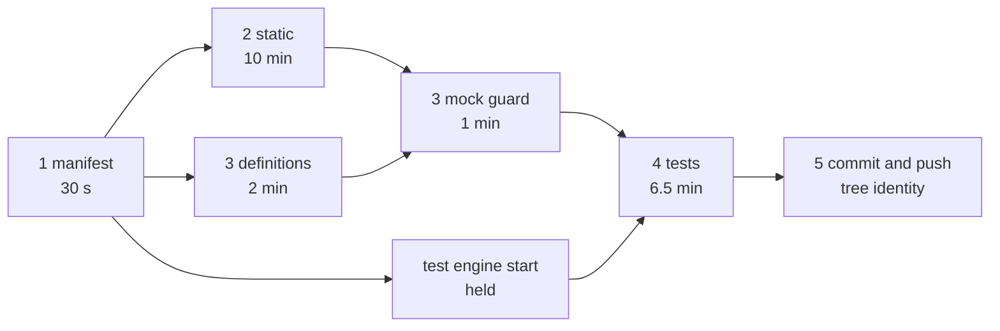

# Commit gate and application tests

This document specifies how application source reaches the repository: the `commit_and_push` tool and
its staged source gate, the dexcli checks the gate relies on, and the API tests of generated
applications. The tool's place in the catalog (timeouts, retries, failure format) is in
[tool orchestration](tool-orchestration.md).

## Principles

- **The gate verifies source, not behavior against real providers.** A passing gate never proves provider,
  deployment or acceptance behavior; the agent reports real execution as pending.
- **Stages stop at the first failure, and nothing is staged before every stage passes.** A gate failure
  commits and pushes nothing, so no Preview auto-deploy follows it
  ([notifications](notifications-and-feedback.md)).
- **The platform renders Flow definitions the way Preview and Release do**, with the same dexcli and no
  diagnostics.
- **Generated applications are tested with mocked connectors; Superverse is tested with real
  dependencies.** The two policies never mix ([Three test policies](#three-test-policies)).

## Where this document stops

| Subject | Owner |
|---|---|
| Tool catalog, timeouts, retry policy, failure model and text format | [tool-orchestration.md](tool-orchestration.md) |
| `ConfirmedRequirements` and the requirements card | [session.md](session.md#requirements-cards) |
| The connector mock contract, connector subagents | [connectors.md](connectors.md) |
| Preview deployment after a push, delivery notifications | [notifications-and-feedback.md](notifications-and-feedback.md) |
| The Sandbox, its ports and the Preview engine | [sandbox.md](sandbox.md) |

## The `commit_and_push` tool

The main agent calls `commit_and_push` when the requested application, its tests and its requirement
trace are complete. It is serial, SYNC and has a 25-minute attempt timeout under the common transient-only
retry policy; the gate itself has no external effect, and the push is query-before-mutate.

### Input

| Field | Rules |
|---|---|
| `summary` | Required, nonblank, at most 32,768 characters; its first line is the activity target and the commit subject source |
| `verification` | Required array of at most 100 strings (each at most 8,192 characters): what the agent checked |
| `remaining_risks` | Optional array of at most 100 strings |
| `requirements` | Optional array of requirement trace items, see [Requirement trace](#requirement-trace) |
| `requirements_revision` | Optional integer: the `ConfirmedRequirements` revision the trace refers to; required when `requirements` is not empty |
| `blocked` | Optional boolean, default false. Only for a concrete blocker the agent cannot resolve, such as missing user-owned information or access, or a check it cannot repair. Unfinished work is not a blocker |

The schema is not strict: with the requirement trace it is one of the two largest schemas, which the
provider's compiled-grammar limit keeps out of the strict set
([tool orchestration](tool-orchestration.md#strict-schemas)). The same decoder validates the input after
the `tool_use` block completes, and the handler rejects blank text and NUL.

### Result

```json
{
  "commit": "0123456789abcdef0123456789abcdef01234567",
  "branch": "main",
  "pushed": true,
  "gate": {"stages": [
    {"stage": "manifest", "status": "passed", "duration_ms": 812},
    {"stage": "static", "status": "passed", "duration_ms": 61300},
    {"stage": "definitions", "status": "passed", "duration_ms": 4100},
    {"stage": "tests", "status": "passed", "duration_ms": 74200}
  ]},
  "tests": {"passed": 14, "failed": 0, "flows": 3, "uncovered": []}
}
```

The result does not echo the inputs; the call's arguments are already in the conversation. `commit` is
the pushed remote default-branch HEAD, so a blocked checkpoint reports its commit too. `gate` is omitted
for a blocked call (nothing was verified), a stage skipped because the tree is clean at the accepted HEAD
has `"status": "skipped"`, and `tests` appears only when the test stage ran; `uncovered` lists
connections that were waived because their connector has no mocks.

A failure is a `ToolFailure` ([tool orchestration](tool-orchestration.md#tool-failures)): the message
names the stage, its duration and the cause, with the output tail of at most 8 KiB.

### When the gate runs

| Situation | Gate |
|---|---|
| Changed source, `blocked=false` | All stages before any token is minted or file staged; the definitions stage runs beside the static stage, and the commit holds only the tree they verified |
| Clean tree at the HEAD the Session already confirmed | Manifest only (a HEAD accepted earlier may predate the current host schema, but its builds are not repeated); the other stages are `skipped` |
| `blocked=true` | No gate. The source is committed and pushed as an explicitly unverified checkpoint; Studio shows it as unverified and no Preview auto-deploy follows |

The agent does not run the same full gate itself beforehand. It inspects the diff and runs focused checks
while editing: `make check-fdg-v2` after Flow changes, a build, and `make test-app RUN=<affected tests>`.

### Commit and push

After the gate, `GitOperations.CommitAndPush` runs the platform Git protocol in the admitted Sandbox:

- **Repository identity.** The lease's `Repository` names the installation and repository and carries the
  clone URL of the repository host (GitHub, or the local Git host in the local lanes); `ExpectedHeadSHA` is
  the Session's confirmed HEAD.
- **Credentials.** The injected `*git.HostCredentials` mints a short-lived token for exactly the admitted
  installation and repository from the repository host (`repohost.Host`: the GitHub App, or the local Git
  host's signed repository credential); it reads no Flow, and the token goes to the origin of the clone URL
  only. The token exists only in the
  environment of one platform Git subprocess and is redacted from every diagnostic before truncation.
  Every Git command the platform runs reads no system or global configuration (the image HOME is
  model-writable), runs no hook, asks no credential helper and never prompts.
- **Commit.** All changes are staged and committed with a process-scoped committer identity and the turn
  marker `SuperVerse-Turn: <sha256(callID)>`, in a subject of at most 72 bytes that never splits a UTF-8
  character. The push never forces. A staged file under `.local/superverse-attachments/`, where
  `place_attachment` writes the user's attachments, fails `attachment_in_source` before anything is
  committed, also for a blocked handoff, and everything is unstaged: the template's `.gitignore`
  ignores `/.local/`, but the application may edit it.
- **Tree identity.** The definitions stage renders the tree that committing the working tree would create
  and names it; after staging, `git write-tree` must give that tree (for a clean accepted HEAD, HEAD's
  tree). A file that changed after the gate rendered it, such as a tracked file the tests or a background
  command wrote, fails `source_check_failed` with the changed paths, and everything is unstaged; nothing
  is committed.
- **Reconciliation.** Git ancestry, not the newest call ID, decides the next step: local behind is a
  checked fast-forward, local ahead is a push (also of several local commits), divergence rebases and
  returns `main_reverification_required` before any push, and unrelated histories are
  `git_remote_conflict`. Remote reads before and after the push reconcile concurrent writers and a lost
  response. A failed push that left the branch unchanged keeps its real diagnostic; only Git's porcelain
  reject flag makes it `git_push_rejected`. An unresolved rebase is `main_rebase_conflict`. These four
  failures have effect `partial`: the commit exists locally and is not pushed.
- **HEAD handoff.** The verified remote SHA is returned as `HeadCommit` of the tool result. The Session Step
  commits it as the Session HEAD in the same commit as the tool result; no Flow RPC confirms it, and the
  field is not part of the content the model sees. When the turn created no commit and the workspace
  fast-forwards to the remote, the verified HEAD is returned only if the local HEAD equals the remote after
  the merge. Beside it, the result carries `DefinedSteps`: each `{FlowType, StepType}` of the Flows the
  passed definitions stage rendered (`SourceGate.DefinedSteps`, at most 256, empty when the stage was
  skipped for a clean accepted HEAD), which `commit_and_push` hands to the Session as
  `ToolExecutionResult.DefinedSteps`, also outside the model's content. The Session reads them only for a
  matched example's [first build](session.md#the-first-build-of-a-matched-example), since the push
  commits exactly the rendered tree.
- **Turn refs.** `refs/superverse/turns/*` record each turn's base. At its start `commit_and_push` removes,
  best effort, every such ref but the current turn's, so a turn's ref disappears only after a later call and
  after the Session durably committed that turn's result. A deletion failure is ignored and never repeats a
  push.

## The staged source gate



| # | Stage | What it checks | Limit | Failure codes |
|---|---|---|---|---|
| 1 | manifest | `dex-app.yaml` meets the host's deployment schema (a bounded 1 MiB read, parsed by the `appmanifest` parser Preview and Release use). The working tree keeps every gate command that HEAD's `.superverse/template.json` declares: `checkStatic`, and `testApplication` once declared | 30 s | `source_check_failed`, `source_gate_weakened` |
| 2 | static | The declared `checkStatic` make target in the tool environment: generate, `make check-fdg-v2` (every Flow rendered by the pinned dexcli), gofmt, `go mod tidy -diff`, `go vet` (also with `-tags apptest`), `go build`, the web build | 10 min | `source_check_failed` |
| 3 | definitions | Beside the static stage: the platform's dexcli renders every Flow the next commit would hold, with no diagnostic, through the `--worktree` mode of `internal/dexai/agents/sandbox/workspace/preview_definitions.py`, which names the tree it rendered and each rendered Flow's Step types (the result's `DefinedSteps`, at most 256 pairs); it stages nothing. After a passed static stage, the mock guard: `go list -deps ./...` with default tags must not include `.../sdkgo/connectormock` (it reads the generated packages) | 2 min | `flow_definition_invalid`, `connector_mock_in_production` |
| 4 | tests | When HEAD declares `testApplication`: `superverse-previewctl apptest run --run-id gate-<sha256(callID)[:16]>-<nonce> --timeout 6m --hold-until /tmp/superverse-apptest-release-<run-id> --hold-timeout 12m -- make test-app`, started with the static stage, which takes the engine lock and starts the engine meanwhile; the gate releases it once static and definitions passed and kills it otherwise, then the [stage 4 checks](#stage-4-checks) | 6.5 min from the release | `application_tests_failed`, `application_tests_incomplete`, `requirements_untested`, `test_environment_unavailable` |
| 5 | commit and push | [Commit and push](#commit-and-push), with the tree identity check | | `source_check_failed` and the Git codes |

Static and definitions run side by side: the definitions program renders an isolated `git archive` of a
temporary-index tree, and the template's generated directories are ignored by Git, so it shares no file with
the builds. A failure of both is reported for static, the definitions failure only as progress before it. Two
CPU-bound stages never overlap: the test compile runs only after static. `make test-app` generates once:
`generate-openapi.sh` keeps `.local/generate.sha256` over its inputs and the generated trees and skips when
both match, so the test stage reuses what `checkStatic` generated and a hand edit of generated code is still
regenerated. The gate keeps no result cache: an identical tree's outcome depends on inputs outside the tree
(`node_modules`, generated code, writable caches, the trace, the host schema and dexcli), a cache in the
Sandbox would be forgeable by the agent's processes, and a clean accepted HEAD already skips the builds.

The stage limits add up to 18 minutes (manifest, static, then the mock guard and the tests), and Git comes on top,
inside the 25-minute attempt. The definitions
program has three modes with one owner each: manual HEAD (PreviewFlow's Preview source preparation),
worktree (this gate, reached through the port `WorktreeDefinitionCheck` that `workspace.NewCapabilities`
injects into `git`) and pinned commit (Preview deployment, [notifications](notifications-and-feedback.md)).

Each stage reports its start and end through the call's progress callback; static and definitions both start
at once, and both report their end once both ended. Progress is best effort and never part of the durable
result ([streaming and Studio](streaming-and-studio.md)). A lost process result or
an unobserved exit is not a stage failure: it stays an uncertain effect for the common retry policy.

### Failure report

A stage failure is the tool failure message, at most 1 KiB of cause plus an output tail of at most 8 KiB:

- static: the last 6 KiB of stdout and stderr (a third at least from stdout, where make echoes its commands);
- definitions: the diagnostics, at most 8 KiB;
- tests: up to 6 failing tests, each cut to fit, plus the engine excerpts and the coverage and trace lines.

```text
Error: application_tests_failed — stage tests failed: make test-app exit 1 after 74 s (14 tests, 2 failed)
- TestNewsletterRevision: newsletter_test.go:88: draft input lacks the prior draft ...
engine: release-newsletter-5c1f (ReleaseNewsletterFlow) Running; Step SnapshotRecipients attempt 4: AttributeMap "subscribers" was not loaded for this invocation
coverage: branch github.listReleases.notFound never returned; Flow SubscriberRegistryFlow never started
requirements: R3 "every subscriber receives the newsletter" names TestSendAll, which did not run
next: make test-app RUN='TestNewsletterRevision|TestSendAll', then retry commit_and_push
owner: application · effect: none
hint: Fix the failing tests and engine problems above, then call commit_and_push again.
```

## Requirement trace

The trace ties the requirements the user was shown to the code and the tests that prove it. The IDs are those
of the current version in the Session's `ConfirmedRequirements` (`R1`, `R2`, ...;
[session.md](session.md#requirements-cards)). A card is recorded in the commit that answers it, so a push later
in the same turn traces that version, and a push after a revised card traces the next one.

Each item of `requirements` has:

- `id`: a feature ID of the current revision;
- `evidence`: 1 to 10 files or symbols (each at most 512 characters) that implement it;
- `tests`: at most 10 test names that prove it; and
- `untested_reason`: at most 300 characters, when no test can.

The Session passes the current IDs and revision to the tool in the trusted call context, like the
HEAD, so the tool reads no Flow. Rules:

- An unknown ID, a duplicate, or a `requirements_revision` that is not the current revision is
  `invalid_arguments`; a blank field is rejected before any effect.
- When stage 4 applies, `blocked=false` and the Session has recorded requirements, every ID of the current
  revision appears, and each item names tests that passed in this run (from `tests.json`) or gives an
  `untested_reason`; otherwise `requirements_untested`.
- Without recorded requirements (a small change) or without stage 4, the list may be empty and only its
  form is checked.

## dexcli checks

Applications are checked by the dexcli the platform pins (v1.6.2). Two checks use it: the template's
`make check-fdg-v2` (stage 2) and the definitions stage (stage 3); both render with errors only. The
pinned dexcli also offers the application lints (`--lint app`), which no consumer passes yet. The
engine-health check of stage 4 catches what static analysis cannot resolve.

### Diagnostics

Every diagnostic is an `error` with a span in the Flow file. "Load" means a declared load: `ExecuteLoad*` or
`WaitForLoad*` in `GetStepOptions`, `dex.WithStepOptions` on the `GoTo`, or `Load*` in `dex.RPCOptions`.

| Code | Tier | Trigger |
|---|---|---|
| `attribute_map_read_not_loaded` | always | `Get` on an AttributeMap that the handler does not load |
| `attribute_map_enumeration_not_loaded` | always | `AllInstanceKeys` or `MapSize` without a whole-map load (exact-instance loads cannot enumerate; this panics at run time) |
| `attribute_map_instance_not_loaded` | always | A constant key that is not among the constant loaded keys |
| `channel_messages_not_loaded` | always | `PendingMessages` or `FindPendingMessage` without a Channel or ChannelMap load |
| `state_load_unresolved` | `--lint app` | Load options that cannot be evaluated statically |
| `connector_branches_merged_unread` | `--lint app` | A Step receives two or more branches of one connector Step and never reads `.Branch` or `.Failure` |
| `action_state_not_rechecked` | `--lint app` | An Action RPC never reads the Attribute its Inbox condition matches or a locked Attribute |
| `start_flow_request_id_missing` | `--lint app` | `StartFlow` with literal options that have no `RequestID` |
| `cross_flow_read_not_found_unhandled` | `--lint app` | A Step calls another Flow's RPC without handling `*dex.FlowNotActiveOrNotFoundError` |

Writes, `Publish`, locks, `Size`, ChannelMap keys and `GetConditionResults` need no load and are never
flagged. Not covered: a page-token cursor that a connector Query returns but the Step does not follow, and
comparing an RPC error with an application sentinel (it arrives as `*dex.WorkerInvocationError`); skills and
tests cover both.

### Analysis

- **Handlers** are Step `Execute` and `WaitFor`, RPCs from `GetRPCs`, and `HandleTimeout`; connector factory
  Steps are skipped.
- **Accesses** are followed through helper functions and methods declared in any file of the package, closures
  and calls inside `for` loops (depth at most 6, memoized). Parameters typed `dex.AttributeMap`, `Channel` or
  `ChannelMap` bind to the call-site resource. A helper access is an edge with `{via: helper}`, so a resource
  read only through a helper is not reported as `unused_resource`.
- **Declared loads** come from `GetStepOptions`, `dex.WithStepOptions` and `dex.ProceedToOnExecuteFailure`
  movements, `dex.DefineRPC` options, call sites that pass an RPC method value with `R.Load(...)`, and the
  directive `// dex:invocation-load attribute-map:<name>` as an escape hatch. Option expressions are evaluated
  through composite literals, package variables, same-package functions and `append`; anything else is unknown.
- **Reporting.** Default mode reports only when every relevant field is known; `--lint app` also reports unknown
  fields as `state_load_unresolved`.
- **Limits.** No SSA, path-insensitive, keys compared per resource, package scope, method values, interfaces and
  reflection not followed.

### Modes and consumers

| Consumer | Invocation | Mode |
|---|---|---|
| Template `make check-fdg-v2` (inside `checkStatic`) | `scripts/render-flow-definitions.py` runs `dexcli visualize --schema-version 2.0 --json` | errors |
| Gate definitions stage, Preview (manual and pinned modes), Release | `dexcli visualize --schema-version 2.0 --json` | errors |
| `scripts/check-flow-definitions.py` (platform Flows) | the same, with zero diagnostics and an exact match with `docs/flows` | errors |

A diagnostic sets `valid: false`, and `--json` writes the partial JSON and exits nonzero, so every consumer
fails without code changes.

Deferred: the lints `connector_page_cursor_unread` and `rpc_error_sentinel`, and passing `--lint app` in the
template's check, which the skills and each example's `AGENTS.md` then name.

### The pinned Dex release

The analysis above shipped in dexcli v1.6.0 (superdurable/dex: reading unloaded state is an error, the
analysis goes through helpers including loops, `unused_resource` is corrected for helper accesses, and the
`--lint app` tier exists), v1.6.1 (a `visualize` stack overflow on self-appending option slices) and v1.6.2
(bounded option expansion, loads added through helper parameters and option field appends, recursive helpers
and expansions above 10,000 expressions as unresolved). Before the release the new `visualize` ran over the
examples of the connectors library and Dex's own examples. The Dex repository's rules apply: its PRs and docs
never mention Superverse, and each release needs the owner's approval.

At this design's release, Superverse pinned dexcli v1.6.2, Dex Server v1.5.0
(whose breaking change to the Web configuration needed no chart setting) and
Go SDK v1.5.0. The current pins are in [the platform specification](../superverse-v2.md):

- **Pins.** `scripts/update-dex-versions.py` rewrites every copy that `scripts/check-dex-versions.py` verifies:
  the Makefile's `DEXCLI_VERSION`, `scripts/install-pinned-binary.sh` (commit and the four platform
  checksums), `sandbox/coding/Dockerfile`, `internal/dexai/delivery/releases/build/hosted/Dockerfile.tools` (URL,
  digests, label), the label check in `runner.py`, `infra-as-code/source-lock.json` and, with
  `--server-version` and a digest, the chart and Terraform pins of the platform Dex Server; with
  `--sdk-go-version` the root `go.mod`. `app-template/go.mod` is edited by hand to the matching minimum SDK,
  because the CLI that renders a definition must agree with the application's SDK on Flow and Step type names
  ([the current contract](../superverse-v2.md)).
- **Platform Flows.** Every Flow that `check-flow-definitions.py` renders (the fourteen registered Flows of
  `docs/flows`) has zero diagnostics; `docs/flows` is regenerated whenever helper-aware edges change the graph
  JSON. The skills teach the diagnostics and the `// dex:invocation-load` directive.
- **Images.** A pin change rebuilds the coding image and the hosted build-tools image, and the Terraform digest
  follows.
- **Verification.** `make check-dex-versions`, `check-flow-definition` and the complete local path on the lanes
  `make required-lanes` names.

## Application API tests

### Three test policies

| Subject | Policy |
|---|---|
| Superverse's own tests | Real dependencies only: Dex, Kubernetes (Kind) or Docker, a real Sandbox, GitHub test repositories, S3 and MinIO. The one controlled substitute is the mock model, in every pull request; the final acceptance before AWS also defaults to mock, with any real LLM API requiring prior developer approval of a strong, stated reason ([context management](context-management.md#mock-model-for-tests)) |
| Generated applications | Each Flow is tested through its API against a real Dex and Temporal that exist only for that run, with mocked connectors. These tests verify source; they are never Superverse, provider or acceptance evidence |
| `dex-connectors-library` | The library's own rules ([connectors.md](connectors.md)) |

`app-template/internal/apptest` and the connector mocks it uses are template content, not Superverse tests.
Mocks live in `internal/apptest` only and never in production code; the gate rejects them elsewhere.

### The test engine: `superverse-previewctl apptest`

`superverse-previewctl apptest run [--run-id ID] [--timeout 6m] [--hold-until FILE [--hold-timeout 15m]]
[--report-dir D] -- <command>` runs the command against a fresh engine. It runs in the foreground in the
caller's process group, so sandboxd kills it on timeout or cancellation, and previewctl tears the engine down on
SIGTERM.

- **Hold.** With `--hold-until`, the run takes the lock and starts the engine, then waits until FILE exists,
  removes it and runs the command with the whole `--timeout` from then; `durationMs` counts from the release.
  The hold, queue wait included, ends at `--hold-timeout` with exit 124 and phase `held` after the teardown.

- **Engine.** In-memory Temporal (`temporal server start-dev --headless`, 127.0.0.1, port 7235, HTTP 7245,
  metrics 7246) ready within 15 seconds; then `dexcli dev --bind-address 127.0.0.1 --dex-port 8805 --web-port
  8806 --external-temporal-address 127.0.0.1:7235 --external-temporal-namespace default --open=false` with blob,
  log and connector directories under the run directory, `dexcli health` passing within 20 seconds. The real
  binaries in `/usr/local/libexec/superverse` are used; the shims on the agent's `PATH` are not.
- **Command environment.** `DEX_FLOW_SERVICE_ADDRESS=127.0.0.1:8805`; `DEX_WORKER_BIND_ADDRESS` and
  `DEX_WORKER_TARGET` both `127.0.0.1:18813`; `DEX_BLOB_CACHE_DIR`, `SUPERVERSE_APPTEST_REPORT_DIR`,
  `DEX_CONNECTOR_MOCK_REPORT_DIR` (the same new report directory, where the connector mocks write their calls) and
  `SUPERVERSE_APPTEST_RUN` under the run directory. No `DEX_PROJECT_*`, so there is no project configuration and
  no credential.
- **Isolation.** Each run gets a new engine bound to 127.0.0.1 only; nothing reaches the Preview engine or the
  Studio Runs view. There is no Service and no NetworkPolicy. It is not a Flow.
- **Teardown and summary.** Count the executions by Flow type and status with `dexcli flow search`; read
  `flow state --no-hydrate` excerpts (Step, attempt, `last_failure_info`, at most 1 KiB each) for up to 5 failed
  or failing executions; merge `tests.json` and `connector-calls.json` into `summary.json` (at most 64 KiB) and
  print one bounded `SUPERVERSE-APPTEST-SUMMARY` line; stop Dex, then Temporal (TERM, KILL after 5 seconds).
  Exit with the command's code, or 124 on timeout.

### Concurrency

Several worktrees can test at once (the main agent's gate and subagents' own `make test-app`), and the
container has 4 GiB of memory, to which the engine adds about 300 MiB beside builds and Preview.

- **One engine at a time.** A run takes an exclusive `flock` on `/tmp/superverse-apptest/lock` before starting
  anything. A second run queues behind it; no run ever kills another. A holder that dies releases the lock with
  its process.
- **The wait is bounded by the caller's own deadline** (the gate's hold limit or the command timeout). A deadline
  that passes while queued exits 124 before any engine starts, and the gate reports it as
  `test_environment_unavailable`. The gate's run holds the lock from the static stage on, so the agent's
  own `make test-app` queues behind it for that time too.
- **Per-run directories.** A run works in `/tmp/superverse-apptest/runs/<run-id>` (the gate names it from the
  call ID plus a per-attempt nonce) with its own report and logs, so queued runs never overwrite each other. A
  passing run deletes its directory; a failing run keeps its report and logs, and each new run keeps only the
  three newest failed directories. The failure report prints the exact path, which the agent reads with `bash`.
- **Subagents** run `make test-app` in their own worktree through the same lock; their prompts forbid every other
  use of these ports.

### Template harness and `make test-app`

- **`apptest.Start(t, worker.Connections{...}) *Env`** builds the registry from `worker.Application`, opens a blob
  cache in `t.TempDir()`, starts a Worker on `DEX_WORKER_BIND_ADDRESS` (an unset or unreachable engine fails the
  test within 30 seconds and never skips it), creates a Client with the same target, serves
  `httptest.NewServer(api.NewHandler(client))` and stops everything at cleanup.
- **`Env`** exposes `API` (the generated ogen client), `Dex` (for Studio operations only) and
  `Eventually(t, timeout, cond)`. Tests run sequentially, without `t.Parallel`; the harness reports test outcomes
  and the mocks report their calls.
- **`make test-app`.** After `generate`, when `SUPERVERSE_APPTEST_RUN` is unset and previewctl exists it
  runs `superverse-previewctl apptest run -- go test -tags apptest -count=1 -timeout 5m -run '$(RUN)'
  ./internal/apptest`; otherwise that `go test` directly, against the engine of the run it is part of.
- **Template layout.** `internal/worker/connections.go` (`Connections`, `OpenConnections`) and `application.go`
  (`Application(Connections)`, the single Flow list, shared by production and tests) with the harness and a
  reference test in `internal/apptest/` (build tag `apptest`); `.superverse/template.json` declares
  `"testApplication": "make test-app"`.

Scenarios the agent writes, per Flow (requirements, not implementation): the happy path; every wired connector
branch and its visible outcome; paged reads on the adversarial default (all pages, window edges, unordered
input, duplicates); empty sets; a duplicate `requestId`; Inbox Actions (approve, revise, a repeated decision, a
stale decision); an uncertain mutation that is reported and not resent (`Calls()`); the first read after each
write; edge-case input that returns 4xx. Studio operations go through `env.Dex`; there are no UI tests and no
sleeps.

### Stage 4 checks

After the tests pass, the gate checks the run's reports. Each check blocks, except where the connector waiver
applies.

- **Flows.** Every `flowType` rendered in stage 3 has at least one execution.
- **Branches.** Every wired (connection, operation, branch) was returned by a mock, read from the process-wide
  recorder in `connector-calls.json`, which the mocks of `sdkgo/connectormock` write themselves (sdkgo v0.29.0 or later).
- **Engine health.** The run fails if an execution ends with an active Step that has at least 3 failed attempts,
  or whose last failure is an SDK usage error (not loaded, panic). This catches an unloaded read that static
  analysis could not resolve, even when the assertions pass.
- **Trace.** [Requirement trace](#requirement-trace).
- **Waiver.** A connector counts as mocked when its module has a `<name>mock` package. A connection whose
  connector has none does not block coverage; the result lists it in `tests.uncovered`.

`test_environment_unavailable` is reported after two failed engine starts or a queue wait that outlasts the deadline;
the agent retries once and then may use `blocked=true`.

### Connector mocks as the gate sees them

The mock contract (`connectormock`, the generated `Operations` seam, the `<pkg>mock` package, manifest `mocks`
and `pagination`, `connectorctl` validation) is owned by [connectors.md](connectors.md) and lives in the
library: `sdkgo` v0.24.0 ships `connectormock`, and llm, github and gmail ship mock packages. The gate depends
on four things: the connector module's `<name>mock` package, which the agent imports in its tests and which
marks the connector as mocked; the recorder behind `connector-calls.json`; a mock that fails the test on an
unscripted call and returns `defect` for an undeclared branch; and adversarial defaults (multi-page, unordered,
duplicated data), which keep a weak test from passing. Mock validation is enabled connector by connector as
mocks land; a connector created by a connector subagent ships with its mock.

### Time budget

| Part | Target p50 | Limit |
|---|---|---|
| Engine start | 8 s | 30 s |
| Test compile (cache warm from `checkStatic`) | 30 s | |
| One scenario | 1 to 2 s | `Eventually` 30 s |
| A newsletter-size suite (about 25 scenarios) | 60 s | `go test -timeout 5m` |
| Teardown and summary | 5 s | |
| **Test stage** | **about 2 min** | **6.5 min** |
| Whole gate (static measured at 43 to 64 s cold; with the image's seeded build cache the first static stage reuses its example's compiled dependencies) | about 3.5 min | 18 min of stage limits plus Git, inside the 25-minute attempt |

The engine start overlaps the static stage, so it leaves the test stage; the test compile of a new project
reuses the seeded build cache ([sandbox](sandbox.md#cold-start)).

### Guidance for the agent

The system prompt, the template's `AGENTS.md` and the skills carry the rules; this document states the constraints.

- Each example's composed `AGENTS.md` (`app-template/examples/<id>/AGENTS.md`) stays within 6 KiB, which
  `make generate-app-template` refuses otherwise; it holds the load rule, the branch
  rule, the map from feature to skill section, the tests section (use the harness and the connector's mock package;
  `env.Dex` only for Studio operations; cover every requirement and every wired branch; never sleep) and the
  commands: `make check-fdg-v2` (Flow definitions including state loads), `make test-app RUN=<regexp>` and
  `commit_and_push`, which runs the whole gate.
- The skill `dex-app-builder/references/api-tests.md` (at most 4 KB) covers the harness, mock scripting, the
  scenarios and how to read a gate test failure.
- Never start your own Dex or Temporal; `make test-app` provides the engine.
- Mocked tests verify source only; the agent names the real execution that remains unverified.

## Dex Flow Changes

No platform Flow is owned or added. `SessionAgentFlow` ([session.md](session.md#sessionagentflow-contract))
executes `commit_and_push` in `ExecuteTool`; the test engine is a process group of a tool command that Pod
reclamation ends. The template's `TextSummaryFlow` and the Flows a generated application defines are application
code, not platform Flows.

- **Identity and execution lifecycle.** None. The call ID is the commit marker; the gate command identities are
  fresh per run (`PlatformExecutionID`), and a run directory is named from the call ID plus a nonce. A duplicate
  call after a lost response reruns the gate (no external effect) and reconciles the push through Git ancestry.
- **Attributes and AttributeMaps.** None added. The tool reads `HeadCommit`, `Workspace` and
  `ConfirmedRequirements`, and the Session records the verified HEAD in the commit of the tool result, and,
  for a matched example's first build, `AgentState.StartingExample.FirstBuild` from its `DefinedSteps`. The call's
  arguments and result live in `CurrentMessages` within its retention. No secret reaches an Attribute.
- **Channels and ChannelMaps.** None.
- **Streams.** `AgentActivity` carries best-effort stage lines (10 MiB, shared by every execution with the same Flow
  type and Stream name); the tool result in `CurrentMessages` is canonical and Snapshot-first reads recover.
- **Steps, RPCs and recovery.** `ExecuteTool`, serial and SYNC, 25 minutes per attempt, four transient-only
  attempts, heartbeat every 20 seconds. No RPC. Known failures return to the model without a retry; the push is
  query-before-mutate and runs only after every stage has passed and the staged tree is the verified one. The
  held test run is a process of the call: a failed static or definitions stage, an error or the call's end
  kills its process group, engine included, and a retried call starts a new run with a new nonce.
  Cancellation: context end, then sandboxd kills the process group, then previewctl tears down. Output per stage command is capped at 1 MiB; full logs stay in the run
  directory. A running `commit_and_push` cannot be interrupted by Stop; the turn ends at the next boundary.

## Database Schema Changes

None. The in-memory Temporal store of a test run is engine state for that run only. Superverse has no SQL and
applications keep Dex as their store.

## UI/UX

- The commit card shows each gate stage with its duration, whether tests ran, and "unverified" for a blocked commit.
  The static and definitions durations overlap, and the progress lines of the two interleave.
  The requirement trace appears through the argument view, with IDs that match the current requirements card.
- The generated application's UI is neither changed nor tested here.
- The agent receives one stage-tagged report and the feature map.

## Tests

Superverse's own tests use real dependencies; the agent's model is the mock model
([context management](context-management.md#mock-model-for-tests)). A missing service is an incomplete
result, never a skip.

| Area | Scenario |
|---|---|
| `apptest` (real coding image, real Temporal and dexcli) | Binds 127.0.0.1 only; the summary matches the real executions; a second run queues and the first is never killed; killing the caller's group leaves no process or listener; a timeout exits 124 after teardown; kept failure directories stay bounded; a held run runs its command only after the release with its whole timeout; a hold past its deadline exits 124; killing a held run leaves no listener |
| Gate (owned disposable sandboxd, real template) | All stages pass with durations, the definitions stage beside the static one; a failure of both reports static; a test that writes a tracked file fails the tree check and stages nothing; a Flow file with a diagnostic fails `flow_definition_invalid`; changing `checkStatic` or `testApplication` fails `source_gate_weakened`; a static failure after more than 6 KiB of output on each stream shows the failing command; an AttributeMap read without a load fails the static stage; a failing assertion is `application_tests_failed`; deleted tests or an unwired branch is `application_tests_incomplete`; a production `connectormock` import is `connector_mock_in_production`; an untested recorded requirement is `requirements_untested`; a clean accepted HEAD repeats no build |
| Dex integration (mock model) | A generated application runs `make test-app` inside the gate; two worktrees test at once and queue; the gate checks the trace against the current requirement IDs; the platform-started bootstrap and the scenario's `make bootstrap` race and the first gate passes (`TestPlatformBootstrapRacesAgentDexIntegration`, stage durations logged) |
| dexcli (Dex repository) | Fixture integration tests: every code fires with its span, the silent cases stay silent, the covered constructs (helpers, closures, loops, package-variable and function options, movement options, call-site rule, directive); Dex's own examples and the connector examples render clean; Superverse's registered Flows render clean with the pinned CLI (`make check-flow-definition`) |
| End to end | The `create-project.spec.ts` and `template-approval.spec.ts` cases run the real gate on the agent's change |

Static checks (`check-app-template`, `check-dex-versions`, `check-flow-definitions`, generation drift) are reported as
static checks. The gate's own live tests need `SUPERVERSE_TEST_SANDBOX_GRPC` and `SUPERVERSE_TEST_SANDBOX_HTTP`
([runbook](../../../internal/dexai/agents/README.md)).

## Documentation

This document owns the gate, the trace, the dexcli checks and the application tests. The Git protocol keeps its
package README (`internal/dexai/agents/sandbox/workspace/git/README.md`); `sandbox/coding/cmd/superverse-previewctl/README.md`
documents `apptest`; The [Agent package README](../../../internal/dexai/agents/README.md) describes development checks. Application source
handoff requires the staged gate and that connector mocks never enter production code.

