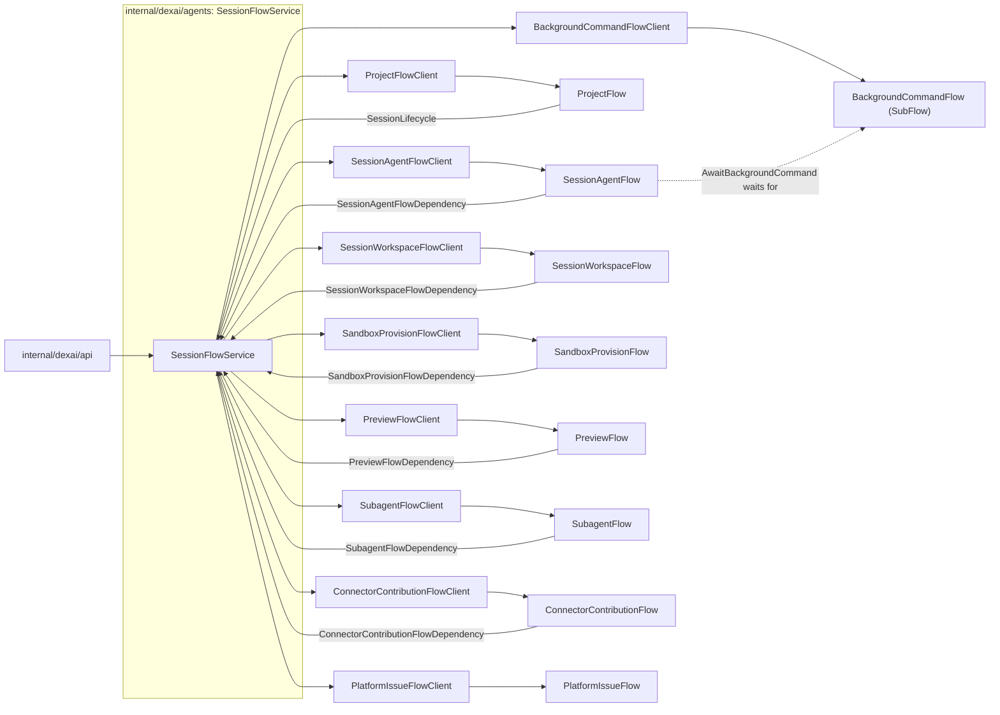

# Composition

This document describes how the agent's pieces are assembled in the server: which component
constructs which, who calls whom, how a Flow reaches another Flow, and how the server starts and
closes it all. It owns the wiring and the naming rules of the Flow layer. The behavior of each Flow
is owned by its topic: [session](session.md), [sandbox](sandbox.md), [subagents](subagents.md).

The agent is made of independently owned Flows next to ProjectFlow: `SessionAgentFlow`,
`SessionWorkspaceFlow`, `SandboxProvisionFlow`, `PreviewFlow`, `SubagentFlow`,
`ConnectorContributionFlow` and `PlatformIssueFlow`, and `BackgroundCommandFlow`, the Session's one
Dex SubFlow. They never call each other directly. A Flow reaches another Flow only through the Service
above them, and a Service reaches a Flow only through that Flow's client; the one exception is the
SubFlow, which the Session's `AwaitBackgroundCommand` waits for as a Dex condition and whose result
it reads itself.

`SessionFlowService.AuthorizeSession` consumes the API's authenticated `accounts.AccountSummary`
and returns `SessionCaller{FlowID, Actor, Role}` after SQL `CapabilityBuild` authorization and the
live Session summary check. The API injects that author into Flow command payloads; no request or
browser field provides it. Deletion's owner bit is derived from the authorized Project role.

## Naming and responsibilities

These rules define the Flow package boundaries.

| Component | File and type | Responsibility |
|---|---|---|
| Flow | `<flow_type>_flow.go`, `<FlowType>Flow`; for example `session_agent_flow.go`, `SessionAgentFlow` | Primitives, registration, StepOptions and thin Steps and RPCs. Flow and Step identities are the Go type names; no `GetFlowType` or `GetStepType` override |
| Flow client | `<flow_type>_flow_client.go` (or `_<responsibility>.go` when split), `<FlowType>FlowClient` | Fronts exactly one Flow type: its start, RPC, read and wait calls, with that Flow's authorization, validation and recovery. Reaches another Flow only through that Flow's client |
| Flow bootstrap | `<flow_type>_flow_bootstrap.go`, `<FlowType>FlowBootstrap` | Assembles one Flow with its process-local resources, injects them into the Flow and its client, and closes them. Holds no durable state and serves no request |
| Service | `<domain>_flow_service.go` (or `_<responsibility>.go`), the concrete type `<Domain>FlowService`, with no interface or `Impl` twin | A general component above the Flows that the Flows and the API both use. Owns cross-Flow coordination and the authorization, validation and recovery that span Flows. Never a forwarding layer for a single caller. Lives in a package other than the Flows that depend on it. The API takes it directly; a Flow reaches it only through its own `<FlowType>FlowDependency` or a narrow port |
| Flow dependency | `<FlowType>FlowDependency` | The interface through which a Flow consumes a Service of another package. The Service satisfies it. A Flow package never declares its own dependencies under a `XyzService` name |
| Narrow port | Named for the responsibility | A single-capability interface, for example `SessionLifecycle`, `repositoryContextReader`, `ProjectDiagnosticsReader`, `AgentTaskLauncher` |
| External API wrapper | `Client` | A wrapper of an external API (GitHub, Kubernetes) keeps the name `Client` |

Other names describe the domain they own (Session identity, tool input schema, AppManifest). `Runtime`,
`runtime.go` and `contract` are not used as generic names.

## Components



Every edge from a Flow back into the Service is a typed in-process interface. The Service owns no Flow
and no durable fact: each fact has the one owning Flow named in its topic.

## Packages

The package tree follows [the current contract](../superverse-v2.md) and
[the current contract](../superverse-v2.md): bounded contexts, and the shared roots `app`,
`comm` (with `comm/dexflow` and `comm/flowid`) and `platform`, which holds the provider adapters. Every
package has at
most 10 hand-written Go files and 10 sub-packages, and `scripts/check-package-layers.py` allows an import
only from a package of a strictly higher level to a lower one. A change that needs a new file where a
package is full goes into a new package split along a responsibility seam.

| Package | Owns |
|---|---|
| `internal/dexai/agents` | The Session Service: `SessionFlowService`, in the files `session_flow_service.go` (the type and its reads), `_workspace.go` (the workspace commands, the start and observation of a provisioning and its report, the workspace Flow's report to the Session, lending the instance to the Preview), `_preview.go`, `_feedback.go` (delivery feedback: the deployment request of a turn's pushed commit, the Preview's outcome and the Live failures as notifications), `_cleanup.go` (a deleting Project's pass and its release by label), `_project.go`, `_configuration.go`, `_tasks.go` (subagents, background command watches and notification coordination), `_connectors.go` (connector contributions) and `_issues.go` (platform issue reports) |
| `internal/dexai/agents/session` | `SessionAgentFlow`, its client, bootstrap, `SessionAgentFlowDependency`, and the primitive-bound helpers |
| `internal/dexai/agents/session/agentloop` | Pure loop decisions and the static tool catalog |
| `internal/dexai/agents/session/conversation` | Entries, request assembly, notifications and the embedded prompts |
| `internal/dexai/agents/session/modelprovider` | The Claude adapter and the `ModelProfile` table ([context management](context-management.md)) |
| `internal/dexai/agents/session/toolinput` | JSON Schemas, generated input types and strict decoding |
| `internal/dexai/agents/session/sandboxtools` | Sandbox tool execution; never imports `session` |
| `internal/dexai/agents/session/agenttasks` | Subagent and background-command records, task IDs, kinds, limits and notification types shared by the Session and the SubagentFlow, and `AgentTaskLauncher` |
| `internal/dexai/agents/session/subagent` | `SubagentFlow`, its client, bootstrap, `SubagentFlowDependency`, context, tools, outcome and the connector contribution of a develop subagent |
| `internal/dexai/agents/session/backgroundcommand` | `BackgroundCommandFlow`, the SubFlow that watches one background command in the ledger, its client (the stop of a watch) and bootstrap |
| `internal/dexai/agents/session/contribution` | `ConnectorContributionFlow`, its client, bootstrap and `ConnectorContributionFlowDependency` |
| `internal/dexai/agents/platformissue` | `PlatformIssueFlow`, its client, bootstrap and `PlatformIssueFlowDependency` |
| `internal/dexai/agents/sandbox` | `sandbox.InstanceProvider`, `Instance`, `Resources` and the typed refusals of provisioning; declares no Flow |
| `internal/dexai/agents/sandbox/sessionworkspace` | `SessionWorkspaceFlow`, its client, bootstrap, `SessionWorkspaceFlowDependency` and the reclamation of an instance |
| `internal/dexai/agents/sandbox/provision` | `SandboxProvisionFlow`, its client, bootstrap and `SandboxProvisionFlowDependency` |
| `internal/dexai/agents/sandbox/preview` | `PreviewFlow`, its client, `PreviewFlowDependency` and `PreviewConfiguration`; no bootstrap, because the Preview holds no process-local resource |
| `internal/dexai/agents/sandbox/kube`, `internal/dexai/agents/sandbox/docker` | The Kubernetes and the Docker `InstanceProvider` ([provider packages](#provider-packages)) |
| `internal/dexai/agents/sandbox/workspace` | The pooled Sandbox transport and the Git and Preview operations shared by Agent and Sandbox; transport only, imports no Flow client |
| `internal/dexai/agents/diagnostics` | The read-only platform tools' server-side reader |
| `internal/comm/platform/dockerapi` | The Docker Engine API on its unix socket as raw REST, built like `kubeapi`; only the Docker implementation packages import it |
| `internal/comm/platform/githubissues`, `internal/comm/platform/connectorlibrary` | The issue repository of platform faults, and the server's connectors library with the upstream pull request client ([connectors](connectors.md)) |
| `internal/dexai/bootstrap` | The composition root; `kubernetes.go` and `docker.go` build the runtime-specific providers |

`session` never imports `subagent`: the Session starts and stops subagents through the narrow port
`AgentTaskLauncher`, which the Service implements. `subagent` imports neither `session` nor `agents`; it
reaches the Session only through `SubagentFlowDependency`. `session` imports `provision` only for the wait
limits of its cold path and `backgroundcommand` for the SubFlow it waits for, and never imports
`sessionworkspace` or `preview`; no instance Flow imports `session`: they reach the Session through their
dependencies. `agents` imports every Flow package and their clients.

## SessionAgentFlowBootstrap

`sessionagent.SessionAgentFlowBootstrap` (`session_agent_flow_bootstrap.go`) assembles `SessionAgentFlow`
with its process-local resources and closes them:

- the Claude adapter (`modelprovider`) with its HTTP client; retries are disabled in the SDK because Dex
  owns them ([context management](context-management.md));
- `workspace.Capabilities`, which holds the pooled `workspace.SandboxResolver` and `git.GitOperations`;
  the resolver finds a Sandbox through the `SandboxAddresses` of the selected runtime, which derives them
  from the lease's provider identities;
- the `sandboxtools.Runner` built over that resolver and Git;
- the `sandbox.InstanceProvider` of the selected runtime, built on those capabilities, which the
  `SessionWorkspaceFlowBootstrap` builds its reclamation over.

```go
sessionagent.NewSessionAgentFlowBootstrap(config SessionAgentConfig, credentials *git.HostCredentials,
    dependency SessionAgentFlowDependency, diagnostics ProjectDiagnosticsReader,
    addresses workspace.SandboxAddresses,
    instances func(*workspace.Capabilities) sandbox.InstanceProvider,
    logger *slog.Logger) (*SessionAgentFlowBootstrap, error)
```

It constructs the Flow with the model client, the Runner, the diagnostics reader, the
dependency, the `repositoryContextReader` (the `*workspace.Capabilities`) and the server settings the Flow
reads (the task and platform turn bounds, the Sandbox and Preview holds, default
model). `Flow()`, `Workspace()` and
`Instances()` expose the shared instances for bootstrap wiring, and `Client(dexClient, executions)` returns the
`SessionAgentFlowClient` bound to the one shared Dex Client and the Dex FlowService client it reads engine
status through. Callers cannot replace the bootstrap's owned references. The bootstrap starts no business
listener, Worker, BlobCache or second Dex Client; the merged server owns those. `Close()` releases idle
provider connections and the workspace pool. The Runner owns no independent connection or durable state;
the Flow validates Session and attempt identity and admits the lease before dispatch, and the Runner binds
exactly the lease carried in `sandboxtools.Call.Lease`.

`SessionAgentFlowClient` (`session_agent_flow_client.go`) fronts `SessionAgentFlow`: `StartAccepted` (stable
FlowID, `IDReuseDisallow`, same-request `IgnoreError`; it returns only the start error and discards the
SDK RunID), typed RPC calls with the bounded lock-conflict retry, the Snapshot and archive reads, and
`GetLiveSessionSummary`, the summary joined with engine status ([session](session.md#stopped-engine-detection)).
The start has no input: `StartAccepted` installs the identity and lifecycle Attributes with the
StartFlow. Neither the model nor the browser can set routing or capability: tool dispatch takes the
binding and repository only from the accepted lease in the Session's own `Workspace` Attribute.

## The instance Flows' bootstraps and the Preview assembly

`sessionworkspace.SessionWorkspaceFlowBootstrap` (`session_workspace_flow_bootstrap.go`) assembles
`SessionWorkspaceFlow` with its reclamation over the shared instance provider and workspace transport,
which it borrows from the Session bootstrap, and returns the `SessionWorkspaceFlowClient`: the start with a
command, the provisioning's report, the retained read and the end at the Project's deletion.
`provision.SandboxProvisionFlowBootstrap` (`sandbox_provision_flow_bootstrap.go`) assembles
`SandboxProvisionFlow` with the shared instance provider and the shared workspace capabilities, which it
borrows from the Session bootstrap and does not close, and returns the `SandboxProvisionFlowClient`: the
idempotent start, and the retained read that reports a stopped engine execution as failed
`WORKSPACE_EXECUTION_STOPPED`. `PreviewFlow` has no bootstrap type, because it holds no process-local
resource of its own: `internal/dexai/bootstrap` builds the Flow with the shared instance provider and
capabilities, the deployment names, the public route settings (`infra.PublicRoutes`; the instance provider
publishes the route), the Project client, its dependency and a `PreviewConfiguration`
(AppManifest registration, configuration pins and grant generations in the Project's Live storage), and the
`PreviewFlowClient` fronts it: the start on the first Preview command or deployment, the retained read,
commands, deployment requests, the Session's settlement announcement and the end of a deleting Project's
Preview. The contracts of both Flows
are in [sandbox](sandbox.md#dex-flow-changes).

## The other Flow bootstraps

- `backgroundcommand.BackgroundCommandFlowBootstrap` builds `BackgroundCommandFlow` with a Sandbox tool
  runner over the Session's pooled workspace capabilities, and its client, which stops a watch by its
  SubFlow ID at the Session's close ([tool orchestration](tool-orchestration.md#background-commands)).
- `contribution.ConnectorContributionFlowBootstrap` builds `ConnectorContributionFlow` with the Service as
  its dependency and the server's connectors library, which opens the pull requests
  ([connectors](connectors.md#contributions)).
- `platformissue.PlatformIssueFlowBootstrap` builds `PlatformIssueFlow` with the issue repository
  (`github.issues`, or only a logger without it) and the environment name of its FlowIDs
  ([tool orchestration](tool-orchestration.md#platform-issue-reporting)).

## SubagentFlowBootstrap

`subagent.SubagentFlowBootstrap` (`subagent_flow_bootstrap.go`) does for `SubagentFlow` what the Session
bootstrap does for the Session, with one difference: the pooled Sandbox resolver is a process-wide resource
that the Session bootstrap owns. The subagent bootstrap borrows `sessionAgent.Workspace()`, builds its own
`sandboxtools.Runner` over it, owns its own Claude HTTP client and closes only what it owns.

```go
subagent.NewSubagentFlowBootstrap(config SubagentFlowConfig, dependency SubagentFlowDependency,
    diagnostics ProjectDiagnosticsReader, workspaces *workspace.Capabilities, logger *slog.Logger) (*SubagentFlowBootstrap, error)
```

`SubagentFlowConfig` carries the Claude and mock clients' configuration, the model settings and the
subagent efforts. `Flow()` and `Client(dexClient)` are exposed like the Session's. `SubagentFlowClient`
(`subagent_flow_client.go`) fronts `SubagentFlow`: the start with the full fingerprint RequestID,
`StopSubagent`, `GetSubagentSnapshot`, and the search by FlowType and ProjectID that project cleanup
uses. The Flow's contract, limits and Steps are in [subagents](subagents.md).

## Dependencies and ports

| Interface | Declared in | Methods | Implemented by | Consumer |
|---|---|---|---|---|
| `SessionAgentFlowDependency` | `internal/dexai/agents/session` | `AdmitSession`, `ProvisionWorkspace`, `ReclaimWorkspace`, `ObserveWorkspace`, `NotifyPreviewWorkspace`, `RequestPreviewDeployment`, `ReportPlatformIssue`, `StopBackgroundCommandWatch`, and the embedded `AgentTaskLauncher` | `SessionFlowService` | `SessionAgentFlow` |
| `AgentTaskLauncher` | `internal/dexai/agents/session/agenttasks` | `StartSubagent` for an admitted record, `StopSubagent` | `SessionFlowService` (`session_flow_service_tasks.go`) | `SessionAgentFlow` Steps `ExecuteTool` (`start_agent`, `stop_task`) and `InterruptAgent` |
| `SubagentFlowDependency` | `internal/dexai/agents/session/subagent` | `AdmitSubagent`, `RefreshSubagentWorkspace`, `ReportSubagentOutcome` | `SessionFlowService` (`session_flow_service_tasks.go`) | `SubagentFlow` |
| `SessionWorkspaceFlowDependency` | `internal/dexai/agents/sandbox/sessionworkspace` | `StartProvisioning`, `ObserveProvisioning`, `ReleasePreviewInstance` (the Preview's `reclaim`), `ReportWorkspaceOutcome` (the Session RPC of that name) | `SessionFlowService` (`session_flow_service_workspace.go`) | `SessionWorkspaceFlow` Steps `ProvisionInstance`, `AwaitProvisioningOutcome`, `ReclaimInstance` and `ReportToSession` |
| `SandboxProvisionFlowDependency` | `internal/dexai/agents/sandbox/provision` | `ReportProvisionOutcome`, the workspace Flow RPC of that name | `SessionFlowService` | `SandboxProvisionFlow` |
| `ConnectorContributionFlowDependency` | `internal/dexai/agents/session/contribution` | `AdmitConnectorContribution`, `ReportConnectorEvent` | `SessionFlowService` (`session_flow_service_connectors.go`) | `ConnectorContributionFlow` |
| `PlatformIssueFlowDependency` | `internal/dexai/agents/platformissue` | `EnsureIssue`, `LabelIssue` | `githubissues` (the issue repository) | `PlatformIssueFlow` Steps `EnsurePlatformIssue` and `LabelPlatformIssue` |
| `PreviewFlowDependency` | `internal/dexai/agents/sandbox/preview` | `AcquireSessionWorkspace` (ready-only for a deployment) and `ReportPreviewOutcome`, the Preview's outcome as a notification | `SessionFlowService` | `PreviewFlow` Steps `AcquireSessionWorkspace` and `NotifyPreviewOutcome` |
| `SessionLifecycle` | `internal/dexai/projects` | `StartForProject(ctx, project)`, `CleanupProjectSession(ctx, projectID)` | `SessionFlowService` | `ProjectFlow` |
| `PreviewReader` | `internal/dexai/projects/config` | `ReadPreviewTarget(ctx, projectID)` | `SessionFlowService` | The Preview-scope configuration read |
| `repositoryContextReader` | Each consuming package (`session`, `subagent`) | `RepositoryContext(ctx, lease)` | `*workspace.Capabilities` | `SessionAgentFlow` and `SubagentFlow` |
| `ProjectDiagnosticsReader` | Each consuming package (`session`, `subagent`) | `ReadDiagnostics(ctx, identity, call)` | `*diagnostics.ProjectDiagnostics` | The read-only platform tools of the Session and of subagents |
| `releases.DeliveryFeedback` | `internal/dexai/delivery/releases` | `ReportDeliveryFailure(ctx, DeliveryFailure)` | `SessionFlowService` (`session_flow_service_feedback.go`) | `ProjectReleaseFlow` and `ProjectDeployFlow` Steps `NotifyReleaseFailure` and `NotifyDeploymentFailure` |

Consumers declare the interfaces they use, so `subagent` needs no import of `session`; one implementation
satisfies both declarations of a shared port. Every `SessionAgentFlowDependency` method is called from a Step of the Session and never from the Sandbox
tool Runner. The workspace methods are called only from the cold-path and deadline Steps, the
platform issue start only from `ReportPlatformIssue` and the watch stop only from
`AwaitBackgroundCommand` at the Session's close. The task methods are called only from `ExecuteTool` for
the two orchestration tools and from `InterruptAgent`. The Service asserts every implemented interface at
compile time.

## SessionFlowService

`agents.SessionFlowService` (`session_flow_service.go`) is the Service of one Project's Session: it
coordinates the Session across its Project, its Agent Flow, its workspace Flow, its provisionings, its
Preview, its subagents, its connector contributions and its platform issue reports, for the API and for
those Flows. It holds the Flow clients `Projects`, `Workspaces`
(`SessionWorkspaceFlowClient`), `Provisions`, `Previews`, `Agent`, `Subagents`, `Contributions`
(`ConnectorContributionFlowClient`), `Issues` (`PlatformIssueFlowClient`) and `BackgroundCommands`
(`BackgroundCommandFlowClient`) and,
only for the release of a deleting Project's resources by label, the shared `sandbox.InstanceProvider`
(`Instances`) and the `preview.PreviewConfiguration` (`PreviewData`), and a logger. The API calls its API-facing methods, all addressed by Project: Project and Session authorization,
Get and Watch reads, Preview commands and Preview source preparation, definition reads,
`RenewWorkspace` and `UpdatePreviewAutoDeploy`. Authorization of the account is by the owning Project, or by the ACTIVE platform
administrator, through the existing server-authorized resource APIs. The Flow dependency and port interfaces in the table
above are satisfied by the same type.

Operations, by file:

- **Workspace (`_workspace.go`).** The workspace commands of the Session and the Preview's request for the
  instance. `ProvisionWorkspace` requires a READY Project, starts the Project's `SessionWorkspaceFlow` on the
  first command and submits `ws-<n>/provision`; `ReclaimWorkspace` submits `ws-<n>/reclaim`; a repeated
  command is accepted, a command of a replaced request refused, and an ended workspace Flow or a Project
  that no longer admits a workspace is a rejection wrapping `ErrWorkspaceCommandRejected`.
  `ObserveWorkspace` reads the request's outcome from the workspace Flow, which owns it. For the workspace
  Flow, `StartProvisioning` starts `provision.Request{Identity, WorkspaceRequestID, Retained}` with the
  Project repository and the command's HEAD (a repeated start joins; a Project that is not READY or not
  bound is a rejection wrapping `ErrWorkspaceStartRejected`), `ObserveProvisioning` reads the provisioning
  (a provisioning whose engine stopped reads as failed `WORKSPACE_EXECUTION_STOPPED`),
  `ReleasePreviewInstance` sends the Preview `reclaim` and reports whether the Preview released the instance
  (`NOT_HELD` and an ended Preview are done, `BUSY` is asked again in the next round), and
  `ReportWorkspaceOutcome` invokes the Session RPC of that name; a missing or closed Session answers false.
  For the provisioning, `ReportProvisionOutcome` invokes the workspace Flow's RPC of that name.
  `AcquireSessionWorkspace` invokes `RequestSessionWorkspace` with the Preview's active command ID (ready-only
  for a deployment, which lends only a READY instance and opens no request), and `NotifyPreviewWorkspace` tells
  the waiting command that its request settled. Every method of this file logs one line
  `session workspace cold path` with `operation` and `project_id`, never a secret.
- **Preview (`_preview.go`).** `PreviewCommand("start-preview")` and `PreparePreviewSource` in the first-demand
  form start the Project's PreviewFlow and send the command; any other command names the Preview the caller
  observed, with no instance while the Preview never acquired one, as after a refused first command. A Session
  without a READY instance still accepts the command: the Preview acquires the instance, which the Session
  requests, and waits for the settlement. `stop-preview` addresses the Preview directly.
- **Feedback (`_feedback.go`).** The delivery feedback of a Session's Preview and of its Live releases and
  deployments ([notifications and feedback](notifications-and-feedback.md)). `ReportDeliveryFailure`
  (`releases.DeliveryFeedback`) builds the `delivery` notification of a Live failure from its input and
  delivers it to `session-<projectID>`. `RequestPreviewDeployment` carries the
  turn-end deployment request to the PreviewFlow: it starts the Session's Preview if none exists, makes one
  locked invocation of the Preview RPC of the same name and only logs the answer (a Preview that ended with its
  Project deploys nothing); it logs the `session workspace cold path` line like the workspace methods.
  `ReportPreviewOutcome` delivers the Preview's `delivery` notification through `ReportSessionNotification`; a
  Session that does not admit it, or is missing or closed, drops it with a logged category, and an error is
  retried by the Preview's `NotifyPreviewOutcome`.
- **Tasks (`_tasks.go`).** Starts and stops subagents (`AgentTaskLauncher`: the one StartFlow of a
  SubagentFlow, `StopSubagent`, which answers whether the subagent has ended); answers `AdmitSubagent`,
  `RefreshSubagentWorkspace` and `ReportSubagentOutcome` for a subagent by calling the Session RPCs
  `AdmitSubagent`, `RequestSessionWorkspace{ForAgentID, Lost}` and `ReportSessionNotification`, each with
  the subagent's `Subagents` record loaded and, for the admission and the report, locked; a Session that
  is not ACTIVE denies the admission and answers the lease refresh and the report `closed`, while a
  report that finds a full queue in an ACTIVE Session is answered `busy` and asked again; routes
  `ReportSessionNotification` for delivery outcomes; stops a closing Session's background command watches
  (`StopBackgroundCommandWatch`, through `BackgroundCommandFlowClient.Stop`); and stops a deleting
  Project's subagents, found by FlowType, `ProjectID` and status. Duplicate notification IDs are safe.
- **Connectors (`_connectors.go`).** Submits the contribution of a completed develop subagent to its
  `ConnectorContributionFlow` once the Session admitted the report, answers that Flow's admission and
  delivers its `connector` events through `ReportSessionNotification`, reads the contributions for the
  Snapshot, and closes a deleting Project's open contributions ([connectors](connectors.md#contributions)).
- **Issues (`_issues.go`).** `ReportPlatformIssue` maps the Session's incident and starts, or joins, the
  `PlatformIssueFlow` of its signature through `PlatformIssueFlowClient.Report`; a start that fails is
  logged and returned for the Step's retry. The Flow files the issue
  ([tool orchestration](tool-orchestration.md#platform-issue-reporting)).
- **Project (`_project.go`) and configuration (`_configuration.go`).** See
  [reads](#reads-preview-configuration-and-deletion).
- **Cleanup (`_cleanup.go`).** See [reads](#reads-preview-configuration-and-deletion).

`git.HostCredentials` (`internal/dexai/agents/sandbox/workspace/git/credentials.go`) mints Git credentials
over the active `repohost.Host`, GitHub or the local Git host. `RepositoryCredential`
requires a repository of the host's configured installation, mints a short-lived token for exactly that
repository and caches it in memory per repository until five minutes before expiry, with at most 256
entries under a mutex. It reads no Flow, and tokens are never logged or persisted. The upstream connector
repository uses a second client for its own installation ([connectors](connectors.md)).

## Bootstrap wiring

`internal/dexai/bootstrap` composes the Flow bootstraps, Flow clients and Services into the server. It receives
the validated [configuration](#configuration), `composition.go` builds the providers and each domain in
order, and `serve.go` runs the listeners. Configuration that is missing or invalid fails before any
listener starts. In outline (`internal/dexai/bootstrap/composition.go`):

```go
sessionService := &agents.SessionFlowService{Projects: projectClient, Logger: logger}
sessionAgent, err := sessionagent.NewSessionAgentFlowBootstrap(config.agent, &git.HostCredentials{Host: config.host}, sessionService, projectDiagnostics, providers.sandboxAddresses, providers.instances, logger)
subagents, err := subagent.NewSubagentFlowBootstrap(subagent.SubagentFlowConfig{...}, sessionService, projectDiagnostics, sessionAgent.Workspace(), logger)
contributions := contribution.NewConnectorContributionFlowBootstrap(sessionService, config.connectors)
backgroundCommands := backgroundcommand.NewBackgroundCommandFlowBootstrap(sessionAgent.Workspace())
previewConfiguration := preview.NewPreviewConfiguration(projectClient, config.host, config.objects, configuration, providers.storage, providers.grants, providers.cleanup)
issues := platformissue.NewPlatformIssueFlowBootstrap(config.issues, config.environment, logger)
workspaces := sessionworkspace.NewSessionWorkspaceFlowBootstrap(sessionAgent.Instances(), sessionAgent.Workspace(), sessionService)
provisioning := provision.NewSandboxProvisionFlowBootstrap(sessionAgent.Instances(), sessionAgent.Workspace(), config.names, sessionService)
previewFlow := &preview.PreviewFlow{Provider: sessionAgent.Instances(), Workspace: sessionAgent.Workspace(), Names: config.names, Routes: routes,
    Dependency: sessionService, Preview: previewConfiguration}
previewClient := &preview.PreviewFlowClient{Flow: previewFlow}
sessionService.Previews, sessionService.Instances, sessionService.PreviewData = previewClient, sessionAgent.Instances(), previewConfiguration
// The delivery Flows take sessionService as releases.DeliveryFeedback; back references follow.
// The registry holds the fourteen server Flows, among them workspaces.Flow(), provisioning.Flow(), previewFlow,
// sessionAgent.Flow(), subagents.Flow(), backgroundCommands.Flow(), issues.Flow() and contributions.Flow().
registry, err := dex.NewRegistry(flows)
// Construct the one shared BlobCache, Dex Client and Worker from this registry, then bind every client to it.
sessionService.Provisions = provisioning.Client(client, executions)
sessionService.Workspaces = workspaces.Client(client, executions)
sessionService.Agent, sessionService.Subagents = sessionAgent.Client(client, executions), subagents.Client(client)
sessionService.Issues, sessionService.Contributions = issues.Client(client), contributions.Client(client)
sessionService.BackgroundCommands = backgroundCommands.Client(client)
```

- One pooled resolver and one instance provider exist in the process. The Session bootstrap builds them
  inside `workspace.Capabilities`; the workspace Flow's reclamation, the provisioning, the Preview, the
  background command watches, the deleting Project's release and the subagent bootstrap share them
  (`sessionAgent.Workspace()`, `sessionAgent.Instances()`). Only the Session bootstrap closes them.
- With `agent.mockModel`, the composition starts the mock model on a loopback port before the Session
  bootstrap and gives the Session and subagent Claude clients its address ([below](#mock-model)).
- The runtime is chosen once, by the configuration key `runtime`: `kubernetes.go` builds the Kubernetes
  API client and the `kube` providers, and `docker.go` the Docker providers with their `SandboxAddresses`;
  the composition receives only the interfaces and the addresses. No Kubernetes API is needed when
  `runtime: docker`.
- One commented block of back references closes the cycles between domains: `projectFlow.Sessions`
  (`projects.SessionLifecycle`), `configuration.Preview` (`projectconfig.PreviewReader`),
  `configuration.Releases` and `deploymentClient.Releases`; the delivery Flows receive the Service as
  `releases.DeliveryFeedback` in their constructors. The Service's `Previews`, `Instances` and
  `PreviewData` are set as soon as the Preview is built; its other clients, and the Dex clients of the
  Preview client, are set once the shared Dex Client exists.
- `projectDiagnostics` is an empty `*diagnostics.ProjectDiagnostics` that the composition fills once the Flow
  clients, the configuration, Runs and a platform `dexpb.FlowServiceClient` exist; it is the
  `ProjectDiagnosticsReader` of the Session and of subagents.
- The API server receives `Sessions` (the Service), `SessionAgents` (the same Session client),
  `Subagents`, `Projects`, `Setups` and `SessionModels`, which says whether the server offers the Claude
  models (a Claude key is present), the mock model and the local lanes' rules. The BFF reads subagent
  status through the Session's task records and the subagent client only for the live activity line
  ([streaming and Studio](streaming-and-studio.md)).
- Owned resources are closed in reverse construction order, so the subagent bootstrap closes before the
  Session bootstrap whose workspace pool it borrows.

## Configuration

The server reads its settings through one package, `cmd/superverse-server/config`, modelled on the Dex
server's configuration. `config.go` declares the YAML schema with its defaults, `validate.go` checks every
range and combination, and the package README is the reference for every key: its meaning, default and range.

- **Loading.** `cmd/superverse-server` reads `SUPERVERSE_CONFIG_FILE`, a comma-separated list of YAML
  files applied in order, later files overriding earlier ones. Decoding is strict: an unknown key, an
  out-of-range value or a forbidden combination stops the server before any listener starts. Only
  `cmd/superverse-server`, `cmd/tools/check-config` and `internal/dexai/bootstrap` import the package, which
  `scripts/check-package-layers.py` enforces.
- **Secrets stay in the environment.** The Claude API key, the GitHub App private key, the cookie signing
  key, AWS credentials, the local builder token and the local Git signing key come from the server's
  environment and never appear in a configuration file, so every profile can be checked in. In Kubernetes
  that environment is the server Secret; in Local Native the launcher passes the generated values and
  `ANTHROPIC_API_KEY` from the main checkout's `.env`.
- **New settings** are added to the schema and the profiles, never as new environment variables.

Profiles, checked in next to `config.go`:

| Profile | Used by | Notable values |
|---|---|---|
| `local-kind.yaml` | Local Kind, the default of `sv2 kind deploy --config` | the mock model offered and new Sessions on it, `repohost: localgit` |
| `native.yaml` | Local Native, complete on its own: `runtime: docker`, `environment: test` only | the mock model offered and new Sessions on it, `repohost: localgit`, the fixed loopback addresses of the host processes and of the Compose platform, and the `native.*` keys |
| `local-kind-acceptance.yaml` | The final acceptance before a publication to AWS, layered over `local-kind.yaml` | new Sessions on Opus 5.5 with the mock model still offered, `repohost: github` with `github.connectors` naming the connectors test repository; the platform developer chooses the model the E2E cases run on |

- **Deployment.** The chart renders the configuration as a ConfigMap, mounts it and sets
  `SUPERVERSE_CONFIG_FILE`; a change of its digest rolls the server. Hosted environments take their values
  from the chart values. `sv2 kind deploy` merges the values it computes (the project image digests and the
  coding profile name) into the profile and records the profile name and digest in its
  deployment inputs. Native loads `native.yaml` plus a last layer that `sv2 native start` adds for what only the
  run knows (`native.runId`, `native.stateDir`, `native.dockerSocket`, `localgit.dir`, `server.blobCacheDir`,
  `sandbox.profile` and the Live images); it needs no Kind deployment.
- **Runtime.** The key `runtime` selects where project workloads run: `kubernetes` (Local Kind and the hosted
  environments) or `docker` (Local Native, only with `localKind` and `environment: test`). The `native.*` keys
  (Docker socket, network prefix, registry, gateway API, routes listener and the run's identity) exist only
  with `docker`, and the route port and the gateway address are settings (`routes.*`), not constants. With
  `runtime: docker` every listener is on 127.0.0.1, containers reach the host's Worker and Git host as
  `host.docker.internal`, and the server starts without a Kubernetes API.
- **Hosted environments** set `agent.model`, `agent.mockModel` and `agent.closestExamplePick` through the
  Terraform variables `agent_model`, `agent_mock_model` and `agent_closest_example_pick`, which every
  environment's `kubernetes.tfvars` names, and the issue repository through optional Terraform inputs;
  test and staging offer the mock model to the administrator, prod never does, and all three start a
  Project created from a first message from the closest example.
- **Receipts.** A Local Kind receipt records the profile and the model target of its E2E cases.
  `release attest` accepts only receipts deployed from the unchanged `local-kind-acceptance.yaml`, so no
  release rests on the local Git host, and copies the receipt's `modelTarget`, the platform developer's
  choice of model, into the release record.

Settings by owner (the owning topic defines each value):

| Settings | Owner |
|---|---|
| `agent.model`, `agent.effort`, `agent.compactionTokens`, `agent.thinkingPrefixMismatch` and the subagent efforts | [context management](context-management.md) |
| `agent.taskTurns`, `agent.platformTurns`, `sandbox.hold` and `sandbox.previewHold` | [session](session.md#configuration) |
| The platform issue repository and installation (`github.issues`) | [tool orchestration](tool-orchestration.md#platform-issue-reporting) |
| The connectors library (`github.connectors`) | [connectors](connectors.md#github-app-setup) |
| `agent.mockModel` and `agent.model: mock` | [below](#mock-model) |
| `repohost` and `localgit` | [below](#repository-host) |
| `runtime`, `native` and `routes` | This document: the Runtime bullet above and [Provider packages](#provider-packages) |

### Mock model

With `agent.mockModel: true`, the composition starts the mock model of the test suite on a random loopback
port inside the server process, points the Session and subagent Claude clients at it and offers it to every
Session as the model `mock` besides the Claude models; `agent.model: mock` starts new Sessions on it. The
real HTTP and stream-parsing code still runs. Local Kind and Native offer it to any account, test and
staging only to the administrator, and a `prod` configuration that sets it refuses to start. The scenario
scripts are embedded in the binary and need no separate Deployment, so Kind and AWS use the same server
binary ([context management](context-management.md#mock-model-for-tests)).

## Repository host

Every Git repository operation of the platform goes through `repohost.Host` in
`internal/comm/platform/repohost`: managed repositories (create, find, archive, read, template
initialization), file and commit reads, release commit validation, and the repository credential, clone
URL and credential scope that a Sandbox or the builder uses. Its errors are typed and host-independent
(repository not found or unreadable, commit unreachable, outcome unknown, permission denied), so failure
classification does not depend on the host. The key `repohost` selects the implementation, and
`internal/dexai/bootstrap` injects it into ProjectSetupFlow, ProjectFlow, ProjectReleaseFlow, the Preview
configuration, the release API and the Git credentials.

| Implementation | Package | Profiles |
|---|---|---|
| GitHub | `internal/comm/platform/repohost/github` | hosted environments and `local-kind-acceptance.yaml` |
| Local Git host | `internal/comm/platform/repohost/localgit` | `local-kind.yaml` and `native.yaml` |

- **GitHub App authentication** (the App JWT, installation tokens and the HTTP client) lives in
  `internal/comm/platform/githubapp`, shared by the GitHub host, platform issue reporting and connector pull
  requests.
- **The local Git host** runs inside the server process, like the mock model, so Native needs no
  extra deployment. It is pure Go (go-git), because the server image has no `git`:
  - bare repositories in `localgit.dir`: Local Kind mounts the main checkout's
    `.local/superverse-v2/git` into the node, and Native keeps its own under `.local/superverse-v2/native`;
    the lanes keep separate repositories;
  - the standard smart HTTP protocol on `localgit.listen` (`0.0.0.0:8085` in the Pod, `127.0.0.1:26085`
    on the Native host), which a Kind Sandbox reaches at the `git-http` port 8085 of the server Service and
    a Native Sandbox at `localgit.cloneBaseURL` (`http://host.docker.internal:26085`);
  - credentials in the GitHub form `x-access-token:<token>`, with HMAC-signed tokens scoped to one
    repository and an expiry;
  - repositories owned by `superverse-local` with the GitHub naming, IDs that are never reused,
    installation ID 1, deterministic template commits, and archival that refuses further pushes;
  - a read-only JSON interface for the E2E checks, which requires an administrator token;
  - the local lanes' copy of the connectors library, `superverse-local/dex-connectors-library`, not
    private, which connector subagents push their branches to and from which the contribution Flow
    publishes a branch to GitHub ([connectors](connectors.md#connector_develop)).
- Validation accepts `localgit` only in the Local Kind and Native profiles. The GitHub path is covered by
  the final acceptance and the GitHub integration tests.

## Provider packages

A capability with several implementations has one shape:

- the parent package holds only the interface, value types and typed errors;
- each implementation is its own sub-package, such as `x/local`, `x/hosted`, `x/github` or `x/localgit`;
- callers import only the parent, and `internal/dexai/bootstrap` is the only production importer of an
  implementation: it selects, builds and injects it (a test may import the implementation it exercises);
- an implementation never imports another except the edges `scripts/check-package-layers.py` records; a
  shared helper such as `internal/comm/platform/githubapp` is its own package.

`scripts/check-package-layers.py` enforces the last two rules. Its recorded edges are the Sandbox and Live
serving implementations, which build on the project infrastructure of their runtime (`sandbox/kube` and
`deployments/kube` on `infra/kube`, `sandbox/docker` and `deployments/docker` on `infra/docker`), and the
Kubernetes test fixture, which composes `infra/kube/local`.

| Capability | Interface | Implementations |
|---|---|---|
| Repository host | `internal/comm/platform/repohost` | `github`, `localgit` |
| Release builder | `internal/dexai/delivery/releases/build` | `build/local`, `build/hosted` |
| Sandbox instances | `sandbox.InstanceProvider` | `sandbox/kube`, `sandbox/docker` |
| Project infrastructure | the role interfaces `Storage`, `Execution`, `Grants`, `Cleanup`, `Connections` and `Redactor` in `internal/dexai/projects/infra` | `infra/kube` (backends `infra/kube/local` and `infra/kube/hosted`), `infra/docker` |
| Live serving and application diagnostics | `deployments.Serving` | `deployments/kube`, `deployments/docker` |

Two axes are kept apart: the runtime where workloads run (Kubernetes or Docker) and the backend that stores
and executes (MinIO and Temporal start-dev, or S3, Temporal Cloud and IAM). Local Kind is Kubernetes with
local backends, AWS is Kubernetes with hosted backends, and Local Native is Docker with local backends.
The `kube` implementations of the Sandbox instances and Live serving build on `infra/kube` and the `docker`
ones on `infra/docker`, and only `internal/dexai/bootstrap` imports an implementation in production. The Docker
implementations share one raw REST client of the
Docker Engine API, `internal/comm/platform/dockerapi`, as the Kubernetes ones share `kubeapi`. Persisted references
keep their JSON keys when their Go fields take runtime-neutral names, and the Docker objects fill them by the
identity mapping of the Local Native decision (0016), whose Sandbox part is in
[sandbox](sandbox.md#instance-model). `objectstore` (one API for MinIO and S3) has a single implementation
and keeps its flat shape.

### Local lanes

- **Local Kind** runs every workload in the Kind cluster: the full Kubernetes path.
- **Local Native** runs the server, Studio and the Release builder as host processes, the platform
  Temporal, MinIO and Dex, the Traefik gateway for Preview and Live, and a local registry under Docker
  Compose, and Sandboxes and Live workloads as Docker containers (`runtime: docker`, profile `native.yaml`).
  It needs no Kind cluster. The server reaches a container only through a port that it published on
  127.0.0.1 and looked up for that use; a container reaches the host as `host.docker.internal`. Release
  images are pushed to the lane's registry, and the builder records and rechecks the digest the registry
  holds, so a Live generation runs exactly the image its Release built; each lane has its own builder state
  and token. The routes of Preview and Live are
  files with their owner and generation, written by compare-and-swap and served to the gateway on the
  server's loopback.
- The lanes run side by side: Native moved 2,000 down from every port it shared with Kind (Studio 21000,
  gateway 21080, server 26080, local Git host 26085, platform Dex 26811 and the others, declared once in
  `native.yaml` and the launcher, which refuses a port Kind serves), Kind takes only its own action lock
  and Native has one owner at a time. They keep separate state, Dex data and repositories. A Dex
  integration test fails before it connects when its Dex, API and Worker addresses belong to different
  lanes or `SUPERVERSE_TEST_LANE` is missing (`dexflowtest`, `make check-test-lanes`), because a Flow
  persists the Worker target it started with.
- Platform Dex routes each Flow to one Worker through the headless Worker Service
  (`dex.workerHeadless`, set by the chart; refused with `runtime: docker`); hosted servers keep serving for
  15 seconds after a replacement starts (`preStop`), so Dex reaches the new Worker before the old one
  stops.
- Kubernetes code lives only in the Kubernetes packages: only `kubeapi`, `infra/kube` (with its
  sub-packages), `sandbox/kube`, `deployments/kube` and `internal/dexai/bootstrap/kubernetes.go` may import
  `kubeapi`, and tests that use `kubeapitest` live there too; `scripts/check-package-layers.py` enforces it.
  Likewise only `dockerapi`, `infra/docker` (with its test fixture), `sandbox/docker` and
  `deployments/docker` import the Docker Engine API client.
- A change runs its three E2E cases and its Dex integration tests on one lane, which `make required-lanes`
  names: Local Native for every change that touches none of the Kind paths, and Local Kind instead when it
  touches one (a Kubernetes package, the coding image, the chart with the coding profile, the Kind lane's
  scripts, values and profiles, or the Terraform Kubernetes root). A change that also touches a path only
  Native exercises (`scripts/native-required-paths.txt`) runs on both. the lane scripts list both path sets;
  `scripts/kind-required-paths.txt` and `scripts/native-required-paths.txt` drive the command, which the
  pull request records, and `make check-agent-rules` keeps them equal. Every publication to AWS is preceded by the
  Kind acceptance on `local-kind-acceptance.yaml`, and `release attest` accepts only a Kind receipt.
  A Dex integration test that depends on the lane reads `SUPERVERSE_TEST_LANE`, and the Worker restart tests
  replace the server through `dexflowtest.RestartServerForTest`, which calls `sv2 native restart-server` on Native.

## Admission

- **Session into Project.** `InitializeSessionAgent` calls `AdmitSession` in a SYNC Step under the same
  SessionStatus lock that `CompleteProjectSession` takes, before accepting any message. This registers the existing execution with
  ProjectFlow as its only Session-scoped child; the ChildFlows key is exactly `session-<projectID>` with no
  child ID. An authoritative frozen or deleted Project response completes the execution with a typed
  `admission_denied` receipt and snapshot; transport errors remain errors. No pre-start membership
  reservation is made.
- **Workspace Flow, provisioning and Preview into Session.** None is a Project child, and none asks the
  Session whether its first effect is still wanted. The workspace Flow has one FlowID per Project under
  `IDReuseDisallow`, and every command is confirmed by its RPC, which an ended execution refuses. A
  provisioning has its own FlowID under `IDReuseDisallow`, so a repeated start of a settled request joins
  its completed execution and causes no provider effect; the workspace Flow admits the provisioning's
  report only for its current instance, and the Session admits the workspace Flow's outcome only while an
  ACTIVE Session waits for exactly that request in state `REQUESTED` (the RPC `ReportWorkspaceOutcome`
  holds SessionStatus, the receipts and Workspace); a late outcome after a replacement or the deletion is
  declined, and the workspace Flow reclaims that instance. The Preview is started by the Session Service on
  the Project's first Preview command or automatic deployment and acquires the Session's instance through
  `RequestSessionWorkspace`, which lends only a READY instance of an ACTIVE Session.
- **Contribution into Session.** `AdmitConnectorContribution`, the first Step of a
  `ConnectorContributionFlow`, asks the Session through the Service before any effect; a deleting
  Project's Session denies it. **Platform issue.** A `PlatformIssueFlow` belongs to no Project and its
  owner is GitHub: its label query before the write is the admission check of a run that reuses the
  FlowID ([StartFlow admission](../start-flow-admission.md#platform-issue-reports)).
- **Subagent into Session.** A subagent is not a Project child. Under `IDReuseDisallow` its start is
  deduplicated by the fingerprint RequestID, and a duplicate joins the same execution. A start can still
  arrive after the Session stopped, was interrupted or closed, so the first Step calls `AdmitSubagent`
  before any effect; the Session answers only for the call that its STARTING (or already RUNNING) record
  names by fingerprint, and a denial ends the execution without an effect: as `admission_denied`, or, for a
  record that a Stop or the Session's end stopped before the start, as STOPPED with its report.
- **Notifications into Session.** `ReportSessionNotification` is admitted only through the Service, only for
  an ACTIVE Session, only while fewer than 32 are pending and only for a new ID
  ([session](session.md#channels-and-channelmaps)).
- **Project start.** ProjectFlow's `StartProjectSession` is the one StartFlow of the Session, inside a durable
  Execute with a stable FlowID, a complete logical RequestID, an explicit reuse policy and same-request
  `IgnoreError` ([StartFlow admission](../start-flow-admission.md)). The agent's other StartFlows are the
  workspace Flow's start on the first workspace command, the provisioning start of each instance and the
  Preview start on the first Preview command or deployment ([sandbox](sandbox.md)), the SubagentFlow start
  from `ExecuteTool` and the contribution start of a completed develop subagent's report, both through the
  Service, and the platform issue start of `ReportPlatformIssue`. The background command watch is a SubFlow
  that Dex starts for `AwaitBackgroundCommand`'s wait.

## Normal path and run-time evidence

On the normal path SessionAgentFlow executes Sandbox tools and commands without any Flow RPC, StartFlow or
Flow read: the Step reads the accepted workspace lease from its own Attributes and talks only to the
sandboxd transport (and, for Git, the repository host). Flow RPCs are limited to:

- on-demand workspace initialization (the `provision` command and the workspace Flow's outcome report);
- recovery after the transport proves the instance unreachable;
- Preview commands;
- the one Preview deployment request a turn's end makes for a pushed commit;
- the reclamation at the Sandbox deadline (the `reclaim` command and the `reclaimed` report), which
  notifies the PreviewFlow only while a Preview holds the instance;
- the start of a platform issue report beside a turn;
- Project deletion, which calls `CompleteProjectSession` once, stops the background command watches and
  ends the workspace Flow and the Preview.

The same rule covers `SubagentFlow`: a subagent receives a copy of the Session's accepted lease in its start
Attributes and talks only to sandboxd. Only when the lease becomes unusable does its Step
`RefreshSubagentWorkspace` ask the Session, through the Service, for a lease (`RequestSessionWorkspace` with
`ForAgentID` and `Lost`, answered only for a RUNNING record). It never reads the Session or another Flow on
its tool path. Two orchestration tools of the main agent are not Sandbox tools and do reach a Flow through the Service:
`start_agent` (the one StartFlow) and `stop_task` for an `agent-...` ID. `merge_agent_changes` and every file,
command and Git tool are Sandbox tools with no Flow RPC.

The read-only platform tools are a separate category: they run server-side through the injected
`ProjectDiagnosticsReader`, read only the caller's own Project, never take the workspace lease and never reach
sandboxd. They do not open a subagent's Flow. Dynamic parallel tool execution is preserved, and the Session's
Step graph is the only owner of serial versus parallel scheduling. Step Attribute loads and commits,
heartbeats and Streams are not Flow RPCs.

Run-time evidence. Each Service method of the workspace and task coordination logs a structured line, so the
absence of `session workspace cold path` lines during tool execution, together with the workspace,
provisioning and Preview execution histories, is the evidence that tool calls made no Flow RPC. The pinned SDK client has no interceptor that could
count Flow RPCs. The identity-fencing limits of the transport are recorded in [session](session.md#steps).

## Reads, Preview configuration and deletion

- **Reads.** `GetSessionSummary` is the lightweight lifecycle read for admission and cleanup;
  `GetLiveSessionSummary` joins engine status for every operation that authorizes a Session; `GetSnapshot` is
  the combined lifecycle and conversation read. The Session's workspace instance (a retained read of the
  `SessionWorkspaceFlow`), the Preview (a retained read of the PreviewFlow, `NOT_STARTED` when none exists)
  and the connector contributions (reads of their Flows) are response-only joins by the Service, never
  duplicated Attributes. Public progress adapters combine these reads with the
  best-effort Agent Streams. The Session `Revision` does not replace message sequence or Snapshot
  reconciliation. The conversion from Snapshot, activity and archive messages to protobuf is in
  `internal/dexai/api/agent.go` ([streaming and Studio](streaming-and-studio.md)).
- **Preview configuration.** `SessionFlowService.ReadPreviewTarget(ctx, projectID)` reads only stored state and
  never reaches a workspace: the Session's `HeadCommit` from the retained summary, the prepared source object
  for that commit through `PreviewFlowClient.ReadPreparedSource` (no Flow call), and Live storage from
  ProjectFlow. A HEAD without a preparation reads NOT_READY with "Prepare the current source"; only an explicit
  preparation or a Preview start requests a workspace. Opening, editing, validating and reading gaps in the
  configuration therefore never wake a reclaimed Sandbox ([sandbox](sandbox.md)).
- **Deletion.** ProjectFlow's deletion calls `CleanupProjectSession(ctx, projectID)` once per pass, only for a
  DELETING Project, and the pass never depends on a Session Step being runnable. It runs in this order:
  1. A running Session is completed once: `CompleteProjectSession` archives the Session, cancels every Agent
     branch, a workspace command in flight included, and stops each background command's watch; the Session
     completes once those waits ended. A Session whose engine already ended abnormally is not asked, and one
     archived for the cleanup is not asked again.
  2. The `SessionWorkspaceFlow` is ended (`CompleteSessionWorkspace`, which cancels a provisioning or
     reclamation in progress), and a provisioning of its recorded instance that may still run is waited for,
     so that nothing is created after the release.
  3. Every SubagentFlow of the Project that has not ended is stopped and waited for. Subagents are no Project
     children, so they are found by FlowType, the indexed `ProjectID` and the indexed status, also when the
     Session failed. The search is eventually consistent: a subagent it misses is denied by the closed
     Session at its admission or fails at its next lease refresh, and the next pass asks again. Then every open
     `ConnectorContributionFlow` of the Project, found the same way, is closed.
  4. The Preview is ended (`EndPreview`), and its resources are released only once its execution no longer runs.
  5. Every resource of the Session is released by label and owner through the instance provider: the Pod found
     by its deterministic names, the Preview's route objects, grants and data in the Live storage, the volume
     and the isolation boundary. Each part queries its exact object before it deletes, with the UID as a
     precondition, and absence is success.
  6. It answers true only once the Session ended, its workspace Flow ended and every resource is gone. A registered Session without an
     execution is an unresolved cleanup error, never an acknowledgment; a Session whose engine failed, was
     canceled or terminated discharges the membership after a fresh DELETING check, and every other Session
     must return its graceful receipt. No terminal state alone proves that no resource remains.

  A typed refusal keeps its classification in the Project's deletion state: a provider's access denial, an owner
  or UID conflict, a missing owner, or a receipt that does not match. A release failure keeps the Project
  DELETING until a retried deletion succeeds. The completion call waits at most two seconds; its lock conflict or
  `DeadlineExceeded` leaves the Session pending, and the next pass reads the Session first. Deletion produces a
  scope-bound terminal receipt, and it discards a dirty workspace: nothing else does.
- **Preview operations.** `workspace.Capabilities.BeginPreview` accepts ephemeral in-process configuration
  material, verifies the immutable configuration identity, rejects runtime-environment overrides and writes
  scoped credential material with mode 0600; only file paths and validated application environment enter the
  process request. Production startup and the route belong to PreviewFlow ([sandbox](sandbox.md)).

## Dex Flow Changes

None in this document. It only defines how the Flows are constructed, started, admitted and cleaned up.
`SessionAgentFlow` is in [session](session.md#sessionagentflow-contract); the instance Flows in
[sandbox](sandbox.md#dex-flow-changes); `SubagentFlow` in [subagents](subagents.md);
`BackgroundCommandFlow` and `PlatformIssueFlow` in [tool orchestration](tool-orchestration.md); and
`ConnectorContributionFlow` in [connectors](connectors.md#dex-flow-changes); each package README owns the
complete per-Flow contract. No new Attribute, Channel or Stream is introduced by the wiring itself.

## Database Schema Changes

None. Composition holds no durable state: no table, projection, counter or mirror. Every durable fact
keeps the owner named in its topic.

## UI/UX

None. Wiring changes no screen.

## Tests

- `make check-flow-registry` builds the Dex SDK registry of every server Flow as the server bootstrap builds
  it (`internal/dexai/bootstrap/flow_registry.go`), and `make check-flow-definition` regenerates the fourteen
  graphs in `docs/flows` and checks them for drift.
- Dex integration tests start the real bootstraps in the test process with the mock model: a READY
  Project starts exactly one Session; a Worker restart leaves one execution; a subagent start admits through
  the Session and a repeated start joins the same execution; a started subagent never reads the Session while
  its lease is usable; Project deletion stops subagents, completes the Session once, ends the Preview and
  releases the Sandbox's resources by label.
- The package-layer, file-length and README checks (`scripts/check-package-layers.py`,
  `scripts/check-go-file-length.sh`) are static checks, not integration evidence.
- `make check-config` loads and validates every checked-in profile with the real `Load` and `Validate`;
  a configuration with an unknown key, an out-of-range value, a `prod` configuration that sets
  `agent.mockModel`, or a hosted environment that sets `repohost: localgit`, fails to start.
- The local Git host's integration tests run real `git` clients against it: clone, fetch by branch and
  by SHA, `ls-remote`, push, non-fast-forward rejection, pushes refused after archival, expired or
  mis-scoped tokens refused, and deterministic template commits. The Local Kind and Native lanes run
  the Dex integration tests and the three E2E cases against it.
- The Docker implementations of the Sandbox instances, the Project infrastructure and the Live serving run
  integration tests against the real Docker Engine, and the Kubernetes implementations against Kind
  ([sandbox](sandbox.md#tests)); a configuration that selects `runtime: docker` outside Local Native fails
  to start.

## Documentation

This document owns the wiring and the Flow-layer naming rules; AGENTS.md carries the rules and must stay
synchronized with CLAUDE.md and `.cursor/rules/planning.mdc`. `internal/dexai/agents/README.md`, the Session and
subagent package READMEs and `internal/dexai/bootstrap/README.md` carry the package file maps and are regenerated
with `make generate-package-readmes`. The README of `cmd/superverse-server/config` is the settings
reference, with a separate table of the secret environment variables; the runbooks link to it.

