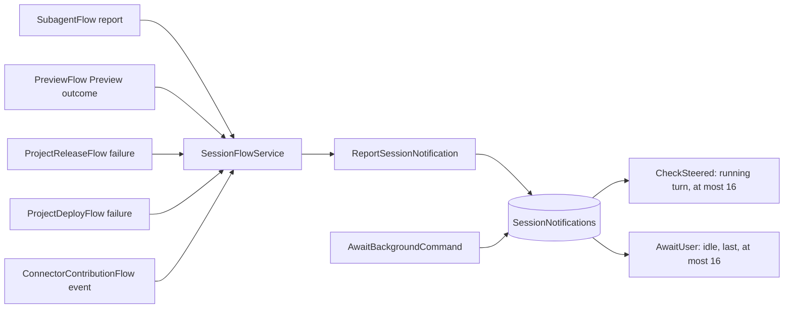
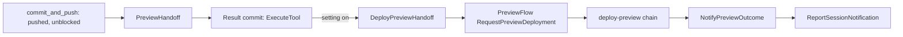

# Notifications and delivery feedback

This document owns how the platform tells the Session Agent that something happened outside
its own turn, and how the agent's pushes reach the Preview. It covers:

- the one Session notification path: Channel, internal RPC, admission, consumption, the
  model's view and the bounds on automatic turns;
- the notification sources: subagent reports, background commands, Preview outcomes, Live
  build and deployment failures, and connector pull-request events;
- Preview auto-deploy after a push, the configuration gap report and failure ownership;
- the Studio side of delivery feedback.

Other topics own what this one uses:

| Subject | Owner |
|---|---|
| Turns, `CheckSteered`, `AwaitUser`, Stop, the full SessionAgentFlow contract | [session](session.md) |
| Entry kinds, the frozen system prompt, append-only rules | [context management](context-management.md) |
| Subagent lifecycle and reports | [subagents](subagents.md) |
| Background commands and the command ledger | [sandbox](sandbox.md); the `bash` tool and platform tools are in [tool orchestration](tool-orchestration.md) |
| The instance lifecycle, PreviewFlow, the Preview engine, the Sandbox deadline mechanics | [sandbox](sandbox.md) |
| Connector pull-request events and release candidates | [connectors](connectors.md) |
| Snapshot and API projection, Studio views | [streaming and Studio](streaming-and-studio.md) |

## Principles

- **One path.** Every outside event that the model may be told reaches the Session through the
  Channel `SessionNotifications`. Sources outside the Flow publish through the internal RPC
  `ReportSessionNotification`; the Session's own Steps publish directly under the same rules. No
  second event channel for the model exists; the one report that never reaches it, a
  provisioning's outcome, is described under
  [Reports that are not notifications](#reports-that-are-not-notifications).
- **The Session is the only consumer and the only owner of the conversation.** A notification
  is a fact for the model, written as an appended user-role entry. It never edits or removes
  anything already sent.
- **The source stays the authority.** A notification is a historical copy. The Preview, the
  Release, the Deployment, the subagent record and the command ledger remain readable on their
  own, and the agent reads current state through the platform tools.
- **Ordinary success is silent.** A `delivery` notification with outcome `ready` normally never
  enters the conversation and never opens a turn; it holds the Sandbox the Preview serves on. The
  next READY after a configuration notice instead resolves that notice in the conversation, still
  without opening a turn.
- **Automation is bounded.** Sizes, queue length, deduplication memory and the number of
  consecutive automatic turns all have limits. Platform faults never start an automatic turn.

## The Session notification path



### Notification

`conversation.SessionNotification` is the Channel payload.

| Field | Meaning |
|---|---|
| `ID` | Event identity ([below](#identity-and-deduplication)) |
| `Kind` | `task`, `delivery` or `connector` |
| `Source` | `subagent` or `command` (task); `preview`, `release` or `deployment` (delivery); `connector` |
| `OccurredAt` | RFC 3339 time at the producer |
| Content | By kind, in the next table |

Sizes: at most 4 KiB per notification, except the report of a subagent `task`, which may reach
24 KiB. Producers truncate text and keep identity fields. Long evidence is never copied in:
the gap list carries the first names only, and build and application logs are read through
`read_delivery_status` and `read_live_app_runs` ([tool orchestration](tool-orchestration.md)).

| Kind | Content | Produced by |
|---|---|---|
| `task` | `TaskID` (`agent-<id>` or `cmd-<id>`), `TaskStatus`, `Summary`, `Report`. A subagent's report is its final text (a subagent that ended without one passes on why it ended and its last reply), and its notification also carries `Changes`, the result commit and diffstat of the saved worktree, or `ChangesUnsaved` when its end could not save the worktree: the report leads with why, and the summary says that the changes stay in the worktree, where `merge_agent_changes` saves them. A command's report gives the exit code, the end reason (`exit`, `lifetime_limit`, `output_limit` or `lost`) and the output size; the agent reads the output with `read_task_output`. A completed `connector_develop` task also carries its `Contribution` ([connectors](connectors.md#connector-subagents)) | `ReportSubagentOutcome` of the SubagentFlow (through the Service); `AwaitBackgroundCommand` of the Session, when the command's `BackgroundCommandFlow` watch ends |
| `delivery` | `Outcome` (`ready`, `failure` or `notice`), `Owner` (`application`, `configuration` or `platform`), `Code`, `Phase` (the Preview command kind), `Commit`, `ResourceID` (the instance a Preview ran on, or the Release's build revision or deployment), optional `ResolvedNoticeID` and Preview `URL` on a resolving READY, `Gaps` (at most the first 8 requirement names), `GapCount`, `Summary`, `Message` | `NotifyPreviewOutcome` of the PreviewFlow; `NotifyReleaseFailure` and `NotifyDeploymentFailure` of the delivery Flows |
| `connector` | `Slug`, `Event` (`pull_request_failed`, `release_candidate_published`, `release_candidate_failed` or `checks_failed`), `Summary`, `Message` | `ReportConnectorEvent` of the connector's `ConnectorContributionFlow`, through the Service ([connectors](connectors.md#the-contribution-branch-and-pull-request)) |

### Identity and deduplication

The ID is derived by the producer from durable facts, so every retry of a producer repeats the
same ID.

| Producer | ID | Example |
|---|---|---|
| Subagent | `task/agent-<id>/<status>` | `task/agent-k3n8q5r1/completed` |
| Background command | `task/cmd-<id>/<status>` | `task/cmd-qjo5x7m2k4ab/exited` |
| Preview | `preview/<WorkspaceRequestID>/<CommandID>/<outcome>` | `preview/ws-42/deploy-preview-137/failure` |
| Release source (hook H1) | `release/<releaseID>/source/r<releaseRevision>` | `release/083ed9fd.../source/r4` |
| Release build (hooks H2, H3) | `release/<releaseID>/<buildRevisionID>/r<releaseRevision>` | `release/083ed9fd.../b7c1/r5` |
| Deployment | `deployment/<deploymentID>/g<generation>/r<revision>` | `deployment/d41e.../g2/r9` |
| Connector | `connector/<slug>/<event>/<head12 or version>` for PR and candidate events; `connector/<slug>/checks_failed/<full-head>` for a CI failure | `connector/newsapi/pull_request_failed/abc123def456` |

The Release and Deployment IDs carry the revision at which the failure was recorded, never a
revision read later: a recovery admitted while a notify Step runs bumps the revision.

`NotificationReceipts []string` holds the IDs of the last 128 admitted notifications, FIFO, together
with the keys of admitted workspace outcome reports ([below](#reports-that-are-not-notifications)). It
is written in the same commit that publishes the notification, so a repeat is a no-op.
Deduplication is bounded to that window: an ID older than 128 admissions is not recognized.
Producers retry within minutes, far inside it.

### Admission

`ReportSessionNotification` is an internal RPC of SessionAgentFlow. It is reached only through
`SessionFlowService` (`internal/dexai/agents/session_flow_service_tasks.go`, which the delivery
sources reach through `session_flow_service_feedback.go` and the connector contributions through
`session_flow_service_connectors.go`); no API handler and no Flow calls it directly. The Session's
own Step `AwaitBackgroundCommand` publishes into the same Channel under the same rules without an
RPC.

It admits a notification when all of these hold:

1. The Session is ACTIVE and its engine execution is running ([stopped-engine
   detection](session.md#stopped-engine-detection)).
2. Fewer than 32 notifications are pending.
3. The ID is not in `NotificationReceipts`.

Answers:

- **true**: published, or a duplicate. A duplicate publishes nothing.
- **false**: not admitted (not ACTIVE, engine stopped, queue full).

The RPC locks `SessionStatus`, `NotificationReceipts` and `Workspace`, because a `ready` delivery
from the Preview holds the instance it serves on. When an ACTIVE Session receives one, the RPC moves
the Sandbox deadline of the Session's READY instance that `ResourceID` names to at least now +
`sandbox.previewHold` (seven days by default; [Sandbox deadline](session.md#sandbox-deadline))
before the checks above decide. Neither a pending question nor a full Channel delays the hold, and
because the deadline only moves later, a repeated notification needs no receipt of its own for it.

What a producer does with false differs by source. Task reports are retried by their producer
(`ReportSubagentOutcome` asks again every ten seconds while an ACTIVE Session's queue is full, for up
to two hours, and then records the report as `undelivered` and completes). For a Session that is no
longer ACTIVE the Service answers `closed`, and the report is recorded `undelivered` at once.
Delivery sources send one best-effort call; on false or failure they log a fixed category and
drop the event, because the Preview, Release or Deployment keeps its failure on its own
resource.

After the Session admitted the report of a completed `connector_develop` task, the Service submits
its contribution to the connector's `ConnectorContributionFlow`
([connectors](connectors.md#contributions)); the Session records nothing of it.

### Reports that are not notifications

One report from the instance Flows reaches the Session by its own RPC and never through this path:
the `SessionWorkspaceFlow`'s outcome of a workspace command arrives as the RPC
`ReportWorkspaceOutcome`. A ready or failed outcome publishes to the ChannelMap `WorkspaceOutcomes`,
which only `AwaitSessionWorkspace` consumes; a `reclaimed` outcome only clears the Preview's hold. It
is not a notification kind, because the model never sees it: it enters neither
`SessionNotifications` nor the conversation, and it opens no turn. A ready or failed report is
admitted only while the Session waits for exactly that request, and a repeated report is admitted
again by its receipt (`workspace/<WorkspaceRequestID>` in `NotificationReceipts`, within the same
128-entry window) ([sandbox](sandbox.md#gates-and-the-cold-path)).

A Preview that ends READY is not such a report. Its start or deployment returns as a `delivery`
notification with the outcome `ready`, and the RPC that receives it holds the instance it serves on
([Admission](#admission)). An ordinary ready notification enters no conversation entry and opens no
turn; one that names a retained configuration `ResolvedNoticeID` enters to confirm that the
configuration is complete, but still opens no turn ([Consumption](#consumption)).

### Consumption

- **During a turn.** At each model-continuation boundary `CheckSteered` takes at most 16 pending
  notifications and appends each as a user-role entry, ahead of any steering text.
- **While idle.** `AwaitUser` takes notifications as its last alternative, after answers,
  steering and queued messages, `AtLeastAtMost(1, 16)`, FIFO.
- **Never while a question waits.** A pending question blocks consumption; notifications wait in
  the Channel and are taken after the answer.
- **Stale failures.** A `delivery` failure whose `Commit` is not the Session's HEAD is appended as
  a notice, never as a failure.
- **`delivery` with outcome `ready`.** Consumed like any other. An ordinary ready notification is
  not appended and opens no turn; one with `ResolvedNoticeID` is appended to confirm the earlier
  configuration notice is resolved and also opens no turn. The Sandbox deadline was already extended
  to now + `sandbox.previewHold` when the RPC received either notification ([Admission](#admission),
  [session](session.md#sandbox-deadline)). A task completion consumed here extends the deadline to
  now + `sandbox.hold`.
- **Termination.** `CompleteProjectSession` cancels the consumers. Pending notifications of a closed
  Session are never consumed; their sources remain readable.

When notifications are recorded the Session writes the existing `snapshot_required` activity so
that connected Studio clients re-read the Snapshot.

### What the model sees

Each notification is one entry: role `user`, kind `notification`, display public
([context management](context-management.md#entry-log)). Its single text block is:

```text
Superverse notification (automated report, not written by the user):
<the SessionNotification as JSON>
```

The instruction for acting on a notification is part of the frozen system prompt
(`internal/dexai/agents/session/conversation/prompts/v1/platform_event.md`), not repeated in each
entry. It tells the model to:

- decide whether the application source at the notified commit causes a failure, using
  `read_delivery_status`, `dexcli` against the Preview engine and the Preview logs;
- fix it and hand off with `commit_and_push` (the Preview then redeploys), or explain in
  business language what the user must do;
- treat a Live failure as information only: Live is a manual publish, so after a fix it tells the
  user to publish the new commit;
- never retry unchanged source and never change user-owned configuration;
- treat a `platform` owner as not caused by the application.

The API projects the entry as role `ROLE_NOTIFICATION` with a typed notification message
([streaming and Studio](streaming-and-studio.md)). Studio never shows it as a user bubble.

### Automatic turns

A notification may open a turn when the Session is idle. These rules decide which ones do.

| Bound | Counter in `AgentState` | Setting and default | Qualifying notifications |
|---|---|---|---|
| Task bound | `AutomaticTaskTurns` | `agent.taskTurns`, 5 | `task` and `connector` |
| Platform bound | `AutomaticPlatformTurns` | `agent.platformTurns`, 3 (0 opens none) | `delivery` failure with owner `application` and `Commit` equal to HEAD |

- A batch of notifications opens at most one turn and counts against the bound of the kind that
  qualified it; when both kinds qualify, the platform bound is charged.
- Not qualifying, so only recorded: `delivery` notices, failures owned by `platform` or
  `configuration`, stale failures, and `ready`.
- Both counters count consecutive automatic turns. A user-initiated turn start (a message, a
  steered or queued message, or an answer) resets both counters and `AutomaticTurnsPaused`.
- Pressing Stop, or reaching a bound, sets `AutomaticTurnsPaused`. The Session records once
  "automatic continuation paused; reply to continue". While paused, notifications are appended
  to the log but open no turn, including those that arrive after Stop.

## Task notifications

- **Background commands.** A command that exits, hits its lifetime or output limit, or whose process is
  lost is recorded in `BackgroundCommands` and announced by `AwaitBackgroundCommand`, once its
  `BackgroundCommandFlow` watch ends. A command that was stopped, by the Stop button or by
  `stop_task`, is recorded `stopped` and sends no notification; one whose recording exhausted its
  retries is recorded lost by `AbandonBackgroundCommand`, also without a notification. The watch is
  in [tool orchestration](tool-orchestration.md#background-commands), the ledger in
  [sandbox](sandbox.md#command-ledger).
- **Subagents.** `ReportSubagentOutcome` reports COMPLETED, FAILED, STOPPED and TIMED_OUT outcomes
  with the report (at most 24 KiB) and the diffstat of the saved changes, or the mark that they
  stayed unsaved. The same RPC records the end in the Session's `Subagents` record, with that record
  locked and loaded by the Service, also when the notification is not admitted; a record that ended
  keeps its end. A subagent stopped by the Stop button saves its work and its STOPPED report arrives
  as an ordinary notification, which opens no turn because automatic turns are paused. A subagent
  that was still STARTING when the Stop came never ran and reports nothing, unless `start_agent`,
  which a Stop cannot interrupt, had already started its Flow: that subagent ends STOPPED without an
  effect and reports it, because the call may already have answered that it started. A subagent
  whose Session could not be asked to admit it reports FAILED at once. See
  [subagents](subagents.md).
- Both extend `Workspace.SandboxDeadline` to now + `sandbox.hold` when consumed.

## Preview auto-deploy after a push

After every push that passed the gate, the Preview is redeployed from exactly that commit when
the user has not turned the setting off. The agent does nothing and learns of a failure through
a notification.



Live is never touched: no Release, build, Live lease or Live fence is involved. Live stays a
manual publish.

### Handoff and setting

- A `commit_and_push` result that is succeeded, pushed and `blocked=false` carries a handoff
  ([commit gate](commit-gate-and-app-tests.md)). When its commit differs from
  `PreviewHandoff.Commit`, the tool-result commit sets `PreviewHandoff{Commit, Sequence}`, where
  `Sequence` is the conversation sequence of the tool message. A push of the same commit adds no
  handoff.
- `PreviewAutoDeploy` is true at initialization, so every Project starts with automatic
  deployment on. The user changes it with `UpdatePreviewAutoDeploy` on the Preview service
  ([UI/UX](#uiux)). A handoff consumed while the setting is off is never deployed later; the next
  handoff deploys again once the setting is on.

### Result commit

- In both platform and remote mode, the successful `commit_and_push` result and
  `PreviewHandoff.PublishedSequence` commit together in `ExecuteTool` under the
  existing message lock. When auto-deploy is enabled, the same decision starts
  an immutable `DeployPreviewHandoff` branch alongside `CheckSteered`.
- Each verified unblocked push is eligible immediately, even while its turn
  continues. A duplicate result cannot publish the same sequence again. Later
  questions, model failures, executor takeover and Stop do not retract an already
  published push.
- A handoff consumed while auto-deploy is disabled advances the publication
  watermark without a deployment. Enabling it later does not replay that push.

### The request

`DeployPreviewHandoff` makes one Service call:

1. Its immutable input names the Session, commit, conversation sequence and accepted
   `WorkspaceRequestID` captured from the accepted lease at publication, even if
   reclamation has changed the workspace state. Without an accepted request ID,
   the new branch deploys nothing. The Session branch never substitutes a newer
   request identity. PreviewFlow owns workspace acquisition and may resume a
   reclaimed workspace or acquire its replacement to build the pinned commit.
2. Otherwise it calls `SessionAgentFlowDependency.RequestPreviewDeployment(identity,
   the captured WorkspaceRequestID, handoff)`, which goes through `SessionFlowService`
   (`session_flow_service_feedback.go`) to `PreviewFlowClient.RequestPreviewDeployment` (locked
   invocation, at most 10 seconds), after the Service started the Project's PreviewFlow if it does
   not exist yet. A Preview that ended with its Project deploys nothing.

A branch accepted before the captured-identity change has no Session in its input.
It retains the earlier read-on-execute behavior and may target an instance that
replaced the one current at publication. This legacy path does not provide the
new-input original-instance guarantee; PreviewFlow still deduplicates its sequence.

The PreviewFlow RPC `RequestPreviewDeployment{WorkspaceRequestID, Commit, Sequence}` runs under
`CommandLock` and answers, in this order:

| Answer | When |
|---|---|
| `QUEUED` | The request is the queued one: a retry of a request that already waits |
| `DUPLICATE` | `Sequence` is not above `PreviewDeployment.HandledSequence` (a lost response, retried), or is below the queued request's |
| `QUEUED` | A command is active: the request becomes `Queued`, and an earlier queued request is replaced, so the newest wins |
| `ACCEPTED` | No command is active: it sets `HandledSequence`, accepts the internal command `deploy-preview-<Sequence>` and publishes it to `PreviewCommands` |

Reclamation does not produce a `SKIPPED` admission: a request arriving while a
command runs is queued, then admitted when that command ends. The deployment
acquires or resumes the workspace and builds its pinned commit. The historical
`SKIPPED` answer remains declared but this admission path does not produce it.

`RequestPreviewCommand` refuses the command kind `deploy-preview`: only this RPC admits it. The Session
records nothing from the answer, which only its log keeps. The outcome returns as a notification.

### The deploy-preview chain

Every source for the deployment comes from the pinned commit, never from `/workspace`, so edits
in progress cannot affect it. The previous preparation stays until the new one succeeds, so a
deployment whose preparation fails leaves it as it was.

0. **AcquireSessionWorkspace.** The command acquires an instance first, and its demand is the one
   Preview demand that is ready-only (`ReadyOnly`): it opens no request and records no wait. When
   the Session no longer lends a READY instance, the command ends `SKIPPED` and notifies nobody, so
   a reclaimed Sandbox is never woken for a deployment.
1. **PreparePreviewSource in pinned mode.**
   - It calls `superverse-previewctl source ensure --commit <sha>`, which exports `git archive
     <sha>` into `$S/source/<sha>` with a commit marker. The call is idempotent and keeps at most
     two trees: the running one and the candidate. A commit missing from the repository is refused
     `PREVIEW_SOURCE_NOT_PREPARED`.
   - It runs the definitions program `internal/dexai/agents/sandbox/workspace/preview_definitions.py` in
     its pinned mode `--pinned <tree> <sha>`: no HEAD, status or source-changed checks; the tree
     must lie under `$S/source/` and its marker must name the commit; strict FDG 2.0 through
     `dexcli visualize` inside the tree; it returns the definitions and the digest of the tree's
     `dex-app.yaml`. The program keeps its path and has three modes, each with one owner: manual
     HEAD, worktree ([commit gate](commit-gate-and-app-tests.md)) and pinned (this topic).
   - The AppManifest is published from the same commit (`projects.PublishAppManifest` reads
     `dex-app.yaml` at the SHA). Its `ManifestDigest` must equal the tree's digest; a mismatch is
     refused `PREVIEW_MANIFEST_FAILED` with owner `platform`.
   - It marks `PreparedSource` READY for this instance, with the pinned commit and the command ID
     as RequestID, and records the AppManifest with it. A refused or failed preparation saves
     neither, so the previous READY preparation keeps its own commit's AppManifest.
2. **VerifyPreviewSource.** Requires a READY preparation of this instance, else
   `PREVIEW_SOURCE_NOT_PREPARED`, checks no workspace HEAD and calls no provider: the Project's one
   Preview takes no route lease ([sandbox](sandbox.md#preparing-and-starting)).
3. **PreparePreviewConfiguration.** Validates and freezes the Project's Preview configuration. On
   `ErrNotReady` or `ErrConflict` it calls `CheckRequirements` ([gap report](#configuration-gap-report));
   non-empty gaps are refused `PREVIEW_CONFIGURATION_INCOMPATIBLE` and recorded. The running
   Preview is left untouched. A deployment changes the Preview's status only here, when the save
   of this Step marks it `STARTING`, so a deployment that ended earlier leaves a READY Preview
   serving its commit.
4. **EnsurePreviewEnvironment, StartPreview, ProbeAndExposePreview.** `StartPreview` is
   `begin --commit <sha>`: an isolated build in `$S/source/<sha>`, build first, then swap, so the
   old application keeps serving until the new one is ready. It reuses the storage grant while the
   configuration revision and principal are unchanged. `ProbeAndExposePreview` reconciles the
   Project's route to the instance under the Project's one host. Engine and supervisor details are
   in [sandbox](sandbox.md).

The Preview configuration comes from the AppManifest prepared for the Session's HEAD, so reading
or editing it never wakes a reclaimed Sandbox. A source that uses a connector's release candidate
passes the definitions step and the configuration check like one that uses a release
([connectors](connectors.md#using-a-connector-before-its-release)).

### Outcome

`CompletePreviewCommand`, `RecordPreviewRefusal` and `RecordPreviewFailure`, all under
`CommandLock`, end the active command. They record `PreviewDeployment.Last` as `READY`,
`INCOMPATIBLE`, `FAILED` or `SKIPPED` (a deployment that found no READY instance), with its owner.
`Last` never records a request that only waits, and a request replaced in the queue leaves no trace
but the newer one. They also admit the queued request: they accept it and publish it to
`PreviewCommands` as `RequestPreviewCommand` does, so `AwaitPreviewCommands` routes it on every
path. When the command that ended was a `stop-preview` or a `reclaim`, they cancel the queued
request instead (`CANCELLED`).

**A deployment that does not reach READY leaves nothing acquired.** A deployment changes the
Preview's status only when its configuration step starts it, so one refused earlier leaves a
READY Preview serving. When a deployment ends after it started the Preview without serving it (the
Preview is still `STARTING`), and nothing is queued, the internal command `release` follows at once;
its rule and chain are with the Preview's primitives
([sandbox](sandbox.md#preview-auto-deploy-on-previewflow)). It leaves the Preview `STOPPED` with
the deployment's failure and gaps, which a person starts again once the source and the
configuration are ready ([Preview panel](streaming-and-studio.md#preview-panel)). A deployment
that fails after it started the Preview therefore also stops the application that served before
it. A request queued during the release deploys after it.

A reportable outcome is kept as a `delivery` notification in the Attribute `OutcomeReport`, which
only these three Steps write, and goes to `NotifyPreviewOutcome`. That Step reads `OutcomeReport`
and delivers it through the Service with provider Step options, saving nothing. Nothing rewrites
the report before the Step ends, so a retry sends the same notification, which the Session's
receipts admit once. The Step returns to `AwaitPreviewCommands` on success and, through its failure
route, once its retries are exhausted: a lost notification only drops the event, because the
Preview keeps the outcome in `Last`, its failure and its gaps.

- `READY` becomes `ready`; `INCOMPATIBLE` becomes `notice` with the gaps; `FAILED` becomes
  `failure` when its owner is `application` and `notice` otherwise.
- An `INCOMPATIBLE` outcome whose gap digest equals `NotifiedGapsDigest` is not reported again; its
  notification ID is retained in `NotifiedGapsNoticeID`. A `READY` outcome resets both values and,
  when that ID is present, carries it with the commit and Preview URL to resolve the configuration
  notice in the conversation. Platform-owned notices are not retained: their recovery is not a
  configuration-completion fact, and a READY cannot identify which transient platform fault it fixes.
- A manual `start-preview` that reaches `READY` reports `ready`, and the failures of a manual
  `start-preview` or `prepare-preview-source` report like an automatic deployment. A completed
  `prepare-preview-source` reports nothing.
- `SKIPPED`, `CANCELLED`, a request replaced in the queue, a stop, a release and a reclamation
  produce no notification: the Snapshot shows them.

### Concurrency and lifetime

- A manual start or prepare during `deploy-preview` gets `BUSY`.
- A newer handoff while one runs is queued, and the newest wins. A commit deploys once
  (`HandledSequence`).
- A `stop-preview` or `reclaim` that ends while a request waits, and the end of the Project's
  Preview, cancel it (`CANCELLED`). The user's stop wins until the next handoff. A `release`
  cancels nothing: a request queued meanwhile deploys after it.
- There is no automatic retry after the user fixes the configuration: one Start click on the
  Preview that the release left `STOPPED`. A deployment refused before it started the Preview
  leaves the Preview as it found it.
- A READY Preview runs until a stop, the Sandbox deadline (seven days after the last successful
  Preview) or Project deletion, at the stable URL `preview-<projectID>`.
- A deployment starts after the turn's last tool use, and the Session's lend of the instance to
  it holds the Sandbox for one more `sandbox.hold`, but nothing holds it while the build runs, so
  `sandbox.hold` must outlast a Preview build: a shorter hold lets the Session's deadline reach
  the instance while the deployment runs, and the reclamation then waits for the busy Preview up
  to its own limit.

## Configuration gap report

`CheckRequirements` lists every reason the Project's configuration cannot start the commit's
application, instead of the first one.

- **Source.** The configuration host's internal read-only route
  `POST /api/v2/project-configuration/requirements` returns `{ready, gaps}`. Each gap is
  `appmanifest.RequirementGap{Kind, ConnectionName, ConnectorID, TriggerName, BindingName,
  EnvironmentName, UnitLabel, FlowName, StepName, OperationID}`, with `Kind` one of
  `CONNECTION_REQUIRED`, `AUTHORIZATION_REQUIRED`, `CONNECTION_INCOMPLETE`,
  `TRIGGER_BINDING_REQUIRED`, `TRIGGER_BINDING_INVALID`, `OPERATION_CONFIGURATION_REQUIRED` and
  `ENVIRONMENT_REQUIRED`.
- **Names only.** A gap never contains a value, credential or field content.
- **A release that cannot be resolved is not a gap.** It fails the Step, which ends as
  `PREVIEW_CONFIGURATION_FAILED` with owner `platform`. Release resolution is in
  [connectors](connectors.md#how-the-configuration-host-resolves-releases).
- **Consumers.** `config.Configuration.CheckRequirements(scope, manifest)` feeds
  `PreparePreviewConfiguration`, `GetProjectConfiguration.requirement_gaps`, the Preview
  snapshot's `configuration_gaps`, `read_delivery_status` and Live hook H3.
- **Storage.** `PreviewState.ConfigurationGaps` keeps at most 32 gaps, kept by a stop (so the
  Preview that a release left `STOPPED` still lists them) and cleared when a start or a
  deployment is admitted. A notification carries the first 8 plus `GapCount`; the Snapshot has the
  full list.
- **Message.** The refusal names the gaps, for example "Configure gmail (authorization required),
  then start Preview". The user configures them in the Project's Preview configuration, which does
  not need the Sandbox.

## Failure owners

The owner comes from the failure-record Step together with its typed cause, never from the code
alone or from message text. Platform faults never start an automatic turn.

### Preview

The deciding Step sets the refusal's `Owner` from the typed cause, and `RecordPreviewRefusal`
records it in `PreviewDeployment.Last.Owner` and in the notification kept in `OutcomeReport`, which
`NotifyPreviewOutcome` delivers.

| Failure | Owner | Effect |
|---|---|---|
| `PREVIEW_FAILED` from a supervisor `failed` answer: the application build fails, or the application exits or fails its health probe within the 5-minute startup budget; the redacted log tail (at most 1,536 bytes) accompanies it | application | `failure`; automatic turn if the bound allows |
| `PREVIEW_FDG_INVALID`: the definitions generator rejected the source | application | `failure` |
| `PREVIEW_MANIFEST_FAILED` with `appmanifest.ErrInvalidAppManifest`: manifest content | application | `failure` |
| `PREVIEW_CONFIGURATION_INCOMPATIBLE` | configuration | `notice` with the gaps and the Configure link; no turn |
| `PREVIEW_START_DEADLINE`, `PREVIEW_START_UNAVAILABLE`, `PREVIEW_OWNERSHIP_CONFLICT`, `PREVIEW_HEAD_NOT_READABLE`, `PREVIEW_ROUTE_FAILED`, `PREVIEW_ROUTE_DEADLINE`; `PREVIEW_MANIFEST_FAILED` from a registration or storage failure or the pinned digest check; every exhausted retry and every other `RecordPreviewFailure` (for example `PREVIEW_SOURCE_FAILED`, `PREVIEW_CONFIGURATION_FAILED`, `PREVIEW_ENVIRONMENT_FAILED`); the other `PREVIEW_ENVIRONMENT_*` and `PREVIEW_STATE_*` codes; a refusal of the Step that checks the preparation (`PREVIEW_SOURCE_NOT_PREPARED`); any other code | platform | `notice`; never a turn |
| Preview `READY` | none | ordinary `ready`: no conversation entry; a READY resolving `NotifiedGapsNoticeID`: a notice-resolution entry with no automatic turn |
| `SKIPPED`, `CANCELLED`, a release | none | no notification |

Typed causes: for `StartPreview`, `ErrPreviewSupervisor` is application and
`PREVIEW_OWNERSHIP_CONFLICT` is platform; for `PreparePreviewSource`, the definitions errors
(`ErrPreviewDefinitionsRejected`, `ErrDefinitionMismatch`, `ErrInvalidDefinitions`) and
`ErrInvalidAppManifest` are application and any other manifest cause is platform;
`RecordPreviewFailure` always records platform, because every exhausted retry and every wait limit
is a platform symptom.

Not reported: Setup (no Session exists before the Project is READY), interactive
`ValidateProjectConfiguration` (answered synchronously in the UI), and failures of the running
application, which the agent reads on request through `read_live_app_runs` and `dexcli`.

## Live build and deployment failure feedback

ProjectReleaseFlow and ProjectDeployFlow tell the Session when a Live release or deployment fails.
They add no transition of their own: each notify Step sits on the successor of an existing FAILED
commit, makes one Service call and returns to that commit's original successor, so a lost
notification only drops the event and the failure stays on its own resource.

### Hooks and owners

| Hook | Where | Failure | Owner | Effect |
|---|---|---|---|---|
| H1 | `CommitReleasePublishingSource` with a Failure | `RELEASE_SOURCE_FAILED` decided by `PrepareReleasePublishingSource` (manifest or Flow Definitions rejected) | application | `failure` |
| H1 | same | `RELEASE_SOURCE_FAILED` from `RecordReleaseFailure` (exhausted retries or wait limit), or builds unavailable at `AdmitRelease` | platform | `notice` |
| H2 | `CommitReleaseBuildRevision` | `BUILD_FAILED` (the provider reported a failed build) | application | `failure`; the build log tail is readable through `read_delivery_status` |
| H2 | same | `BUILD_UNKNOWN`, or the automatic Live deploy was rejected (`AutoDeployFailure`; the build stays READY) | platform | `notice` |
| H3 | `RecordReleaseBuildFailure` | `RELEASE_BUILD_FAILED` in `FreezeReleaseBuildConfiguration` when `CheckRequirements` reports gaps for the commit's Live draft | configuration | `notice` with the gaps and a link to the Release configuration |
| H3 | same | any other `RELEASE_BUILD_FAILED`, and an unknown automatic-deploy outcome | platform | `notice` |
| Deploy | Failure branch of `CommitDeploymentPhase` | `DEPLOYMENT_FAILED` with phase `ApplyApplication` or `VerifyReadiness` | application | `failure`; the Live log tail is readable through `read_live_app_runs` |
| Deploy | same | phase `VerifyReleaseAndConfiguration` | configuration | `notice` |
| Deploy | same | any other phase: `AdmitDeployment`, `AcquireProjectDeployment`, `PublishDefinitions`, `PrepareLiveExecution` (the message names the branch), `StartLiveDex`, `CommitCurrentLive`, `ReleaseProjectDeployment` | platform | `notice` |

With cancellation or cleanup requested (Project deletion), including
`CleanupCancelledDeployment`, nothing is notified: the Release's successor is
`CleanupReleasePublishing`, and the Deployment's Failure branch skips the notify Step.

The owner is decided where the failure is committed:

- H1: the producing Step sets `PreparedReleaseSource.FailureOwner` on its Step input
  (`PrepareReleasePublishingSource`'s source rejection sets application; `AdmitRelease` and
  `RecordReleaseFailure` set platform). Like `Status`, it is committed only with the failure.
- H2: the observation state, or the presence of `AutoDeployFailure`.
- H3: `dexflow.RecoveryStep`, plus the gap read for `FreezeReleaseBuildConfiguration`.
- Deploy: `Failure.Phase`.

### Inputs and delivery

- The hook builds the notify Step's input from the state it commits, so it carries the FAILED
  revision in its event ID. The event ID and message come only from this input, and the Step reads
  no state. A retry, a Worker
  restart or a concurrent recovery therefore repeats exactly the same ID. Both Steps take
  `releases.DeliveryFailure{ID, ProjectID, Source, Owner, Commit, ResourceID, Failure, Gaps,
  OccurredAt}`, built by the hook with the event ID of the table above.
- Both Steps use provider Step options and save nothing.
- They call the narrow port `releases.DeliveryFeedback.ReportDeliveryFailure(ctx,
  DeliveryFailure)`, injected into both Flows' constructors (deployments imports releases).
  `SessionFlowService` implements it, so no Service forwards for a single caller.
- The Service builds the `delivery` notification from the input, never classifying by code,
  resolves `session-<projectID>` (the Project's only Session) and calls
  `SessionAgentFlowClient.ReportSessionNotification`.
- Only an `application` failure for the Session's HEAD opens an automatic turn. After a fix the agent
  tells the user to publish the new commit.

## UI/UX

Studio shows delivery feedback without technical language; the layout of the conversation is in
[streaming and Studio](streaming-and-studio.md).

- **Notices.** A notification appears in the conversation as a distinct notice, announced
  through `role="status"`, never as a user bubble. It shows a title by source and kind, the code,
  the short commit, a collapsible message and, for configuration gaps, the gap list. Delivery
  notices use the platform variant of the task notification component. Links by source:
  - Preview: "Configure Preview" opens the Project's Preview configuration and the Preview
    panel. It reads stored state, so it never wakes a reclaimed Sandbox.
  - Release: the Release page and its configuration.
  - Deployment: the Deployment page.
- **Preview panel.**
  - A switch "Update the Preview after every push", on by default, calls
    `UpdatePreviewAutoDeploy` on the Preview service.
  - The automatic deployment status: queued, running, ready, needs configuration or failed, with
    its gaps and the Configure link.
  - "Preview is at X, HEAD is Y", from the Preview snapshot's source commit and the Session's HEAD.
  - After a deployment that ended before READY, the Start Preview and Retry Preview cleanup
    actions follow the state its `release` left ([Preview panel](streaming-and-studio.md#preview-panel)).
- **Configuration surface.** Highlights `requirement_gaps`. After saving, the user starts the
  Preview with the existing Start action.
- **API.**
  - `PreviewService.UpdatePreviewAutoDeploy{project_id, optional bool is_enabled, caller}`, whose
    handler reaches the Session through `SessionFlowService`;
  - `AgentDescription.is_preview_auto_deploy_enabled`;
  - `PreviewSnapshot.automatic_deployment`, a `PreviewDeploymentSnapshot{commit, status, failure,
    updated_at}` with the enum `PreviewDeploymentStatus`;
  - `PreviewSnapshot.configuration_gaps` and `ProjectConfigurationSnapshot.requirement_gaps`, both
    lists of `ConfigurationRequirementGap{kind, connection_name, connector_id, trigger_name,
    binding_name, environment_name, unit_label, flow_name, step_name, operation_id}` with a closed
    `kind` enum;
  - the message role `ROLE_NOTIFICATION`.
  The Studio mock
  handles `UpdatePreviewAutoDeploy` with explicit fixtures; it is never evidence for the
  production path.

## Dex Flow Changes

### SessionAgentFlow (parts owned here)

The Flow's full contract is in [session](session.md#sessionagentflow-contract). This section
states the primitives and behavior this topic owns.

**Identity and execution lifecycle**

- Flow type `SessionAgentFlow`; FlowID `session-<projectID>`, for example `session-a7k2`. The
  business ID, creation trigger, Start RequestID and reuse policy are unchanged
  ([session](session.md#identity-and-lifecycle)).
- This topic adds no StartFlow, FlowID or execution. `DeployPreviewHandoff` and its failure route
  `AbandonPreviewHandoff` are Steps of the same execution.
- Duplicates, retries and recovery: a duplicate notification is a no-op through its ID; a repeated
  handoff is a no-op through its `Sequence` at the PreviewFlow; Step retries, Worker restarts and
  Run changes reset none of the state below, and no identity contains a RunID.
- Business completion, archival and engine completion are unchanged. Pending notifications of an
  archived Session are never consumed.
- This topic gives the Session no new start and no new ownership in other Flows: it asks the
  PreviewFlow for a deployment through the Service, which starts the PreviewFlow when none exists.

**Attributes** (ordinary values, not AttributeMaps; none holds a secret; none is indexed)

| Attribute | Type | Owner and writers | Growth |
|---|---|---|---|
| `NotificationReceipts` | `[]string` | The Session. Written with each publish by `ReportSessionNotification` and `AwaitBackgroundCommand`, and with each admitted workspace outcome report by `ReportWorkspaceOutcome`, under the Attribute's own lock | At most 128 IDs and report keys, FIFO; retained for the Session's lifetime |
| `PreviewHandoff` | `{Commit (40 hex), Sequence, PublishedSequence}` | The Session. The successful tool-result commit in `ExecuteTool` records and publishes a handoff under `MessageWindowLock`; the Attribute has no lock of its own, and no RPC writes it | One value of fixed size, retained for the Session's lifetime |
| `PreviewAutoDeploy` | `bool`, true at initialization; a missing value reads false | The Session. Writers: `InitializeSessionAgent` and `UpdatePreviewAutoDeploy`. Readers: `ExecuteTool` and `GetSnapshot` (`AgentDescription.is_preview_auto_deploy_enabled`) | One value |

The automatic-turn counters live in `AgentState` ([session](session.md#automatic-turns)):
`AutomaticTaskTurns`, `AutomaticPlatformTurns` and `AutomaticTurnsPaused`.

**AttributeMaps.** None owned here. `BackgroundCommands` and `Subagents` belong to
[tool orchestration](tool-orchestration.md) and [subagents](subagents.md).

**Channels and ChannelMaps**

| Channel | Payload | Producers | Consumers |
|---|---|---|---|
| `SessionNotifications` | `conversation.SessionNotification`, at most 4 KiB (a subagent report at most 24 KiB) | `ReportSessionNotification` (through the Service) and `AwaitBackgroundCommand` | `CheckSteered` (running turn, at most 16) and `AwaitUser` (idle, last, `AtLeastAtMost(1,16)`, never during a question) |

- Admission: ACTIVE, engine running, fewer than 32 pending, new ID. A duplicate answers true with no
  second publish. Deduplication has an implemented identity (the ID) and an implemented admission
  rule (`NotificationReceipts`), bounded to 128 IDs. A background command's exit that finds the
  Channel full is not published; its `BackgroundCommands` record keeps the outcome, which the
  agent reads with `read_task_output`. A task ID is the command's ledger ID (`cmd-` plus 12
  characters), so a foreground command moved to the background keeps its ID.
- `CheckSteered` takes notifications only at a model-continuation boundary or together with
  steering; otherwise they wait for `AwaitUser`.
- Ordering: FIFO. A user message queued earlier is consumed before a notification at the same
  `AwaitUser`; a notification consumed at `CheckSteered` precedes the steering text.
- Staleness: a failure whose commit is not HEAD becomes a notice.
- Expiry and cancellation: none by time. Termination: `CompleteProjectSession` cancels the
  consumers, and what is still pending is never consumed.
- ChannelMaps: None added.

**Streams.** None added. The existing `AgentActivity` carries `snapshot_required` when
notifications are recorded. Streams keep their budget of 10 MiB shared by every execution of the
same Flow type and Stream name, are best effort, and lose or truncate silently. The Snapshot (the
projected history, `ROLE_NOTIFICATION` entries, the setting and the Preview deployment status) is
the canonical state every consumer reads to recover; no notification is derived from a Stream.

**Steps, RPCs and recovery**

| Step or RPC | Purpose | Options and recovery |
|---|---|---|
| Step `DeployPreviewHandoff{Session, WorkspaceRequestID, Commit, Sequence}` | One deployment request immediately after each verified push result | SYNC; 45-second attempts, retried for 3 minutes; no lock; Execute failure routes to `AbandonPreviewHandoff`. External operation identity: the handoff `Sequence`. A lost response is retried and answered `DUPLICATE` (`QUEUED` while the request still waits). The Step uses the original captured workspace identity; Preview owns sequence supersession and workspace recovery after reclamation |
| Step `AbandonPreviewHandoff` | End a handoff whose request exhausted its retries | 30-second method timeout; keeps nothing, because the engine history holds the cause; the next handoff or a manual Start deploys again |
| RPC `ReportSessionNotification` | Admit one notification | Internal; short; locks SessionStatus, `NotificationReceipts` and `Workspace` (a `ready` delivery of the Preview holds the instance it names, [Admission](#admission)); idempotent |
| RPC `UpdatePreviewAutoDeploy` | Set `PreviewAutoDeploy` and optional `PreviewAutoDeployChangedBy` | User command options; SessionStatus and both Attribute locks; no-op preserves the changer |
| `CheckSteered`, `AwaitUser` | Deliver notifications and open automatic turns | Changes described above; `AwaitUser` appends entries without a model call when no turn qualifies |
| `FinishInterrupt` | Pause automatic turns without retracting published pushes | [session](session.md#stop-button) |
| The `CancelSteps` list of `CompleteProjectSession` | Names `DeployPreviewHandoff` and `AbandonPreviewHandoff` | Updated with the Steps |

- There is no uncertain external effect: the deployment request and the notification are idempotent
  by identity, and a notification carries no effect.
- Compatibility: pre-launch direct replacement. New Steps, Channels and Attributes require Local
  Kind and AWS to drop their old Projects before the rollout. `docs/flows/sv2-session-agent-flow.json`
  is regenerated and `check-flow-definitions.py` lists the Channel.

### PreviewFlow (Preview deployment)

The full contract is in [sandbox](sandbox.md#dex-flow-changes). This section states the
differences for Preview deployment.

**Identity and execution lifecycle**

- Flow type `PreviewFlow`; FlowID `preview-<projectID>`, for example `preview-a7k2`. One execution
  serves the Project's Preview across all of its Sandbox instances, so `PreviewDeployment`
  (including `HandledSequence`) lasts as long as the Project. A request that names an instance the
  Preview released, or is releasing, is `SKIPPED`. The Service starts the execution when the first
  deployment request finds none, exactly as the first Preview command does.
- No new Start, FlowID or execution. The `deploy-preview` command is internal: its ID is
  `deploy-preview-<Sequence>`, derived from the handoff's sequence, so it is stable across RPC
  retries. The `release` command is internal too: its ID `release-<deploy command ID>` names the
  deployment it follows, so it is stable across Step retries.
- Business versus engine completion and retention are unchanged: the execution completes only when
  the deleting Project ends it, and its retained snapshot keeps `PreviewDeployment.Last`.

**Attributes**

| Attribute | Type | Rules |
|---|---|---|
| `PreviewDeployment` | `{Queued *{WorkspaceRequestID, Commit, Sequence, RequestedAt}; HandledSequence int64; Last {CommandID, Commit, Sequence, Status RUNNING, READY, INCOMPATIBLE, FAILED, SKIPPED or CANCELLED, Failure, Owner, UpdatedAt}; NotifiedGapsDigest; optional NotifiedGapsNoticeID}` | Changed only under `CommandLock`, by `RequestPreviewDeployment` and by the Steps that end a command or the Preview; `save` never writes it, so a provider Step cannot drop a queued request, and a queuing request writes it alone without a new `Revision`; fixed size; retained for the execution; not indexed; no secret; an old payload decodes the optional notice ID as empty |
| `OutcomeReport` | Nullable `*conversation.SessionNotification` | The `delivery` notification of the last reportable outcome, at most 4 KiB. Written only by the Steps that end a command, read by `NotifyPreviewOutcome`; fixed size; retained for the execution; not indexed; no secret, because a failure message is a bounded, redacted cause |
| `PreviewState.ConfigurationGaps` | `[]appmanifest.RequirementGap`, at most 32, names only | Kept by a stop; cleared when a start or a deployment is admitted |

The Step input `previewRefusal` gains `Owner` (omitted when empty), set by the deciding Step from the
typed cause. AttributeMaps: None.

**Channels and Streams.** `PreviewCommands` also carries the internal `deploy-preview` command,
published by `RequestPreviewDeployment` when it accepts a request and by the Steps that end a
command when they admit the queued one, and the internal `release` command, which only the Steps
that end a deployment publish. A queued request is state, not a message, so at most one message
is pending per admitted command. ChannelMaps: None. Streams: None.

**Steps, RPCs and recovery**

- New RPC `RequestPreviewDeployment` (`CommandLock`, short). It is internal, reached only through the
  Session Service on behalf of the Session's `DeployPreviewHandoff`, and it is the only admission of
  `deploy-preview`.
- New command kind `deploy-preview` acquires a READY instance (`AcquireSessionWorkspace`, ready-only)
  and runs `PreparePreviewSource` (pinned mode), `VerifyPreviewSource`,
  `PreparePreviewConfiguration`, `EnsurePreviewEnvironment`, `StartPreview` and
  `ProbeAndExposePreview`, with the retries and wait limits of the Sandbox design.
- New command kind `release`, admitted by the Steps that end a deployment (see
  [Outcome](#outcome); the rule and the chain are in
  [sandbox](sandbox.md#preview-auto-deploy-on-previewflow)).
- New Step `NotifyPreviewOutcome`: provider Step options, reads `OutcomeReport`, saves nothing. Its
  success and its failure route both go to `AwaitPreviewCommands`. A retry is a no-op through the
  Session's receipts.
- Changed: `CompletePreviewCommand`, `RecordPreviewRefusal` and `RecordPreviewFailure` (the outcome,
  its owner, the kept report, the queued admission and the `release` that follows a deployment
  that started the Preview without serving it; `RecordPreviewFailure` always records `platform`);
  `RequestPreviewCommand` (refuses `deploy-preview` and `release`); `AcquireSessionWorkspace` (the
  ready-only demand of a deployment, which ends `SKIPPED` without a READY instance);
  `PreparePreviewConfiguration` (gaps, and the save that marks a deployment's Preview `STARTING`);
  `StartPreview` and `PreparePreviewSource` (the refusal owner from the typed cause). A READY
  Preview holds its instance through its `ready` notification, with no Step or RPC of its own.
  New refusal code `PREVIEW_CONFIGURATION_INCOMPATIBLE`.
- External operations keep the sandboxd IDs derived from the command ID. The requirement read is
  read-only, so it needs no recovery. Query before mutate: the pinned source export is idempotent per
  commit, and the build swaps only after the new application is healthy.
- A Worker loss follows the Sandbox wait limits and routes. Compatibility: a new Attribute, Step,
  RPC and two command kinds on a Flow that replaced SandboxFlow before launch; old executions close
  in the rollout; `docs/flows/sv2-preview-flow.json` is regenerated.

### ProjectReleaseFlow and ProjectDeployFlow

- **Identity and lifecycle.** Unchanged: `release-<projectID>-<40-hex commit>` and
  `deploy-<projectID>-<deploymentID>`. No Start, FlowID or execution is added, and a notify Step
  never changes a status.
- **Attributes.** Unchanged, except one transient field on the input of
  `CommitReleasePublishingSource`: `PreparedReleaseSource.FailureOwner` (omitted when empty). It is
  committed only with the failure, like `Status`.
- **Channels and Streams.** Unchanged. A recovery admitted during a notify Step waits in its
  existing Channel (`ReleaseBuildCommands`, `DeploymentRecoveryDecisions`).
- **Steps and recovery.** New Steps `NotifyReleaseFailure` (hooks H1 to H3) and
  `NotifyDeploymentFailure` (one hook). Their inputs carry the FAILED revision, so a retry, a Worker
  restart or a concurrent recovery repeats exactly the same event ID, which the Session's receipts
  deduplicate. Each Execute is one Service call with no lock; both routes lead to the hook's
  original successor. Changed: the successors of the four hook Steps. Each file grows by about 25
  lines, far below its limit; `deployments` stays at 10 files.
- **Compatibility.** Pre-launch replacement; both graphs are regenerated.

## Database Schema Changes

None. Every durable fact has one Flow owner:

| Fact | Owner |
|---|---|
| Notification queue, receipts, automatic-turn counters, setting, latest handoff, history | SessionAgentFlow |
| Preview deployment (queued, last, gaps, the notification to deliver) | PreviewFlow |
| Gaps | Computed by the configuration host from stored configuration; never stored as a fact |
| Failures | Their producing Flow; a notification is a historical copy |

No table, projection or mirrored lifecycle is added. Build and Live log tails are read on demand
and never persisted.

## Tests

Agent paths are covered by Dex integration tests with the mock model
([context management](context-management.md#mock-model-for-tests)); Dex, Kind or Docker, the Sandbox and
the GitHub test repositories are real. End-to-end coverage stays at the three happy paths, and the two
Preview cases follow the automatic deployment that every push now makes. Where nobody configured the
Session's Preview, as in `create-project.spec.ts` and the new-project journey, the case first waits for
the deployment to end at the missing connection: the Preview is `STOPPED` with
`PREVIEW_CONFIGURATION_INCOMPATIBLE` in the phase `deploy-preview`, and the conversation shows the
configuration notice for the pushed commit; the person then configures and starts the Preview as
before. `template-approval.spec.ts` configures the Preview before the agent's first turn builds, so the
push of the recorded card deploys itself, and the case waits until the Preview is READY at the pushed head, shown
as the deployed commit with its Open Preview link and no Start Preview, with no conversation entry. A
missing service is an incomplete result, never a skip.

- **Path.**
  - A duplicate ID publishes once; the 33rd pending notification is refused; the 129th distinct ID
    evicts the oldest receipt.
  - A notification that arrives with a user message queued waits behind that turn and follows at
    the next idle boundary; one that arrives during a turn precedes the steering text.
  - A notification that arrives while a question waits is consumed after the answer.
  - A Worker restart before consumption keeps it; Project deletion drains the Channel.
  - Stream loss: with the activity frames dropped, the Snapshot still shows the notice and the
    automatic turn.
- **Automatic turns.** An application failure at HEAD opens one turn; with `agent.platformTurns`
  set to 1 the next one is only recorded and sets `AutomaticTurnsPaused`; a stale-commit failure is
  a notice; Stop pauses and a later user message resets. Task and connector notifications follow
  `agent.taskTurns`.
- **Task notifications.** A background command's exit notifies once its SubFlow watch ends; a stopped
  command does not; a subagent report of 24 KiB is admitted.
- **Connector notifications.** A pull request that cannot be opened publishes one
  `pull_request_failed` notification per head (`connector-pr-retry`).
- **Preview auto-deploy.**
  - Push, then `deploy-preview` READY at that commit before the turn ends with a `ready` notification and no
    conversation entry; the deadline moves to `sandbox.previewHold`, also while a question waits.
  - A commit pushed earlier in a turn that ends with a question is still handed off.
  - A disabled setting deploys nothing; a handoff consumed while disabled is not deployed later.
  - The answers of `RequestPreviewDeployment`: `ACCEPTED`, then `DUPLICATE` for a retried sequence,
    `QUEUED` replaced by a newer `QUEUED`, and `DUPLICATE` for an older sequence, sent while the
    active deployment's provider Steps run, with the newest queued request kept on every read;
    the replaced request never prepares a source. A request that waits while a stop runs is
    cancelled when the stop ends.
  - A deployment of a commit whose definitions are invalid is refused `PREVIEW_FDG_INVALID`
    (application) and keeps the previous READY preparation with its AppManifest; a manual start
    then serves that preparation.
  - The deployment of a Session's HEAD whose Preview nobody configured is refused
    `PREVIEW_CONFIGURATION_INCOMPATIBLE`; its release leaves the Preview `STOPPED` with the
    refusal, its gaps and the READY preparation, and the Session records the configuration
    notice; the Preview starts once configured.
  - Stop clears an unpublished handoff; a deployment on a reclaimed or released instance ends
    `SKIPPED`, notifies nobody and wakes no Sandbox.
  - A Worker restart during `deploy-preview`, `NotifyPreviewOutcome` and `DeployPreviewHandoff`
    yields exactly one notification and a dispatched handoff.
  - The agent edits during an auto-deploy: definitions and application both come from the pinned
    commit, the workspace stays dirty and unchanged, and the URL stays the same.
  - A pinned prepare of a commit missing from the repository is refused
    `PREVIEW_SOURCE_NOT_PREPARED`; a tree whose `dex-app.yaml` digest differs from the published
    AppManifest is refused `PREVIEW_MANIFEST_FAILED` (platform); three pinned preparations in a row
    leave at most two trees.
  - A commit that adds a connector gives an `INCOMPATIBLE` notice with gaps and no turn; after
    configuring through the connector service and starting, the Preview reaches READY; the same gaps
    again are not reported twice; with the Sandbox reclaimed, reading and editing the Preview
    configuration starts no Sandbox.
- **Owner classification.**
  - An application that exits or fails its health probe within the startup budget gives
    `PREVIEW_FAILED`, owner application, then an automatic turn.
  - Retries exhausted against an unreachable supervisor give `PREVIEW_START_UNAVAILABLE` (platform,
    notice).
  - A failed configuration registration gives `PREVIEW_MANIFEST_FAILED` (platform); an invalid
    `dex-app.yaml` gives the same code with owner application.
  - A pre-created foreign route object gives `PREVIEW_OWNERSHIP_CONFLICT` (platform).
  - A shortened wait limit with a hanging build gives `PREVIEW_START_DEADLINE` (platform).
- **Live hooks.**
  - A local-builder build failure gives `BUILD_FAILED` and one application notification (an
    automatic turn when the commit is HEAD).
  - Invalid Flow Definitions give one application notification at H1.
  - A missing Live connection at `FreezeReleaseBuildConfiguration` gives a configuration notice
    with gaps.
  - A rejected automatic deploy (Live moved) gives a platform notice.
  - A `VerifyReadiness` failure of a crashing application gives one application notification, and
    the Live log tail is readable.
  - Project deletion during a failure produces no notification.
  - A recovery admitted while the notify Step runs: the notification carries the FAILED revision and
    a replay after a Worker restart is deduplicated.
- **Studio.** The existing Preview E2E case shows the automatic deployment status. The notice
  rendering, the switch round trip and the Configure link are checked at the BFF boundary with real
  Dex; the Studio typecheck must pass with `ROLE_NOTIFICATION` messages in the history.

Not verified without a hosted environment: hosted CodeBuild log tails and the Live log tail on AWS.

## Documentation

- This document owns the notification path and delivery feedback; [session](session.md) and
  [sandbox](sandbox.md) link here.
- `docs/api/resource-grpc.md` documents the role, the messages, the RPC and the Preview and
  configuration fields; `docs/flows` is regenerated.
- The frozen system prompt carries `platform_event.md`; `dex-skills` describe reading Preview logs
  and `dexcli` in the Sandbox, the notification meaning, auto-deploy, and never claiming a Preview
  result before its outcome.
- the current contract records Preview auto-deploy and delivery feedback and amends the READY Preview hold
  of the current contract.
- [Session](session.md) owns the Flow RPC scope and bounded notification turns.

