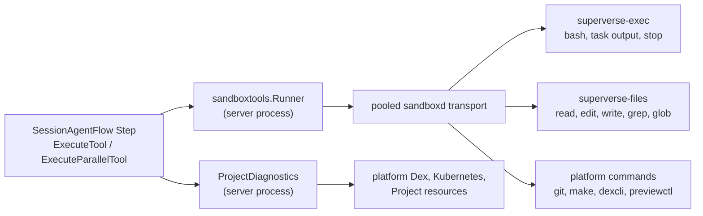
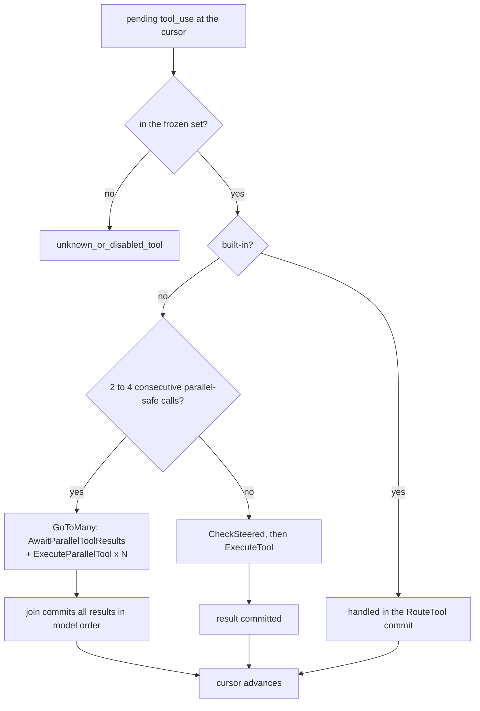

# Tool orchestration

This document specifies the tools of the Session Agent and of its subagents: the catalog and its
input schemas, result formats and budgets, how calls are routed and scheduled, where each tool
runs, and how failures are classified, retried and reported. The Flow that runs tools is
`SessionAgentFlow` ([session.md](session.md)); `SubagentFlow` runs the same tool Steps over its own
worktree ([subagents.md](subagents.md)).

## Principles

- **One scheduler.** The Session's Step graph alone decides serial versus parallel execution. The
  tool Runner has no concurrency limiter, no mutation lock and no internal retry.
- **No Flow RPC on the normal path.** A tool Step reads the accepted workspace lease from its own
  Attributes and talks only to the sandboxd transport and, for Git, the repository host (GitHub,
  or the local Git host of the local lanes). The only tool calls that reach another Flow are
  `start_agent` (StartFlow of `SubagentFlow`) and `stop_task` for an `agent-` task ID
  (`StopSubagent`), both through the Session Service ([subagents.md](subagents.md)). A background
  command's watch is a SubFlow the Session waits for, not a tool call ([Background
  commands](#background-commands)).
- **Results are sized when they are recorded.** What is stored is what the model sees; nothing is
  truncated on send. Large output spills to a file on disk and the result names it.
- **One handler per failure.** Transient faults are retried by Dex. Every other failure is a result
  for the model, with an owner and an effect. There is no manual recovery and no user decision about
  a tool.
- **Uncertain effects are reconciled before they are repeated.** The model queries the ledger, Git
  or the file; a missing response is never read as success.

## Where this document stops

| Subject | Owner |
|---|---|
| Command ledger, background commands, process limits, workspace lease, cold start, image helpers' contract revision | [sandbox.md](sandbox.md) |
| Completion notices of tasks, automatic turns | [notifications-and-feedback.md](notifications-and-feedback.md) |
| `start_agent`, `merge_agent_changes`, subagent tool sets per kind, worktrees | [subagents.md](subagents.md) |
| Request assembly, frozen tools in the request, stop reasons, effort entries, `PendingBytes` | [context-management.md](context-management.md) |
| The commit gate, requirement trace and application tests | [commit-gate-and-app-tests.md](commit-gate-and-app-tests.md) |
| Connector selection and connector subagents | [connectors.md](connectors.md) |
| Stop, steering, questions, requirements cards, the SessionAgentFlow contract | [session.md](session.md) |
| What reaches the browser | [streaming-and-studio.md](streaming-and-studio.md) |

## Where tools run



- **Server side** (`internal/dexai/agents/session/sandboxtools`, `internal/dexai/agents/diagnostics`): strict
  argument decoding, helper requests and responses, failure classification, the platform Git
  protocol and commit gate, the connector catalog, and the three platform tools. The Runner reads
  no Flow: `Call` carries the tool name, arguments, `Identity{FlowID, CallID}`, the accepted lease,
  the confirmed HEAD, the agent root and, for `commit_and_push`, the current requirement IDs and
  revision. The Session fenced the lease to itself when it accepted the grant.
- **Image helpers** (stdlib-only Go binaries in the coding image, JSON in and out): sandboxd's file
  API reads bytes only, cannot search and cannot leave `/workspace`, and its process API restricts
  nothing but the working directory. Two helpers fill the gap:
  - `superverse-exec`: the command ledger behind `bash`, `read_task_output` and `stop_task`
    ([sandbox.md](sandbox.md)). Exit 0 is a definite answer; exit 1 is a helper error.
  - `superverse-files`: `read`, `edit`, `write`, `grep` and `glob`. `grep` and `glob` run
    `rg --no-config`, which honors `.gitignore` and skips `.git`.
  - Both share `sandbox/coding/internal/supervision` (flock, process identity, atomic JSON, setsid)
    and `sandbox/coding/internal/confinement` (the path rules below). A missing or incompatible
    helper is the platform fault `platform_command_unavailable`.
- **Platform commands** that are not model tools (Git, `make check-static`, dexcli, previewctl) run
  as sandboxd processes with platform-owned environments; they get a fresh execution identity per
  run (`PlatformExecutionID`).
- **Binding.** `Runner.Run` borrows the pooled transport of the lease, runs one handler and releases
  the borrow. A missing lease, or a transport that proves the instance unreachable before any
  request, returns `ErrWorkspaceUnavailable`: nothing was sent, which makes it the only signal for
  automatic cold-path rerouting ([session.md](session.md#steps)). Release failure is logged with a
  safe error type and never replaces the result.

## Tool catalog

`agentloop/tool_catalog.go` holds the one static `[]ToolDefinition`. An entry has a name, a
description, a strict input schema, workspace access (`none`, `read_only`, `mutating`), an execution
policy (attempt timeout, attempts, total duration, `LongRunning`, `supportsParallelExecution`),
`Platform` for server-side read tools and `RequiresApproval` for the approval path. `Run` is nil for
built-ins and platform tools. A startup check validates names, duplicates, object schemas that reject
additional properties and the strict limits below; a defect stops the process. There is no separate
registry, dispatcher or admission layer.

The tool set of an agent is frozen with its segment, sorted by name ([context
management](context-management.md#request-parameters)). A call to a name outside the frozen set
returns `unknown_or_disabled_tool`.

### Overview

| Tool | Available to | Workspace access | Parallel | Strict |
|---|---|---|---|---|
| `bash` | main and every subagent (`run_in_background`: main only) | mutating | no | yes |
| `read` | all | read only | yes | yes |
| `edit` | main, and the subagent kinds that edit files (`investigate`, `change`, `connector_develop`) | mutating | no | yes |
| `write` | as `edit` | mutating | no | yes |
| `grep` | all | read only | yes | yes |
| `glob` | all | read only | yes | yes |
| `read_task_output` | main | read only | yes | yes |
| `stop_task` | main | mutating | no | yes |
| `commit_and_push` | main | mutating | no | yes |
| `connector_catalog` | all | read only | yes | yes |
| `read_delivery_status`, `read_platform_flow`, `read_live_app_runs` | main, and the subagent kinds that read the platform (`investigate`, `change`) | none (server side) | yes | no |
| `read_attachment` | main, platform mode | none (server side) | yes | no |
| `place_attachment` | main, platform mode | mutating | no | no |
| `write_todos`, `request_user_input`, `start_timer` | main | none (built-in) | n/a | yes |
| `confirm_requirements` | main | none (built-in) | n/a | yes |
| `set_effort` | main, `change` and `connector_develop` subagents, on a model that takes effort | none (built-in) | n/a | yes |
| `start_agent`, `merge_agent_changes` | main | mutating | no | no |

Subagents have no `write_todos`, `request_user_input`, `start_timer`, `commit_and_push`,
`start_agent` or background commands; the tool set of each subagent kind is in
[subagents.md](subagents.md). A subagent's `bash` omits `run_in_background`.

### Input fields

Every schema rejects additional properties. Required fields are listed first; "optional" counts the
optional parameters that count against the strict limit.

| Tool | Required | Optional |
|---|---|---|
| `bash` | `command`; `description` (at most 200 characters, shown to the user) | `timeout_seconds` (default 120, at most 600), `run_in_background` (2) |
| `read` | `path` | `offset` (first line, 1-based), `limit` (at most 2,000 lines) (2) |
| `edit` | `path`, `old_string`, `new_string` | `replace_all` (1) |
| `write` | `path`, `content` (at most 4 MiB) | none |
| `grep` | `pattern` (regular expression) | `path`, `glob`, `output_mode` (`files_with_matches` default, `content`, `count`), `context` (0 to 20, content mode), `head_limit`, `offset`, `case_insensitive` (7) |
| `glob` | `pattern` | `path` (1) |
| `read_task_output` | `task_id` | `offset` (byte offset into the output file) (1) |
| `stop_task` | `task_id` | none |
| `commit_and_push` | `summary`, `verification[]` | `remaining_risks[]`, `requirements[]`, `requirements_revision`, `blocked`, and per requirement `tests[]` and `untested_reason` (6; fields in [commit-gate-and-app-tests.md](commit-gate-and-app-tests.md#input)) |
| `connector_catalog` | `query` (at most 160 characters) | `operation`, `limit` (1 to 8, default 4) (2) |
| `write_todos` | `todos[{content, status pending, in_progress or completed}]`; an empty list clears it | none |
| `request_user_input` | `questions` (1 to 3): `id`, `header` (at most 32 characters), `question`, `options` (2 to 3: `label`, `description`) | none |
| `confirm_requirements` | `title`, `summary`, `features[{id, text}]` (at most 20; IDs `R1`, `R2`, ...), `connections[{need, connector, operations[], status existing or new, user_setup}]`, `user_setup[]`, `acceptance[]` (arrays may be empty), and the optional Flow `design` ([flow design](../design-first/flow-design.md#the-artifact)) | none |
| `start_timer` | `duration_seconds` (at least 1), `reason` | none |
| `set_effort` | `level` (`high` or `xhigh`), `reason` | none |
| `start_agent` | `description` (1 to 80 characters; for `connector_develop` also the commit and pull request title), `prompt` (at most 32 KiB), `kind` (`investigate`, `change`, `connector_select`, `connector_develop`) | `slug` and `contribution` (`new`, `operation` or `fix`), both for `connector_develop` only (2) |
| `merge_agent_changes` | `agent_id`, `action` (`apply` or `discard`) | `paths[]` (1; at most 200 workspace-relative paths, only with `apply`) |
| `read_delivery_status` | none | `release_id` (40 hex, a Live Release), `deployment_id` (a Live deployment); with neither it reports Preview and newest Live resources |
| `read_platform_flow` | `flow_id`, `view` (`summary`, `state`, `history`) | `after_event_id`, `page_size` (1 to 50, default 50) |
| `read_live_app_runs` | `operation` (`search`, `summary`, `state`, `history`, `logs`) | `flow_type`, `flow_id`, `filters[]` (at most 8), `after_event_id`, `page_size`, `tail_lines` (1 to 200) |

The optional parameters of the strict tools stay well within the limit of 24, counting nested
optional properties. The exact schemas live in `internal/dexai/agents/session/toolinput/schema/*.json`.
`grep.path` is a literal existing file or directory and `glob.path` is a literal
existing directory; wildcards in either field are never expanded. A Go module
directory can be resolved with `go list -m -f '{{.Dir}}' <module>`.

A `glob` pattern (the `glob` tool, and the `glob` argument of `grep`) that contains `/` is matched
against the whole path, relative to the agent root or absolute in a read-only root, as ripgrep
anchors it; `**/client*.go` finds a file anywhere below `path`, while `dex/client*.go` does not.

### Strict schemas

- **API limits (verified).** A request may carry at most 20 `strict` tools, and the strict schemas
  together at most 24 optional parameters; the catalog check enforces both at startup. A third,
  undocumented limit is the size of the grammar the API compiles from the strict schemas: past it
  the request fails with HTTP 400 "The compiled grammar is too large". The API compiles it only when
  the request may call tools, so `tool_choice: none` hides the limit and the live strict-tool test
  uses `tool_choice: auto`.
- **Which tools are strict.** The tools with small schemas are strict. `confirm_requirements` and
  `commit_and_push` have the largest schemas and stay non-strict, because with them the grammar
  exceeds the limit on Opus 5.5. The platform tools stay non-strict as well, and so do `start_agent`
  and `merge_agent_changes`: they leave the measured strict set unchanged, and whether they fit
  strict is for the next live strict-tool measurement to decide. Non-strict tools are validated by
  the same decoder after the `tool_use` block completes. Any change to the strict set reruns
  `make test-claude-live`.
- **Bounds are the decoder's job.** `toolinput.Schema.Decode` applies the envelope (one UTF-8 JSON
  object of 1 byte to 32 MiB, no duplicate, unknown or null top-level field, no trailing JSON), then
  generated decoding (required fields, types, defaults) and `Validate` (ranges, array sizes, Unicode
  string lengths). Handlers add what a schema cannot say: byte and NUL limits, blank text and path
  rules. An omitted optional value takes its default; an explicit zero is validated, not replaced.
- **`eager_input_streaming`** is set on `write`, `edit` and `confirm_requirements`, so long `content`,
  `old_string`/`new_string` and the card stream early. Eager streaming is independent of strictness:
  `confirm_requirements` stays non-strict. The input is decoded and validated only after the
  `tool_use` block completes, so partial or invalid JSON (for example after `max_tokens`) never
  reaches a handler; only the card's partial input is read before that, leniently and for display
  only, into the `RequirementsDraft` Stream ([requirements drafts](streaming-and-studio.md#requirements-drafts)).
  The flag is part of the frozen tool definitions and so of the prompt digest: setting it on the card
  rolled each open Session's context over once at its next turn ([rollover](context-management.md#rollover)).
- The live Claude API test sends the full strict tool set to each supported model
  ([context management](context-management.md#models)).

### Timeouts and retries

| Policy | Tools | Attempt timeout | Execution |
|---|---|---|---|
| Foreground command | `bash` | the command's `timeout_seconds` plus the ledger's 30-second grace | SYNC polling Step; see [Commands](#commands) |
| Files and tasks | `read`, `edit`, `write`, `grep`, `glob`, `read_task_output`, `stop_task` | 60 seconds | default (ASYNC local phase, then a regular execution) |
| Commit | `commit_and_push` | 25 minutes | SYNC |
| Catalog | `connector_catalog` | 60 seconds | default |
| Platform | the three platform tools | 45 seconds | SYNC |
| Delegation | `start_agent`, `merge_agent_changes` | 2 minutes and 3 minutes | SYNC; Stop does not cancel them ([subagents.md](subagents.md)) |
| Built-in | `write_todos`, `request_user_input`, `confirm_requirements`, `start_timer`, `set_effort` | none: run inside `RouteTool`'s commit | one attempt |

- **Retry only transient faults.** Four attempts, 2 seconds doubling to 30 seconds, and a total
  duration equal to the attempt timeout plus 3 minutes. Every catalog tool is safe to repeat by
  identity (see [External-operation identity](#external-operation-identity)), which is the
  precondition for retrying at all.
- **The Runner performs one attempt** and never sleeps or retries internally. While a call runs, its
  Step heartbeats every 20 seconds (`dexflow.KeepAlive`); the one-minute heartbeat timeout detects a
  lost Worker, and the attempt timeout bounds a call that reports nothing.
- **SYNC** (`LongRunning`) marks a call that can outlast the ASYNC local phase (about seven
  seconds), during which the Session answers no RPC. Such a call starts directly as a regular
  execution.
- When retries are exhausted the failure route records `tool_unavailable`
  ([Tool failures](#tool-failures)).

## Results

### Formats and budgets

| Tool | Result | Budget |
|---|---|---|
| `bash` | Stdout and stderr merged in output order. A truncated result states the total size and the path of the full output file. A non-zero exit adds one status line, `exit code: N`. | At most 30,000 bytes: the first 8,000 and the last 22,000, cut at line boundaries |
| `read` | `cat -n` lines (number, tab, text); a line longer than 2,000 characters is cut and marked; when more remains, the last line gives the next offset | At most 2,000 lines and 64 KiB |
| `edit` | `Edited <path>: N replacement(s), lines a-b` | One line |
| `write` | `Created <path>` or `Overwrote <path>` with the line and byte counts | One line |
| `grep` | By `output_mode`: file paths (default), matching lines with optional context, or counts per file; `head_limit` and `offset` page the result | At most 32 KiB |
| `glob` | Paths, most recently modified first | At most 200 paths and 16 KiB |
| `read_task_output` | The task's status (running, exited with code, lost, and the end reason) and its output from `offset`, with the next offset | At most 30,000 bytes per call |
| `stop_task` | The task's final status; for a subagent that is still running, that it is stopping and its report follows as a notification; for one the Session counts as lost, that it is lost | One line |
| `commit_and_push` | Commit SHA, branch, and the duration of each gate stage ([commit gate](commit-gate-and-app-tests.md#result)) | A few lines |
| `connector_catalog` | At most 8 compact entries: connector ID, name, version, exact module, matching operations and triggers (name, kind, description), `install_command`, the paths of the manifest and the generated factory in the module, and the catalog's source, digest and match count | At most 16 KiB |
| Platform tools | JSON, redacted ([Platform diagnostic tools](#platform-diagnostic-tools)); the existing parameters page a large result | At most 16 KiB |
| `write_todos`, `request_user_input`, `confirm_requirements`, `start_timer`, `set_effort` | A short status payload; `request_user_input` ends the turn when its wait begins and `start_timer` waits; `confirm_requirements` answers `recorded` with the version and the turn goes on | Small |
| `start_agent` | `{task_id: "agent-<id>", base_commit}`, immediately; `{task_id, status}` when a Stop ended its record before the start | Small |
| `merge_agent_changes` | JSON with `result` (`merged`, `merged_with_conflicts`, `nothing_to_merge` or `discarded`), the applied files, the conflicts as `{path, kind}` (kind `content`, `binary`, `delete_modify`, `add_add` or `changed_during_merge`), the unchanged files, the requested `paths` that name no changed file (`unknown`) and, for a conflict or an unknown path, a `next` line | One entry per touched file, within the 64 KiB backstop |

A non-zero command exit is reported as an `is_error` result carrying the output and the status line;
the command ran, so the result has no failure header.

### Sizing at ingestion and spill

The tool that produces a result applies its budget (the helpers for files and commands, the server
for catalog and platform tools) before the Step commits it. The committed `tool_result` is the final
entry content: it is never truncated, re-projected or re-sized when it is sent, and its bytes count
into `PendingBytes` for compaction ([context management](context-management.md#token-accounting)).
A result is also kept within 64 KiB when it is recorded, as a backstop: a longer one keeps its head and
tail around a notice of the omitted bytes. It cuts only a tool that did not size its own result, such
as a merge that touched very many files.

Command output over the budget spills: the full stream stays in the ledger file
`/tmp/superverse-exec/runs/<id>/output.log`, which the result names. The model reads it with `read`
(a read-only root) or, for a background task, pages it with `read_task_output`.

## Routing and scheduling



- **Pending calls.** The `tool_use` blocks of one model reply wait in `AgentState.PendingToolCalls`;
  `PendingToolIndex` is the cursor. `RouteTool` admits and routes the call at the cursor.
- **Built-ins** (`write_todos`, `start_timer`, `request_user_input`, `confirm_requirements`,
  `set_effort`) run inside the `RouteTool` commit. A question ends the turn and supersedes the calls
  behind it (`superseded_by_user_input`); a requirements card is recorded as the next version and the
  calls behind it run ([session.md](session.md#requirements-cards)); `start_timer` waits, and the calls
  behind it run afterwards.
- **Admission before dispatch** for `start_agent` is made in `RouteTool` (the limits and the
  `Subagents` record; [subagents.md](subagents.md)); its execution is `ExecuteTool`.
- **Parallel wave.** `RouteTool` takes the run of consecutive calls from the cursor that are
  parallel-safe (`supportsParallelExecution`: read-only Sandbox tools and platform tools), at most
  4 (`maximumParallelToolCalls`) and at least 2, and stops at the first call that is mutating,
  built-in, unknown or approval-gated. It starts `AwaitParallelToolResults` and one
  `ExecuteParallelTool` per call with `GoToMany`.
- **The join.** Each branch publishes one `parallelToolResult` to the ChannelMap
  `ParallelToolResults`, instance `tool-batch-<LastSequence>-<firstIndex>` (for example
  `tool-batch-37-0`), which is unique per wave. `AwaitParallelToolResults` waits with
  `ForN(expectedCount)`, validates branch index uniqueness and CallID correspondence, and commits all
  results in the model's original order in one commit, whatever the completion order.
- **Serial calls.** Mutating tools, and a read-only call that has no parallel neighbor, run as
  `CheckSteered`, then `ExecuteTool`; the boundary Step is where steering, notifications and Stop are
  applied between calls ([session.md](session.md#step-graph)).
- **Each `tool_use` is answered exactly once**, in the user message that immediately follows the
  reply; a completion that arrives later reaches the model as a notification
  ([context management](context-management.md#request-assembly),
  [notifications](notifications-and-feedback.md)). A reply cut by `max_tokens` is answered with
  `is_error` results and no call runs ([context management](context-management.md#stop-reasons-and-errors)).
- **Admission-to-run fence.** `RouteTool` takes `AgentInterrupt` together with its
  conversation locks and applies a pending Stop before a built-in or parallel wave.
  A stopped route records one interrupted result for every pending call and ends
  the turn. Serial execution keeps the existing `CheckSteered` admission, which
  records `RunningTool` in the same commit as its Stop check.
- **Interruption.** Stop cancels `ExecuteTool`, `ExecuteParallelTool`, `RecoverParallelToolExecution`
  and `AwaitParallelToolResults`; results already published to the wave are kept, the remaining calls
  answer `interrupted_by_user`, and a mutating tool's effect is `unknown`
  ([session.md](session.md#stop-button)).

### Workspace gates

A wave or serial call with workspace access first requires a usable accepted lease; the dispatcher
marks it in use (`WorkspaceUse`), and a wave keeps it until its join: the Session reclaims the instance
only when no wave uses it, which it decides itself under the `Workspace` lock. Platform-only waves take no
lease. When the Runner
reports `ErrWorkspaceUnavailable`, the call was not dispatched: a serial call stays pending and a
read-only wave is re-routed after the workspace is restored, without consuming a Dex retry. A
mutating call whose earlier attempt may have run is not repeated: it completes with
`command_interrupted`. The gates and the cold path belong to [session.md](session.md#steps) and
[sandbox.md](sandbox.md).

## Process-local transport

Workspace transports are pooled by `workspace.SandboxResolver`, one entry per Project that records
its full `Binding`: the sandboxd gRPC connection, the adapter built on it and the addresses that the
runtime resolved for it.

- `Bind` borrows an entry and `Release` returns it; neither closes the transport. A different
  `Binding` for the same Project retires the old entry, which closes when its borrowers reach zero.
- The pool holds at most 256 entries. A full pool evicts the least recently used idle entry, or
  returns `errCapacity` when none is idle. One janitor goroutine, owned by the resolver and stopped by `Close`, closes
  entries that had no borrower for ten minutes. Shutdown closes every owned transport.
- The addresses come from the `SandboxAddresses` of the runtime that provisioned the instance, derived
  from the lease's provider identities: Kubernetes resolves the cluster DNS name of the Sandbox's Service,
  and Docker looks up, for every new transport, the ports that the container carrying the instance UID
  publishes on 127.0.0.1 now, which a restart changes. An address the runtime cannot resolve is treated as
  unreachable.
- Before returning, `Bind` proves liveness without sending a request: the connection must reach READY
  within five seconds. A failed probe evicts the entry and returns an error wrapping
  `workspace.ErrUnreachable`, which becomes `ErrWorkspaceUnavailable`. Dial failures and addresses that
  cannot be resolved are treated the same; `errClosed` and `errCapacity` stay distinct.
- The pool is never authority: a replaced Worker rebuilds it from the lease in Session Attributes.
- The connector catalog is cached for five minutes in the Runner: one public document of at most
  1 MiB, no credential, no goroutine. The server keeps its own copy for the catalog matches of a
  Session's first request ([connectors](connectors.md#catalog-matches-of-the-first-request)).

## Commands

`bash` runs a shell command in the agent root through the command ledger `superverse-exec`; the ledger
format, limits and garbage collection are in [sandbox.md](sandbox.md).

- **Identity.** The ledger ID derives from the Flow ID and the call ID; `begin` with the same ID and
  the same digest returns the current state and never restarts the command; a different digest is
  `execution_conflict`.
- **Foreground flow.** `begin --wait 5s`, then a polling loop of `status --wait 20s` inside one
  heartbeat Step (`PollingStepOptions`) until the command exits or its timeout passes. The ledger
  enforces the process lifetime itself, so the process ends even if the Flow stops polling. Only the
  second and later attempts pass `--not-before`, which lets the ledger tell that the instance was
  replaced since an earlier attempt (`instance_replaced`).
- **`SettleForegroundCommand`** is the failure route for a timeout or retry exhaustion. It reads the
  ledger status:
  - exited: the normal result;
  - running past the timeout: the main agent's command moves to the background and the result names
    its task ID; a command that cannot move (a subagent has no background commands) is stopped and
    recorded as `command_timed_out`;
  - lost, or `instance_replaced`: `command_interrupted` (platform, effect unknown).

  `ExecuteTool` declares both Execute failure routes, so dexcli sees them: `SettleForegroundCommand`
  for `bash` and `RecordToolFailure` for every other tool. Settle tells a timeout from exhausted
  retries with `dexflow.RecoveryTimedOut`; if Settle itself exhausts its retries,
  `RecordToolFailure` records `command_interrupted` with effect unknown. A workspace that becomes
  unreachable while a started command is polled returns the error for a Dex retry, whose
  `begin --not-before` answers `instance_replaced` if the instance changed, so nothing runs twice.
- **Timeout.** `timeout_seconds` defaults to 120 and is at most 600; a longer command uses
  `run_in_background`.
- **Background mode** returns a task ID (`cmd-<12 characters>`, derived from the execution digest)
  at once. `read_task_output` and `stop_task` are ordinary Sandbox tools resolved by the ledger and
  need no Flow read; at most 4 background commands run per Sandbox (`background_limit_reached`).
  `stop_task` on a `cmd-` ID sends TERM and, after 10 seconds, KILL, idempotently; on an `agent-` ID
  it calls `StopSubagent` through the Service. `read_task_output` reads command tasks; a subagent's
  report arrives as a notification, and any unknown ID is `task_not_found`.

### Background commands

A background command runs for up to 3,300 seconds (`agenttasks.BackgroundCommandLifetime`). Its
watch is one long polling Step, so it runs in its own Flow, `BackgroundCommandFlow`, a Dex SubFlow
of the Session: the Session only waits for it while the command runs, so its turns, its tool routing
and its move to a new Run never wait for the command. The per-Flow contract is in the
[backgroundcommand README](../../../internal/dexai/agents/session/backgroundcommand/README.md).

- **Start.** The Step that records the command (`ExecuteTool`, or `SettleForegroundCommand` when a
  foreground command moves to the background) writes its `BackgroundCommands` record and moves to
  `CheckSteered` and `AwaitBackgroundCommand` together. `AwaitBackgroundCommand`'s WaitFor returns
  the SubFlow condition with the input `BackgroundCommandWatch{TaskID, SessionFlowID, Lease}`; Dex
  derives the FlowID `SubFlow:<Session FlowID>-<Step execution ID>-0`, for example
  `SubFlow:session-6w4b-AwaitBackgroundCommand-3-0`, and starts it once for the Step execution. Step
  execution IDs are unique for the Session's lifetime, so no two commands share a SubFlow.
- **Watch.** The SubFlow's one Step, `WatchBackgroundCommand` (`dexflow.PollingStepOptions` of the
  lifetime plus five minutes), polls the ledger without a Flow read and completes with the command's
  end: the ledger's end, or lost when the instance does not know the task (a replacement instance).
  Past its limit, or after its retries, `RecordBackgroundCommandLost` completes it with a lost end.
- **End.** `AwaitBackgroundCommand` waits with `AnyOf` for the SubFlow and for the task's instance
  of the ChannelMap `BackgroundCommandStops`. Its Execute (under the `NotificationReceipts` lock)
  records the end in `BackgroundCommands` once and publishes the `task` notification unless the
  command was stopped; a SubFlow that ended otherwise, or a failed WaitFor, records it lost.
  Exhausted retries take `AbandonBackgroundCommand`, which records the command lost without a
  notification. No RPC reaches either Flow on this path.
- **Stop.** The Stop button and `stop_task` stop the command through the ledger; the watch observes
  it stopped and completes, and the command is recorded `stopped` without a notification. Dex does
  not stop a SubFlow with its parent, so the Project's deletion stops each running watch explicitly:
  `CompleteProjectSession` publishes one `BackgroundCommandStops` message per running command
  instead of cancelling the waiting Steps; the Step that sees the stop win stops the SubFlow by its
  `dex.SubFlowID` (`StopBackgroundCommandWatch`, one Flow call at the Session's close; a SubFlow that
  no longer runs counts as stopped) and records the command stopped. The Session completes after
  every such Step.
- **Primitives.** The Attribute `TaskID`, installed with the start, which Dex Web shows; the RPCs
  `GetDexSummary` and `GetDexDisplay`; no AttributeMap, Channel, ChannelMap or Stream of its own.
- **Limitation.** A failure of Dex to start the SubFlow, after the start's own bounded attempts,
  fails the Session, because a SubFlow condition has no failure route of the waiting Step yet
  (superdurable/dex).

The completion notices and automatic turns are in
[notifications-and-feedback.md](notifications-and-feedback.md#task-notifications).

## Files and confinement

Every call carries a trusted **agent root**: `/workspace` for the main agent, the subagent's own
worktree for a subagent. The helpers resolve symlinks first and then require the path to fall:

- inside the agent root, readable and writable; or
- inside a read-only root: `/opt/superverse/dex-skills` (the repository's `dex-skills/`),
  `$GOMODCACHE`, `/usr/local/go/src`, the Preview logs (`/var/lib/superverse/preview/logs`) and
  `/tmp/superverse-exec/runs`.

A path outside both, a write into a read-only root, and any path with a `.git` component relative to
the root are refused with `path_outside_roots`. The rule is for isolation and correctness, not
security: the helpers and `bash` both run as UID 1000, and a command can still `cd` elsewhere.

- **Skills and module sources** are read with the same tools. The model finds a module's source
  directory with `go list -m -f '{{.Dir}}' <module>` (after `go get` or `go mod download` when the
  module is not restored) and reads, searches and lists it under `$GOMODCACHE`. Prompts,
  each example's `AGENTS.md` and `dex-skills/` name paths this way; no `source=` selector exists.
- **`edit`** needs `old_string` to match exactly once unless `replace_all` is set
  (`edit_no_match`, `edit_ambiguous`), refuses identical strings (`edit_noop`), and works on text
  files only (`binary_file`, `file_too_large`).
- **`write`** replaces a file with `content`; writing the same content again changes nothing.
- **`read`** refuses a directory (`path_is_directory`) and a binary file (`binary_file`); `glob` lists
  directories.
- **`grep`** and **`glob`** report an invalid regular expression or pattern as `invalid_pattern`.
- **Permissions.** A path that a directory without search permission hides resolves through its
  nearest ancestor that resolves, so the path rules decide first. When the permissions of a confined
  path, or of a directory on its way, then deny `read`, `edit`, `write`, or the search path of `grep`
  or `glob`, the call fails at once with `path_permission_denied` (owner `call`, effect `none`): the
  model's own commands set them, so a retry cannot help. `grep` and `glob` keep what ripgrep found
  below the search path and name the paths it could not read in a closing note. A permission error on
  a helper's own state outside the roots, such as `edit`'s intent records, stays a transient helper
  error.

## External-operation identity

| Tool | Identity | Query before mutate and recovery |
|---|---|---|
| `bash` | Ledger ID from Flow ID and call ID, plus a digest of the request | `begin` returns the existing state; `status` settles an exhausted or lost call |
| `stop_task` | Task ID | `stop` is idempotent; for an `agent-` ID `StopSubagent` is idempotent too |
| `edit` | An intent record in the Sandbox, keyed by the call identity | A retry finds the edit applied and returns the original result, or applies it once |
| `write` | The content | The same content is a no-op |
| `commit_and_push` | The turn marker `SuperVerse-Turn: <sha256(callID)>` and Git ancestry | Remote reads before and after the push reconcile a lost response ([commit gate](commit-gate-and-app-tests.md#commit-and-push)) |
| `start_agent` | The SubagentFlow ID and a request fingerprint | A duplicate joins the same execution ([subagents.md](subagents.md)) |
| `merge_agent_changes` | The plan and receipt of each request: every file, a discard, or the sorted selected paths | Idempotent by file pre-image; a repeated request answers its receipt ([subagents.md](subagents.md)) |
| Read-only tools, platform tools | None needed | Repeating changes nothing |

The ledger, intent records and worktree receipts are files in the Sandbox. They are references for the
model's reconciliation; the platform's gates never trust them.

## Tool failures

### Failure type

Every code is declared once, with its owner and its hint, as a struct-typed value of the package
`internal/dexai/agents/toolfailure` (`toolfailure.Code`), so no code is a string literal elsewhere and a
stored tool result keeps the code's spelling. `sandboxd/tool_failure.go` defines
`ToolFailure{code, effect, cause, detail}`; the owner is the code's.

| Field | Values | Meaning |
|---|---|---|
| owner (of the code) | `call`, `application`, `platform` | Who can change the outcome: the model's call (arguments, state, limits), the generated application (its source or tests), or the platform (not the call's fault) |
| `effect` | `none`, `completed`, `partial`, `unknown` | What the call did to the world: nothing; all of it (although the call reports a failure); part of it; or it cannot be told |

`NewToolFailure(code, cause)` makes a failure with the effect `none`; `.WithEffect()` names another,
`.WithDetail()` adds secret-free text for the model and `.Rewrap()` replaces the cause.
`IsTransient(err)` looks at types only, never at text: gRPC `Unavailable`, `ResourceExhausted`,
`Aborted` and `DeadlineExceeded`; sandboxd HTTP 429, 502, 503 and 504; network errors,
`ECONNRESET` and `io.ErrUnexpectedEOF`; and an error its source marked transient (`MarkTransient`,
for example a remote Git command that exited nonzero after the network failed).

### Classification order

1. Invalid arguments: `invalid_arguments`.
2. A `ToolFailure`: returned as the result.
3. A transient error: returned to Dex for a retry.
4. Any other error: `tool_error` (platform), recorded at once. The effect is `none` for read-only
   tools and `unknown` for tools that change state.
5. Retries exhausted: `RecordToolFailure` (serial) or `RecoverParallelToolExecution` (a wave branch)
   records `tool_unavailable` (platform), with the effect of rule 4.

The Flow never fails because of a tool, and no tool failure waits for a user.

### What the model sees

The `tool_result` has `is_error: true` whenever the result is not a success, and its text is:

```text
Error: <code> — <message, at most 1 KiB; for a gate failure the output tail, at most 8 KiB>
owner: <owner> · effect: <effect>
hint: <the hint of this code>
detail: <at most 2 KiB, no secrets; omitted when empty>
```

For example:

```text
Error: edit_no_match — old_string was not found in internal/dexai/app/summary.go
owner: call · effect: none
hint: Read the file again and copy old_string exactly, including whitespace and indentation.
```

The hint of a platform failure says that the call did not cause it, that the maintainers have been
notified, which alternative tool can reach the same goal, and, when none can, to tell the user in
business terms. A failure with effect `partial` or `unknown` tells the model to check what happened
(`git status`, the file, `read_task_output`) before repeating the call.

### Codes

Hint text lives next to each code in `internal/dexai/agents/toolfailure/code.go`; the owner's hint closes
the hint of a platform code unless the code's own hint replaces it.

**Owner `call`, effect `none`**

| Code | Raised when |
|---|---|
| `invalid_arguments` | The input fails the schema, a range, a size, a blank-text, NUL or path rule |
| `path_not_found` | The path does not exist |
| `path_is_directory` | `read`, `edit` or `write` names a directory |
| `path_outside_roots` | The path leaves the agent root and the read-only roots, writes into a read-only root, or contains `.git` |
| `path_permission_denied` | The permissions of a confined path, or of a directory on its way, deny the file tool, such as a file the model locked with `chmod 000` (the helpers and `bash` share UID 1000) |
| `binary_file` | `read` or `edit` meets a file that is not valid UTF-8 text |
| `file_too_large` | The file exceeds what the helper reads or edits |
| `edit_no_match` | `old_string` does not occur in the file |
| `edit_ambiguous` | `old_string` occurs more than once and `replace_all` is not set |
| `edit_noop` | `old_string` and `new_string` are equal |
| `invalid_pattern` | `grep` or `glob` pattern does not parse |
| `command_not_started` | The ledger rejected the start before running anything (agent root missing or not a directory) |
| `background_limit_reached` | Four background commands are already running |
| `task_not_found` | `read_task_output` or `stop_task` names an unknown task ID, or `stop_task` or `merge_agent_changes` an agent ID that no subagent of the Session has |
| `attachment_not_found` | `read_attachment` or `place_attachment` names an attachment the Session's Project has not bound ([attachments](context-management.md#attachments)) |
| `subagent_limit_reached` | `start_agent` while three subagents already run |
| `subagent_budget_reached` | `start_agent` after six subagents started since the user's last message (checked before the running limit) |
| `snapshot_too_large` | `start_agent`: the uncommitted and untracked files its worktree would copy exceed 100 MiB |
| `agent_not_finished` | `merge_agent_changes` names a subagent that is still running (a lost one counts as ended) |
| `sandbox_request_rejected` | sandboxd rejected the request (HTTP 400 or 422) |
| `sandbox_conflict` | sandboxd answered a conflict (HTTP 409) |
| `sandbox_payload_too_large` | The content exceeds the Sandbox's size limit |
| `connector_contribution_running`, `connector_contribution_limit_reached` | `start_agent` of kind `connector_develop` for a connector another unfinished develop subagent works on, or for a 17th distinct connector of the Session ([connectors](connectors.md#connector_develop)) |
| `catalog_result_too_large` | A connector result is too large; select one exact operation |
| `flow_not_in_project`, `live_not_ready`, `not_found` | Platform-tool refusals ([below](#platform-diagnostic-tools)) |

**Owner `call`, effect `partial`**

| Code | Raised when |
|---|---|
| `command_output_limit_exceeded` | A command's output passed 16 MiB and its process group was killed |
| `command_timed_out` | A foreground command passed its timeout and was stopped (stop confirmed) |

**Owner `application`**

| Code | Effect | Raised when |
|---|---|---|
| `source_check_failed` | none | The template's `checkStatic` target failed, or `dex-app.yaml` failed the host schema |
| `flow_definition_invalid` | none | The platform's dexcli rejected the Flow definitions |
| `source_gate_weakened` | none | The working tree removed or changed a gate command that HEAD declares |
| `application_tests_failed`, `application_tests_incomplete`, `requirements_untested`, `connector_mock_in_production` | none | The application test stage ([commit gate](commit-gate-and-app-tests.md#stage-4-checks)) |
| `git_remote_conflict`, `git_push_rejected`, `main_rebase_conflict`, `main_reverification_required` | partial: committed locally, not pushed | The push could not complete ([commit gate](commit-gate-and-app-tests.md#commit-and-push)) |

**Owner `platform`**

| Code | Effect | Raised when |
|---|---|---|
| `sandbox_access_denied` | none | sandboxd denied access (HTTP 403) |
| `process_output_limit_exceeded` | none | A platform helper's output passed its ceiling |
| `catalog_unavailable`, `catalog_invalid` | none | The official catalog could not be fetched, or is not valid |
| `source_check_unavailable` | none | The committed template declares no supported source check |
| `workspace_not_empty`, `workspace_origin_mismatch` | none | The checkout found files but no Git repository, or a Git origin that is not the Project's repository |
| `test_environment_unavailable` | none | The application test engine could not start ([commit gate](commit-gate-and-app-tests.md#stage-4-checks)) |
| `platform_command_unavailable` | none | `superverse-exec` or `superverse-files` is missing or incompatible |
| `workspace_unavailable` | none | The call was never dispatched: the workspace could not be restored after repeated losses |
| `workspace_disk_low` | none | `start_agent`: the volume has less than 1 GiB free, so no subagent worktree was created |
| `execution_conflict` | none | The ledger saw the same execution ID with a different request digest |
| `command_interrupted` | unknown | An earlier attempt of a mutating call may have run and the instance that could tell is gone, or the ledger reports the command `lost` or `instance_replaced` |
| `tool_error` | none or unknown | A non-transient error with no more specific code |
| `tool_unavailable` | none or unknown | Retries are exhausted |

**Decided by the Session** (the same text format; owner `call`, effect `none` unless stated)

| Code | Raised when |
|---|---|
| `unknown_or_disabled_tool` | The name is not in the frozen tool set |
| `output_limit_exceeded` | A reply that hit `max_tokens`: each of its tool calls is answered unexecuted |
| `invalid_effort` | `set_effort` asked for a level the model profile does not offer |
| `multiple_write_todos_calls`, `invalid_todos` | A response writes the progress list twice, or the list is invalid |
| `invalid_duration_seconds` | `start_timer` got an invalid duration |
| `invalid_user_input`, `user_input_already_pending` | A question or requirements card is invalid, or a question is already waiting |
| `rejected_by_user` | A tool that requires approval was rejected |
| `superseded_by_steered_user_message`, `superseded_by_user_input` | The call sat behind steering, or behind a question, and did not run |
| `interrupted_by_user` | Stop ended the turn; effect `unknown` for a tool that changes state |

The delegation codes above are explained in
[subagents.md](subagents.md#failure-codes-of-the-three-tools). A conflict of a merge is not a failure:
`merged_with_conflicts` is a normal result.

### No manual recovery

The Session has no recovery decision, panel, Channel, lock or RPC for tools. Reconciliation of an
uncertain effect is the model's job, with the tools that observe it: the ledger through
`read_task_output`, `git status` and `git log` through `bash`, and `read` for files. The hint of an
`unknown` or `partial` result says which. Open questions that need the user's facts go through
`request_user_input`, never through a technical decision.

## Platform diagnostic tools

`read_delivery_status`, `read_platform_flow` and `read_live_app_runs` read what the platform knows
about the Session's own Project. `ToolDefinition.Platform` gives them a category of their own: no
workspace access, so a wave of them takes no lease and works while the Sandbox is reclaimed; parallel;
non-strict; SYNC attempts of 45 seconds under the common retry policy, safe to repeat because they
change nothing.

`executeTool` hands a platform call to the constructor-injected `session.ProjectDiagnosticsReader`
with the Session identity read from the Flow's own Attributes. No argument names a Project or a
Session. [`internal/dexai/agents/diagnostics`](../../../internal/dexai/agents/diagnostics/README.md) implements it:

| Tool | Reads |
|---|---|
| `read_delivery_status` | The Project, its Setup, the Session's Sandbox instance and the Project's Preview, the newest three Releases (with the log tail of a failed build) and Live deployments, the Session HEAD and the Live pointer; each resource names its FlowID |
| `read_platform_flow` | One platform Flow's summary, allowlisted state, or one page of history. Only the Project's `project-`, `setup-`, `release-` and `deploy-` Flows, its `preview-` and `session-workspace-` Flows and the Session's own `sandbox-provision-` Flows are admitted; any other FlowID, including every SessionAgentFlow, SubagentFlow and BackgroundCommandFlow, is refused with `flow_not_in_project` before any read |
| `read_live_app_runs` | The Live application's runs (search, summary, state, history) through the same checks as a Studio Live target, and the end of its container log through the runtime (the Pod log, or `docker logs`) |
| `read_attachment` | An attachment the Session's Project bound ([attachments](context-management.md#attachments)): a document's outline, or one 32 KiB part of a section, or of a JSON file's redacted text, framed as material the user attached; an image is `invalid_arguments` |

`place_attachment` is a Sandbox tool of its own kind: the Session's Step reads the redacted copy of a
JSON attachment its Project bound through its `attachmentRenditions` port, and the tool writes it
through `superverse-files write` at `/workspace/.local/superverse-attachments/<id>/<name>`, which the
application template's `.gitignore` ignores; `commit_and_push` refuses a staged tree that holds such
a file (`attachment_in_source`). It is mutating, so it joins no wave, and loose, so the measured
strict tool set is unchanged. Neither attachment tool is offered to a connected local agent.

The platform Dex is shared by every Project, so the Agent never gets raw platform engine access. For
the Preview the Agent runs `dexcli` against the Sandbox-local engine (read subcommands, `--no-hydrate`)
and reads the Preview logs.

- **Budget.** At most 16 KiB per result, applied when it is produced; a history or search page keeps
  as many events or runs as fit and says where the rest starts.
- **Redaction.** Every string, object keys included, is redacted before it is cut: first the configured
  values of at least 8 bytes that the read can reach (a Live deployment's frozen configuration and its
  container's grant environment; a build's frozen configuration), longest first, then `infra.Redact`
  (namespace, workload generations, Temporal namespace, hosted cloud names). No result names a RunID,
  a Start RequestID or a blob reference, and no blob is loaded.
- **Failures.** `invalid_arguments`, `flow_not_in_project`, `live_not_ready` and `not_found` are call
  failures with effect `none`; a platform error is retried, and a platform-owned result reports an
  issue ([below](#platform-issue-reporting)).

## Platform issue reporting

A platform fault should reach the maintainers without the user's involvement. The Step
`ReportPlatformIssue` is a side branch of the Step that records the fault: it runs beside the turn,
never blocks it and never changes a tool result. It starts, or joins, the `PlatformIssueFlow` of the
fault's signature, which files one GitHub issue per signature; the per-Flow contract is in the
[platform issue README](../../../internal/dexai/agents/platformissue/README.md).

- **Triggers.** `ExecuteTool` and `SettleForegroundCommand` when the recorded result has owner
  `platform`; `RecordToolFailure`; the join of a parallel wave, once for each distinct signature of
  its platform-owned results; and `CallModel` on a non-retryable model error (HTTP 400, 401 or 403;
  [context management](context-management.md#errors)). Each moves to `CheckSteered` and
  `ReportPlatformIssue` in one decision. A compaction's rejection is not reported (a 401 or 403 recurs
  in the next model call), nor is a wave result recorded after a Stop.
- **Call chain.** `ReportPlatformIssue` calls `SessionAgentFlowDependency.ReportPlatformIssue`;
  `SessionFlowService` implements it in `internal/dexai/agents/session_flow_service_issues.go`, maps
  the incident and starts the signature's Flow through `PlatformIssueFlowClient.Report`. The Flow's
  provider Step `EnsurePlatformIssue` calls `EnsureIssue` of `internal/comm/platform/githubissues`, which acts through
  `internal/comm/platform/githubapp`, and `LabelPlatformIssue` calls its `LabelIssue` for an issue GitHub
  opened without the label.
- **Identity and deduplication.** The signature is the SHA-256 of the owner, tool, code and error type
  (the engine's type of the final error, or `http_<status>` for a model rejection), never of a message
  or payload (`flowid.PlatformIssueSignature`). The Flow is `platform-issue-<env>-<sig16>`, for
  example `platform-issue-test-3f9a1c2b7d4e5f60` (`<sig16>` is the first 16 hex characters of the
  digest); it belongs to no Project. Its Start RequestID fingerprints `{SessionFlowID, CallID,
  Signature}` under `dex.IDReuseAllowIfNotRunning` with same-request IgnoreError, and a different
  report while the run is open is answered as joined (`*dex.FlowAlreadyStartedError`), so concurrent
  reports of one signature, from one Session or several, run one `EnsurePlatformIssue`. That Step
  queries open and closed issues for the label `superverse-incident:<env>:<sig16>` and creates an
  issue only when none carries it: query before mutate, which is also the admission check of a new
  run of the reused FlowID. GitHub drops a label the caller may not set; an issue it opened without the
  label is committed by the decision into `LabelPlatformIssue`, which attaches the label, so a retried
  label call never opens a second issue. The remaining window is GitHub's label listing, which is eventually
  consistent for a few seconds after a run that opened the issue completed. GitHub is the owner of
  the issue; the run keeps only the incident and the outcome.
- **Primitives.** Attributes `Incident` (identifiers and classification only, fixed by the start) and
  `Outcome`; Steps `EnsurePlatformIssue`, `LabelPlatformIssue`, `RecordPlatformIssue` and `DropPlatformIssue`; RPCs
  `GetPlatformIssue`, `GetDexSummary` and `GetDexDisplay`, read-only; no AttributeMap, Channel or
  Stream.
- **Content.** Identifiers and classification only: environment, Flow ID, call ID, tool, code, owner,
  effect, error type and time. Never credentials, tool arguments, file contents or conversation text.
- **Credentials.** The GitHub App gets the Issues permission and an installation on the issue
  repository. A second `githubapp.App` serves that installation, and its tokens are restricted to
  Issues write and Metadata read; connector contribution uses the same App with its own installation
  ([connectors.md](connectors.md)).
- **Configuration.** The server configuration keys `github.issues.repository` (`owner/name`) and
  `github.issues.installationId`, both or neither. Without them (every local profile, and prod) the
  Flow only logs the incident (`logged`). AWS test and staging set them, through optional Terraform
  inputs rendered into the server configuration, to the platform's own repository.
- **Failure of the report.** `ReportPlatformIssue` holds no lock and retries only a failed start
  (provider options: retried for three minutes); its failure route `AbandonPlatformIssue`
  ends a report whose start exhausted its retries, which the Session Service logged. Inside the Flow,
  `EnsurePlatformIssue` records `opened`, `found`, `logged`, or `dropped` for a refusal, and its
  failure route `DropPlatformIssue` records a report whose retries ran out as dropped;
  `LabelPlatformIssue` records `opened`, with the final error when the label call was refused or its
  retries ran out;
  `RecordPlatformIssue` writes the outcome, records a `platform_issue` event with the signature and
  outcome in the run's history and completes. The turn is unaffected.

## Dex Flow Changes

No Flow is owned or added by the tool path; `SessionAgentFlow` ([session.md](session.md#sessionagentflow-contract))
and `SubagentFlow` ([subagents.md](subagents.md)) own the primitives that follow. This section states
the tool-specific parts of their contracts.

### Identity and execution lifecycle

- **Identities.** The call ID is the model's `tool_use` ID (for example `toolu_01B2c3d4`), stable
  across Dex retries. A wave is identified by `tool-batch-<LastSequence>-<firstIndex>`, for example
  `tool-batch-37-0`. The ledger and sandboxd execution IDs derive from the Flow ID and the call ID.
- **Start RequestID and reuse.** Tools start no Flow except `start_agent`, whose StartFlow identity is
  owned by [subagents.md](subagents.md).
- **Duplicates, retries and recovery.** A Step retry re-runs the same call with the same identity; the
  ledger, intent records and Git ancestry make the repeat safe. A Worker restart rebuilds the transport
  pool from the lease in Attributes. A Run switch resets nothing: the cursor, wave state and results are
  Attributes and ChannelMap instances.
- **Completion.** A tool call completes no Flow. Business completion, archival and engine completion of
  the Session are in [session.md](session.md#business-completion-archival-and-engine-completion).

### Attributes and AttributeMaps

None added by this topic. The tool path reads and writes, under the owners in session.md:

| Primitive | Use by the tool path | Loading and locking |
|---|---|---|
| `AgentState` | `PendingToolCalls`, `PendingToolIndex`, `Running` | Ordinary Attribute |
| `Workspace`, `WorkspaceUse`, `HeadCommit` | Lease, wave in use, verified HEAD set with the result of `commit_and_push` | Ordinary Attributes; `ExecuteTool` and `ExecuteParallelTool` take no lock |
| `ConfirmedRequirements` | Read into the call context of `commit_and_push` | Ordinary Attribute |
| `CurrentMessages`, `ArchivedMessages` | Tool results appended as `tool_result` entries | The committing Steps load the message maps and hold `MessageWindowLock`; a wave branch does neither, it only publishes |
| `BackgroundCommands`, `Subagents` | Task records created by `bash` and `start_agent` | As in session.md |

No Attribute holds a secret: tool results are redacted and bounded, and a GitHub token exists only in
the environment of one platform Git subprocess. Tool results grow `CurrentMessages` like any entry and
follow its retention and archive rules.

### Channels and ChannelMaps

| Name | Payload | Producers and consumers | Admission, duplicates, termination |
|---|---|---|---|
| `ParallelToolResults` (ChannelMap) | `parallelToolResult{Index, Call, Result, ErrorType, Timing, WorkspaceLost}`; key `tool-batch-<LastSequence>-<firstIndex>`, from server-derived values; example `tool-batch-37-0` | Each branch (`ExecuteParallelTool` or `RecoverParallelToolExecution`) publishes once with its commit; `AwaitParallelToolResults` consumes with `ForN`; `InterruptAgent` reads published results and clears the instance | The join validates index and CallID; each instance is unique per wave, so there is no revision or retry suffix. No deduplication beyond that is claimed. There is no expiry; cancellation clears the instance |
| `ToolApprovals` (ChannelMap) | `ToolApproval`; key is the call ID | `ApproveTool` to `AwaitToolApproval` | Exact pending CallID. No catalog tool requires approval; the path is retained for the capability |

### Streams

`AgentActivity` carries the tool events: `model_tool_call{tool, target}` when the `tool_use` block
completes (the target is at most 200 characters: `bash` its `description`, file tools the path, `grep`
and `glob` the pattern, `commit_and_push` the first line of its summary, `connector_catalog` the query,
platform tools the Flow or operation, `read_task_output` and `stop_task` the task ID, `start_agent` its
description, `merge_agent_changes` the agent ID, `confirm_requirements` the title), `tool_progress` with
the attempt number only, and the terminal completed or failed event with the failure code. No file
content, diff or command output is streamed. `RequirementsDraft` carries the drafts of a
`confirm_requirements` call while the model writes it, at most one a second, which `CallModel` writes
([requirements drafts](streaming-and-studio.md#requirements-drafts)). The budget is 10 MiB shared by every execution with the same
Flow type and Stream name; delivery is best effort and the tool result in `CurrentMessages` is canonical
([streaming-and-studio.md](streaming-and-studio.md)).

### Steps, RPCs and recovery

| Step | Purpose | Mode and failure route |
|---|---|---|
| `RouteTool` | Admit the call at the cursor, run built-ins, choose serial or wave | No `WaitFor`; short |
| `ExecuteTool` | One serial call | Per the catalog row; SYNC for `bash`, `commit_and_push`, `start_agent`, `merge_agent_changes` and platform calls; failure route `RecordToolFailure` |
| `ExecuteParallelTool` | One wave branch | Same policy; failure route `RecoverParallelToolExecution` |
| `AwaitParallelToolResults` | Join | `WaitFor` `ForN`; commits in model order |
| `RecoverParallelToolExecution` | Publish a typed `tool_unavailable` result for a branch whose retries are exhausted | Short; publishes and ends |
| `RecordToolFailure` | Record `tool_unavailable` for a serial call and continue through `CheckSteered`; starts `ReportPlatformIssue`; fails the STARTING `Subagents` record of a `start_agent` call | Short; locks `AgentInterrupt` |
| `SettleForegroundCommand` | Settle a foreground `bash` after a timeout or retry exhaustion ([Commands](#commands)) | Short |
| `ReportPlatformIssue` | Start or join the `PlatformIssueFlow` of the fault's signature | Side branch; no lock; provider options, retried for 3 minutes; failure route `AbandonPlatformIssue` |
| `AbandonPlatformIssue` | End a report whose start exhausted its retries | Ends the side branch |
| `AwaitBackgroundCommand`, `AbandonBackgroundCommand` | Wait for a background command's watch and record its end ([Background commands](#background-commands)) | WaitFor `AnyOf` the SubFlow and its stop; locks `NotificationReceipts`; failure route `AbandonBackgroundCommand` |

- **RPCs.** The tool path adds no RPC and calls none on the normal path. `RequestSessionWorkspace`,
  `ReportWorkspaceOutcome` and the other workspace RPCs belong to the cold path ([sandbox.md](sandbox.md)).
- **Other Flows.** `BackgroundCommandFlow` (a SubFlow per background command) and
  `PlatformIssueFlow` (one per fault signature) are started from the tool path; their contracts are
  in their package READMEs, linked above.
- **External effects and recovery.** [External-operation identity](#external-operation-identity). The
  owner of an incomplete operation is the model, through the tool that observes it; the Session holds no
  recovery state.
- **Cancellation list.** Every Step above that can be in flight is in the hard-coded `CancelSteps`
  list of `session_agent_flow.go` ([session.md](session.md#cancellation-lists)).
- **Compatibility.** Before launch there is no migration code. An open execution that holds a pending
  call to a tool outside the frozen set answers it with `unknown_or_disabled_tool`;
  a changed tool set or description changes the prompt digest, so each active Session rolls over to a new
  segment at its next turn ([context management](context-management.md#rollover)). Local Kind is
  recreated and AWS projects are deleted before a rollout.

## Database Schema Changes

None. Tool state is owned by SessionAgentFlow and SubagentFlow. The command ledger, intent records and
worktree receipts are Sandbox files that serve as references only; GitHub owns the incident issues.

## UI/UX

- A tool card shows the tool, its target, its status and, on failure, the failure code. A platform
  failure also shows that the maintainers were notified. Command output, file contents and diffs are
  not shown.
- A task panel shows background commands and subagents ([notifications](notifications-and-feedback.md)).
- There is no tool recovery panel, patch card or command-progress view. The studio mock uses the same
  tool names and result shapes explicitly.

## Tests

Agent paths run as Dex integration tests with the mock model; the Sandbox, Dex and GitHub test
repository are real, and a missing service is an incomplete result, never a skip. End-to-end coverage
stays the three happy paths ([context management](context-management.md#mock-model-for-tests)).

| Area | Scenario |
|---|---|
| Failure handling | A wrong working directory is corrected by the model; a tool whose retries are exhausted records `tool_unavailable` with the right effect; a parallel branch failure joins as a typed result; no recovery Step exists (`dexcli flow summary --no-hydrate`) |
| Commands | A foreground command runs once across a Worker restart; a timeout moves it to the background (main) or records `command_timed_out` (subagent); `lost` and `instance_replaced` record `command_interrupted` |
| Files | Basic `read`, `edit`, `write`, `grep`, `glob`; `edit` ambiguity and no-match; reads of a skills file and a module source found with `go list -m -f '{{.Dir}}'`; a write into a read-only root and a `.git` path are refused; a note locked with `chmod 000` fails with `path_permission_denied` at once, alone and in a wave, for every file tool |
| Parallel waves | Four read-only calls form one wave; the results commit in model order; a lost workspace re-routes the wave; Stop keeps published results |
| Strict limits | The catalog check fails startup for a 21st strict tool or a 25th optional parameter; the live API test sends the strict set to every supported model |
| Issue reporting | Reports of one signature, from different calls, join one `PlatformIssueFlow` run, which records `logged` without an issue repository; with the real issue repository the run opens exactly one issue (a manual GitHub test) |
| Background commands | A command's watch is a SubFlow: the Session routes tools while it runs; the end publishes one notification; a stopped command publishes none; Project deletion stops every running watch |
| Platform tools | The existing integration test against Local Kind: a reclaimed Sandbox still reads; foreign Flows are refused; redaction holds; the three tools form one wave |
| Helper container | Real coding container: ledger identity, offset reads, limits, `stop`, `lost`; file tools' basic behavior and path rules |

Static checks (schema generation drift, the catalog check, build, vet, FDG 2.0 validation) are
reported as static checks, not as integration evidence.

## Documentation

This document owns the tool catalog, the failure model and the platform tools.
`internal/dexai/agents/session/toolinput/README.md` describes schema generation;
`internal/dexai/agents/session/sandboxtools/README.md` and `internal/dexai/agents/diagnostics/README.md` describe
their packages and link here; the `backgroundcommand` and `platformissue` READMEs own the per-Flow
contracts of `BackgroundCommandFlow` and `PlatformIssueFlow`. The prompt
`internal/dexai/agents/session/conversation/prompts/v1/session.md` carries the tool-use guidance for the
model.

