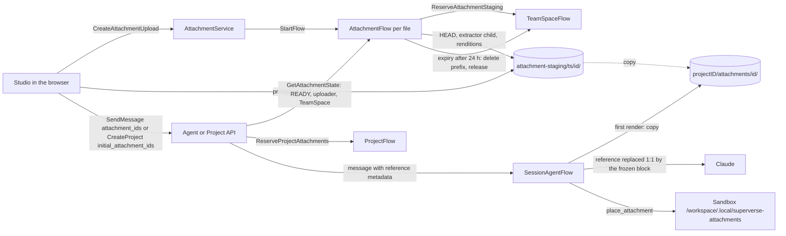

# File attachments in the chat and on the start page

A person can attach one or several files to a message: in a Project's chat composer, and on
the start page with the first message that creates a Project. The Superverse agent reads them
as part of the request:

- **Documents** (Markdown, text, Word, PDF with a text layer) are read as text.
- **Images and graphs** usually show an existing process: a flowchart, a swimlane, a
  whiteboard photo, a screenshot of another tool. The agent reads them as a description of the
  process Dex should build, and turns what is unclear into questions on the requirements card.
- **JSON** exports of other automation tools (n8n first) are routed to the in-repo
  workflow-import guidance of the `dex-app-builder` skill, which inventories the export with a
  deterministic script in the workspace instead of summarizing it by hand.

This directory is the design, written as the finished system. Source facts were read from `main` at `0ce637705`
(2026-10-17); file and line references are to that commit.

## The pieces

| Piece | What it is | Topic |
|---|---|---|
| Upload and preparation | The browser hashes the file, normalizes images and PUTs it to object storage with a presigned URL. `AttachmentFlow`, one per file and scoped to the TeamSpace, verifies the object, runs the extractor child process (shared with KNOW), redacts secrets in JSON, writes immutable renditions and keeps the attachment READY for 24 hours. `TeamSpaceFlow` holds the staging quota. | [upload-and-preparation.md](upload-and-preparation.md) |
| The conversation | A sent attachment is a small `superverse_attachment` reference block in the user entry. Every model call replaces each reference 1:1 with its frozen rendition, the exact Claude block, copied into the Project on first use. Segment opening re-renders the pending request's attachments; budgets, compaction, caching and remote mode are defined here, with `read_attachment` and `place_attachment`. `ProjectFlow` holds the lifetime quota. | [conversation.md](conversation.md) |
| API and Studio | `AttachmentService` (four RPCs), the new fields of `SendMessage`, `CreateProject` and `AgentMessage`, authorization, configuration, the composer chips, the start page, history, infrastructure and packages. | [api-and-studio.md](api-and-studio.md) |

## Principles

- **Bytes never enter Dex state or the business protocol.** The browser writes to storage by
  presigned PUT; Flows hold object references, sizes, digests and counts. The Studio BFF
  accepts no `bytes` field and at most 1 MiB of JSON per request
  (`web/studio/lib/server/rpc/request-decoder.ts:26,155-173`,
  `web/studio/lib/server/request-body.ts:89-91`), and stays that way.
- **One owner per fact.** An attachment's lifecycle and preparation belong to its
  `AttachmentFlow`; the staging quota to `TeamSpaceFlow`; the Project's lifetime quota to
  `ProjectFlow`; what the model saw to the Session's entries; the bytes to immutable objects.
  Nothing is mirrored into SQL.
- **What the model sees is frozen.** A rendition is the exact Claude content block, written
  once by preparation under its content digest. Every choice that changes what is sent (which
  variant, an overflow placeholder) is made when an entry is appended or a segment opens and is
  frozen in `Entry.Blocks`, so every later call sends the same bytes: prompt caching keeps
  hitting and the thinking prefix check (`thinkingPrefixMismatch: error` in
  `cmd/superverse-server/config/native.yaml:42` and `local-kind.yaml:42`) keeps passing.
- **Content is untrusted data.** Documents, images and exports are framed as material the user
  attached, never as instructions. Secrets in JSON are removed before anything reads the file;
  the raw upload is deleted.
- **Exports are inventoried, not paraphrased.** An automation export reaches the model as a
  structural summary and a routing note; its redacted file goes to the workspace, where the
  skill's script reads it.
- **Everything is bounded:** file sizes per kind, files per message, rendered bytes and images
  per segment, staged files per TeamSpace, attachments per Project lifetime, extractor
  resources, cache memory per replica, and every wait.

## Decisions

Decided by the owner on 2026-10-17 (not reopened here):

| Decision | Consequence |
|---|---|
| Port the n8n workflow-import subskill into the in-repo skill package | ATTACHSKILL copies `workflow-import.md`, `n8n-semantics.md` and the scripts from the standalone `dex-skills` 0.40.0 into `dex-skills/dex-app-builder/`; the Superverse copy reads the connector catalog through the `connector_catalog` tool, not `curl` |
| We build KNOW's shared storage and extractor foundation, rebased onto today's tree, in coordination with the partner, who keeps the knowledge agent, notes and the Knowledge page | ATTACH builds presigned uploads, head reads, copies, `storage.browserEndpoint`, the bucket CORS rule and the extractor child in `internal/comm/fileextract` ([coordination](#coordination-with-know)) |
| A local agent (Codex in remote mode) gets text only | v1 refuses attachments while the Session runs remotely; ATTACHREMOTE later delivers documents and JSON as text renditions and still refuses images ([remote mode](conversation.md#remote-mode)) |
| A raw JSON upload is deleted once its redacted copy exists | Preparation deletes every version of the raw original right after it writes the redacted copy ([secrets](upload-and-preparation.md#json-detection-and-secret-redaction)) |
| Few E2E runs | Three pull requests now instead of nine; the implementation is one pull request that runs Local Kind and Local Native once |

Decided here because the design rules, the code or existing decisions determine them:

| Decision | Reason |
|---|---|
| Upload by presigned PUT to object storage, verified by a head read | The business protocol has no byte uploads and the BFF bounds bodies at 1 MiB; storage enforces length, SHA-256 and no-overwrite itself, and the bytes never pass through Studio or the server ([upload](upload-and-preparation.md#upload)) |
| Staging is scoped to the TeamSpace, one `AttachmentFlow` per file | The start page uploads before the Project exists: `CreateProject` derives the Project ID only when it is called (`internal/dexai/api/project.go:99`). A Flow per file gives every upload a durable owner of its quota slot, its preparation, its expiry and its deletion |
| Renditions are the exact Claude blocks, built once and stored by digest; the entry holds a reference that is replaced 1:1 | Byte-identical requests keep the cache and the thinking binding (`modelprovider/claude_client.go:158-163`); one block per reference keeps the cache anchor index of `AssembleRequest` unchanged ([substitution](conversation.md#reference-blocks-and-substitution)) |
| Copy into the Project on first render, inside the Session's model Steps; no BOUND state and no bind RPC | `sendMessage` may refuse after the API admitted (a question waits: `session/session_messages.go:839-846`), and `CreateProject` names a Project before `ProjectFlow` admits it; a copy made by the Session is fenced by Session completion, which Project deletion awaits before it deletes `<projectID>/` ([copy-on-first-render](conversation.md#copy-on-first-render)) |
| No synced `attachments` table; upload status comes back from `CompleteAttachmentUpload`'s bounded wait | Rows of top-level Flows are never deleted (`docs/architecture/teamspace/read-model.md:58`), so a high-volume transient object would grow a table forever, and only the uploader's chips need the status (owner question 1) |
| Quotas in unsynced AttributeMaps: 200 files / 2 GiB staged per TeamSpace, 1,000 / 2 GiB per Project lifetime | Each count has one owner that serializes it; exact instance loads keep each reservation O(1); a lifetime Project quota bounds objects that stay until the Project is deleted, also after retention dropped their entries |
| The browser normalizes images to a long edge of at most 2000 px and at most 1 MiB | Above 20 images per request every image must be at most 2000 px per side; 100 images is the limit on 200k-context models such as Haiku 4.5, a Session model (`conversation/model.go:29`) ([request limits](conversation.md#budgets)) |
| Exports go to the workspace through `place_attachment` | The workflow-import reference says never summarize an export by hand and run `n8n_inventory.py inventory` on it; a deterministic script needs the file |
| Workspace path `/workspace/.local/superverse-attachments/<id>/<name>`, refused by the source gate | `.superverse/` is committed (`app-template/.superverse/template.json`), `/.local/` is ignored (`app-template/.gitignore:1`), and `commit_and_push` stages with `add --all` (`sandbox/workspace/git/commit.go:84-86`); `.gitignore` is user-editable, so the gate also refuses the path ([place_attachment](conversation.md#place_attachment)) |
| `read_attachment` is a read-only platform tool behind `ProjectDiagnosticsReader` | It reads only the Session's own Project and never the workspace, which is exactly that category (`session/session_agent_flow_dependency.go:80`), so it needs no rule change; only `place_attachment` does |
| The attachment list travels in the sender envelope, not in a text block of its own | A second text block in a user entry breaks the public projection, which requires the entry text to be exactly the envelope (`conversation/entry.go:311-316`), and the pending-request quote (`conversation/messages.go:80-85`) |
| References count their estimated context tokens, not their rendered bytes, in the compaction estimate | The trigger divides appended bytes by four (`agentloop/context_segment.go:105-107`); a 1 MiB image renders as about 1.4 MB of base64, which would read as 350,000 tokens instead of at most 4,784 and force an immediate compaction ([accounting](conversation.md#accounting)) |
| A first message with an automation export skips closest-example matching | The export, not an example, is the behavior authority of the import; matching reads only the text (`internal/dexai/api/project.go:100-108,133-144`) |
| The extractor is `internal/comm/fileextract`, a child process of the server binary | It is domain-free and shared by attachments and KNOW; `internal/dexai/agents` is at its sub-package limit once `knowledge` and `attachments` exist, and `internal/comm/platform` is full (10 sub-packages) |
| Formats `n8n` and `generic` first | Only n8n has a skill reference today; Make, Zapier and Power Automate wait for theirs (ATTACHFORMATS) |

Rejected alternatives:

| Alternative | Why not |
|---|---|
| **L0**: a BOUND state with a Bind RPC from the API at send, and a synced `attachments` table | A bind before admission is two-phase with no rollback (`sendMessage` can refuse after the bind) and unfenced against Project deletion (`DeleteProjectObjects` runs only after the children completed, `projects/project_flow_effects.go:172-190`); JSON would reach the prompt instead of the workspace; the table grows forever |
| **L2**: no Flow; preparation in the API handler and a bucket lifecycle rule for expiry | No durable quota owner; RPCs of up to two minutes through the BFF; the extractor slot is not durable across restarts; expiry cannot be tested locally (MinIO lifecycle timing) |
| **L3**: Claude Files API blocks (`file_id`) instead of base64 renditions | Uploads are not idempotent and cannot be looked up by key; a second store with its own retention; the data sits at the provider; remote mode cannot use it. Revisit if the 20 MiB per-segment budget binds |

## Dex Flow Changes

- **New**: `AttachmentFlow`, one per uploaded file, with its complete per-Flow contract in
  [upload-and-preparation.md](upload-and-preparation.md#attachmentflow).
- **Changed**:
  - `TeamSpaceFlow` gains the `AttachmentStaging` AttributeMap, the `AttachmentStagingTotals`
    Attribute, two RPCs and a prefix deletion in its deletion Step
    ([contract parts](upload-and-preparation.md#teamspaceflow-changes)).
  - `ProjectFlow` gains the `Attachments` AttributeMap, the `AttachmentTotals` Attribute, two
    RPCs and attachments on `SessionStartRequest`
    ([contract parts](conversation.md#projectflow-changes)).
  - `SessionAgentFlow` gains no primitive and no Flow RPC: payloads carry references, the model
    Steps resolve and copy renditions through a port, segment opening re-renders, admission
    checks attachments, and two tools join the catalog
    ([contract parts](conversation.md#sessionagentflow-changes)).
- Every other Flow: none.
- Open executions of the changed Flows replay unchanged (all additions are optional JSON
  fields, new map instances and new RPCs); before launch they are reset as usual. The generated
  graph `docs/flows/sv2-attachment-flow.json` joins the catalog and the three changed graphs
  are regenerated.

## Database Schema Changes

None. No table, column or migration. Upload status is read from the `AttachmentFlow` by the
upload commands themselves; quotas live in unsynced Flow maps; the Session is not projected.
The reasons are under [Decisions](#decisions).

## UI/UX

See [api-and-studio.md](api-and-studio.md#studio). In short:

- **Composer**: Attach (+), drag and drop on the chat and pasting images add files. Each file is
  a chip above the text with its kind, name, size and a progress ring (hashing, uploading,
  reading, ready); a failed chip says why in business language; a JSON chip says what was
  found ("n8n workflow · 12 nodes · 3 keys removed"). Send waits for every chip.
- **Start page**: the same chips on the large composer; a reload keeps the chips by ID.
- **History**: user bubbles show chips and image thumbnails; a click opens the file.
- **Local agent**: Attach is disabled with "Attachments work with the Superverse agent".
- **Disclosure** at the first attach: "Files are read by the AI model to understand your request."

## Tests

Real dependencies only (Dex, PostgreSQL, MinIO, the extractor child, the Sandbox), with the
mock model as the one substitute:

- Dex integration tests of each changed Flow, listed with its contract: identity and replays,
  the last-quota-slot race, presigned PUTs against MinIO (wrong length, wrong digest, second
  PUT), expiry deleting every version, a Worker restart during preparation or during the copy,
  and a Project deleted with a queued attachment message leaving no object.
- Corpora run through the real extractor child: synthetic JSON exports for redaction, image
  probes, documents shared with KNOW.
- Three mock scenarios, each launched by a Dex test: `attachment-image`,
  `attachment-document` and `attachment-workflow-import` ([scenarios](conversation.md#mock-scenarios)).
- gRPC boundary tests of `AttachmentService` authorization; every new RPC gets its recorded
  invocation for `make check-rpc-coverage`.
- E2E: the `create-project` case attaches one PNG and one n8n JSON on the start page through
  the real presigned PUT; the three cases stay the only E2E cases.
- Uncovered Studio paths, which no browser test drives (the coverage map credits their files to
  `create-project.spec.ts` because that case loads them, not because it runs these branches):
  removing a chip and its `DeleteAttachment`; a reload that restores remembered chips and checks
  them again; the 403 that asks for a fresh upload URL; drop and paste; a message with
  attachments from the Session composer, and from the mock composer while it steers a timer
  wait; taking a queued message back into the tray; the tray locked while a send runs, with a
  file added meanwhile kept for the next message; a ready chip that expires while the page stays
  open, and the chips checked again after a refused send; the focus after a removal and the
  announcements of an empty tray; and the local agent's disabled Attach. The four
  `AttachmentService` RPCs are recorded by `api-integration` tests through the gRPC API, not
  through Studio.
- Unverified until AWS or a real-model run: the S3 CORS rule and checksum headers on S3, the
  quality of image reading, and the live cache check with images.
- Uncovered invariants, which no real-dependency test drives yet: messages steered together whose
  attachments overflow the segment (each of them is the pending request and is shown again by the
  compaction, and one never shown is listed as never shown) needs a lane with a small
  `attachments.segmentImages`; and the configuration's bound of one message by the segment
  (`conversation.MessageAttachmentBytes`) is checked only by `make check-config` on the profiles,
  besides the upload test's check of a real image block against `imageBlockBytes`.

## Documentation

- This directory owns the design. Updated with the implementation:
  [superverse-v2.md](../superverse-v2.md) (the Flow table and package rows),
  [start-flow-admission.md](../start-flow-admission.md) (one StartFlow call site),
  [resource-grpc.md](../../api/resource-grpc.md) (the service and fields),
  [context management](../agent-harness-design/context-management.md) (reference blocks,
  segment opening, accounting), [tool orchestration](../agent-harness-design/tool-orchestration.md)
  (the two tools, the source gate code), [session](../agent-harness-design/session.md)
  (admission), [infrastructure](../teamspace/infrastructure.md) (CORS, the browser endpoint,
  shared with KNOW), the server configuration reference, the package READMEs, the mock model
  README and decision 0010's package list.
- KNOW gets rebased paths and a Resource Scalability section from us as a proposal;
  its storage and extractor sections point at the shared pieces. We do not edit its branch.
- **Rule amendment**, approved by the owner on 2026-10-18 and applied to AGENTS.md, CLAUDE.md and
  `.cursor/rules/planning.mdc` together: the normal-path Sandbox sentence gains "and, for
  `place_attachment`, the Session's own Project's attachment objects in storage".

## Resource Scalability

In summary:

- **Per upload**: one `AttachmentFlow` (complete within 25 hours, closed kept 30 days) and at
  most five objects under `attachment-staging/<teamSpaceID>/<attachmentID>/`, deleted when the
  Flow ends; at most 200 files and 2 GiB staged per TeamSpace.
- **Per sent attachment**: at most four copied objects and a manifest under
  `<projectID>/attachments/<attachmentID>/`, deleted with the Project by the unchanged
  `DeleteProjectObjects` (`internal/comm/platform/objectstore/cleanup.go:29-36`); at most 1,000
  attachments and 2 GiB per Project lifetime, so 10,000 Projects hold at most about 20 TiB.
- **Per model request**: at most 20 MiB of attachment blocks and 60 images per segment, under
  the 32 MB request and 100-image limits.
- **Hot path**: presigning is local signing; one head read per upload; one ProjectFlow RPC and at
  most ten retained Flow reads per message with attachments; renditions come from a bounded
  per-replica cache keyed by digest. No control-plane call per request and no scan across
  tenants. No new bucket, IAM role or Kubernetes object; one CORS rule on the existing bucket.

## Coordination with KNOW

KNOW is the partner's knowledge-base design (`docs/architecture/knowledge/`, not yet merged). Both designs need presigned uploads and text
extraction; the owner decided on 2026-10-17 that we build the shared foundation.

| Piece | Who | Notes |
|---|---|---|
| `objectstore` presigned PUT and GET, head read with checksum, server-side copy | ATTACH | KNOWSTORE's storage part; KNOW uses it unchanged |
| `storage.browserEndpoint` | ATTACH | Local Kind uses the existing `kind ports` MinIO forward (`infra-as-code/scripts/kind/cluster.py:50`), so no gateway route is needed; KNOW's `local-preview-gateway` route is stale (Local Kind routes only Project hosts through the project Gateway, `infra-as-code/scripts/chart_validation.py:443-446`) |
| The artifact bucket's CORS rule | ATTACH | One rule for `PUT`, `GET` and `HEAD` from the Studio origin; KNOW adds nothing |
| The extractor child (`superverse-server file-extract`) and `internal/comm/fileextract` | ATTACH | KNOW's four document readers, limits and corpus, moved from `internal/agents/knowledge/extract`; the server Pod's memory limit grows by 1 GiB once |
| `knowledgedao`, the migration, `KnowledgeDocumentFlow`, the knowledge agent, notes, the Knowledge page, the Session tools | KNOW | Unchanged ownership |
| Saving a document attachment to team knowledge | ATTACHKNOW, after KNOWDOCS | `CreateKnowledgeUpload` gains an attachment source; its `KnowledgeDocumentFlow` copies the Project's copy of the original instead of waiting for a browser PUT |

KNOW's paths predate the `internal/comm` and `internal/dexai` move. The rebased names we
propose to its author: `internal/agents/knowledge` → `internal/dexai/agents/knowledge`,
`internal/platform/objectstore` → `internal/comm/platform/objectstore`,
`internal/tenancy/connectiondao` → `internal/dexai/tenancy/connectiondao`,
`internal/api/tenancy` → `internal/dexai/api/tenancy`, `internal/bootstrap` →
`internal/dexai/bootstrap`, the extractor → `internal/comm/fileextract`, and the
`knowledge-extract` subcommand → `file-extract`.

## Owner decisions and open questions

Decided by the owner on 2026-10-18:

1. **Upload status without a SQL table.** `CompleteAttachmentUpload` waits a bounded time for
   READY or FAILED, and Studio repeats it after a reload.
2. **The AGENTS.md amendment for `place_attachment`** (a Sandbox tool that also reads the
   Project's attachment objects from storage) is approved and applied.
3. **Caps**, kept as configuration: 200 files / 2 GiB staged per TeamSpace; 1,000 / 2 GiB per
   Project lifetime; 10 files per message; images at most 1 MiB and 2000 px; documents at most
   20 MiB; JSON at most 4 MiB; 20 MiB and 60 images per segment.
4. **Public documentation.** This README and the three contract documents are public; the
   roadmap stays private, and public documents do not link to it.

Still open:

5. **Sending files to the model provider.** Images and document text are sent to Anthropic with
   the request. Studio shows a one-line disclosure at the first attach; the product's privacy
   terms should say it too.
6. **Later**: a visual PDF mode (pages as images) for scanned or diagram-heavy PDFs, and
   attaching export JSON that a person pastes as text. Recommendation: not in v1.
