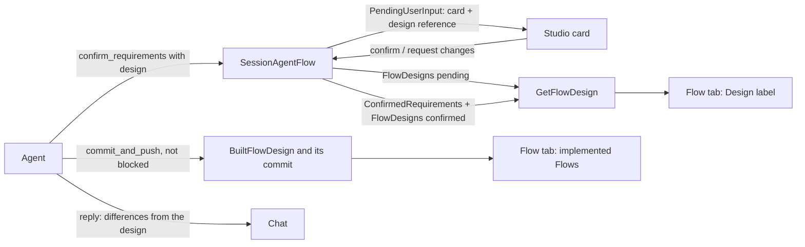

# Design before implementation

Before the agent builds a new application or a large change, the person confirms a
requirements card ([session](../agent-harness-design/session.md#requirements-confirmation)).
This design adds the agent's Flow design to that card: the Flows it will add or change,
drawn as Flow graphs with the same renderer Studio uses for implemented Flows, and a short
design summary. The person confirms the requirements and the design together, in the one
confirmation that already exists. From the card until the build is complete, the Flow tab
draws the designed Flows, labeled Design; then the implemented Flows replace them. The agent
names in the chat how what it built differs from the design. Nothing blocks on a difference.

## The pieces

| Piece | What it is | Topic |
|---|---|---|
| Flow design | A compact, typed description of the proposed Flows: Steps with their groups and explanations, what each Step waits for, the transitions between Steps, Channels, Actions and Attributes, and which feature (R1, R2...) each Step serves. It is an optional `design` part of `confirm_requirements`, which the server validates. | [flow-design.md](flow-design.md) |
| Storage and API | `SessionAgentFlow` owns the design. The card and the confirmed requirements carry a small reference (digest and outline). The body lives in a two-instance AttributeMap `FlowDesigns` (`pending`, `confirmed`) that one read RPC serves. | [flow-design.md](flow-design.md#storage) |
| Rendering and confirmation | Studio expands the design into an FDG 2.0-shaped graph and draws it on the Flow tab in place of the Flows it changes, outside the Flow Definition catalog, under a Design label. Each Step is marked new or changed against the current source. The card keeps its two actions. | [studio.md](studio.md) |
| Build completion | A pushed, unblocked `commit_and_push` marks the confirmed design built. Once the Preview's processes are built from that push, the implemented Flows replace the design on the Flow tab. | [flow-design.md](flow-design.md#build-completion) |
| Differences | When the build is complete, the agent compares what it built with the confirmed design and names each difference in its reply. Studio draws no comparison. | [studio.md](studio.md#differences-between-the-build-and-the-design) |

## Dex Flow Changes

Only `SessionAgentFlow` changes. It gets one AttributeMap (`FlowDesigns`), two Attributes
(`BuiltFlowDesign` and `BuiltFlowDesignCommit`) and one read RPC (`GetFlowDesign`). `RouteTool`, `AnswerQuestions` and
the commit of a `commit_and_push` result change their effects. The full per-Flow
contract of the changed parts is in [flow-design.md](flow-design.md#per-flow-contract-sessionagentflow).
Every other Flow: None. No new Flow exists; the design is a fact of the Session, and nothing
about it has a lifecycle of its own.

## Database Schema Changes

None. The Session is not projected ([read model](../teamspace/read-model.md#flows-that-are-not-projected)).
The design is read by FlowID, one Session at a time, through `GetFlowDesign`. A future
cross-Project view of designs would have to justify a projection on its own.

## UI/UX

See [studio.md](studio.md). In short:

- The requirements card adds a **Design** part: the design summary and outline, one line per
  Flow of what it changes (new, changed or removed, with the Steps and Actions that change),
  and **Open design**, a link to the Flow tab.
- From the card until the build is complete, the Flow tab draws the designed Flows in place
  of the ones they change, under a label: "Design · waiting for your confirmation", then
  "Design · building", then "Design · built, building processes". Steps are marked new or
  changed, and the Step panel shows the explanation, the wait, the ways out and the features
  the Step serves. There is no switch. Designed Flows are tagged in the Flow picker.
- A card that arrives while the Flow tab is open shows there at once; on another tab the
  Flow tab's entry carries a **Design** marker.
- When the build is complete and its processes are built, the implemented Flows replace the
  design. The agent's reply names any difference from the design. The canvas never does.
- **Confirmed requirements** show the confirmed design's summary and outline as text.

## Tests

Superverse's test policy applies: real dependencies, the mock model as the only substitute,
and no unit tests. The changed tool needs mock scenarios
that drive it (`make check-mock-scenarios`).

| Test | What it proves |
|---|---|
| `summary-approval` scenario, extended | Its card carries a design of `TextSummaryFlow` with `AwaitSummaryApproval`, the `SummaryApprovals` Channel and the `Approve summary` Action. That is exactly what the scenario then implements, so the agent's final reply says it built the design as confirmed. `RecordSummaryUncertainty` is a failure route on both sides, so the design view and the implementation both hide it, and the outline ends with "+1 failure-handling Step". |
| New scenario `design-revised` and `TestSessionMockDesignRevisedDexIntegration` | Card 1 stores the `pending` design, and the Snapshot's reference has its digest. `GetFlowDesign` returns the body with that digest. A request for changes leaves nothing confirmed. Card 2 replaces `pending`. The confirmation copies it to `confirmed` in the commit that writes `ConfirmedRequirements`, whose design reference matches, and `design_built` is false. A compaction's `segment_start` carries the outline. A blocked `commit_and_push` leaves `design_built` false. |
| `TestSessionMockSummaryApprovalDesignBuiltDexIntegration` | The `summary-approval` push through the commit gate, pushed and unblocked, makes `design_built` true with `design_built_commit` the pushed head, and the final reply says the design was built as confirmed. |
| New scenario `design-refused` and `TestSessionMockDesignRefusedDexIntegration` | A transition to an undeclared Step, an unreachable Step, a wait on an undeclared Channel, a feature ID the card lacks and an oversized design are each refused with `invalid_user_input` and no pending input. The corrected card is admitted. |
| `TestSessionMockRequirementsCardDexIntegration`, unchanged | A card without a design behaves as before. Its reference is absent, and `GetFlowDesign` answers NOT_FOUND. |
| `template-approval.spec.ts`, extended (Native lane) | With the Flow tab open, the card arrives and the tab shows `TextSummaryFlow` from the design at once, under "Design · waiting for your confirmation", compared with the template's initial design: the Result stage is marked changed, `AwaitSummaryApproval` in it new and `GenerateSummary` changed, with no Runs or Start; the card says "TextSummaryFlow · changed: adds AwaitSummaryApproval, Approve summary; changes GenerateSummary". Confirm: the label says "Design · building". After the push and the automatic process build, the implemented `TextSummaryFlow` replaces the design: its Result stage carries no mark and the label is gone. |

The comparator and the design view are Studio code. The extended spec covers them and records
them in the Studio coverage map. No new E2E case exists. Whether the agent names a difference
is the real model's behavior under the prompt; the mock scenarios script the reply, so only a
real-model run checks it.

## Documentation

- [Agent harness session](../agent-harness-design/session.md): the requirements
  confirmation section, the Attribute table (`FlowDesigns`, `BuiltFlowDesign`,
  `BuiltFlowDesignCommit`, the design reference), the RPC list (`GetFlowDesign`) and the large/small change rule for
  design-only deviations.
- [Streaming and Studio](../agent-harness-design/streaming-and-studio.md#requirements-card):
  the card's Design part and the Flow tab's design view.
- [Resource API contract](../../api/resource-grpc.md),
  [agent transport parity](../../api/agent-transport-parity.md) and
  `api/superverse/v2/superverse.proto`: `AgentService.GetFlowDesign` and the design messages.
- `docs/flows/sv2-session-agent-flow.json`, regenerated.
- The Session prompt (`internal/agents/session/conversation/prompts/v1/session.md`), the
  in-repo `dex-skills/dex-app-builder` (`SKILL.md`, `references/product-discovery.md`
  "Confirmation artifact"). `app-template/AGENTS.md` stays as it is: it is at the size the
  agent's repository context inlines, and the skill carries the rules. The design guidance quotes the rules of
  `dex-skills/dex-app-builder/references/fdg-authoring.md` rather than restating them: a
  group of two or more main-story Steps is one run or one choice, and `is_failure_route`
  marks breakage only, never a business rejection. The prompt, the skill and the analyzer
  then say the same thing in one pass. The prompt also tells the agent to name, when a build
  of a confirmed design is complete, every difference between what it built and the design.
- The mock model README (new scenarios), the package README of the new
  `internal/agents/session/flowdesign`, the Studio READMEs of `components/flow/design` and
  `lib/session/design`, the Studio mock README, and the test rows of
  [integration verification](../../../internal/agents/README.md).
- the current contract, recording
  decisions 1, 3 and 6 above.

## Resource Scalability

No cloud, Kubernetes, Temporal or database resource is created. The design adds Dex state per
Session (one per Project, [the current contract](../agent-harness-design/session.md)) and
one small cache per browser tab:

| Resource | Unit | Bound | Deleted |
| --- | --- | --- | --- |
| `FlowDesigns` instances | Session | two fixed keys, at most 24 KiB each | with the Session's state |
| `BuiltFlowDesign` | Session | one digest of 71 bytes | with the Session's state |
| `BuiltFlowDesignCommit` | Session | one commit SHA of 40 bytes | with the Session's state |
| Design reference in `PendingUserInput` and `ConfirmedRequirements` | Session | a digest and an outline of at most 2 KiB, inside the 16 KiB requirements bound | replaced by the next card or confirmation |
| Studio's design cache (`lib/session/design`) | browser tab | the designs read in the tab, keyed by digest | when the tab closes |
| The card version the Flow tab showed | browser | one storage key per Project | with the browser's site data |

- Hot path: the Snapshot and the Watch carry only the reference, `design_built` and
  `design_built_commit`. Studio
  reads a body through `GetFlowDesign` only to draw a design or the card's change lines, and
  a Watch frame with an unchanged reference reads nothing. `GetFlowDesign` is an unlocked
  read of one Session by its FlowID: no database read, no scan across Projects and no
  control-plane call.
- A confirmation writes one more map instance, and a pushed, unblocked `commit_and_push`
  writes one more small Attribute in a commit it already makes. No Dex call is added.
- At 10,000 Projects the designs hold at most about 480 MB of Session state, bounded per
  Session and removed with it. Nothing is created per request, event or build, and no
  per-tenant resource meets a provider quota.
