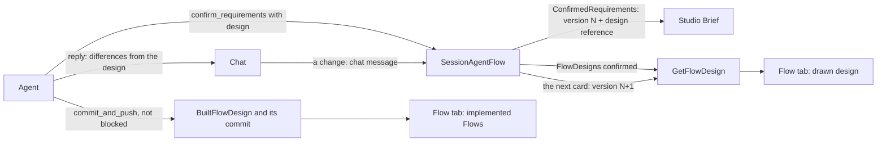

# Design before implementation

Before the agent builds a new application or a large change, it shows a requirements card
([session](../agent-harness-design/session.md#requirements-cards)), which the Session records
as the next version of the requirements while the agent goes on building; the person changes
it with a chat message.
This design adds the agent's Flow design to that card: the Flows it will add or change,
drawn as Flow graphs with the same renderer Studio uses for implemented Flows, and a short
design summary. The requirements and the design are recorded together, under one version
number. Studio shows the real flow whenever one exists, so a design is drawn only before the
first build of a Project that started from the default template, whose processes are the
template's text summary until then: from the card until the build is complete, the Flow tab
draws the designed Flows, labeled Design; then the implemented Flows replace them for good. A
change to a built Project, and every Project that started from an example, records cards
without a design and keeps the real flow, whose Steps the next build adds or changes are
marked for a moment. The agent names in the chat how what it built differs from the design.
Nothing blocks on a difference.

## The pieces

| Piece | What it is | Topic |
|---|---|---|
| Flow design | A compact, typed description of the proposed Flows: Steps with their groups and explanations, what each Step waits for, the transitions between Steps, Channels, Actions and Attributes, and which feature (R1, R2...) each Step serves. It is an optional `design` part of `confirm_requirements`, which the server validates. | [flow-design.md](flow-design.md) |
| Storage and API | `SessionAgentFlow` owns the design. The current requirements (the Attribute `ConfirmedRequirements`) carry a small reference (digest and outline). The body lives in the AttributeMap `FlowDesigns` under the one key `confirmed`, which one read RPC serves. | [flow-design.md](flow-design.md#storage) |
| Rendering | Studio expands the design into an FDG 2.0-shaped graph and draws it on the Flow tab in place of the Flows it changes, outside the Flow Definition catalog. Each Step of a process the current source holds is marked new or changed against it. While the design is built, the card's Process Brief is the title and status on the canvas's corner and the summary with More details under it. | [studio.md](studio.md) |
| Build completion | A pushed, unblocked `commit_and_push` marks the current design built. Once the Preview's processes are built from that push, the implemented Flows replace the design on the Flow tab. | [flow-design.md](flow-design.md#build-completion) |
| Differences | When the build is complete, the agent compares what it built with the current design and names each difference in its reply. Studio draws no comparison. | [studio.md](studio.md#differences-between-the-build-and-the-design) |

## Dex Flow Changes

Only `SessionAgentFlow` changes. It gets one AttributeMap (`FlowDesigns`), three Attributes
(`BuiltFlowDesign`, `BuiltFlowDesignCommit` and `WrittenDesignSteps`), one read RPC (`GetFlowDesign`)
and one Stream (`RequirementsDraft`, the drafts of a card the model writes). `RouteTool`,
`CallModel` and the commit of a `commit_and_push`, `write` or `edit` result change their effects. The full per-Flow
contract of the changed parts is in [flow-design.md](flow-design.md#per-flow-contract-sessionagentflow).
Every other Flow: None. No new Flow exists; the design is a fact of the Session, and nothing
about it has a lifecycle of its own.

## Database Schema Changes

None. The Session is not projected ([read model](../teamspace/read-model.md#flows-that-are-not-projected)).
The design is read by FlowID, one Session at a time, through `GetFlowDesign`. A future
cross-Project view of designs would have to justify a projection on its own.

## UI/UX

See [studio.md](studio.md). In short:

- A requirements card with a design draws on the Flow tab, which the canvas fills. While the
  design is built its **Process Brief** is small: the title and "Building · N of M steps
  written" on the canvas's corner, the card's one-line summary under the canvas, and one
  **More details** with what to set up, who decides, what starts it, the rules, the features,
  how it is accepted and, nested, the Go names and what it changes. Nothing waits for a
  confirmation, and a person changes the card only with a chat message. The chat shows each
  recorded version once, as one line where the agent recorded it, which opens to the card.
- While the agent writes the card, the Flow tab shows "Drafting" with the draft's main-story
  Step names as a row of dashed boxes and the summary as it arrives, with no drawing.
- From the card until the build is complete, the Flow tab draws the designed Flows in place
  of the ones they change. Steps of a process the project already has are marked new or
  changed (a first design carries no marks), a Step whose code is not written yet is dashed,
  and the Step panel shows the explanation, the wait, the ways out and the features the Step
  serves. There is no switch. Designed Flows are tagged in the Flow picker.
- A card that arrives while the Flow tab is open shows there at once; on another tab the
  Flow tab's entry carries a **Design** marker.
- Once the design is built, the Brief's corner, line and More details go and the drawing stands
  alone; when its processes are built, the implemented Flows replace the design. The agent's
  reply names any difference from the design. The canvas never does.
- After that first build, and for a Project that started from an example, no design is drawn:
  while a change runs the Flow tab keeps the last built flow under the Build processes strip,
  and when the change's push is built it marks the Steps the build added or changed for a moment
  ([after the first build](studio.md#after-the-first-build)).

## Tests

Superverse's test policy applies: real dependencies, the mock model as the only substitute,
and no unit tests. The changed tool needs mock scenarios
that drive it (`make check-mock-scenarios`).

| Test | What it proves |
|---|---|
| `summary-approval` scenario, extended | Its card carries a design of `TextSummaryFlow` with `AwaitSummaryApproval`, the `SummaryApprovals` Channel and the `Approve summary` Action. That is exactly what the scenario then implements, so the agent's final reply says it built the design as recorded. `RecordSummaryUncertainty` is a failure route on both sides, so the design view and the implementation both hide it, and the outline ends with "+1 failure-handling Step". |
| Scenario `design-revised` and `TestSessionMockDesignRevisedDexIntegration` | Card 1 records version 1 with its design in `confirmed`, and the Snapshot's reference has its digest; the turn goes on to a durable timer. `GetFlowDesign` returns the body with that digest. A change sent and steered interrupts the timer and makes card 2, which records version 2 and replaces `confirmed` in the commit that writes `ConfirmedRequirements`, whose design reference matches, so the first digest reads as changed, and `design_built` is false. A compaction's `segment_start` carries the outline. The next push traces version 2: a trace of version 1 is refused, and the blocked `commit_and_push` of version 2 leaves `design_built` false. |
| `TestSessionMockSummaryApprovalDesignBuiltDexIntegration` | The `summary-approval` push through the commit gate, pushed and unblocked, makes `design_built` true with `design_built_commit` the pushed head, and the final reply says the design was built as recorded. The edit that declares `type AwaitSummaryApproval struct` marks `TextSummaryFlow.AwaitSummaryApproval`, and only it, written; the card, streamed at 100 ms per delta, wrote several drafts to `RequirementsDraft` before it was recorded, the last one complete with its call, title and six designed Steps. Input 2, a change after that first build, records version 2 without a design: the built design is not carried onto it, so the reference is absent, `GetFlowDesign` of the old digest answers NOT_FOUND, and the segment a compaction opens carries `<card_design>` and no `Flow design:` line; its push traces version 2. |
| Scenario `design-refused` and `TestSessionMockDesignRefusedDexIntegration` | A transition to an undeclared Step, an unreachable Step, a wait on an undeclared Channel, a feature ID the card lacks and an oversized design are each refused with `invalid_user_input` and record no version. The corrected card is recorded. |
| `TestSessionMockRequirementsCardDexIntegration`, unchanged | A card without a design behaves as before. Its reference is absent, and `GetFlowDesign` answers NOT_FOUND. |
| `template-approval.spec.ts`, extended (Native lane) | While the card streams, the Flow tab, switched from the first conversation, shows "Drafting" with the designed Steps' names. Once the card is recorded the tab shows `TextSummaryFlow` from the design at once, with "Building · N of 6 steps written" on its corner, compared with the template's initial design: the Result stage is marked changed, `AwaitSummaryApproval` in it new and `GenerateSummary` changed, with no Runs or Start; the summary line reads the card's summary and its More details keep the outline and "Text summary · changed: adds Await summary approval, Approve summary; changes Generate summary"; the chat shows "Recorded version 1: Summary approval", which opens to the card. After the scripted edit the design reads "6 of 6 steps written" and `AwaitSummaryApproval` is solid. The first input builds on: once the push built the design the overview is gone, and after the automatic process build the implemented `TextSummaryFlow` replaces the design: its Result stage carries no mark. Last, on the mock model, a change after that first build (input 2, automatic builds off) records version 2 without a design; while its push is unbuilt the Flow tab keeps the built `TextSummaryFlow` with no design, phase, Brief or marker, and once Build processes builds it the reworded `AwaitSummaryApproval` (or its closed Result stage) is marked changed for a moment. |

The comparator and the design view are Studio code. The extended spec covers them and records
them in the Studio coverage map. No new E2E case exists. Whether the agent names a difference
is the real model's behavior under the prompt; the mock scenarios script the reply, so only a
real-model run checks it.

## Documentation

- [Agent harness session](../agent-harness-design/session.md): the requirements
  card section, the Attribute table (`FlowDesigns`, `BuiltFlowDesign`,
  `BuiltFlowDesignCommit`, the design reference), the RPC list (`GetFlowDesign`) and the large/small change rule for
  design-only deviations.
- [Streaming and Studio](../agent-harness-design/streaming-and-studio.md#requirements-card):
  the card, its Process Brief and the Flow tab's design view.
- [Resource API contract](../../api/resource-grpc.md),
  [agent transport parity](../../api/agent-transport-parity.md) and
  `api/superverse/v2/superverse.proto`: `AgentService.GetFlowDesign` and the design messages.
- `docs/flows/sv2-session-agent-flow.json`, regenerated.
- The Session prompt (`internal/dexai/agents/session/conversation/prompts/v1/session.md`), the
  in-repo `dex-skills/dex-app-builder` (`SKILL.md`, `references/product-discovery.md`
  "Confirmation artifact", which still ask for a design on every card that changes Flows: the
  prompt and the `confirm_requirements` tool text own the first-build rule until the skill's
  follow-up with its coding image). The examples' `AGENTS.md` (`app-template/examples/<id>/`) stay as they are: each is at the size the
  agent's repository context inlines, and the skill carries the rules. The design guidance quotes the rules of
  `dex-skills/dex-app-builder/references/fdg-authoring.md` rather than restating them: a
  group of two or more main-story Steps is one run or one choice, and `is_failure_route`
  marks breakage only, never a business rejection. On these group and failure-route rules the
  prompt, the skill and the analyzer then say the same thing in one pass. The prompt also tells the agent to name, when a build
  of a recorded design is complete, every difference between what it built and the design.
- The mock model README (new scenarios), the package README of the new
  `internal/dexai/agents/session/flowdesign`, the Studio READMEs of `components/flow/design` and
  `lib/session/design`, the Studio mock README, and the test rows of
  [integration verification](../../../internal/dexai/agents/README.md).
- the current contract, recording
  decisions 1, 3 and 6 above.

## Resource Scalability

No cloud, Kubernetes, Temporal or database resource is created. The design adds Dex state per
Session (one per Project, [the current contract](../agent-harness-design/session.md)) and
one small cache per browser tab:

| Resource | Unit | Bound | Deleted |
| --- | --- | --- | --- |
| `FlowDesigns` instances | Session | one fixed key (`confirmed`), at most 24 KiB; a Session that waited at a card before cards stopped waiting may also hold `pending` until its next card deletes it | with the Session's state |
| `BuiltFlowDesign` | Session | one digest of 71 bytes | with the Session's state |
| `BuiltFlowDesignCommit` | Session | one commit SHA of 40 bytes | with the Session's state |
| Design reference in `ConfirmedRequirements` | Session | a digest and an outline of at most 2 KiB, inside the 16 KiB requirements bound | replaced by the next card |
| Studio's design cache (`lib/session/design`) | browser tab | the designs read in the tab, keyed by digest | when the tab closes |
| The card version the Flow tab showed | browser | one storage key per Project | with the browser's site data |

- Hot path: the Snapshot and the Watch carry only the reference, `design_built` and
  `design_built_commit`. Studio
  reads a body through `GetFlowDesign` only to draw a design or the card's change lines, and
  a Watch frame with an unchanged reference reads nothing. `GetFlowDesign` is an unlocked
  read of one Session by its FlowID: no database read, no scan across Projects and no
  control-plane call.
- A card with a design writes the one map instance in the commit that records it, and a
  pushed, unblocked `commit_and_push` writes one more small Attribute in a commit it already
  makes. No Dex call is added.
- At 10,000 Projects the designs hold at most about 240 MB of Session state, bounded per
  Session and removed with it. Nothing is created per request, event or build, and no
  per-tenant resource meets a provider quota.
