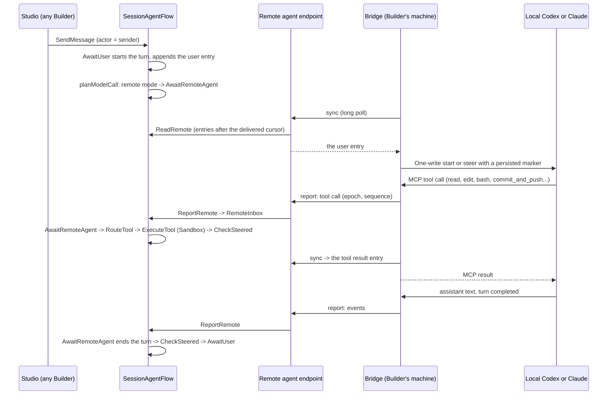

# Remote agent and shared Sessions

A Builder can work on a Project with their own coding agent instead of the platform's model.
The supported local agents are **Codex and Claude Code**, connected by the macOS `dexai` command on the Builder's machine. The platform keeps everything that makes the work shared and safe: the
Project's one Session and its conversation, the Sandbox the code lives in, the commit gate, the
Preview, delivery feedback, and the record of who said and did what. The local agent reasons; every
file read, edit, command and commit runs in the Project's Sandbox through the platform's own
tools, so a teammate who takes over continues from the same code without merging anyone's local
work.

The same pull requests make the Session explicitly multi-person: every message, answer, Stop
and setting change records the person who made it, and the model (the platform's or the
connected local agent) sees who wrote each message.

This directory describes the design in its finished form. The package READMEs own each Flow's complete contract
once the code exists, and the Session's base contract stays in
[agent harness: session](../agent-harness-design/session.md); the documents here state only
what changes.

## The pieces

| Piece | What it is | Topic |
|---|---|---|
| Executor | Who runs the Session's turns: the platform model or one connected remote agent. One `Executor` Attribute on `SessionAgentFlow` with a monotonically increasing epoch; one Step, `AwaitRemoteAgent`, replaces the model call in remote mode; everything else (turns, tools, Stop, questions, notifications, Preview handoff) is the existing Session machinery. | [executor](executor.md) |
| Connection | Pairing a Bridge to a Project with a one-time code from Studio, the connection credential (one PostgreSQL table, hashed tokens), the remote agent endpoint the Bridge calls, takeover and revocation. | [connection](connection.md) |
| Bridge | `dexai`: a private Go command that drives the Builder's Codex daemon or Claude headless process, owns one foreground connection and serves platform tools through a local MCP server. | [bridge](bridge.md) |
| Collaboration | Actors on messages, answers, Stop, settings and Preview commands; how the sender reaches the model without being forgeable; permissions among Builders; Studio's author lines. | [collaboration](collaboration.md) |
| Run feedback | Failures of application Runs that belong to the current development (started from Studio's Preview Runs or registered by the agent) reach the Session as notifications, in both executor modes. | [run feedback](run-feedback.md) |
| Composition | Every new and changed package, its responsibility and level, configuration keys, the listener, and the wiring. | [composition](composition.md) |

## How a remote turn works

- **One executor at a time.** The `Executor` Attribute names the platform model or exactly one
  remote connection and carries an epoch. Every remote report names its epoch; the Flow refuses
  any other in the same commit that would act on it, so an old Bridge that is still running
  cannot write after a takeover.
- **The platform never calls a model in remote mode.** `planModelCall` returns
  `AwaitRemoteAgent` before any segment, compaction or model step; the tools that start
  platform subagents are not offered to the remote agent.
- **Tools run where they always run.** A remote tool call becomes a pending tool call of the
  turn and goes through `RouteTool` and `ExecuteTool` with the accepted workspace lease, the
  command ledger, the existing timeouts, parallel read-only waves and failure handling.
- **The conversation stays the record.** Messages, answers, tool calls, tool results and the
  remote agent's public replies are conversation entries in `CurrentMessages` and
  `ArchivedMessages`; Studio and the Bridge read the same entries.

## Current behavior

Each `dexai connect` creates an independent foreground connection. Exiting it
revokes only that connection; other connections continue. The Project remains
remote and offline until explicitly reconnected or switched in Studio.

Remote mode never falls back to the platform model. The local provider owns
its model credentials and private history. The platform owns shared messages,
actor attribution, tool admission, Sandbox effects and immutable Preview
publication. One-write delivery reconciles ambiguous effects through exact
public-history markers and never automatically resends an uncertain write.

Studio asks the Builder to acknowledge local model execution and the risk that
shared messages or untrusted application failure text can reach that agent.
Every Project tool call remains subject to the server's Project and executor
checks. The client supplies no platform model or platform subagent fallback.

## Principles

- **Reuse the Session.** Remote mode adds the smallest set of primitives that the remote agent
  needs (see [executor: why these primitives](executor.md#why-these-primitives-and-no-others))
  and changes no existing Step's identity.
- **One owner per fact.** The Session owns the executor, the conversation and every tool
  outcome; PostgreSQL owns connection credentials and liveness; the local provider owns private
  reasoning and its local history, which the platform never stores.
- **The platform proves effects, not the agent.** Commits, pushes, Preview deployments and test
  results are recorded by the platform's own tools; nothing is inferred from what the local agent says.
- **Everything is bounded.** The inbox, open tool calls, imported history, event batches,
  long polls and connections per server replica have fixed limits.

## Related documents

- [Agent harness design](../agent-harness-design/README.md): the Session, tools, Sandbox,
  notifications and Studio that remote mode reuses.
- [TeamSpace](../teamspace/README.md): accounts, Project roles and the SQL read model the
  connection authorizes against.
- [Superverse V2 architecture](../superverse-v2.md) and [StartFlow admission](../start-flow-admission.md).
