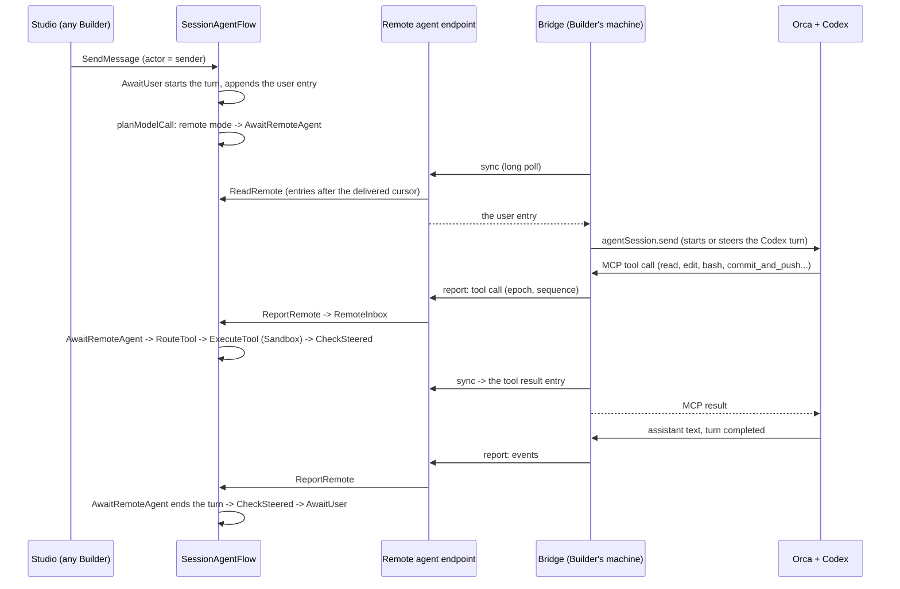

# Remote agent and shared Sessions

A Builder can work on a Project with their own coding agent instead of the platform's model.
The first and only supported agent is **Codex running inside Orca** on the Builder's machine
(or a machine they run). The platform keeps everything that makes the work shared and safe: the
Project's one Session and its conversation, the Sandbox the code lives in, the commit gate, the
Preview, delivery feedback, and the record of who said and did what. Codex only reasons; every
file read, edit, command and commit runs in the Project's Sandbox through the platform's own
tools, so a teammate who takes over continues from the same code without merging anyone's local
work.

The same pull requests make the Session explicitly multi-person: every message, answer, Stop
and setting change records the person who made it, and the model (the platform's or the
connected Codex) sees who wrote each message.

This directory describes the design in its finished form. The package READMEs own each Flow's complete contract
once the code exists, and the Session's base contract stays in
[agent harness: session](../agent-harness-design/session.md); the documents here state only
what changes.

## The pieces

| Piece | What it is | Topic |
|---|---|---|
| Executor | Who runs the Session's turns: the platform model or one connected remote agent. One `Executor` Attribute on `SessionAgentFlow` with a monotonically increasing epoch; one Step, `AwaitRemoteAgent`, replaces the model call in remote mode; everything else (turns, tools, Stop, questions, notifications, Preview handoff) is the existing Session machinery. | [executor](executor.md) |
| Connection | Pairing a Bridge to a Project with a one-time code from Studio, the connection credential (one PostgreSQL table, hashed tokens), the remote agent endpoint the Bridge calls, takeover and revocation. | [connection](connection.md) |
| Bridge | `superverse-bridge`: a Go program in this repository that the Builder runs next to Orca. It holds the connection, drives the Orca session over Orca's structured `agentSession` protocol, and serves the Superverse tools to Codex as a local MCP server. An Orca plugin starts it and shows its state. | [bridge](bridge.md) |
| Collaboration | Actors on messages, answers, Stop, settings and Preview commands; how the sender reaches the model without being forgeable; permissions among Builders; Studio's author lines. | [collaboration](collaboration.md) |
| Run feedback | Failures of application Runs that belong to the current development (started from Studio's Preview Runs or registered by the agent) reach the Session as notifications, in both executor modes. | [run feedback](run-feedback.md) |
| Composition | Every new and changed package, its responsibility and level, configuration keys, the listener, and the wiring. | [composition](composition.md) |

## How a remote turn works

- **One executor at a time.** The `Executor` Attribute names the platform model or exactly one
  remote connection and carries an epoch. Every remote report names its epoch; the Flow refuses
  any other in the same commit that would act on it, so an old Bridge that is still running
  cannot write after a takeover.
- **The platform never calls a model in remote mode.** `planModelCall` returns
  `AwaitRemoteAgent` before any segment, compaction or model step; the tools that start
  platform subagents are not offered to the remote agent.
- **Tools run where they always run.** A remote tool call becomes a pending tool call of the
  turn and goes through `RouteTool` and `ExecuteTool` with the accepted workspace lease, the
  command ledger, the existing timeouts, parallel read-only waves and failure handling.
- **The conversation stays the record.** Messages, answers, tool calls, tool results and the
  remote agent's public replies are conversation entries in `CurrentMessages` and
  `ArchivedMessages`; Studio and the Bridge read the same entries.

## Decisions

These product decisions were made by the owner on 2026-10-12 and are not reopened by this
design:

- The first version supports only Codex inside Orca. Other harnesses come later through the
  same Bridge protocol.
- A Builder may connect an existing Codex conversation; there is no "share from here" choice.
  Its public history is imported into the Session.
- The email of each person is sent to the model with their messages.
- Only Runs that belong to the current development are observed automatically.
- A separate repository is created only if a component must be published separately; the
  Bridge and the Orca plugin live in this repository, and a separately started Bridge command
  is acceptable.
- Remote mode never falls back to the platform model. While the remote agent is offline, work
  queues; a Builder switches to the platform agent explicitly.

**Accepted risk (owner, 2026-10-12).** The connected Codex runs on the connecting Builder's
machine with the permissions that Builder gave it in Orca, and any Builder's message, and the
failure text of an application Run, reaches it. A message could ask it to run something on that
machine. The connect dialog ([connection: UI/UX](connection.md#uiux)) states this before pairing,
and its text is this paragraph's, so the design and Studio say one thing; Run failure text is framed as untrusted
data and truncated ([run feedback](run-feedback.md#what-the-agent-receives)); the Bridge offers
only Superverse tools through its MCP server and the connect guide recommends a dedicated Orca
profile with Codex's sandboxed permission mode ([bridge](bridge.md#security)).

**Orca credential (owner, 2026-10-12).** The Bridge uses Orca's owner token in the first version,
confined by its compiled method allow-list; narrowing it is follow-up work
([bridge](bridge.md#orca-protocol)).

## What is verified

- **Source facts** were read from `main` at `72d0fac71` (2026-10-12): the Session's Step graph,
  primitives, locks and RPCs, the tool catalog, the notification path, the Sandbox deadline, the API
  and BFF boundary, the credential read endpoint, the migrations and package limits. The first draft's
  baseline was `5eae756fa`; its facts that changed since are corrected here.
- **Owner decisions** are listed under [Decisions](#decisions), with the accepted risk.
- **Compatibility evidence**: the original ORCACHECK record covers Orca 1.4.224 and Codex
  0.162.1. The Bridge currently allows Orca 1.4.224 and 1.4.225 with Codex 0.162.x;
  its 1.4.225 method shapes, fingerprint admission and fence behavior were reviewed from
  the installed application. Live status and tab reads were checked on 1.4.225; a complete
  pairing, delivery and cancellation run still requires a local connection.

## Principles

- **Reuse the Session.** Remote mode adds the smallest set of primitives that the remote agent
  needs (see [executor: why these primitives](executor.md#why-these-primitives-and-no-others))
  and changes no existing Step's identity.
- **One owner per fact.** The Session owns the executor, the conversation and every tool
  outcome; PostgreSQL owns connection credentials and liveness; Orca owns Codex's private
  reasoning and its local history, which the platform never stores.
- **The platform proves effects, not the agent.** Commits, pushes, Preview deployments and test
  results are recorded by the platform's own tools; nothing is inferred from what Codex says.
- **Everything is bounded.** The inbox, open tool calls, imported history, event batches,
  long polls and connections per server replica have fixed limits.

## Related documents

- [Agent harness design](../agent-harness-design/README.md): the Session, tools, Sandbox,
  notifications and Studio that remote mode reuses.
- [TeamSpace](../teamspace/README.md): accounts, Project roles and the SQL read model the
  connection authorizes against.
- [Superverse V2 architecture](../superverse-v2.md) and [StartFlow admission](../start-flow-admission.md).
