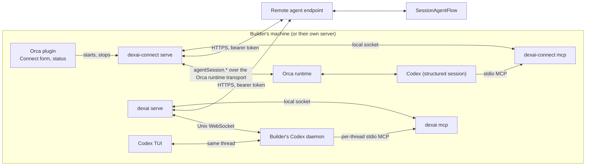

# Bridge

`dexai-connect` is the program a Builder runs next to Orca. `dexai` is the direct macOS command
that connects to the Builder's Codex daemon or Claude Code. Both use the same relay, local state, platform client
and MCP server packages, but keep separate default state directories. They call no platform model
and keep no Project source state the platform depends on. This document owns the Bridge, its Orca and
Codex integration, the provider boundary, the Orca plugin, distribution and security. The server
side is in [connection](connection.md) and [executor](executor.md).

## Shape

- **`serve`** is the long-lived process: one per Orca profile, holding an exclusive lock in its
  state directory so the plugin and a manual start never run two. It owns every network call to the
  platform and every call to Orca.
- **`mcp`** is what Codex starts as its MCP server. It holds no credentials: it connects to `serve`
  over a local socket (mode 0600, in the state directory) and forwards tool listings and calls.
- **`connect`**, **`status`** and **`disconnect`** are the manual commands; `connect` asks for the
  pairing code interactively and then runs `serve` in the foreground.

### Provider boundary for direct clients

The shared `cmd/dexai-connect/relay`, `state`, `platform` and `mcpserver` packages are imported
by `cmd/dexai-cli`. `relay.Provider` owns the local session and thread IDs,
runtime versions, cancel, public history, event subscription, event positions, and a declared
submission mode. `relay.Orca` adds only the tab, worktree and reload operations used by the
current Orca connect UI. `dexai-connect` still uses Orca; `dexai` selects the direct Codex
provider. Both use the local MCP server name `superverse`.

Orca's existing `binding.json` keys and `progress.json` positions remain readable and are written
the same way. Empty `providerId` identifies these Orca bindings. Direct bindings will carry their
provider ID and an opaque event cursor; their local MCP process addresses the binding by its
connection ID instead of an Orca session ID. For Codex, the persisted legacy `orcaSessionId`
field contains that connection ID, while `providerThreadId` is the Codex thread ID.
Each direct `connect` process owns a fresh mode-0700 directory under its state
root's `connections/`, with one provider, binding, lifetime lock and local socket.
Different Projects, endpoints and provider kinds run independently in different
terminals. The default root needs no per-command override. The root's short
admission lock reserves at most eight slots across active connection directories,
failed-cleanup records and legacy flat bindings; it is never held during a prompt,
provider call, pairing or relay polling. A single legacy `serve` supervisor still
uses one provider and rejects a binding for a different provider. The bridgeapi field names and endpoint paths are
unchanged; its binding values remain opaque to the platform.

The delivery record has two policies selected by the provider. A journal provider saves the
operation ID and runtime fence, asks the provider again with that same ID while pending, and
settles from the journal. A provider may classify a settled rejection as retryable. In that case,
the relay writes the replacement operation ID and any queued-copy withdrawal ID into the existing
sending record before it requests the withdrawal or submits the replacement. It reports
`delivery_delayed` once at two minutes, keeps the cursor on the entry, and reports
`delivery_failed` only if a permanent rejection occurs or the ten-minute retry window expires.
`SubmissionOneWrite` first saves the platform key,
generation, operation ID, payload fingerprint and random marker. It then durably marks the record
attempted before one provider write. On an accepted response with a canonical user item ID, it
settles immediately. A provider may return `retry` only after it proves that no user message was
admitted; the relay then persists a replacement operation ID and fresh marker before its next
write. Otherwise it makes one read-only history check, bounded to ten seconds, for the exact
marker in canonical public user history. A positive match accepts. No match, read failure, lost
response, or restart after the attempted bit returns `delivery_uncertain` and advances the platform
cursor without another write. Only a provably permanent invalid-content refusal reports
`delivery_failed`. A crash after persisting `attempted` but before writing can therefore lose a
message and report uncertainty; it cannot create a duplicate send. Direct adapters must embed the
marker in user content, avoid internal send retries, filter hidden reasoning, and normalize the
submitted user's event ID to the deterministic ID they gave the relay for echo suppression.

### Direct Codex binding

`dexai connect` asks for the code and agent on the terminal. It offers Codex and
Claude Code; Claude uses one headless child owned by this foreground process. Codex CLI and the Builder's own managed daemon
must both be at least 0.162.0 at connect and reconnect; 0.163.0 is the newest
verified daemon version. A newer version connects with a warning at startup and
in status. An unrecognized turn status, item type or required answer stops the
binding with an explicit protocol error. dexai does not install or update either.
The command pairs, starts one persistent Codex thread in its local working directory
with a per-thread MCP configuration, stores the binding, activates the platform connection, and
sends the platform brief as the first user turn. It opens the Codex TUI on that thread only after
the first user message appears in persisted history. An unmaterialized empty thread cannot be
resumed into the TUI, so no empty model turn is sent. The default working directory is a private
per-binding scratch directory; `--cwd` selects an existing local directory. Project source stays
in the Superverse Sandbox and is reached through the platform tools, not mirrored locally.

The per-thread MCP override runs `dexai mcp` with `DEXAI_BINDING_ID` set to the connection ID.
It does not edit global Codex configuration or use `ORCA_AGENT_SESSION_ID`. Both the relay's first
`thread/resume` after daemon reconnection and the TUI resume supply the same override so either
can resume first. A running turn receives `turn/steer` with the observed `expectedTurnId`; Stop
uses `turn/interrupt` and confirms idle state. The provider reads public user and final assistant
items from paginated `thread/turns/list` history; it synthesizes a durable event cursor from turn
IDs and item ordinals and scans back to it after disconnection. A cursor older than its bounded
500-turn scan fails visibly. Hidden reasoning and raw tool output never enter platform events.
The marker proof and one-write rule apply to the brief and every Studio message. If the brief
cannot be proved, `dexai connect` refuses to open the TUI and reports the local uncertainty;
queued Studio messages have an entry sequence and report `delivery_uncertain` to Studio.
An app-server resume timeout and every current Codex JSON-RPC refusal occur before admission, so
the provider returns `retry` and the relay makes a durably identified replacement within the
ten-minute delivery window. The app-server provides no structured permanent-content refusal today,
so it never turns an arbitrary RPC error or its text into final delivery failure. A lost response
after `turn/start` or `turn/steer` stays uncertain and is never retried from absence alone.

Exiting a direct Codex TUI or stopping its Claude foreground command ends and
revokes only that connection. Its local turn is cancelled and its private directory
is removed after successful revocation; failed revocation retains state for
explicit disconnect. The platform executor remains remote, offline, and work
already admitted by the platform is not cancelled by credential revocation.
Reconnecting requires a new pairing code; choosing the Superverse agent remains
an explicit Studio action. Status and disconnect enumerate the root's isolated
connections and pre-existing flat bindings. An exited empty reservation is
reclaimed at the next admission. Legacy `dexai serve` does not acquire or resume
new isolated bindings, and holding its root lock does not block new connects.

The command creates no new cloud, Kubernetes, Temporal, Dex or database resource. The Builder's
existing daemon is shared; each binding adds one Codex thread or Claude child and one private local state record,
with at most eight bindings per state directory. Local relay queues and report files are bounded.
The local agent owns history retention; disconnect revokes the credential and removes its local binding. No
cloud control-plane call or tenant-wide scan is on a request, poll or event path.

## Binding

A binding is (Project, Orca session). One Orca session is bound to at most one Project, and one
Project has at most one active binding (its executor).

1. **Pair** with the code ([connection](connection.md#pairing)).
2. **Choose the conversation.** The plugin lists Orca's structured Codex sessions (the Orca session
   the Builder is looking at is preselected) and offers "New conversation". Before redeeming the
   pairing code, terminal `connect` lists each eligible Codex session and a "New conversation in
   <worktree>" choice for every open Orca worktree from the tabs snapshot. `--worktree` narrows the
   new-conversation choice, and `--new --worktree <selector>` creates it without the picker. A
   newly opened Orca Codex chat may already have a session ID while lacking a provider thread;
   it is shown as unavailable until the Builder sends a message, or they can select New
   conversation. The Bridge checks this before pairing for direct `--session` too. Bound sessions
   and Codex running in a terminal are unavailable (two processes would write one thread). An
   existing conversation is driven by its Orca session ID, so Orca's own conflict check applies.
3. **Install the MCP server** in the Codex home that Orca uses for that session's account (the
   default `~/.codex/config.toml`, which Orca mirrors into its managed account homes): one
   `[mcp_servers.superverse]` entry that runs `<bridge> mcp` with
   `env_vars = ["ORCA_AGENT_SESSION_ID"]` and `tool_timeout_sec` above the longest tool (1,800 s), because Codex passes a stdio MCP server only a fixed set
   of environment variables plus those it names. Only that server entry is written; other settings, permissions and credentials are untouched. A Codex session
   whose `ORCA_AGENT_SESSION_ID` is not bound gets **zero** tools from it, so every other Codex
   conversation on the machine is unaffected.
4. **Reload** the conversation so Codex loads the server: the Bridge waits until the session is
   idle (or the Builder chooses "Stop current work and connect") and restarts it with resume, keeping
   the same provider thread. If the resumed session's identity cannot be confirmed, binding fails;
   no replacement conversation is created silently.
5. **Activate** ([connection](connection.md#activation-and-takeover)), then **import history**: the
   public user and assistant messages of the conversation, newest last, at most 200 messages or
   512 KiB, reported as `imported_message` events labelled "imported from Orca by <owner>".
6. **Brief**: the Bridge sends Codex a first message composed from `ReadRemote`: the requirements
   card, HEAD, the todo list, public messages at or before the activation cursor and `agentContext`.
   Messages after that cursor are delivered only by the delivery loop, even if they arrive while the
   brief waits for context. That context contains
   the remote agent instructions, shared Session rules and repository context; it excludes
   instructions for platform-only tools. It tells Codex that the Project's code lives only in
   the Superverse Sandbox and changes only through the `superverse` tools. It also directs
   Codex to choose published connectors through `connector_catalog` and the Dex skills and to
   tell the user when remote mode cannot yet contribute a new connector or a fix.
   The server-owned remote instructions also tell Codex to open an application task worktree
   before a Codex subagent edits, keep that subagent inside the returned path, and have the
   parent merge and resolve conflicts. The Bridge adds no task-worktree instructions.
   While `agentContextState` is `pending`, it waits up to three minutes. The wait start is stored
   in `progress.json` across restarts. If the wait expires, it sends the brief; when context later
   becomes `ready`, it sends exactly the platform-provided `<repository_context>` section once,
   using the normal durable Orca submission record. Follow-up checks are at least 15 seconds apart
   and stop after 30 minutes, or immediately on `unavailable`; the progress file retains the
   check and deadline timestamps and the settled result across restarts. With no pending follow-up,
   the delivery loop has no timer. The Bridge adds no instructions. Codex reads
   MCP `instructions` once at startup, so that copy does not change after a later delivery.

## Loops

- **Delivery.** `sync` returns entries after the Bridge's delivery cursor. Every user-role entry
  that the Bridge did not itself report (Studio messages, answers, notifications, Stop and
  turn-limit notices) is sent to the bound session with `agentSession.send`, which steers a running
  Codex turn or starts one. Each message keeps its sender block
  ([collaboration](collaboration.md#what-the-model-sees)). The Bridge never sends an entry twice by
  itself, and reports every outcome Orca cannot confirm:
  1. Before sending, the Bridge writes to its state file, as *sending*: the entry's platform delivery
     key (`<connectionId>/<entry sequence>`), the generation it binds, a new Orca client operation ID
     in the form Orca requires (a 13-digit millisecond timestamp, a hyphen and 32 random hex digits),
     the payload's fingerprint and the `expectedRuntimeFence` it sends with.
  2. It sends with that operation ID as `clientOperationId` and the request's `payloadFingerprint`
     (SHA-256 over Orca's canonical sorted-key JSON, which Orca recomputes). Orca 1.4.224 and 1.4.225 keep the
     journal of submissions in SQLite (`agent-session-journal.db`), so it survives an Orca restart;
     a byte-identical resend with the same ID returns the current state without sending again, for
     24 hours. The Bridge never sets `retryUnknown`.
  3. It acts on the submission state Orca returns, not on the RPC's success:
     - `accepted`: advance the cursor and clear *sending*, in one state-file write;
     - `pending`: keep *sending* and ask again with the same operation ID until it settles;
     - a permanent `rejected`: report `delivery_failed` with Orca's reason (Studio shows "Codex did not
       accept this message" with "Send again") and advance;
     - a retryable `rejected`: persist a replacement operation ID and any `keptAsQueuedMessageId` in
       *sending* before calling `agentSession.queuedMessageDelete` for that copy and submitting the
       replacement. This leaves the cursor in place, reports `delivery_delayed` once after two minutes,
       and reports `delivery_failed` only when the ten-minute retry window expires. A failed withdrawal
       or a copy already dispatched is `unknown`, because its delivery cannot be determined;
     - `unknown`, including a submission Orca no longer finds: report `delivery_uncertain` (Studio shows
       "This message may not have reached Codex" with "Send again") and advance.

  On restart with an entry still *sending*, the Bridge asks again with the same operation ID,
  fingerprint and fence. Orca 1.4.224 and 1.4.225 do not compare `expectedRuntimeFence` (it must be `null` on
  `create` and a positive integer otherwise) and its fence belongs to a session, not to the Orca
  process; the Bridge detects an Orca restart by a change of `_meta.runtimeId`. Except for the durable
  replacement after a retryable rejection, the Bridge does not create a new ID for the same entry,
  and treats an answer that is not `accepted`, a permanent `rejected`, or retryable as `unknown`.
  A first submission older than Orca's 24-hour limit is
  `unknown` too. So the Bridge never sends the same entry twice by itself; whether Codex received it is
  confirmed only by `accepted`, and every other outcome is shown to the Builders. Message text is
  never used to detect a duplicate. The meaning of each state and whether the journal survives an
  Orca restart are ORCACHECK items.
- **Tool calls.** An MCP call from Codex becomes a `report` with the next sequence and the generation
  of the Codex turn that made it; the MCP response is the matching `tool_result` entry (call ID
  `remote-<epoch>-<sequence>`), read through `sync`. The MCP timeout is the tool's own attempt timeout
  plus one minute (`commit_and_push`: 26 minutes); questions use 30 minutes
  ([executor](executor.md#questions-and-the-requirements-card)). A refused report (stale generation or
  epoch) returns the call to Codex as interrupted.
- **Tool set.** The tools Codex sees are the set the server sent at activation. When a `sync`
  shows a new digest, the Bridge fetches the set again and tells Codex that its tool list changed.
- **Events.** `agentSession.subscribe` is not served to the owner token on the local socket (it
  streams only to paired WebSocket clients), so the Bridge polls `agentSession.history` with
  `direction: "after"` from its cursor about once a second and reports, at most once per second and
  32 events per report: completed assistant messages, user messages the owner
  typed in Orca, a short summary of Codex activity (its subagents starting and finishing, a local
  command it ran, or a pending approval), and turn completion. Subagent activity comes from
  `subagent-group` blocks on root assistant rows. A non-empty agent `settledAt` marks its finish;
  Orca recovery can mark an agent `unverifiable` without that timestamp, which also marks its
  finish. The Bridge emits each start and finish once per message item and agent ID, and rows
  bearing `agentId` are never imported.
  Echoes of messages the Bridge delivered are
  recognized by the Orca message ID that `send` returned and are not reported. Hidden reasoning and
  raw tool output are never reported.
- **Call trace.** `mcp` writes one private JSON line per tool response in the Bridge state directory,
  with local/remote call IDs, tool name, MCP receipt, first report, report answer, `sync` result,
  response-write timestamps and an outcome code. `calls.jsonl` rotates through two older files at
  4 MiB each. `dexai-connect trace` prints each segment and p50/p90/p99; it makes no network
  call. A missing timing point means that stage was not reached or its response was not observed.
- **Stop and takeover.** When `sync` shows the turn interrupted, the Bridge calls
  `agentSession.cancel`. A 409 `executor_changed` or a 401 stops every loop, cancels the running
  Codex turn, removes the binding and shows "Connection replaced by <name>" or "Reconnect from
  Studio".
- **Reconnection.** After a network error the Bridge retries with backoff (1 s to 60 s) and resends
  its unacknowledged report with the same sequence; on restart it reads its state file and resumes.
  It catches up from Orca's history (`agentSession.history`) for events it had not reported.
- **A Codex turn running across a Bridge restart is stopped (fail-closed).** The Bridge keeps no
  durable record of which turn is running, and it does not infer one from history, so after a
  restart it cannot serve that turn's tool calls. On start, before serving any MCP call, the Bridge
  first checks that the Orca session still holds the bound provider thread (otherwise it stops and
  asks for reconnection), then asks Orca for the turn state. A turn the restarted process cannot serve
  is cancelled (`agentSession.cancel`); only an explicit idle, completed or interrupted state counts as
  finished. Calls of that turn not yet sent are answered `interrupted` locally; calls already sent (or
  possibly sent) may still finish, and their results arrive as messages. The Bridge stores the turn's
  `TurnCompleted` once (a durable drain record survives another restart) and accepts new work only when
  every sequenced report from before the restart is acknowledged or refused, `settledThrough` has reached
  the highest acknowledged or possibly admitted sequence, Orca reports the turn finished, and every
  admitted tool result has been seen. The fence covers all pre-restart work, not only the latest turn:
  a latest turn whose events were not yet read never opens the Bridge while an older turn's admitted
  effect is unsettled. Restoring a running turn is deferred until Orca's structured turn state is verified.

Local state (0600, in the Bridge's state directory): the token, the binding, the delivery cursor
and the entry being sent, the next report
sequence, the last imported Orca message ID and unacknowledged reports (at most 1,024 items or
8 MiB per binding; when full, the Bridge stops accepting new MCP calls until acknowledgements free
space), and the call timing trace (three files of at most 4 MiB).

## Orca protocol

- The Bridge is a client of the Orca runtime's structured session RPCs (`agentSession.create`,
  `send`, `cancel`, `history`, `queuedMessageDelete`, plus `status.get` for the version and
  `session.tabs.listAll` to list structured sessions) over Orca's local unix socket: one
  newline-delimited JSON request per connection (`{id, authToken, method, params}`), discovered from
  `orca-runtime.json`, whose socket path and token change on every Orca restart. Orca drops a socket
  idle for 30 seconds, and `create` or a first `send` may start Codex inside the call, so a call that
  closes without an answer is uncertain and is resent byte-identically. The paired remote transport
  (`orca serve`, WebSocket with device pairing) does not accept the owner token and is not supported
  in the first version.
- **Credential (source-verified, Orca 1.4.224 and 1.4.225).** No narrow credential exists:
  - every `agentSession.*` method requires the `workspace` permission, which also covers terminals
    and files;
  - a `runtime-paired` client is granted `workspace`, `settings-write`, `accounts-admin`,
    `skills-admin` and `host-admin` automatically, whatever it asked for when pairing;
  - the owner token in `orca-runtime.json` has every permission;
  - the plugin host API exposes no `agentSession` method, so a plugin cannot mediate the session for
    the Bridge.

  **Owner decision (2026-10-12)**: the first version reads Orca's owner token from
  `orca-runtime.json`, so connecting needs no extra approval step in Orca. The Bridge's Orca client is
  confined to a compiled allow-list of the methods named above, with no generic pass-through and no
  method or session chosen by data from the platform; the token stays on the machine and is never
  sent to the platform or logged. Narrowing it (a paired-client credential, then a session-only
  permission from Orca upstream) remains a future compatibility improvement.
- **Versions.** The Orca version comes from `status.get` (`appVersion`); no RPC reports Codex's,
  so the Bridge runs `codex --version` itself. `agentSession` is not a published Orca API: its methods and fences change between
  releases. The shared relay version policy refuses Orca below 1.4.0 or Codex
  below 0.162.0. Orca 1.4.225 and Codex 0.163.0 are the newest verified
  versions; newer versions warn while still connecting. An unrecognized
  protocol answer stops its binding. The design asks Orca upstream for a stable
  session API; until then this maintenance cost is accepted.
- No terminal automation and no screen scraping: a missing capability is reported as incompatible.

## Orca plugin

- Source in `integrations/orca-plugin/` (TypeScript), packaged as an Orca plugin archive. Orca does
  not require plugins to be open source; the plugin is distributed from Superverse, like the Bridge.
- It shows the Connect form (endpoint, pairing code), the bound Project and its executor state, and
  "Disconnect". It starts `dexai-connect serve` as a detached process the first time the Builder
  connects, after Orca's consent prompt for running code.
- Orca reclaims an idle plugin worker after five minutes and kills only the worker, so the Bridge
  outlives it. The Bridge therefore watches its own reasons to run: every 30 seconds it checks that
  the plugin is still enabled (`plugins.list`) and that the Orca process recorded in
  `orca-runtime.json` is alive, and exits when either is not. The plugin's `deactivate` hook is not
  relied on, because Orca calls it for reclamation, disabling and exit alike.
- When the plugin cannot start the Bridge, it shows the manual command
  `dexai-connect connect`, which does the same thing in a terminal.

## Distribution

The server endpoint can serve provisioned Bridge artifacts for macOS and Linux (arm64 and amd64)
and the plugin archive. The contract the endpoint implements:

- **Version.** The Bridge's version is a semantic version set at build time (`-X main.version`); the
  first release is `0.1.0`. A build without one (`make build-dexai-connect-local`, a plain `go build`)
  reports exactly `bridgeapi.DevBridgeVersion` (`0.0.0-dev`), which `pair` accepts only when
  `remoteAgent.acceptDevBridge` is true (the local profiles). Any other version, a prerelease
  included, is compared by semantic-version precedence with `remoteAgent.minimumBridgeVersion`; a
  lower one is refused with `bridge_outdated` (403).
- **Artifacts.** The existing environment download protocol allows `superverse-bridge-<os>-<arch>`
  for `darwin` and `linux`, `arm64` and `amd64`, the plugin archive `superverse-orca-plugin.tgz`,
  and `manifest.json` holding `bridgeapi.DownloadsManifest`'s artifacts
  (`{name, version, os, arch, sha256, path}`); the same type is the wire schema, with no second format.
- **Serving.** `GET /remote-agent/v1/downloads/manifest` returns the artifacts read from `manifest.json` on each request
  and fills in `minimumBridgeVersion` from the configuration; `GET /remote-agent/v1/downloads/<path>`
  serves only a listed path. A missing directory or
  manifest means an empty manifest and 404 for every artifact, which is the Native lane's normal state:
  there the Builder runs the locally built Bridge.

The local release script builds `dexai-connect` archives for the same four platforms and `dexai`
archives for macOS arm64 and amd64. It stamps both commands with a released semantic version no lower
than the default `remoteAgent.minimumBridgeVersion` (`0.1.0`), refuses a dirty tree or any source
other than the tip of `origin/main`, and only creates `dexai-connect-v<version>` or `dexai-v<version>`
in the public mirror when the operator supplies `--publish`; its default is build-only. The generated
Homebrew formulas belong in `superdurable/homebrew-tap`. The existing environment downloads keep their
fixed names; no GitHub Actions job publishes a release. Windows (and WSL) are not supported in the
first version.

## Security

- **Accepted risk** (owner, 2026-10-12): the connected Codex runs on the Builder's machine with the
  permissions the Builder gave it, and other Builders' messages and Run failure text reach it. The
  connect dialog says so; the install guide recommends a dedicated Orca profile whose Codex runs in
  its sandboxed, workspace-write mode in an empty working directory.
- **What the platform trusts.** Nothing Codex says changes platform state except through the
  Superverse tools, which run in the Sandbox with the Session's lease and the platform's checks. The
  Bridge cannot choose the actor, Project or workspace of a call: the token fixes the Project and
  owner, and the Session fixes the rest.
- **Secrets.** The connection token stays in the Bridge's state file; the Orca credential is never
  sent to the platform; model and ChatGPT credentials never leave Orca. The Bridge logs no message
  text, tool arguments or tokens.

## Dex Flow Changes

None here; see [executor](executor.md#dex-flow-changes). The direct-client boundary adds no Flow,
Step, RPC, Attribute, AttributeMap, Channel, ChannelMap, or Stream and changes no Flow identity,
execution, retention, or recovery behavior.

## Database Schema Changes

None; the Bridge's local state is a client cache, not a source of truth. Existing Orca records are
read without migration; the optional provider ID, opaque event cursor and one-write attempt fields
are local JSON only.

## UI/UX

- The plugin panel: "Connect to Superverse" (endpoint and code), then "Connected to <Project> as the
  agent · Codex 0.162.1", activity ("working on: …"), and "Disconnect".
- The terminal command prints the same states, one line each.
- Every error says what to do: upgrade the Bridge, reconnect from Studio, choose a structured session,
  restart Orca.
- The provider boundary adds no UI. The current command continues to connect through Orca.

## Tests

- A real Native HTTP Dex test verifies the endpoint's `pending` to `ready` context state and
  platform-provided section. A real Orca Bridge integration case for the three-minute timeout,
  restart recovery, and one follow-up delivery remains necessary; no scripted Orca dependency
  is introduced.
- **Compatibility check** (before BRIDGE, on a real Orca 1.4.224 and Codex 0.162.x, recorded in
  `evidence/orca-compatibility.md`): the owner token reaching the allow-listed methods; session create, resume of an existing
  structured session, send while idle and while running (steer), cancel, history and subscribe event
  shapes; the submission states `send` returns for a new, repeated and lost submission, and across an
  Orca restart (runtime fence change); whether events carry one order in which a turn's start can be
  placed against a boundary; the `env_vars` entry passing `ORCA_AGENT_SESSION_ID` to the MCP process in both
  Orca account modes; zero tools in an unbound session; a plugin worker starting a detached process
  that survives reclamation; restart with resume keeping the provider thread.
- **Bridge integration tests** (local only, real Orca and the Native lane's endpoint; missing Orca is
  a failure, not a skip): pairing to activation, a message delivered and steered, a tool call round
  trip, echo suppression, Stop, takeover by a second Bridge, reconnection with an unacknowledged
  report, history import bounds, refusal of an unlisted Orca version.
- **Acceptance** with the real Codex model on the owner's machine before the feature is announced;
  the owner decides when and with which account, as for any real-model acceptance.
- The provider boundary runs the Bridge race, real Orca PTY and protocol cases, real Native
  Bridge/Dex integration, and the lane selected by `make required-lanes`. Direct adapters require
  their own real-provider tests and acceptance when implemented. A one-write adapter must prove
  exact marker matching, ambiguous write and restart uncertainty, no resend, replay and echo
  suppression against its real provider.

## Documentation

- `docs/runbooks/remote-agent.md` (new): install, connect, takeover, disconnect, upgrade, uninstall,
  troubleshooting.
- `integrations/orca-plugin/README.md` and the Bridge's package READMEs. The relay and state
  READMEs document the provider and local record contracts.

## Resource Scalability

No platform resource is created per Bridge beyond its connection row ([connection](connection.md#resource-scalability)).
On the Builder's machine: one `serve` process per Orca profile, at most 8 bindings (32 hard limit),
bounded local queues as above, and at most 12 MiB of call timing trace per state directory. The
trace is removed with that local directory. Timing adds no platform or Orca call to a tool request.
One context poll every two seconds is made per binding only while
the brief is pending, for at most three minutes. After a timed-out brief, the delivery loop checks
for the repository section at intervals of at least 15 seconds, for at most 30 minutes, and stops
immediately on `unavailable`. It makes no timed wake when no follow-up is pending. The local progress file retains at most
one bounded brief and one repository section for crash recovery.
The provider boundary adds no platform, cloud, Kubernetes, Temporal, Dex or database resource.
The one-write path adds at most one bounded provider history read per ambiguous delivery, not per
poll or event, and one small marker and attempted bit in the existing per-binding progress file.
It retains no extra file or process. The existing per-profile binding limit and cleanup on local
state removal apply to future providers. No quota-limited control-plane call enters the hot path.
