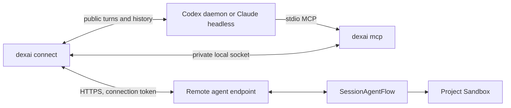

# Bridge

`dexai` connects a Builder's local Codex or Claude Code to one Project. Its private
implementation lives under `cmd/dexai-cli`; the server's public JSON contract is
`internal/dexai/agents/remoteagent/bridgeapi`. Project source and authoritative
conversation state remain on the platform. The server side is described in
[connection](connection.md) and [executor](executor.md).

## Shape

The relay owns platform requests, report sequencing, delivery progress and local
provider events. The MCP process has no platform credential: it forwards tool
calls to the owning foreground through a private socket. The platform supplies
the tool catalog and prompt; tools run through the Session's existing admission,
workspace lease, deadlines and recovery paths.

## Binding

`dexai connect --endpoint <origin>` offers the agent before the pairing code.
It discovers installed agents through the login shell PATH, checks version and
login, and offers explicit installation or login when needed. Those actions
default to No without a TTY. Existing agents are never silently upgraded. Every invocation owns fresh private state, a local agent session and
one foreground relay. Repeating connect in another terminal creates an independent
connection, including when the two terminals choose different providers. At most
eight connection slots share a state root. Exiting the Codex TUI or Claude
foreground revokes and removes only that connection; the Session remains remote
and offline until a Builder reconnects or explicitly switches in Studio.

`dexai status` enumerates endpoint, Project and connection identity. A targeted
`dexai disconnect --connection <id>` removes only the selected connection.
Legacy flat direct bindings remain resumable through `dexai serve`; new connects
use their own foreground lifecycle. Failed cleanup retains enough private state
for explicit disconnect instead of releasing the slot while its credential may
remain usable. Agent history retention belongs to the local provider.

A definite missing endpoint (an uncoded 404, missing DNS name or TLS hostname
mismatch) holds the relay without further retry. Explicit disconnect can remove
local state without claiming platform revocation; a transient-looking failure
asks before local removal and retains state without a TTY. `disconnect --local`
skips revocation explicitly. It stops the owned local turn before removal;
switch to the platform agent in Studio or pair again to take over the old
connection.

The platform brief is the first user turn. Repository context may be pending:
the relay waits at most three minutes, then sends the available platform brief.
If context becomes ready later, it sends one platform-provided repository section,
checking at intervals of at least fifteen seconds for at most thirty minutes.
An unavailable context stops follow-up checks. Progress retains only the bounded
brief and repository section needed for recovery.

## Provider boundary

The private `relay`, `state`, `platform`, `mcpserver` and `trace` packages belong
to `cmd/dexai-cli`. `relay.Provider` owns local session identity, runtime version
checks, cancellation, public history, ordered event positions and event resume.
Every adapter supports one-write delivery. Its marker lookup reads canonical
public user history; hidden reasoning never enters platform events or local relay
progress.

### Delivery and recovery

Before sending, the relay durably records the platform entry key, generation,
operation ID, payload fingerprint and random marker. It persists the attempted
bit before making one provider write. A response proving acceptance with a
canonical user item ID settles the delivery. A provider may return `retry` only
after proving that no user message was admitted; the relay persists a replacement
operation ID and fresh marker before another write, within the ten-minute retry
window. A delayed delivery is reported once after two minutes.

After an ambiguous write, a bounded read-only history lookup searches for the
exact marker. A positive match proves delivery. No match, a read failure, a lost
response or recovery with the attempted bit set yields `delivery_uncertain` and
advances the platform cursor without another write. A crash between persisting
the bit and writing may therefore lose a delivery; it cannot cause an automatic
duplicate. Only a proven permanent invalid-content refusal is `delivery_failed`.
The same rule applies to the brief and later Studio input. Provider events use
the deterministic submitted-message identity for echo suppression.

Report admission and tool completion are separate: `reported` proves admission,
while `settledThrough` proves that the Session consumed the report and recorded
its tool result when applicable. The local bounded report store survives a
relay restart; recovery reconciles canonical server state before retransmitting
an admitted report. Epoch, generation and connection identity fence stopped or
replaced work. Generation changes cancel the local turn and record an ordered
provider event boundary before new work is reported.

### Codex

The Builder's Codex CLI and shared daemon must both be at least 0.162.0;
0.163.0 is the newest verified daemon version. Newer-than-verified versions start with a compatibility warning;
unrecognized required protocol answers stop the binding explicitly. The command
starts an absent daemon but never updates, downgrades or restarts an existing one.

A fresh Codex thread receives a per-thread MCP override running `dexai mcp` with
`DEXAI_BINDING_ID` equal to the connection ID. Both relay reconnection and TUI
resume supply the same override. The first brief must appear in canonical history
before the TUI opens: no empty model turn is needed. Running turns receive
`turn/steer` with their observed turn ID; Stop uses `turn/interrupt` and confirms
idle state. Paginated public history resumes from provider-owned event cursors;
a cursor older than the bounded 500-turn scan fails visibly. Lost responses after
a turn write remain uncertain. A structured pre-admission refusal may retry;
error-text guesses never establish rejection or delivery.

### Claude Code

The command owns one headless `claude` process using stream-json and an explicit
session ID. Claude Code must be at least 2.1.41 for its documented authentication
checks. It passes the platform MCP configuration per process with
`DEXAI_BINDING_ID`, disables built-in tools through an empty `--tools` list, and
permits only the strict platform MCP catalog. Its transcript supplies public user and final assistant
messages for resume, marker proof and echo suppression. Signed provider state
stays local; plaintext hidden reasoning is never persisted by the relay. Child
processes, subscriptions and pipes have explicit cancellation and cleanup owners.

## Distribution

`make build-dexai-local` builds a development binary. Its exact `0.0.0-dev`
version pairs only with explicit local profiles. Released semantic versions must
meet `remoteAgent.minimumBridgeVersion` (default `0.1.0`).

The local release script builds macOS arm64 and amd64 archives from a clean tip
of `origin/main`, checks SHA-256 digests, and renders the Homebrew formula.
Publication requires the explicit `--publish` option. No GitHub Actions job
builds or publishes the CLI. The server's optional environment-download routes
remain governed by the [public API](../../api/remote-agent.md#http-routes).

## Security

Connecting permits local model execution with the Builder's configured agent
permissions. Other Builders' messages and untrusted Run failure text may reach
that agent. Studio displays the accepted local-machine warning before pairing.
Use the private scratch directory unless a local working directory is required.
Project file reads, edits, commands, commits and Preview effects use platform
tools against the Project Sandbox.

The connection token fixes Project and owner; the agent cannot choose either.
Tokens remain in private local files. Pairing codes are interactive input, never
command arguments. Model credentials stay with the local provider. Logs and
bounded timing traces contain no message text, tool arguments, token or model
credential. MCP installation is scoped to the thread or child process.

## Dex Flow Changes

None in the client. The existing Session owns `Executor`, `RemoteInbox`, canonical
messages and tool outcomes; its complete inventory is in [executor](executor.md#dex-flow-changes).
The client adds no Flow, Step, RPC, AttributeMap, ChannelMap or Stream.

## Database Schema Changes

None. Private local files own relay progress only. SQL retains the existing
connection credential owner and revocation lifecycle.

## UI/UX

Connect checks the selected provider and its login before prompting for the code,
then stays in the foreground. Status
identifies independent connections. Exit stops its own connection and explains
that the Project remains remote and offline. Uncertain delivery is visible and
never silently retried; reconnect and executor switching remain explicit.

## Tests

Real Codex with isolated `CODEX_HOME`, real Claude Code and direct Native
integration cover pairing, brief, one delivery, MCP tool results, steering,
Stop, history proof, reconnect, independent foregrounds and targeted cleanup.
Missing dependencies are failures. Scripted provider substitutes are prohibited.
`make ci`, `make required-lanes` and the selected lane's three E2E journeys and
Dex integration cases remain required. The platform lane defaults to the mock model. Any real model or LLM API
requires a strong, stated reason approved by the platform developer before the
run and recorded with its model in the release record or PR Tests section.

## Documentation

The [runbook](../../runbooks/remote-agent.md) owns operation. Client package
READMEs own provider, delivery and local state contracts. The public API owns
HTTP fields and admission behavior.

## Resource Scalability

No new cloud, Kubernetes, Temporal, Dex or database resource is created. One
local foreground, private socket, bounded queues/report files and one agent
session exist per connection, with at most eight slots per root including failed
cleanup and legacy records. Successful exit revokes and removes private state;
crashed empty reservations are swept on admission, while stored failures require
explicit disconnect. Provider history has the provider's retention policy.
Timing traces are bounded to three 4 MiB files per state directory. Ambiguous
delivery adds at most one bounded history proof read, never a control-plane call
or tenant-wide scan per poll or event. Platform connection-row bounds remain in
[connection](connection.md#resource-scalability).
