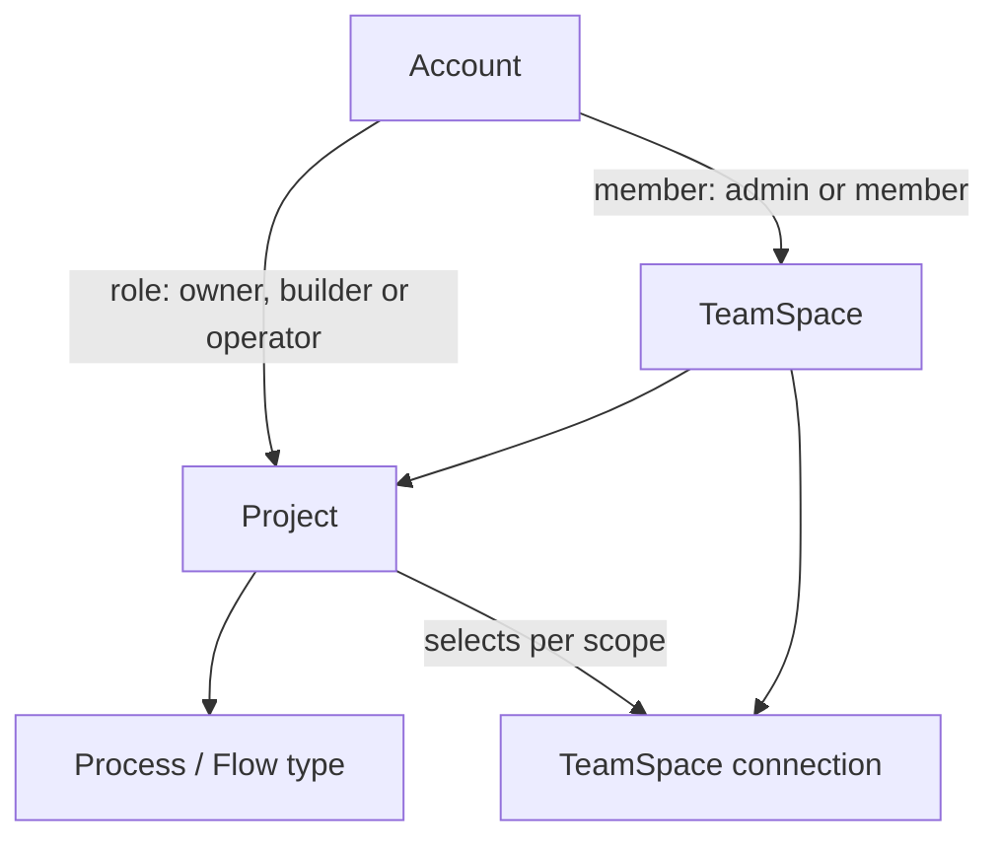

# TeamSpace design

A TeamSpace is where a team works in Superverse: it holds the team's Projects, its
people and the connections its applications share. This directory is the single home
for that design: TeamSpaces and roles, accounts, the PostgreSQL read model that serves
every read from outside a Flow, shared connections, the API and Studio surfaces, and
the infrastructure they need.

Topic documents describe current behavior. A Flow's complete contract lives in its owning topic document, and its package README links there.

## The pieces

| Piece | What it is | Topic |
|---|---|---|
| TeamSpaces and roles | `TeamSpaceFlow` owns a TeamSpace, its members (admin or member) and its Project registry. `ProjectFlow` owns each Project's members and their role (owner, builder or operator). Every request is authorized by one SQL join over both memberships. | [teamspaces-and-roles.md](teamspaces-and-roles.md) |
| Accounts | Accounts and login sessions are database-authoritative; there is no AccountFlow. | [accounts.md](accounts.md) |
| Read model | Dex Attribute Store sync writes the Flows' durable facts into PostgreSQL tables keyed by business IDs. Lists, details, Watches, login, authorization and Live Runs targets read SQL. | [read-model.md](read-model.md) |
| Connections | A TeamSpace connection is a named configuration and credential of a connector for one major version; a connector's minor releases keep connections compatible. Applications only read credentials through the platform, which refreshes them on read. The platform relays its Slack application's events to the applications of `platform` Slack connections. | [connections.md](connections.md) |
| API and Studio | The new business services, the internal credential read endpoint and where Studio shows TeamSpaces, people, connections and roles. | [api-and-studio.md](api-and-studio.md) |
| Infrastructure | PostgreSQL on every lane, its roles and migrations, the Dex Attribute Store configuration, network policy, the local OAuth server and the Slack event relay's configuration and ports. | [infrastructure.md](infrastructure.md) |

## Principles

- **One owner per fact.** Each durable fact has exactly one owner: a Flow for
  everything with a lifecycle, the database for accounts and TeamSpace connections.
- **Reads from outside a Flow go to SQL.** A Flow is projected when a list, join,
  group by or cross-entity read needs it; its detail reads then use the same table.
  A Flow read only by FlowID, one entity at a time, stays on the Flow and reads only
  what it needs. [read-model.md](read-model.md) lists every remaining Flow read and
  why.
- **Synced tables are written only by Dex.** The database grants guarantee it, and
  synced tables carry no foreign keys or CHECK constraints, because a violated
  constraint would block a Flow's sync queue.
- **Admission before a write reads the Flow.** The read model is eventually
  consistent; a write that depends on current state confirms it with the owning Flow.
- **Applications only read shared credentials.** The platform stores every
  credential and refreshes it when a read finds it close to expiry; one refresher per
  connection is guaranteed by a lease in the database. The secrets that only refreshing
  needs never reach an application.
- **No repair loops.** Sync drift only follows an outage longer than the retry budget
  or a bug; both are found and fixed by hand.
- **SQL lives in DAO packages.** Every query is a named method of a `*dao` package; no
  other code writes SQL.

## Related documents

- [Superverse V2 architecture](../superverse-v2.md): the platform-wide contract; its
  Flow table and tenancy sections link here.
- [the current contract](../studio-setup/studio.md): the Studio Builder frame,
  whose role lenses and Shared surfaces this design fills with server data.
- [Agent harness design](../agent-harness-design/README.md): the Session, Sandbox and
  Preview, which this design leaves unprojected.
- [Resource API contract](../../api/resource-grpc.md) and
  [StartFlow admission](../start-flow-admission.md).
