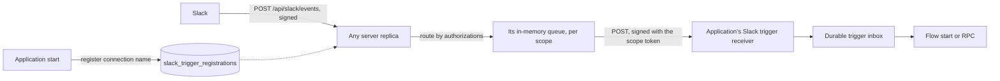

# TeamSpace connections

A TeamSpace configures each connector once, under a name such as `preview-test1` or
`live-prod1`, and its Projects only choose which configured connection each of their
connection names uses. Applications never store, write or refresh credentials: they read
them from the platform, which refreshes and mints them as each connector's manifest
declares.

## Connections

- A **connection** is a name, a connector, a major version line, an authentication
  method, the OAuth client it uses (`user` or `platform`, see [OAuth clients](#oauth-clients)),
  the non-secret connection settings (the manifest's `spec.configuration` and the method's
  non-secret fields) and the credential: an API key, OAuth tokens or a service account key
  with its minted token, with its status, issue time and expiry. For example `live-prod1`
  is the company Slack workspace for Slack `v0`.
- The credential lives only in immutable, KMS-encrypted objects in the platform bucket;
  the database holds the reference, status, issue time, expiry and revision. Secrets never
  reach the database, logs or errors. At rest each connection keeps its current
  credential and at most one raw response (and at most one object a lost lease left until the
  next write-back):
  - `teamspaces/<ts>/connections/<id>/credentials/<sha256>`, the current credential only;
  - `teamspaces/<ts>/connections/<id>/refresh/<credential_revision>`, the raw provider
    response of a refresh in progress, recording its grant, which the commit of that revision deletes.
- A name is unique within a TeamSpace, connector and major version; renaming is not
  supported.

Configuration that stays in the Project: Step settings (operation configuration),
trigger bindings and the application environment.

## Connector versions and connections

A connector's minor and patch releases keep its connections compatible, so a connection
serves every release of its major version, release candidates included:

- the authentication methods keep their IDs, fields and OAuth scopes;
- connection settings only gain optional fields; none is removed, renamed, retyped or
  made required.

Any other change to the connection contract is a new major version, also before v1: a
v0 connector that breaks its connections releases v1.0.0 (the Go module path changes only
from v2). Other breaking changes before v1 may keep the library's minor bump. Adding an
operation or a trigger stays a minor release as long as it needs no new scope.

The rule holds from the first release of a major version. Until a major version has a
release, its release candidates may still change the connection contract between
candidates, which is how a connector the agent is still developing settles its fields; a
connection made on an earlier candidate is then flagged on the Project's Connectors page,
because a selection revalidates the settings against the version the application declares,
and is fixed by editing it there.

The connectors library states this rule in its versioning guide. Its compatibility gate
compares a release, and every release candidate (`connectorctl release-candidate`), with
the latest release of the same major version reachable from `main`, skips the comparison
when that major version has no release yet, and rejects a candidate or release that breaks
the contract without a new major version.

Connector minor versions move often, because the agent's connector contributions add
operations, so this rule is what lets a TeamSpace configure a connection once: an
application that upgrades within a major version keeps its connections and never
repeats OAuth.

## Database-authoritative, without a Flow

Connections have no work that needs durable execution: credentials are refreshed when
read, and creating, editing, authorizing, selecting and deleting are requests. Their
rules are relational: unique names, a selection only of an ACTIVE connection of the same
connector, version line and method, and no deletion while in use. One transaction
enforces each of them, and every read is a direct, strongly consistent query. The
accounts follow the same pattern ([accounts.md](accounts.md)); today's per-Project
connections in the configuration host have no Flow either.

```sql
CREATE TABLE team_space_connections (
  team_space_id TEXT NOT NULL, connection_id TEXT NOT NULL,
  creation_fingerprint TEXT NOT NULL,                -- idempotent create: same request, same row
  name TEXT NOT NULL, connector_id TEXT NOT NULL, module_path TEXT NOT NULL,
  version_line TEXT NOT NULL,                        -- the major version: v0, v1, v2
  manifest_version TEXT NOT NULL,                    -- whose declarations refresh; only moves forward
  auth_method_id TEXT NOT NULL,
  oauth_client TEXT NOT NULL CHECK (oauth_client IN ('user', 'platform')),
  settings JSONB NOT NULL, revision BIGINT NOT NULL,
  credential_ref JSONB, credential_revision BIGINT NOT NULL DEFAULT 0,
  credential_status TEXT NOT NULL
    CHECK (credential_status IN ('AUTHORIZING', 'READY', 'REAUTHORIZATION_REQUIRED')),
  credential_issued_at TIMESTAMPTZ,                  -- null for static credentials
  credential_expires_at TIMESTAMPTZ,                 -- null for static credentials
  refresh_lease_owner TEXT, refresh_lease_until TIMESTAMPTZ,
  connection_status TEXT NOT NULL CHECK (connection_status IN ('ACTIVE', 'DELETED')),
  creator_account_id TEXT NOT NULL REFERENCES accounts (account_id),
  updated_by_account_id TEXT NOT NULL REFERENCES accounts (account_id), -- last settings change or authorization
  last_failure JSONB, created_at TIMESTAMPTZ NOT NULL, updated_at TIMESTAMPTZ NOT NULL,
  PRIMARY KEY (team_space_id, connection_id));
CREATE UNIQUE INDEX team_space_connections_name
  ON team_space_connections (team_space_id, connector_id, version_line, name)
  WHERE connection_status <> 'DELETED';
CREATE INDEX team_space_connections_recent
  ON team_space_connections (team_space_id, created_at DESC, connection_id DESC);
CREATE UNIQUE INDEX team_space_connections_id ON team_space_connections (connection_id);
CREATE TABLE team_space_connection_usages (
  team_space_id TEXT NOT NULL, connection_id TEXT NOT NULL,
  project_id TEXT NOT NULL, scope TEXT NOT NULL CHECK (scope IN ('preview', 'live')),
  added_at TIMESTAMPTZ NOT NULL,
  PRIMARY KEY (team_space_id, connection_id, project_id, scope),
  FOREIGN KEY (team_space_id, connection_id) REFERENCES team_space_connections);
CREATE INDEX team_space_connection_usages_scope ON team_space_connection_usages (project_id, scope);
CREATE TABLE scope_credential_tokens (
  project_id TEXT NOT NULL, scope TEXT NOT NULL CHECK (scope IN ('preview', 'live')),
  token_hash TEXT NOT NULL UNIQUE,                   -- SHA-256 of the random token
  token_secret_ref JSONB NOT NULL,                   -- the secret object that holds the token itself
  created_at TIMESTAMPTZ NOT NULL,
  PRIMARY KEY (project_id, scope));
```

- These tables are written by the server, through `internal/tenancy/connectiondao`, so
  they can carry constraints. They have no foreign key to the synced `team_spaces` and
  `projects`, whose rows may appear later.
- Creation is idempotent: the IDs derive from the account and request ID, a replay
  returns the existing row, and the same request ID with other content is
  `ALREADY_EXISTS`. The API checks in SQL that the TeamSpace is READY first.

## Reading credentials

Applications only read. When an application uses a connection, sdkgo calls the
platform's credential read endpoint and receives the credential; the connection's
settings come with the configuration entry ([When changes apply](#projects-use-connections)).
The platform refreshes and mints credentials itself, as the connector's
manifest declares ([Connector library changes](#connector-library-changes)): it already
exchanges authorization codes with the same declarations (`exchangeToken`,
`oauthCredentialMaterial` and `deriveCredentials` in the configuration host), and a
refresh is the same token endpoint with `grant_type=refresh_token`. One read:

1. **Authenticate and authorize**: the scope token's hash gives the Project and scope; a
   usage row confirms that the scope uses the connection; the connection is ACTIVE. A
   scope that does not use it gets `CONNECTION_NOT_SELECTED`, which sdkgo always treats as a
   terminal error; the next Preview start reads the new configuration document.
2. **Whether to refresh**: a static credential is returned as is: one whose method
   declares no refresh or minting grant, or OAuth tokens stored without a refresh token.
   Client credentials and JWT bearer methods mint, so they are never static.
   A static credential whose recorded expiry has passed is set to `REAUTHORIZATION_REQUIRED`:
   nothing can renew it. Each grant
   of a credential keeps its own issue time and expiry in the credential object (Slack's
   bot and user tokens are two grants), and the row's `credential_issued_at` and
   `credential_expires_at` are those of the grant that expires first. A grant is
   refreshed when `now >= issued_at + lifetime - skew`, where `lifetime = expires_at -
   issued_at` and `skew = min(5 minutes, lifetime / 4)`; one without an expiry (a
   `missingExpiry: keep` response) is refreshed only when forced. A fixed 5-minute skew
   would refresh a 60-second token on every read. The function lives in sdkgo's
   `oauthtoken`, which the platform imports, so both sides agree.
3. **Forced refresh**: a read that carries `rejectedRevision` equal to
   `credential_revision` refreshes, unless the credential was issued within the
   forced-refresh floor, `min(60 seconds, lifetime / 4)` (60 seconds when the lifetime is
   unknown), which returns the current credential without a state change. For Keycloak's
   60-second tokens the floor is 15 seconds. A static credential has no forced refresh:
   `rejectedRevision` changes nothing. A call rejected within the floor fails with the
   provider's authentication error, as a refreshed token that is rejected again does
   today, and the first read after the floor forces the refresh; sdkgo never reports that
   failure as reauthorization required. sdkgo sends the revision the failed call used, so
   a call that raced a refresh retries with the newer credential instead of forcing
   another refresh.
4. **Claim the lease**: `UPDATE … SET refresh_lease_owner = $id, refresh_lease_until =
   now() + 30 s WHERE … AND credential_revision = $expected AND credential_status = 'READY'
   AND (refresh_lease_until IS NULL OR refresh_lease_until < now())`. A read that does not claim it reads
   the row every 200 ms until the revision or status changes, or until the lease expires
   and it claims the lease itself. A read's request ends within 35 seconds, waiting and
   renewal included, below the listener's 40-second write timeout. An authorization or a key
   replacement claims the same lease without the status condition, because it replaces a
   credential that needs one. Every change to `REAUTHORIZATION_REQUIRED` advances
   `credential_revision`, and a renewal's commit also requires `credential_status = 'READY'`,
   so a connection that needs reauthorization never returns to READY except through an
   authorization. sdkgo's cache bounds the waiters to the application's processes.
5. **Recover**: if `refresh/<credential_revision>` exists, the platform applies that
   response to the grant it records, whichever grant is due now, and does not call the
   provider: that grant's refresh token is spent. A stored response that cannot be applied
   (its grant is no longer declared, or it does not parse) is deleted and sets
   `REAUTHORIZATION_REQUIRED`.
6. **Call the provider** without holding a transaction or lock, with a deadline 5 seconds
   before the 30-second lease, measured on the platform's clock from just before the claim
   (never the database's `refresh_lease_until` against the local clock), and no later than
   the read's 35 seconds; a renewal with less than 10 seconds left does not start, and the
   read returns the current credential if it has not expired. One round refreshes one grant: the due grant that
   expires first or, for a forced refresh, the grant with the oldest `issuedAt`. Another
   grant that is also due gets its own round with the next read, so a rotating provider is
   never refreshed needlessly. A refresh token grant reuses `exchangeToken`'s request
   construction (the grant type, the refresh token, the client of the connection's
   `oauth_client`, the token endpoint authentication method, the request encoding and the
   declared `additionalParameters`); a service account signs a JWT bearer assertion and
   exchanges it (sdkgo's `SignJWTBearerAssertion` and `ExchangeJWTBearerAssertion`). The
   raw response is stored as the `refresh/<credential_revision>` object before it is
   parsed. If that store fails, the platform logs a warning that names the connection and
   grant and no content, and continues; the new credential object is then the only copy of
   the tokens.
   - A transport failure after the request was sent (a timeout, a reset connection) leaves
     the outcome uncertain: the platform retries once with the old token under the same
     lease. It succeeds when the request never arrived, the provider does not rotate, or
     the old token is within its grace period; after a strict rotation it answers
     `invalid_grant`, which is handled as terminal. This window is in the protocol itself
     and cannot be closed, but the retry never makes it worse: the new token is lost
     either way.
   - A declared terminal error code (`invalid_grant` by default), or a reported `scope`
     that no longer covers the declared scopes (`userScopes` for a user grant), sets
     `credential_status = REAUTHORIZATION_REQUIRED`, records a `last_failure` without
     secrets and deletes the raw response object (`last_failure.code` is
     `CREDENTIAL_REJECTED` for a credential that needs reauthorization and
     `AUTHORIZATION_FAILED` for an authorization that did not complete, where the credential
     stays as it was); the read returns that state, which
     sdkgo reports as `ErrReauthorizationRequired`. A response without `scope` leaves the
     scopes unchanged (RFC 6749 section 5.1).
   - Any other error (a 5xx, for example) releases the lease; the read returns the current
     credential if it has not expired and fails otherwise, and the next read tries again.
     It never sets reauthorization required.
7. **Write back**: parse the response with the grant's `credentialMappings` (a mapped
   value the response omits, such as the refresh token, keeps the stored one; the
   `missingExpiry` rule applies), set that grant's issue time and expiry, write the new
   `credentials/<sha256>` object, then `UPDATE … SET
   credential_ref, credential_revision = r + 1, credential_issued_at,
   credential_expires_at, refresh_lease_owner = NULL WHERE credential_revision = r AND
   refresh_lease_owner = $id`. Before the `UPDATE`, while the database confirms that the lease has at least 10 more
   seconds (so nobody else can claim it during the cleanup), the write-back deletes every
   object under the connection's prefix except the current `credential_ref`, the new object
   and `refresh/<credential_revision>`: what a crash or a lost lease left. After a
   successful `UPDATE` it deletes only the replaced `credential_ref` and
   `refresh/<credential_revision>`; it holds no lease then, and any other object may be the
   next lease holder's. A write-back whose `UPDATE` fails because another read took the
   lease over deletes nothing, not even its own object, which can be the identical
   content-addressed object the new lease holder commits; the next write-back's cleanup
   removes it otherwise. So at rest each connection holds its current credential object, at
   most one raw response and at most one object a lost lease left.
8. **Service accounts** take the same path, minting in step 6: the stored credential is
   the static key fields with the minted access token and its expiry. Nothing rotates, so
   the retry is always safe.
9. **The platform's own uses**: Studio's pickers and provider commands
   (`handleProviderCommand`) call the same read function, so an expired token is
   refreshed there instead of answering `CONNECTOR_CREDENTIAL_UNAVAILABLE`. They carry no
   scope token: they skip step 1 and are authorized by the Studio caller's TeamSpace and
   Project roles; the other steps are the same.

**Host-kept fields.** The read never returns the secrets that only the platform's
refreshing and minting need. The connectors library derives them from the manifest's
declarations: a refresh grant's `refreshTokenCredential` and `clientSecretCredential`, a JWT
bearer's `keyCredential` and any credential its `privateKey` reads with `fromCredential`, and the
client credentials secret. It publishes each authentication method's set as
`hostKeptCredentials` in the release metadata, and the platform reads that list instead of
deriving it again. A read returns every other credential field: an `oauth2` read omits the
refresh token and the client secret but keeps fields such as the client ID, and a JWT bearer
or client credentials read keeps the minted access token and non-secret fields such as a
delegated user or tenant ID, never the key or the secret. An application that held them could
refresh on its own and break the single refresher that rotating providers need, and a
`platform` connection could not be served without handing the application the platform
application's secret. The library generates a shared-entry decoder that does not require these
fields, its gate checks that no connector reads them outside its refresh driver and generated
code, and a method's set is part of the connection contract, so it does not change within a
major version ([Connector library changes](#connector-library-changes)). Every release lists
every method, with an empty list for a method that keeps nothing; a connector without named
methods lists its one method with an empty ID. A release without the list predates shared
connections, so the platform refuses it, never guessing the set: creating, copying or
selecting a connection of it, or advancing a connection's `manifest_version` to it, is
rejected with the newest release of the same major version that lists it, and a read through
it answers 409 without a credential.

**Which declarations refresh.** Applications of one major version may declare different
releases of a connector, but a connection is refreshed with one set of declarations: those
of its `manifest_version`. That is the latest release of the major version in the catalog
or, while the major version has no release yet, the newest release candidate a selection
validated. The column only moves forward, and only a selection or an update writes it: one
that validates the settings against a newer version raises it. An update moves
`manifest_version` to the newest release only when that release declares the same OAuth
scopes; otherwise the connection keeps its release. No read path writes it, and
the TeamSpace page does not. The read function caches parsed manifests by version.

**Scopes.** The platform stores no granted scopes. Three checks catch a change of scopes:
- The refresh compares the scopes a response reports with the declared ones (step 6).
- A selection compares the scopes declared by the application's declared version with
  those of the connection's `manifest_version`, from the two manifests and before it
  advances `manifest_version`. When they differ it refuses the selection and changes
  nothing: the message says the connection was authorized for version X's scopes and the
  application's version Y needs others, so someone allowed to change its credential
  reauthorizes it to Y. Reauthorizing to a version advances `manifest_version` and starts
  OAuth with that version's scopes in one action, under the credential rule of
  [TeamSpace roles](teamspaces-and-roles.md); other Projects keep the old credential until it
  completes. This happens only between release candidates before a major version's first
  release, or for a generic connector whose scopes setting changed.
- Editing a setting that any grant of the method reads through a value source is a
  credential change under that same rule: a `fromSetting` source or a template placeholder of
  the OAuth declarations (authorization and token endpoints, token endpoint authentication
  method, scopes, credential derivation endpoints), of a client credentials grant or of a JWT
  bearer grant (token endpoint, issuer, subject, audience, private key). The same `UPDATE`
  that stores the settings sets `credential_status = REAUTHORIZATION_REQUIRED`, records the
  `last_failure` and advances `credential_revision`, so no read sends the refresh token or
  the client secret (for `platform`, the platform's own) to an endpoint the editor chose,
  and no renewal that held the lease before the edit commits after it. The set is the union
  of the current and the new release's declarations when the edit also advances
  `manifest_version`.

**Provider endpoints.** A token endpoint may come from settings, a credential or a service
account key, and the platform sends it client secrets and signed assertions from inside the
cluster, where it has an AWS identity and could reach the instance metadata address. Because
an endpoint setting decides where the platform sends a connection's secrets, changing it is a
credential change ([Scopes](#reading-credentials), last bullet). Every
provider call, token endpoints and provider commands alike, goes through one HTTP client
whose dialer checks each resolved address (`net.Dialer.Control`) and refuses loopback,
private, link-local (including 169.254.169.254) and unspecified addresses. Checking at
dial time also defeats DNS rebinding, which a check of the URL's literal host, as
`safeProviderURL` does today, cannot. The client is sdkgo `providerhttp`'s guarded
transport, the same code the generic OAuth2 connector and Dex Web's rule follow, with the
public-https-only policy; the local profiles' `connections.allowInsecureOAuthEndpoints`
selects its private-http policy instead.

So one connection has one provider call at a time, and a refresh token that the
provider invalidates on use is never used twice. sdkgo caches what it reads in memory:
it reads again when the skew function says the token needs a refresh, and a static
credential every 15 minutes; on a provider 401 it reads again with the rejected
revision; while the platform is briefly unavailable it keeps using cached values that
have not expired. Changing a credential notifies nobody: there are no copies, and the
next read returns the new value. Nothing is refreshed while nobody reads, so an unused
connection costs nothing.

Compared with Live today: sdkgo refreshes in every application process, and a process
killed in the middle of a refresh (every deployment, push and Sandbox reclamation) leaves
an abandoned admission that never permits a provider replay, so the connection goes
straight to reauthorization required. The platform moves that window into a long-lived
process, stores the response before parsing it and retries an uncertain call once, so
fewer refreshes are lost.

What the connectors library declares (library `725ce4f`): authentication methods are
`apiKey` (40), `oauth2` (35) and `serviceAccount` (7: Google ×6 and Salesforce). Their 33
hand-written refresh drivers all use `sdkgo/oauthtoken.TokenEndpoint` and differ only in
data: terminal error codes, a JSON request body (4: Atlassian ×3 and monday), client
secret basic authentication (8: Calendly, DocuSign, QuickBooks, Pipedrive, Slack, Spotify,
Xero and Zoom), extra refresh parameters (4, such as Microsoft's `scope`), a missing
`expires_in` (monday, Salesforce), retained response fields (4: HubSpot, Pipedrive, Zoho
CRM and Salesforce), keeping a token whose expiry is missing (6), a public client (1), JWT
bearer assertions (the 7 service accounts) and client credentials (6 methods, all
`apiKey`: Help Scout, Entra ID app-only, OneDrive app-only, Outlook Calendar app-only,
Outlook Mail app-only and the Xero custom connection). XCONNREFRESH moves these into the
manifest. How their refresh tokens behave decides how much the lease
matters:

| Kind | Count | Examples | On read |
|---|---|---|---|
| No refresh: API keys, personal tokens, database passwords | 29 | OpenAI, Stripe, Notion, Airtable, PostgreSQL, Twilio | Returned as is |
| Refresh, where concurrent refreshes are harmless: refresh tokens that do not rotate or stay valid, client credentials, service accounts | 20 | Google (7), Microsoft (6), HubSpot, Pipedrive, Zoho (2), LinkedIn, Spotify, Help Scout | Refreshed near expiry |
| Refresh tokens invalidated on use, which need a single refresher | 13 | Atlassian (3), Calendly, QuickBooks, Xero, Linear, monday, Zoom, Slack with rotation, GitHub expiring tokens, DocuSign, Salesforce with rotation | Refreshed near expiry under the lease |

The remaining risk: the provider rotated a token and the response was lost both times.
The next refresh is rejected and the connection needs reauthorization.

## OAuth clients

A connection's OAuth client comes from one of two sources, in `oauth_client`:

- **`user`**: the person creating the connection enters a client ID and secret, which
  are stored in the credential object, as today. Reauthorization reuses the stored client
  instead of asking for it again, and a copy to a new major version carries it. The
  generic OAuth2 HTTP connector's client secret also goes into the credential object,
  never into `settings`.
- **`platform`**: an application that the platform registered for the connector and
  method in this environment. Its non-secret part is server configuration,
  `connections.platformClients` (`{"<connector>/<method>": {clientId, scopes: [...]}}`);
  its secret comes only from the environment, `SUPERVERSE_CONNECTOR_OAUTH_CLIENT_SECRETS`,
  a JSON map with the same keys, and the bootstrap refuses to start when a configured
  client has no secret. The credential object then holds only tokens.
  An authorization attempt's seed records only the client source and ID; the callback takes
  the secret from the server configuration, so the platform's secret never enters the bucket. The manifest does
  not change: the platform fills the method's `clientIDCredential` and
  `clientSecretCredential` fields, which the form hides.
- An authorization attempt stores its seed (the actor, the redirect URI, the PKCE verifier,
  the client and, for `user`, its secret) and then the token answer under
  `teamspaces/<ts>/connection-oauth/<connection>/<attempt>/`; the OAuth state names the
  TeamSpace, the connection and the attempt. An attempt expires 10 minutes after it starts.
  A new attempt deletes the connection's earlier attempts, a completed one deletes every
  object of them but its completion marker, and the TeamSpace's deletion deletes them all,
  so a `user` client secret stays in a seed at most until the connection's next attempt,
  its completion or the TeamSpace's deletion; an expired seed is void and the callback
  refuses it. There is no bucket lifecycle rule (an AWS item).
- A new connection of an OAuth method is created by its first authorization, not before it:
  `StartTeamSpaceConnectionOAuth` takes the creation (`new_connection`) instead of a
  connection ID, validates it as `CreateTeamSpaceConnection` would, requires its name to be
  free, and stores it in the seed under the ID it derives. The callback inserts the row only
  after the code exchange answered a credential, and commits that credential at once, so the
  connection appears READY. Cancelling at the provider, a refused code or a wrong client
  secret leave no row, no name held and nothing for anyone to delete.
  `CreateTeamSpaceConnection` refuses an OAuth method unless it copies a connection of another
  major version.
- A connection can use `platform` only when the connector version's declared scopes are
  a subset of the platform application's registered scopes, and when the authorization
  fills every credential field the method requires: a field of its credential mappings or
  derivations, or the client ID and secret, which the platform supplies. Of the library's 49
  OAuth methods (library `b2b3ad6`), only Slack `v0` fails this. Otherwise the Connections page
  offers only `user`. Slack `v0` requires the app-level `app_token`, which no
  authorization returns, so a Slack `v0` connection always uses `user`; `platform` starts
  with Slack `v1`, where `app_token` is optional
  ([Slack event relay](#slack-event-relay)). So when a new connector version adds a scope, it can use only
  `user` until the platform application is verified again; the connectors library's gate
  does not check this, the platform configuration does.
- Studio: where the environment has a platform application, "New" shows no client fields
  and authorizes with Superverse's application; otherwise it asks for the client as
  today. Every connection shows which kind it uses.
- The local lanes have no platform applications, so they always use `user`; the
  end-to-end case's Keycloak client is a `user` client. Registering and verifying
  platform applications is an operations item.
- The source only decides where a refresh request's client ID and secret come from; it
  does not change how reads refresh. Neither client secret reaches an application: the read
  strips it as a host-kept field, which is also what lets a `platform` connection be served.
- Slack triggers of a `user` connection use Socket Mode: the connector opens the socket in
  the application with the app-level `xapp-` token of the creator's own Slack app. The
  platform's Slack application has no app-level token in any credential, because one token
  would receive the events of every customer workspace; its events reach applications
  through the [Slack event relay](#slack-event-relay) instead. Until the relay and the Slack
  connector's relayed receiver are both released, Studio refuses to bind a Slack trigger to
  a `platform` connection and says why; the guard's text may change before then, but the
  guard stays until both have shipped.

## The read endpoint and scope tokens

- `POST /internal/connection-credentials/read` with the scope token and
  `sharedConnectionId`, and optionally `rejectedRevision`; it returns the credential
  without its host-kept fields, its revision, its issue time and its expiry (sdkgo applies
  the same skew function to them), or `REAUTHORIZATION_REQUIRED` or
  `CONNECTION_NOT_SELECTED`. It returns no settings. It is
  not part of the business protocol and is not reached through the Studio BFF. The wire
  contract is [the credential read endpoint](../../api/credential-read.md).
- At most 64 reads are in flight, and at most 8 of one Project scope, so a Preview's code
  cannot hold the slots that Live reads need; a read beyond either is HTTP 429.
- It has its own listener and port, serving only this endpoint and the Slack
  [trigger registration](#registration). Ingress: NetworkPolicy
  lets Project namespaces and Sandboxes reach that port and nothing else of the server.
  Egress: a Live application's baseline excludes private ranges, so it gains a rule to this
  port of the server. Kind's network plugin (kindnetd, with its `kube-network-policies`
  controller) enforces NetworkPolicy, but the platform policies are skipped on Kind, so the
  first policy that selects the server Pod would isolate it: Kind gets the matching policy
  with a companion that keeps the server's other ports open, and the Kind tests cover both.
  Local Native has no NetworkPolicy: the endpoint listens on the loopback and containers
  reach it as `host.docker.internal`, so the scope token and usage checks are the only
  boundary there; the tests cover them on both lanes. Responses are never logged.
- Threat model: inside the cluster the endpoint speaks plain HTTP, like the rest of the
  cluster's traffic. NetworkPolicy limits who can connect; the scope token and the usages
  limit what a caller can read. TLS is a later option, for example a certificate that
  cert-manager issues for the service name.
- The listen address and the address advertised to applications are server
  configuration keys with per-lane profiles. The advertised address is written into
  frozen Live configuration, so it is a fixed address per environment, such as a
  service DNS name (`host.docker.internal` on Native).
- The platform creates one random token per Project scope and stores its hash together
  with the reference of the secret object that holds it; the object's key has a random ID,
  so no other writer could derive the reference. The token reaches the application
  through the scope's configuration: a `credentialBroker` section with the endpoint
  address and the token's secret reference. That changes the grant and the seeding: the
  workload grant's secret keys, which came from the environment entries' references, also
  include `credentialBroker.tokenSecretRef`; the grant gains `GetObject` on the
  configuration head, so a 401 can reread the head's token reference (MinIO granted only
  `GetObjectVersion`; IAM already allows it); and seeded configuration drafts keep the
  `credentialBroker` section. The Preview grant lists only Preview objects, so a Sandbox
  cannot read the Live token, and a Preview token reads only connections the Preview uses.
- Deleting a Project deletes its tokens and usages, so its reads are refused.
- Rotating a scope token (designed, not yet needed) keeps running applications working.
  The platform:
  1. writes the new token as a new secret object;
  2. updates the scope's configuration head to reference it;
  3. switches the stored hash and reference in one update.
  Until the switch, applications keep using the old token. After it, their next read gets
  401, rereads the head and finds the new reference. Switching the hash first would leave
  the head pointing at the old token.

## Projects use connections

- **Selection**: in each scope, every connection name of the application maps to one
  TeamSpace connection of the same connector, version line and authentication method
  (the one the application chose in `dex-app.yaml`). The Preview has one selection;
  Live's is made in Live's next-publish layer, where a connection name follows Preview
  unless Live picks its own, and each publish freezes its version's copy
  ([Live's next publish](#lives-next-publish), the current contract). A selection is written into
  the configuration entry as `sharedConnectionId`, together with the connection's current
  settings, as a non-shared entry carries them; the entry carries no credential. The
  settings are trimmed to the fields of the exact version the application declares,
  because generated decoders reject undeclared fields.
- **Usages**: a `team_space_connection_usages` row says a Project scope uses a
  connection. It authorizes reads, shows where a connection is used and protects it from
  deletion. A usage is recorded only for a connection of the Project's own TeamSpace: the
  selection, the configuration host's freeze (which also reads each selected connection
  within that TeamSpace when it refreshes the frozen settings) and the Live deployment each
  pass the Project's TeamSpace.
  - A scope's usages are replaced as the set of connection IDs it selects, not added and
    removed per connection name, because two names can select the same connection.
    Only the Preview's freeze replaces a set.
  - The transaction that inserts a usage first locks the connection row with `… WHERE
    connection_status = 'ACTIVE' FOR SHARE`. A foreign key alone takes only a key-share
    lock under READ COMMITTED, which does not conflict with the deletion's status update,
    so a selection and a deletion could both commit.
  - A Preview selection adds the usage of the connection it selects; the Preview's freeze
    at its next start replaces the Preview's usages with the frozen set. The running
    Preview keeps reading the connection it started with until then.
  - A Live deployment adds the usages of its version (`EnsureConnectionUsages`) and never
    removes any, so a rollback can read its connections.
  - Studio's "release unused connections" keeps only the usages of the current Live
    version. It is refused while a deployment runs, and `EnsureConnectionUsages` adds back
    whatever a later deployment needs.
  - Deleting a Project removes all of them.
- **When changes apply**: credential changes (tokens, reauthorization, another account)
  apply at the next read, to every application using the connection. Settings are frozen
  in the configuration entries instead, because connectors and their clients take them
  when they are built:
  - Live: a release freezes each name's connection with the version, and the build's
    freeze refreshes the shared entries' settings from the connection rows at that moment;
    a rollback restores them. Step settings, triggers and the environment freeze the same
    way. The version's copy that the build freezes comes from Live's next-publish layer
    (the current contract), no longer from a per-version draft.
  - Preview: a selection writes its entry; the Preview's freeze at its next start refreshes
    every shared entry's settings from the connection rows and replaces the Preview's
    usages. Nothing rewrites a Preview document when a connection's settings change, and a
    running Preview keeps its connection and settings until it restarts: sdkgo never
    follows a changed selection.
  - The TeamSpace connection holds the current settings; the entries are their per-version
    snapshots, owned by the configuration documents like Step settings.
  - Studio says so when settings are edited: "applies to Preview at its next start and to
    Live with the next release". Switching a connection to another account still
    affects every version that uses it at once; Studio keeps listing the affected
    Projects, and only a TeamSpace admin, or a builder in every Project with a Live usage,
    may do it ([roles](teamspaces-and-roles.md#hierarchy-and-roles)).
- **Application grants**: a workload grant today lists the configuration object, the
  listed secret objects and read-write access to the scope's `connections/*`
  (`internal/projects/infra/workload.go`). Only the first two remain, with the broker
  token among the secret objects and a read of the configuration head
  ([above](#the-read-endpoint-and-scope-tokens)); `connections/*` leaves the grant, the
  MinIO policy and the IAM policy.

### Live's next publish

[the current contract](../studio-setup/flow-changes.md) defines the next publish layer. The
[configuration host](../../../internal/studio/confighost/README.md#live-next-publish-layer)
owns the storage and resolution; this section states what it means for connections.

- **One layer.** Live's settings for the next publish are one sparse configuration document per
  Project, `<live prefix>/next-publish/configuration/head`, written with compare-and-swap. It
  holds only what Live chose for itself. A connection name it does not hold **follows Preview**:
  the next publish selects the TeamSpace connection that Preview's applied version selects (what
  the Preview runs, not an unapplied pick), selected again for the Live scope with Live's own
  credential broker, so no token crosses scopes. When Preview's applied version does not declare
  the name, current Live's selection stays; with neither, the name is a gap that blocks publishing.
- **Connections tied to one address never follow.** A connector whose provider signs inbound
  webhooks with a secret of one endpoint cannot serve both Preview's and Live's addresses. The
  platform keeps the list (Stripe, Typeform, Help Scout and Calendly, each with its reason) until
  the connectors library's manifest declares it, and the catalog marks such a connector
  `endpoint_bound` with its reason. Asking one of its connection names to follow Preview is
  refused with `CONFIGURATION_ITEM_CANNOT_FOLLOW` (409), and the name is a gap on Live, with
  `follow_refusal` `ENDPOINT_BOUND`, until Live picks its own connection. A secret environment
  value never follows either.
- **One layer, two places.** The Next publish column of Setup on the Preview tab and Setup on the
  Live tab edit the same layer. "Same as Preview" removes Live's own selection. A name is
  **waiting** when the connection it resolves to differs from the one current Live runs; Live
  uses it only after a publish. There are no confirmations and no conflicts.
- **Publishing freezes a copy.** Publishing a version builds that version's copy from the layer,
  refreshes its connection settings from the connection rows at that moment and freezes it, as
  [above](#projects-use-connections). A rollback restores an older version with its frozen
  selections and leaves the layer alone, so the Live tab then shows the layer's differences as
  waiting.
- **Usages do not change.** The layer records no usage, so a selection there neither authorizes
  a read nor protects the connection from deletion; readiness reports `CONNECTION_REQUIRED` for
  a name whose connection was deleted. A Live deployment adds the usages of the version it serves,
  as before, and a new key or sign-in reaches Live at its next credential read.
- **Migration.** A Project without a layer gets one computed from what it runs: each connection
  name whose current Live selection differs from Preview's applied one, and every address-bound
  connection, becomes Live's own; the rest follow. No running Live changes. A trigger binding or
  Step setting of Live's own under a name that follows keeps an anchor, that name's entry without
  a selected TeamSpace connection, which selects nothing.
- **TeamSpace ▸ Connections.** Each Project that uses a connection shows **P** where its Preview
  selects the connection and **L** where its current Live uses it, both from the usage rows. The
  prototype's dashed **L** ("Live from the next publish", or "at the first publish" before the
  Project has Live), where the layer resolves one of its connection names to the connection while
  current Live does not use it, is deferred: it is not a usage, the usage rows do not hold it,
  and resolving every Project's layer on each page view grows with the TeamSpace's Projects.

## Version lines and release candidates

- A version line is the major version, with any release-candidate suffix ignored:
  `v0.3.0-rc.2`, `v0.3.0`, `v0.4.0` and `v0.4.1` are all `v0`, so one connection serves
  the candidates, the releases and every minor upgrade.
- Connections are created from two places, neither of which scans applications, and
  release candidates stay out of the catalog:
  - the TeamSpace's Connections page, from `catalog.yaml`'s released versions, each with
    the logo its release publishes at its tag (`ConnectorCatalogEntry.logo_svg`, read from
    the library's source and kept per release by the server; empty when it publishes none);
  - a Project's Connectors page, which shows the exact version each connection name
    declares (`ConnectorRequirement.version` of the AppManifest, possibly a candidate);
    creating there uses its major version.
- A connector that is not in the catalog yet, such as one the agent just contributed,
  is configured from the Project. For example, the agent publishes `acme-crm`
  `v0.1.0-rc.1` and declares the connection name `crm` with it in `dex-app.yaml`; the
  platform registers the Preview's AppManifest when the Session pushes, as it does today.
  The Connectors page shows `crm · acme-crm v0.1.0-rc.1 · OAuth`, and its Preview list
  offers only "New connection…", because no connection of `acme-crm` `v0` exists. "New connection…" takes the
  connector, the exact version and the authentication method from that row, fetches the
  manifest of `v0.1.0-rc.1` through the release resolver, runs the settings form and
  OAuth, creates the TeamSpace connection and selects it for the Preview. From then on it
  is an ordinary TeamSpace connection: other Projects that declare `acme-crm` `v0` can
  select it, and later candidates and releases of `v0` keep using it. Once the connector
  is released into the catalog, the TeamSpace page can create its connections too. A
  connector that is neither in the catalog nor declared by any application has no
  manifest to configure from, so no connection can exist for it yet.
- Settings are validated against the manifest of the exact version, fetched through the
  configuration host's `connectormanifest` release resolver, which knows where releases
  and candidates are published. A selection revalidates the settings against the
  version the application declares.
- After an application moves a connector to a new major version, its Connectors page
  offers to copy the previous connection to the new major version. The copy is a create
  from the previous connection (`copy_from_connection_id`): it takes its settings,
  revalidates them, carries a `user` OAuth client, and needs a new authorization, because
  the connection contract changed.

## Deletion

- A connection in use cannot be deleted: the deletion transaction locks the connection
  row (`SELECT … FOR UPDATE`) before it checks the usages, so it serializes with the
  usage insertions that lock the same row. Usages of Projects whose `projects` row is
  DELETED do not count and are removed: DELETED is final, and the read model only lags,
  so a DELETED row is true.
- Deleting a connection deletes every object under its prefix.
- Deleted connection rows stay; the unique index excludes them, so names can be reused.
- Deleting a TeamSpace deletes its connections after its Projects, through
  `ConnectionCleanup.DeleteTeamSpaceConnections` (see
  [teamspaces-and-roles.md](teamspaces-and-roles.md)). No usage can remain by then, so a
  call is never refused because of usages; each call is bounded and idempotent.

## Slack event relay

A `platform` Slack connection serves Slack triggers through the platform: the platform
receives its Slack application's Events API deliveries over HTTP and relays each event to
the applications whose connections serve that Slack workspace. Only `platform` connections
are relayed; a `user` connection keeps its own `xapp-` token and Socket Mode
([OAuth clients](#oauth-clients)). The platform runs no connector code: it routes and
forwards, and the application's Slack connector decides what an event means. The wire
contracts are [the Slack event relay API](../../api/slack-relay.md).



### Receiving

- `POST /api/slack/events` on a public listener of its own: the platform load balancer
  routes exactly this path to it, so the handler reads the raw body Slack signed.
- The handler verifies Slack's signature with the platform Slack application's Signing
  Secret over the raw body before it parses JSON: constant-time comparison, a 5-minute
  timestamp window and a body size limit. It answers `url_verification` with its challenge
  only after the signature verified.
- Every request is answered 200 at once, without waiting for any delivery. If Slack's
  deliveries fail too often, Slack disables the event subscription of the whole platform
  application, for every customer. So a failed signature check, a stale timestamp (a Signing
  Secret rotated before the environment, a drifting clock), an oversized body, a routing
  failure, a full queue or a dead application drops the event and logs the reason, and
  still answers 200. Slack expects an answer within 3 seconds; the handler's own database
  work, the routing query and the uninstall update, has a 1-second deadline, and a timeout
  also drops, logs and answers 200.
- The Signing Secret comes only from the server's environment
  ([configuration](infrastructure.md#slack-event-relay)). Neither the endpoint nor the delivery
  logs a payload.

### Routing

- **Routing identity**: authorization and reauthorization of a Slack connection store, from
  the `oauth.v2.access` response, `team.id` as `provider_account_id` and `enterprise.id` as
  `provider_organization_id` (NULL outside Enterprise Grid). Both are non-secret and change
  when a reauthorization switches the connection to another workspace. Reading them is the
  platform's own Slack code, beside the endpoint; no connector code runs.
- An event is routed by its `authorizations[]` entry (`team_id`, `enterprise_id`), not by
  the outer `team_id`: in a Slack Connect shared channel the outer `team_id` can be the
  other organization's. It goes to every registration of every ACTIVE, READY `platform`
  Slack connection whose `provider_account_id` equals the event's `team_id` and whose
  `provider_organization_id IS NOT DISTINCT FROM` its `enterprise_id` (a plain `=` never
  matches NULL), one delivery per registered connection name of each scope.
- Phase 1 refuses an Enterprise Grid org-level installation (`is_enterprise_install`) of a
  `platform` connection at OAuth completion, with a message that says to install the app
  in a workspace. A Slack Connect shared channel delivers only to the installation in
  `authorizations`, so a shared channel between two customers of the platform reaches the
  connection of the workspace Slack chose.
- Routing is one indexed query per event, made by the receiving replica before it answers,
  within the 1-second deadline.
  Rows authorized before the migration have no account ID and are not routed until they
  are reauthorized.

### Queue and delivery

- The receiving replica puts each routed delivery into its own in-memory queue, and its
  consumer delivers it. Any replica can receive and deliver, so there is no forwarding
  between replicas and no single-replica premise; with several replicas each delivers what
  it received.
- The queue is a capability with a small interface: one call offers an item under a key
  (the Project scope) and never blocks; one call consumes items, in order per key, with
  bounded concurrency across keys. Its package holds the interface, the item type and the
  typed errors (full, too large); each implementation is a sub-package, and only
  `internal/bootstrap` imports one, selected by `connections.slackRelay.queue.implementation`
  ([configuration](infrastructure.md#slack-event-relay)). Beta has only `memory`. SQS or Kafka
  implementations come at production launch; nothing is built for them before.
- Limits against memory exhaustion (initial values in
  [configuration](infrastructure.md#slack-event-relay), tuned from measurements): a total
  number of queued items, a total of queued bytes, a size cap per event and a bounded queue
  per scope, so a dead application fills
  only its own queue. Each scope's items are delivered one at a time in arrival order, so a
  thread's root is delivered before the replies the same replica received after it; across
  scopes a bounded number of deliveries run at once, each with a short timeout.
- **Best effort**: an item over a limit, a failed or timed-out call (including a Project
  without a running Preview or without Live, whose route answers no 200) and every queued
  item at a server restart is dropped and logged with its reason. A delivery whose
  processing panics is released and logged, so the queue never wedges. Nothing is retried or
  redelivered. An event is durable only once it is in the application's trigger inbox.
- **Privacy**: events pass only through the server process's memory and are never written
  to the database, a bucket or a log.
- **Delivery**: the consumer POSTs Slack's unmodified `event` object with its `event_id`,
  `event_time` and outer `team_id`, signed with the scope's token, to the trigger path of
  the scope's existing public route, which the platform derives from the Project ID and the
  connection name ([relayed events](../../api/slack-relay.md#relayed-events)). The
  application's HTTP server serves the receiver there, as it serves a webhook connector's;
  the route being public is safe because the receiver accepts only a valid signature.
- **Delivery path per environment**: every delivery travels the public path, server to
  load balancer or gateway to application, the way the platform already probes a Live
  generation or a Preview (`internal/projects/infra/addresses.go:52-67` derives the hosts):
  - AWS: `https://<scope>-<project>.<environment>.dexai.dev`, resolved by public DNS and
    reached through the internet-facing load balancer of the Project routes.
  - Local Kind: the host `<scope>-<project>.localhost` resolves nowhere inside the cluster,
    so the server dials the project Gateway's `projects-gateway` Service at `routes.gatewayURL`
    (`http://projects-gateway.superverse-v2-gateway.svc.cluster.local:80`) with that Host
    header, and Envoy routes it to the Live generation's or the Sandbox's Service
    (`internal/projects/infra/kube/local/backend.go`).
  - Local Native: the server dials the lane's gateway at `routes.gatewayURL`
    (`http://127.0.0.1:21080` plus the lane's port offset) with the Host header
    `<scope>-<project>.localhost`, and the gateway routes it to the Live container's or the
    coding container's published port (`internal/projects/infra/docker/routes.go:316-330`).
  The delivery never dials a Pod or a container directly. The scope token is the
  signing key because the application already holds it (`credentialBroker.tokenSecretRef`),
  the platform already stores its secret object, and its rotation is already designed; a
  separate relay secret would add a secret object, a grant and a configuration field for
  nothing. A new credential field would also break the connection contract.

### Registration

- When the application's Slack connector starts a relayed receiver for a connection name,
  it calls the registration endpoint on the credential read listener with its scope token:
  "the connection this scope selects as `support` receives relayed Slack events"
  ([trigger registration](../../api/slack-relay.md#trigger-registration)). It registers
  again on every start.
- The request names no address. The platform derives the receiver's URL from the scope's
  public route, the Preview or Live URL of the Project, and the connection name
  ([network paths](infrastructure.md#network-paths)). So the platform never calls a host
  that a caller chose, which is the SSRF rule; a request naming a URL is refused. The Live
  route follows each redeployment to the serving generation by itself.
- Registrations are rows in `slack_trigger_registrations`, so every replica routes with
  them. The registration handler writes them through `connectiondao`; a usage row has at
  most 8 registered connection names.
- Cleanup: a registration belongs to its usage row and is deleted with it, by a cascading
  foreign key: the Preview's freeze, "release unused connections", the Project deletion
  and the TeamSpace deletion remove usages and therefore registrations. The next start of
  an application that still selects the connection registers again. Each Preview freeze and
  each Live preparation also removes the scope's registrations whose connection name no
  longer selects the registered connection in the frozen document, so a renamed or replaced
  name frees its slot.

### Deduplication and ordering

- The receiver is an `sdkgo/webhooktrigger` endpoint, like the other webhook connectors.
  It verifies the request, decodes the event, records it in the durable inbox of every
  running binding whose filter accepts it, answers 200 only after every record, and then
  delivers in arrival order (library `b2b3ad6`,
  `sdkgo/webhooktrigger/endpoint.go:167-211, 257-287`). The relay treats anything but 200 as
  a failed delivery.
- Deduplication is the application's; the relay adds none. Today:
  - A Flow-start target uses the event ID as the start request ID and disallows Flow ID
    reuse, so a duplicate start of the same Flow ID is consumed without a second Flow, even
    after the first completed (`sdkgo/trigger.go:280-323`). With the application's
    deterministic Flow ID resolver, Slack retries and duplicate relayed pushes of one event
    start at most one Flow.
  - An RPC target is not deduplicated by Dex, so the RPC treats a repeated event ID as a
    duplicate, as the Slack connector's thread-approval example does
    (`connectors/slack/examples/thread-approval/flow/workflow.go:179`).
  - The durable inbox ignores an event ID only while that event is pending
    (`sdkgo/projectconfig/trigger_inbox.go:95-111`) and forgets it once consumed
    (`sdkgo/projectconfig/provider/trigger_inbox.go:185`).
- Flow starts are therefore deduplicated already, and an RPC target's duplicates remain
  the application's own job; neither the relay nor XSLACKRELAY adds a deduplication.

### Uninstalls

`app_uninstalled`, and `tokens_revoked` when its `tokens.bot` lists a revoked bot token, are
handled by the platform, not relayed: every `platform` Slack connection with that
`provider_account_id` and `provider_organization_id` whose credential was issued before the
event's `event_time` becomes `REAUTHORIZATION_REQUIRED` with the next credential revision,
which ends any refresh in flight, and a `last_failure` that names the event. A
`tokens_revoked` that lists only user tokens leaves the connections as they are and is
logged; a credential issued after the event, by a reinstallation, is not marked. This is
best effort like every event: if it is lost, the connection keeps showing READY while
Slack rejects its token, and the applications' calls fail with Slack's authentication
error.

### The shared bot

When several TeamSpaces authorize the same Slack workspace with the `platform` client,
they share one installation of the platform's Slack application. This is accepted for
Beta, without a restriction:

- they share one bot identity and one bot token;
- every channel the bot is in is visible to all of them;
- every event of that workspace goes to all of them;
- messages from all of them show the same bot name;
- uninstalling the application, from any one of them or in Slack, breaks all of them.

A team that needs isolation creates its connection with the `user` client and its own
Slack app. Studio says this in one sentence when a `platform` Slack connection is created.

### Risks

- **Shared Slack bot**: the TeamSpaces that connect one Slack workspace through the
  platform share its bot, its channels, its events and its uninstall (above).
- **Best-effort events**: a server restart, a queue limit or an unreachable application
  drops events, and they are not redelivered. An event is durable only once it is in the
  application's trigger inbox.
- **Order across replicas**: Slack may deliver a thread's root and a reply to different
  replicas, which deliver them independently, so a reply can overtake its root. The RPC
  target then consumes the early reply as undeliverable, as it does for any reply without
  a Flow.
- **Lost uninstalls**: a dropped `app_uninstalled` or `tokens_revoked` leaves a dead
  connection showing READY until someone reauthorizes it.

### Dex Flow Changes

None. No Flow, Step, Attribute, Channel or Stream changes: the relay lives in the server
process and its registrations in the database, and the application's existing Trigger
targets start Flows or call RPCs as they do for Socket Mode. The delivery address is the
scope's public URL, derived from the Project ID, so the relay reads no Flow.

### Database Schema Changes

Migration `0005_slack_relay.sql` (after `0004` connections; migrations only add):

```sql
ALTER TABLE team_space_connections
  ADD COLUMN provider_account_id TEXT,        -- Slack team.id from oauth.v2.access
  ADD COLUMN provider_organization_id TEXT;   -- Slack enterprise.id; null outside Enterprise Grid
CREATE INDEX team_space_connections_provider_account
  ON team_space_connections (connector_id, provider_account_id)
  WHERE provider_account_id IS NOT NULL AND connection_status = 'ACTIVE';
CREATE TABLE slack_trigger_registrations (
  team_space_id TEXT NOT NULL, connection_id TEXT NOT NULL,
  project_id TEXT NOT NULL, scope TEXT NOT NULL,
  connection_name TEXT NOT NULL CHECK (length(connection_name) BETWEEN 1 AND 256),
  registered_at TIMESTAMPTZ NOT NULL,
  PRIMARY KEY (team_space_id, connection_id, project_id, scope, connection_name),
  FOREIGN KEY (team_space_id, connection_id, project_id, scope)
    REFERENCES team_space_connection_usages ON DELETE CASCADE);
GRANT SELECT, INSERT, UPDATE, DELETE ON slack_trigger_registrations TO superverse_server;
```

- Owner: the server, through `connectiondao`. The OAuth completion writes the two provider
  columns in the same update that stores the credential; the registration handler upserts
  registrations; usage deletions cascade.
- The foreign key's key-share lock serializes a registration with the deletion of its
  usage, so no registration outlives its usage. A registration needs no lock of the
  connection row: routing checks the connection's status at every event.
- A registration is a non-secret row of a few dozen bytes per Project scope and connection
  name, at most 8 per usage.

### UI/UX

No new page and no proto change. Studio says, when a `platform` Slack connection is
created, that the TeamSpaces connecting one workspace through the platform share its bot,
and keeps
refusing a Slack trigger on a `platform` connection until the relay and the connector's
relayed receiver have both shipped. After that, a trigger binding of a `platform` Slack
connection is accepted like any other. A refused Enterprise Grid org-level installation
shows its reason on the connection.

### Tests

On both lanes, against real PostgreSQL, the real server listeners, the `memory` queue, the
lane's real gateway and a real Preview application with the released Slack connector:

- A test builds Slack-signed events with the lane's private test Signing Secret and drives
  the real `POST /api/slack/events`: the application's start registers its connection name,
  the event is routed by `authorizations`, queued, posted to the application's Slack
  trigger receiver and starts a Flow; a second push of the same event ID, before and after
  the first was consumed, starts no second Flow. The test seeds the `platform` Slack connection, with placeholder tokens and a team
  ID, through `connectiondao` and the credential store, because the local lanes have no
  Slack; the Flow it starts calls no Slack API.
- `url_verification` is answered only with a valid signature; a wrong signature, a stale
  timestamp, an oversized body, a routing miss, a routing query past its deadline and an
  unknown event type all answer 200, deliver nothing and are logged.
- A registration with another scope's token, or for a connection this scope does not use,
  is refused; so are a `user` connection and a ninth connection name. A registration
  disappears with its usage.
- An event goes only to the scopes that registered a connection name and use a `platform`
  connection of the event's team: another team's connection, an unregistered scope and a
  `user` connection of the same team receive nothing.
- With small configured limits, a full scope queue, a full total queue and an oversized
  event drop the event and log the reason, while other scopes keep receiving; a dead
  receiver's events are dropped after the delivery timeout without delaying another
  scope.
- `app_uninstalled` and `tokens_revoked` set the matching connections to
  `REAUTHORIZATION_REQUIRED` and no other.
- The receiver refuses a relayed request with a wrong HMAC or a stale timestamp, posted to
  the public route, and starts nothing.
- On both lanes every delivery travels the public path, server to the lane's gateway to the
  application, never directly to a Pod or container; the test checks it at the gateway.

These tests drive the platform endpoint the way the end-to-end cases drive the browser;
they are not Slack evidence. Slack's own deliveries, the OAuth completion's team and
enterprise IDs and the org-level refusal stay uncovered locally and are verified in the
test environment with a Slack test workspace.

### Documentation

This section, [the Slack event relay API](../../api/slack-relay.md), the relay's
configuration and network paths in [infrastructure.md](infrastructure.md#slack-event-relay),
the server configuration reference, the dex-app-builder guidance on mounting the Slack
receiver, and the READMEs of the new
packages.

## Code that changes

Code that reads or writes a Project's `connections/*` today moves to the TeamSpace
tables, to the read function, or stops touching credentials: the configuration host's
`connector_connections.go`, `connector_oauth.go`, `connector_ui_sessions.go`,
`project_configuration.go`, `prepared_source.go` and `configuration_host.go`;
`internal/projects/config/configured_values.go`; and `internal/projects/infra/workload.go`
and `scope.go`. The refresh reuses `exchangeToken`'s request construction,
`handleProviderCommand` calls the read function, and one provider HTTP client with the
dial-time address check (sdkgo `providerhttp`) replaces `safeProviderURL`. The manifest
decoder (`connectormanifest/release_manifest.go`) accepts value sources for `tokenEndpoint`,
`tokenEndpointAuthMethod`, `scopes`, `userScopes` and the OIDC endpoints, and resolves them
from the connection's settings with the same rules as Dex Web. The domain logic and the read
endpoint's handler live in `internal/tenancy/connections`; its types are named for their
responsibility, such as `CredentialReader`.

The Flows reach connections only through ports that the bootstrap injects, each called
from an Execute that only writes the database or deletes objects:
ProjectDeployFlow's `EnsureConnectionUsages`, ProjectFlow's `ReleaseConnectionUsages` and
TeamSpaceFlow's `ConnectionCleanup`. A Release freezes each entry's `sharedConnectionId`
with its version; the configuration host's build freeze refreshes the entries' settings
from the connection rows, so the Release Flow itself reads no connection.

## Connector library changes

- **Refresh declared in the manifest (XCONNREFRESH)**: the manifest declares how the
  platform refreshes and mints, beside what it already declares for the authorization
  code exchange. The library's pull request holds the exact schema; its shape:

  ```yaml
  oauth2:
    tokenEndpoint: ...                   # already declared
    tokenEndpointAuthMethod: client_secret_post | client_secret_basic   # new to the library
    tokenRequestEncoding: form | json                                   # new to the library
    credentialMappings: [...]            # already declared; they also map refresh responses,
                                         # and a mapped value a response omits keeps the stored one
    refresh:                             # optional; the defaults suit most connectors
      terminalErrorCodes: [invalid_grant]          # Google adds invalid_client, unauthorized_client
      missingExpiry: keep | {lifetime: 2h}         # a response without expires_in
      additionalParameters: {}                     # Microsoft: {scope: ...}
      grants: [...]                                # Slack: bot and user tokens refresh separately
  apiKey:
    clientCredentials: {...}             # the 6 client credentials methods mint on apiKey,
                                         # so their connections stay compatible
  serviceAccount:
    jwtBearer:
      keyCredential: service_account_key
      privateKey: {fromKey: private_key}           # Salesforce: {fromCredential: jwt_private_key}
      issuer: {fromKey: client_email}
      subject: {fromCredential: delegated_user}    # optional
      audience: {fromKey: token_uri}
      tokenEndpoint: {fromKey: token_uri}
      scopes: [...]
      lifetime: 1h
      credentialMappings: [...]                    # the minted token, Salesforce's instance_url
      credentialCopies: [...]                      # Gmail: primary_email from delegated_user
  ```

  A value is a literal, `{fromCredential}`, `{fromSetting}`, `{fromKey}` (only in a JWT
  bearer with a key) or a `{template}` with a fixed scheme and host (Microsoft's tenant in
  the URL). No `rotation` field is needed: an uncertain outcome is always retried once with
  the old token, and the provider's answer decides. `missingExpiry` applies only to
  refresh responses: the platform always stores complete state, so it never needs the
  drivers' rule of refreshing when a stored expiry is missing. With `missingExpiry: keep`,
  monday's first call in each expiry cycle takes one 401 before a forced refresh recovers.
  - The library's gate runs every hand-written driver against a stub token endpoint and
    compares its requests and response mapping with the declarations, on both the release
    and the release-candidate path; it rejects a method whose driver refreshes or mints
    without a declaration, because the platform would treat it as static. Generating the
    drivers was rejected: they keep provider-specific checks that the platform does not
    need (QuickBooks' realm, monday's token expiry, tenant and instance URL validators).
  - Today the platform and Dex Web parse `tokenEndpointAuthMethod` and
    `tokenRequestEncoding`, but the library's strict decoder rejects them, so the 8
    connectors that need client secret basic authentication cannot declare it and the
    platform's code exchange sends their secret in the body. XCONNREFRESH adds both
    fields, and the platform's decoder update in TSCONN fixes the exchange.
- **Shared connections in sdkgo (XSDKCRED)**: the configuration document
  (`project-configuration/v1alpha3`) gains the optional entry field `sharedConnectionId`
  and the `credentialBroker` section; the scope token is the secret object
  `DEX_CREDENTIAL_BROKER_TOKEN`. An entry with `sharedConnectionId` takes its settings
  from the entry, as other entries do, and reads only its credential from the endpoint,
  so an application starts while the platform is unavailable. It caches the credential in
  memory, never reads or writes `connections/*` and never calls its driver's `Refresh`:
  when the skew function says the token needs a refresh it reads again
  (`oauthtoken.ProportionalRefreshSkew`, `ForcedRefreshFloor` and
  `IsRefreshRequiredWithIssueTime`, which the platform imports; `IsRefreshRequired` and
  `RefreshSkew` stay for the drivers);
  `ResolveAfterRejection` reads again with the revision the rejected call used, and when
  that read returns the same revision (within the forced-refresh floor) the call fails
  with the provider's authentication error instead of looping; `REAUTHORIZATION_REQUIRED`
  is `ErrReauthorizationRequired`; `CONNECTION_NOT_SELECTED` is always a terminal error,
  because sdkgo never follows a changed selection (the next Preview start reads the new
  document); a 401 from the endpoint rereads the scope token once, so tokens can be
  rotated. Static credentials are read again every 15 minutes, and cached values
  that have not expired keep working while the platform is unavailable. The drivers stay
  for entries without `sharedConnectionId` (the connector mocks of application tests and
  the library itself); after the explicit reset every Superverse application uses shared
  entries. This bullet changes only `projectconfig` and `oauthtoken`; the generated
  connector code changes in the next bullet. sdkgo is a general library, so the field
  names a shared connection; in Superverse its value is the TeamSpace connection's ID.
- **Host-kept fields in shared entries**: the declarations name the fields only the
  platform needs ([Reading credentials](#reading-credentials)). The library generates, on
  each connector's `Credentials` type, a decoder for shared entries that does not require
  them; sdkgo finds it by type assertion, so connectors keep their sdkgo requirement. The
  release metadata lists each method's set as `hostKeptCredentials`, and the compatibility
  gate treats that set as part of the connection contract. The release build refuses
  metadata in which any method lacks the list, so an empty set is written as `[]`. A type-checked gate check proves
  that no connector package reads a host-kept field outside its refresh driver and its
  generated code, so a connector works with what a shared read returns. This is not the
  generation of refresh drivers rejected above: those keep their provider-specific checks,
  and this is only a decoder.
- **OAuth endpoints from settings and a generic OAuth2 HTTP connector (XOAUTHCONN)**:
  today the manifest schema requires fixed `https://` OAuth endpoints. A method may take
  them from connection settings instead, and the consumer checks the scheme; a new
  connector calls any OAuth-protected HTTP API, with its client secret in the credential,
  not in the settings. The OAuth end-to-end case uses it.
- **Versioning (XCONNVERSION)**: the versioning guide also says that a new version that
  adds a scope can use the platform's OAuth application only after that application is
  verified again ([OAuth clients](#oauth-clients)).
- **The Slack connector's relayed receiver (XSLACKRELAY)**, for the
  [Slack event relay](#slack-event-relay):
  - `app_token` becomes optional. The compatibility gate treats any change of a credential
    field's `required` as a connection break (`schema/connection_compatibility.go:143-145`
    in the library), and rightly so here: the `v0` shared decoder requires `app_token`
    (`connectors/slack/zz_generated_connector.go:285-287`), so an application on a `v0`
    release cannot decode a credential without it. The change is therefore Slack
    `v1.0.0`; `v0` connections keep `user` and their Socket Mode, and a Project moves to
    `platform` by copying its connection to `v1`, which needs a new authorization anyway.
  - The connector's trigger runner keeps Socket Mode when the credential has an
    `app_token`. Without one it serves an `sdkgo/webhooktrigger` endpoint per connection
    name, which the application mounts on its HTTP server at
    `/triggers/slack/<base64url(connection name)>`, as it mounts a webhook runner at the
    provider's webhook URL; `VerifyRequest` checks the relay signature with the scope token
    and `DecodeEvent` reuses the Socket Mode payload decoding and route matching. Once its
    sources run, the runner registers the connection name.
  - sdkgo gains, beside the credential broker client, the registration client and the
    relay signature check.
  - Merging and releasing need the owner's confirmation, like every library change here.
- Superverse raises its sdkgo pins in `go.mod` and `app-template/go.mod` and regenerates
  the template.

## Agent and skills

No new agent tool. Studio marks connections the TeamSpace already has on the
requirements card. The dex-app-builder guides (`connector-architecture.md` and others)
say that connections are configured in the TeamSpace, applications declare connection
names, different settings need different names, and Step settings stay in the Project;
they also drop the outdated "Preview credentials per Session".

## Tests

Integration tests use real PostgreSQL, MinIO and the local OAuth server:

- **Constraints**: idempotent creation; one winner of a concurrent create with the same
  name; a selection of another major version or method refused; candidates and minor upgrades on their
  major version; a copy to a new major version revalidates settings and needs a new
  authorization.
- **Refresh on read**, declared by the manifest and against Keycloak: concurrent reads of
  an expiring credential make one provider refresh and all receive the new credential;
  the proportional skew refreshes a 60-second token once per lifetime, not on every read;
  a claimant whose lease expired loses its write-back to the revision check; killing the
  process after the response is stored completes the next read without a provider call;
  an uncertain outcome (the connection reset after the request was sent) is retried once
  with the old token, the reset coming from a fault-injecting TCP proxy in front of the real
  Keycloak that only forwards bytes, resets connections at set points and never forges a
  response; a declared terminal error sets reauthorization required; concurrent
  reads with a rejected revision cause one refresh, older revisions none, and a credential
  issued within the forced-refresh floor, `min(60 s, lifetime / 4)`, is not refreshed
  again; after any refresh a connection holds only its current credential object and no
  raw response, and killing the process after the update and before the cleanup leaves a
  single object under the prefix after the next refresh.
- **Declarations and scopes**: a selection or an update that validates a newer version
  raises `manifest_version`, an older one does not lower it, no read path writes it, and
  refresh uses that version's declarations; a selection whose declared version has other
  scopes than `manifest_version` is refused and changes nothing, reauthorizing to that
  version succeeds, and editing a `{fromSetting: scopes}` setting requires authorization; a
  refresh response without `scope` keeps the scopes, and one whose scope no longer covers
  the declared scopes sets reauthorization required.
- **Host-kept fields**: a read returns no field of the release's `hostKeptCredentials` and
  every other field, and a connector decodes what it returns in shared mode.
- **Provider endpoints**: a token endpoint or provider command URL from settings whose
  host resolves to 127.0.0.1 or 169.254.169.254 is refused at dial time, outside the local
  profiles' `connections.allowInsecureOAuthEndpoints`.
- **OAuth clients**: reauthorization reuses the stored `user` client; a copy to a new
  major version carries it; `platform` is offered only for scopes the platform
  application covers, and the bootstrap refuses a platform client without a secret.
- **Authorization**: tokens of other Projects or scopes, unused connections, deleted
  Projects and missing tokens are refused; a Preview token cannot read a connection only
  Live uses. A credential change to a connection with a Live usage is refused for a builder
  who lacks builder rights in one of the usages' Projects and accepted for a TeamSpace
  admin; settings changes and Preview-only connections need only a TeamSpace admin or the
  owner or builder of any Project. On Kind, a
  Live application Pod reaches the read endpoint's port and a Pod outside the Project
  namespaces does not.
- **Settings**: a Preview selection writes the connection's settings, trimmed to the
  declared version's fields, into the entry; a settings change rewrites no Preview
  document, and the Preview's next start picks it up through its freeze, which also
  replaces its usages; a running Preview keeps reading its old connection after a new
  selection; a Live version keeps its frozen settings until the next release, and a
  rollback restores the older settings; an application starts with the read endpoint
  unavailable and reads its credential once the endpoint returns.
- **Selection and deletion race**: a deletion and a selection or deployment of the same
  connection, started together many times, never leave a DELETED connection in use; a
  scope whose two names select one connection keeps its usage when one name changes.
- **Lifecycle**: Project deletion removes usages and tokens; deletion in use is refused
  and DELETED Projects' usages do not count; TeamSpace deletion removes everything; old
  and new Live versions read their own connections; a rollback can read; releasing
  unused connections keeps only the current Live version's usages and is refused while a
  deployment runs; applications have no access to
  `connections/*`.

The end-to-end case `oauth-connection` walks the critical path in Studio:

1. In the TeamSpace's Connections page, create a connection with the generic OAuth2
   HTTP connector and authorize it: Playwright signs in on the local OAuth server's
   login page, and Studio shows the authorization READY.
2. Create a Project; the mock scenario `oauth-connection` has the agent add the
   connector and a Flow that calls the OAuth server's userinfo endpoint through it.
   Select the connection for Preview and run the Flow: it succeeds.
3. Release and deploy Live with the same connection and run it there: it succeeds.
4. Refresh: the OAuth server issues 60-second access tokens and refresh tokens that are
   invalidated on use, and revokes the whole grant when one is reused. After expiry,
   start several runs at once in Preview and Live: all succeed, and the OAuth server's
   events show one refresh per expiry and no reused refresh token. This relies on the
   proportional skew: a fixed 5-minute skew would refresh on every read.
5. Reauthorization: revoke the grant through the OAuth server's admin API. A call
   within the forced-refresh floor (15 seconds for these tokens) fails with the
   provider's authentication error; a read after the floor forces a refresh, gets
   `invalid_grant` and sets reauthorization required. The test starts its run after the
   floor, so that run fails with reauthorization required, and Studio shows it; after
   authorizing again, runs succeed.
6. The applications' buckets hold no `connections/*`.

The local OAuth server is an existing open-source implementation started as a lane
dependency, a real dependency like the local Git host and MinIO: Keycloak, which has a
login page, short token lifetimes and refresh tokens invalidated on use, and whose name
cannot be confused with Dex. It serves plain HTTP. Only the platform calls a token
endpoint, so instead of installing a local CA in the browser, the server and the
applications, the server configuration key `connections.allowInsecureOAuthEndpoints`
allows `http` OAuth endpoints. Only the local profiles set it, and `Validate` rejects it
in test, staging and production, like `repohost: localgit`.

Not covered locally: minting for service accounts, which has no real local provider, and a
credential with two refresh grants (only one due grant refreshed per round, the oldest
`issuedAt` on a forced refresh), since no local provider issues two refresh tokens. The
connectors library's own tests cover both, its agreement test covering Slack's two grants,
and live tests on request; Keycloak covers the platform's single-grant refresh.
