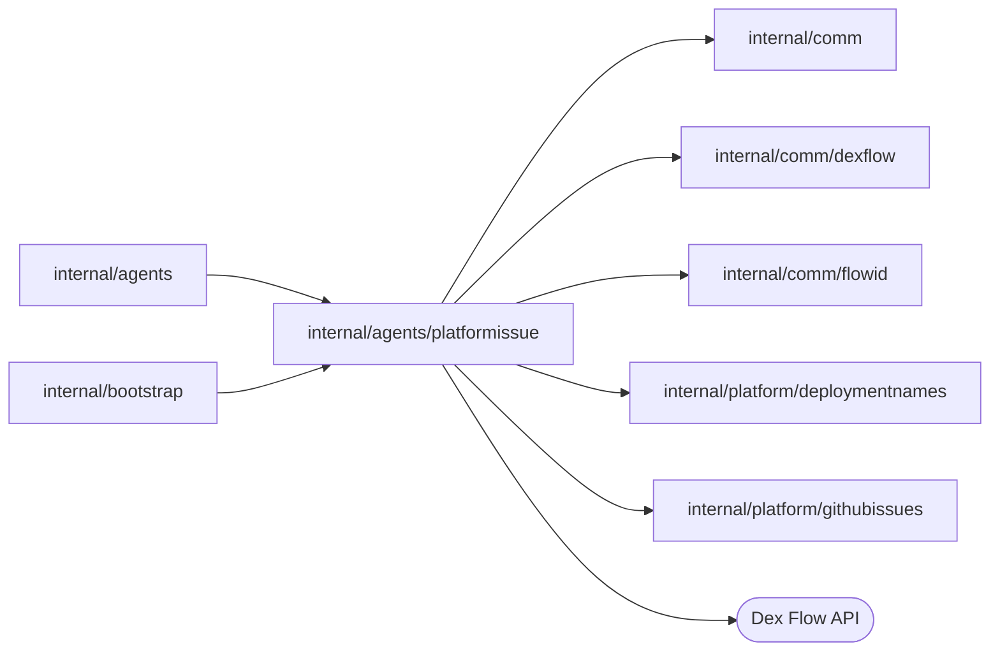
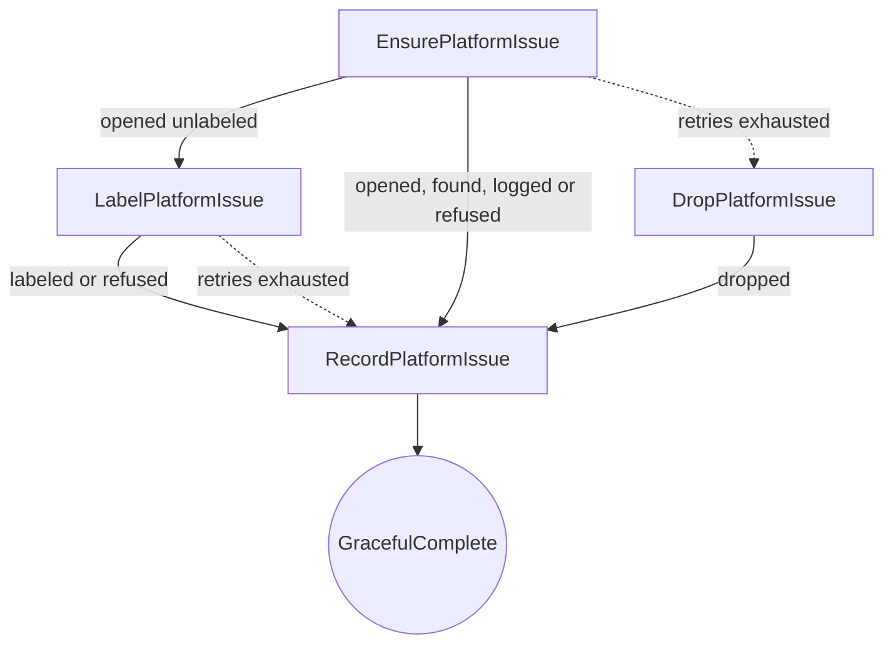

# Platform issue reports

<!-- BEGIN GENERATED PACKAGE SUMMARY (scripts/check-package-readmes.py; edit only Purpose) -->
Purpose: Files the platform faults of one signature as one GitHub issue: PlatformIssueFlow finds or opens it by the signature's label, records the outcome and completes.

Callers: `internal/agents` and `internal/bootstrap` import this package.

Dependencies: it imports `internal/comm`, `internal/comm/dexflow`, `internal/comm/flowid`, `internal/platform/deploymentnames` and `internal/platform/githubissues` and calls the Dex Flow API.

<!-- END GENERATED PACKAGE SUMMARY -->

`PlatformIssueFlow` owns the report of a platform fault of a Session
([tool orchestration](../../../docs/architecture/agent-harness-design/tool-orchestration.md#platform-issue-reporting)
owns the design). The Session starts it beside the turn, which never waits for it, through
the Session Service; the Flow finds or opens the GitHub issue of the fault's signature through
[`githubissues`](../../platform/githubissues/README.md), or only logs the incident where the
server names no issue repository. GitHub owns the issue; the platform keeps no copy.

| File | Responsibility |
| --- | --- |
| `platform_issue_flow.go` | Primitives, Step and RPC registration, Step options, thin Steps and the read RPCs |
| `platform_issue_flow_client.go` | `issueFlowID`, `PlatformIssueFlowClient`: the start of a report, which joins a running execution of its signature, and the retained read |
| `platform_issue_flow_dependency.go` | `PlatformIssueFlowDependency`, the issue repository the Flow files in and labels the issue in |
| `platform_issue_flow_bootstrap.go` | `PlatformIssueFlowBootstrap`: the Flow with the issue repository and the logger, and its client |
| `platform_issue.go` | `Incident` with its signature and Start RequestID, the struct-typed `outcomeStatus`, `Outcome`, `snapshot`, the outcome event, the issue's title and body and the log lines |

## Dex Flow Changes

| Fact | Single owner |
| --- | --- |
| The issue of a signature in an environment: its number, page, state and label | GitHub, through the label `superverse-incident:<env>:<sig16>` |
| How one report went: the incident that started the run and its outcome | the run of `PlatformIssueFlow` (`Incident`, `Outcome`) |
| That a fault happened in a Session, and the incident it reported | `SessionAgentFlow`: the input of its side-branch Step `ReportPlatformIssue` in its engine history |

### Identity and execution lifecycle

- Flow type: `PlatformIssueFlow` (the Go type name; no `GetFlowType` override).
- FlowID: `platform-issue-<env>-<sig16>`, for example
  `platform-issue-test-3f9a1c2b7d4e5f60`, derived by `flowid.PlatformIssueFlowID`
  (`platformissue.issueFlowID`). `<env>` is the server's environment and `<sig16>` the first 16
  hex characters of the signature, the hex SHA-256 of the fault's owner, tool, code and
  error type (`flowid.PlatformIssueSignature`), which the issue's label also carries. The
  Flow belongs to no Project: every Session's report of the signature reaches it.
- Creation trigger: the Session's side-branch Step `ReportPlatformIssue`, through
  `SessionFlowService.ReportPlatformIssue`, which maps the Session's
  `agentloop.PlatformIncident` to `Incident` and calls `PlatformIssueFlowClient.Report`.
  Nothing else starts a report, and a read never starts one.
- Start RequestID: `flowid.Fingerprint` of `{SessionFlowID, CallID, Signature}`.
- Reuse policy: `dex.IDReuseAllowIfNotRunning` with `AlreadyStarted.IgnoreError`:

  | Existing run | Same RequestID | Different RequestID |
  | --- | --- | --- |
  | None | New run | New run |
  | Running | Success; joins the running run without replacing its `Incident` | `*dex.FlowAlreadyStartedError`, which the client answers as joined (`Report.Joined`) |
  | Closed | New run of the same FlowID | New run of the same FlowID |

  Concurrent reports of one signature, from one Session or several, therefore run one
  `EnsurePlatformIssue`, which closes the race of two reports that each open an issue. A
  report after the run closed starts a new run.
- First-Step admission: the issue's owner is GitHub, so `EnsurePlatformIssue` asks it.
  `githubissues.EnsureIssue` queries the label, open and closed issues, before it writes,
  so a new run of a reused FlowID, and a retried attempt, find the issue an earlier one
  opened and never open another. An issue GitHub opened without the label, which it drops
  for a caller that may not set it, is committed by the decision into `LabelPlatformIssue`
  before the label is attached, so a retried label call never opens another; only a
  dropped label whose creation answer was also lost leaves an issue no report finds. The remaining window: GitHub's label listing is
  eventually consistent for a few seconds, so a new run within seconds after a run that
  opened the issue completed may still open a second one. Keeping the run open until the
  listing returns the issue would close it; this is accepted instead.
- Completion: the outcome is the business result. `RecordPlatformIssue` ends the run with
  `dex.GracefulComplete(Receipt{Signature, Status})`; business and engine completion
  coincide, and there is no archival state. There is no explicit rerun: the next report of
  the signature is a new run.
- Retention: the completed run stays readable through `GetPlatformIssue` for the engine
  retention period; nothing reads it afterwards. A read after retention reports absence.
- Relationships: an independent top-level execution, neither a SubFlow nor a Project
  child; it makes no cross-Flow call and the Session never reads it.

### Attributes and AttributeMaps

There is **no AttributeMap**. Both Attributes are ordinary singleton values.

| Attribute | Type and meaning |
| --- | --- |
| `Incident` | `Incident` struct, fixed by the start: `Environment`, `SessionFlowID`, `CallID`, `Tool`, `Code`, `Owner`, `Effect`, `ErrorType` and `OccurredAt`, identifiers and classification only |
| `Outcome` | nullable `*Outcome`: `Status` (`opened`, `found`, `logged` or `dropped`, the struct-typed `outcomeStatus`), `IssueNumber` and `URL` of the issue GitHub returned, and the bounded final error of a dropped report, or of an opened issue GitHub would not label. Nil until the report ended |

- Owner: the run is the only writer; its Steps form one chain, so no Step holds a lock
  and none needs CAS. `RecordPlatformIssue` is the only writer of `Outcome`.
- Index and query needs: none. A report is addressed by its FlowID; diagnostics search by
  `FlowType = 'PlatformIssueFlow'`.
- Secrets: none. No message, argument, file or conversation text enters an Attribute; the
  installation token stays inside the GitHub App client, and the final error of a dropped
  report is GitHub's error text, bounded to 2 KiB.
- Loading: ordinary Attributes are delivered to every handler.
- Growth and retention: fixed size per run; nothing needs cleanup.

### Channels and ChannelMaps

None.

### Streams

None. The outcome event in the engine history and the server log are the diagnostic
records.

### Steps, RPCs and recovery

- `EnsurePlatformIssue` (start Step, `dexflow.ProviderStepOptions()`: synchronous, a
  45-second attempt, retried for three minutes; no lock) calls
  `PlatformIssueFlowDependency.EnsureIssue` with the issue of the incident. Where no issue
  repository is configured (`githubissues.ErrNotConfigured`) the outcome is `logged`; a
  refusal asking again cannot change (`githubissues.ErrRejected`) is `dropped` with its
  reason; any other error, a lost answer included, is logged with the attempt and returned,
  so the engine runs the next attempt, which queries the label first. A found issue is
  `found`, an opened one `opened`; an issue GitHub opened without the label moves, with its
  number and page in the decision's `Outcome`, to `LabelPlatformIssue`.
- `LabelPlatformIssue` (`dexflow.ProviderStepOptions()`, no lock) calls
  `PlatformIssueFlowDependency.LabelIssue`, which adds the signature's label to the opened
  issue; a repeat changes nothing. A refusal (`githubissues.ErrRejected`) moves to
  `RecordPlatformIssue` as `opened` with its reason; any other error is logged and retried.
  Its failure route is `RecordPlatformIssue` itself with the same `opened` input, which records
  the final error. An issue left unlabeled is not found by the next report, which opens another.
- `RecordPlatformIssue` (`dexflow.StateStepOptions()`) writes `Outcome`, with the final error
  (`ctx.RecoveryError().Detail`, bounded) when it is the failure route of `LabelPlatformIssue`, records the
  `platform_issue` event (`outcomeEventRecord`: signature, outcome, issue number, failure), logs
  the incident with its outcome, a warning or an error for a dropped report, and completes.
- `DropPlatformIssue` (`dexflow.StateStepOptions()`) is the failure route of
  `EnsurePlatformIssue`: it moves to `RecordPlatformIssue` with `dropped` and the final
  error (`ctx.RecoveryError().Detail`, bounded); each failed attempt was already logged.

A Worker that dies during `EnsurePlatformIssue` loses only that attempt; the next one
queries the label again. One that dies during `LabelPlatformIssue` repeats the label call on
the committed issue. No incomplete operation outlives the run: an issue opened by an
attempt whose answer was lost is found by the next attempt or the next run.

RPCs:

| RPC | Options | Purpose |
| --- | --- | --- |
| `GetPlatformIssue` | unlocked, output only, short | The `snapshot`: the incident and the outcome. It also serves a completed run. Diagnostic only |
| `GetDexSummary`, `GetDexDisplay` | unlocked, short | Operator metadata: the `Incident` and the `Outcome` |

`PlatformIssueFlowClient.GetForTest` reports a signature never reported as
`*dex.FlowNotFoundError`.

Compatibility: `LabelPlatformIssue` is a new Step; an open run is in `EnsurePlatformIssue` for
at most its retry window and continues with the new graph, so no open run needs
reconciliation. Before that, a new Flow type. Before it, the Session filed the issue itself in its Steps
`ReportPlatformIssue` and `DropPlatformIssue`; an open Session that has one of those Step
executions in flight is pre-launch state that the rollout reconciles by deleting the
Project.

## Database Schema Changes

None. GitHub owns the issue and the run's Attributes own the report.

## UI/UX

None. No Studio page shows a report, and the Agent's platform tools, which read only the
Session's own Project, do not read this Flow. Operators see it in Dex Web with the platform
Flows (`GetDexSummary`, `GetDexDisplay`) and in the issue repository.

## Tests

- `TestPlatformIssueJoinDexIntegration` (`SUPERVERSE_TEST_DEX_ADDRESS`,
  `SUPERVERSE_TEST_WORKER_HOST`): reports of a fresh signature start on a Worker target
  nothing serves yet, so the run stays open; a second report of the signature from another
  call joins it, and a retry of the first joins it again. Once a Worker of the test, without
  an issue repository, serves the target, the one run runs `EnsurePlatformIssue` and
  `RecordPlatformIssue` once each and records `logged`.
- `TestPlatformIssueFlowGitHubIntegration`, a manual test with the inputs of
  [`githubissues`](../../platform/githubissues/README.md#verification): the same join with
  the real issue repository; the one run opens exactly one issue, which the label listing
  returns alone; the test closes the issue and deletes its label.
- `TestPlatformIssueLabelGitHubIntegration` of
  [`githubissues`](../../platform/githubissues/README.md#verification): `LabelIssue`, twice, on a
  real issue opened without the label, which a later `EnsureIssue` then finds. GitHub keeps the
  label for the App, which may set it, so no test drives `LabelPlatformIssue` through a dropped
  label or a failed label call; its repeat safety is that of `LabelIssue`, and the decision
  that commits the opened issue before it is the Flow's.
- `TestSessionMockPlatformIssueDexIntegration` and
  `TestSessionMockModelFailureDexIntegration` ([`agents`](../README.md#tests)): every
  report of a Session addresses the `PlatformIssueFlow` of its signature, one FlowID per
  signature, whose run records `logged`.

## Documentation

[Tool orchestration](../../../docs/architecture/agent-harness-design/tool-orchestration.md#platform-issue-reporting),
[StartFlow admission](../../../docs/architecture/start-flow-admission.md) and
[the Session Service](../README.md). The generated graph is
`docs/flows/sv2-platform-issue-flow.json`.
