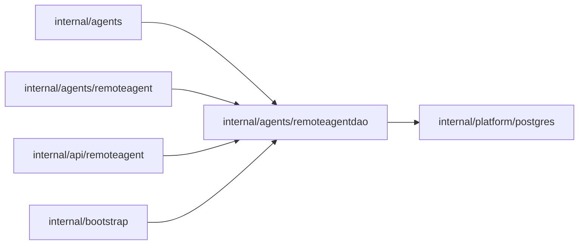

# Remote connection credentials

<!-- BEGIN GENERATED PACKAGE SUMMARY (scripts/check-package-readmes.py; edit only Purpose) -->
Purpose: Owns PostgreSQL remote connection credentials, bounded pairing admission, revocation and liveness without owning the Session executor.

Callers: `internal/agents`, `internal/agents/remoteagent`, `internal/api/remoteagent` and `internal/bootstrap` import this package.

Dependencies: it imports `internal/platform/postgres`.

<!-- END GENERATED PACKAGE SUMMARY -->

The server's shared pool is injected; this package creates no pool or
background cleaner. Migration `0007_remote_agent_connections.sql` is additive.
Credentials store hashes only. The Session owns current executor identity
and epoch; this table has only `PAIRING`, `PAIRED` and `REVOKED` statuses.

Pairing admission takes a transaction-scoped Project advisory lock, removes
revoked and expired pairing rows, and refuses at six remaining rows. Paired
credentials are never evicted. Hash collisions only serialize unrelated
Projects. Project deletion removes the exact Project's credentials at the
existing Session cleanup boundary. Liveness updates are limited to once per
connection per minute.

Creation and deletion share the transaction-scoped Project lock even for an
empty Project. Creation rereads current issuing login, account and Project
memberships/status after the lock, then applies the injected owning capability
policy before cleanup/count/insert. Project deletion is idempotent and reports
pending until its SQL projection is visibly DELETING/DELETED, so existing
reconciliation cannot acknowledge a stale READY snapshot. Redemption locks and
updates only an existing unexpired row; it cannot insert after cleanup.

Hash lookups join ACTIVE account, issuing login expiry/auth_epoch and current
Project/membership read models with one query. These reads never write Dex
projections. The credential consumer owns 401/403/404 distinctions and applies
the real Project capability; unavailable dependencies propagate. Liveness
writes are conditional at 60 seconds. Real lane PostgreSQL tests cover row and
advisory locks, zero/five-row races, single use, retained paired rows, liveness
and current credential invalidation. See
[the table and cleanup contract](../../../docs/api/remote-agent.md).

`LastSeen` reads one exact `(project_id, connection_id)` PAIRED row through its
primary-key index and returns only a nullable timestamp. Absent, wrong-project,
revoked and null results return nil; SQL errors propagate. Session uses this
only for transient display of its canonical remote executor, never for admission
or authority. It adds no durable column, port or pool. Missing Project projections
cannot acknowledge deletion; existing bounded Project reconciliation eventually
records failure if visibility never arrives.
