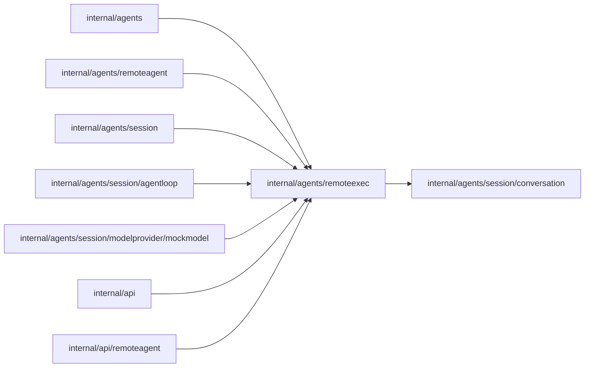

# Session executor

<!-- BEGIN GENERATED PACKAGE SUMMARY (scripts/check-package-readmes.py; edit only Purpose) -->
Purpose: Defines Session executor admission, report fences, bounded inbox items, stable remote calls, public delivery and platform handoff metadata without transport or credentials.

Callers: `internal/agents`, `internal/agents/remoteagent`, `internal/agents/session`, `internal/agents/session/agentloop`, `internal/agents/session/modelprovider/mockmodel`, `internal/api` and `internal/api/remoteagent` import this package.

Dependencies: it imports `internal/agents/session/conversation`.

<!-- END GENERATED PACKAGE SUMMARY -->

RAPAIR declares these domain types and the Session's `Executor` Attribute; it
does not write them. RAEXEC owns mode changes, generation/report fences, the
remote branch and handoff consumption. `Binding` is public display metadata;
the HTTP boundary maps the separately owned Bridge protocol explicitly.

`Mode` is the closed set `platform` and `remote`. `Executor` holds its mode,
monotonic epoch and generation, optional `RemoteExecutor`, and optional
`PlatformHandoff`. A remote executor carries its connection ID, immutable
authenticated owner, binding, admitted-report watermark (`Reported`), consumed-report
watermark (`Consumed`) and activation time. A `RemoteExecutor` persisted before `Consumed`
existed reads 0; such pre-launch open remote executions are reset, not reconciled (Session README).
The handoff carries its platform epoch, time range, at most four owners in
oldest-first order, and the closed reason `switched` or `connection_removed`.
RAEXEC enforces those write-time bounds; credentials never confer executor
authority.

The owning Session's read treats an absent Attribute as platform at epoch 0,
without persisting a default. No Flow, Step, Channel, Stream, database table,
timer, pool or goroutine is introduced by this package.

`Change` is pure basis-epoch admission; the Session commits it with interruption
and wake publication. `InboxItem` is a server-only Report/Control union. Reports
are independently validated and matched against current authority; a sequence at or below
`Reported` of the current remote connection and epoch is a duplicate whatever its generation, so a
retry after a lost answer and a Stop is never refused `stale_generation` (that refusal proves
non-admission); a report of another connection or epoch is never a duplicate; duplicate
admission never republishes, gaps carry the expected sequence, and actual
encoded pending report unions are bounded to8/2MiB. Controls cannot appear in
Bridge Report DTOs and have no business state; consumers reread Executor.

## Settlement watermark

`Reported` proves only admission. `SettledThrough` is the highest report sequence of the
current epoch and connection whose outcome the Session durably recorded; the Bridge reads it in
`sync` as `settledThrough`. It is not stored separately: it is
`min(Consumed, sequence of each pending remote call of this epoch - 1)`, computed by
`Executor.SettledThrough` over AgentState's pending suffix (`PendingToolCalls[PendingToolIndex:]`)
in the one ReadRemote that reads both, so it needs no Channel size or load. `ReadRequest.RepositoryContext`
asks the same read for the Workspace's repository context (at most 8 KiB), which only the sync that
builds a remote agent's context (`agentloop.RemoteAgentContext`) sets. `Consumed` advances only
under `executorLock`, in the AwaitUser or AwaitRemoteAgent commit that consumes a report of this
epoch and connection (`Executor.Consume`), and a pending call leaves the suffix only in the commit
that appends its canonical tool_result. The transitions are therefore:

- an events-only report: settled by the commit that consumes it;
- a `TurnCompleted` report: settled by the commit that consumes it, whether a turn runs (it ends
  the turn) or not (the idle branch ignores it but still consumes it);
- a report of a stale generation (an older generation, same epoch and connection): consumed and,
  for a tool call, answered interrupted in the same commit;
- a serial tool call: settled by the commit that appends its tool_result (a real result, an
  interrupted, cancelled or `EffectUnknown` one, or `request_user_input`'s `waiting_for_user`
  placeholder) and moves the cursor past it;
- a parallel wave: the cursor stays at the wave's first call until the join
  (AwaitParallelToolResults) appends every result of the batch and moves past all of it, so the
  watermark jumps to the batch's last sequence only then, never at a branch completion;
- Stop (`endStoppedTurn` in FinishInterrupt or AwaitRemoteAgent), `waitForUser`'s superseded calls
  and `rejectStaleToolBatch`: they answer the remaining calls and clear the cursor in one commit;
- a takeover (`SetExecutor` to another connection or to platform) starts a new epoch whose
  `RemoteExecutor` begins at `Consumed` 0; the old epoch's queued reports are consumed later as
  stale and never move the new epoch's watermark.

Reports are admitted with consecutive sequences and consumed in order, and a tool batch finishes
before the next report is consumed, so the value never decreases within an epoch and is contiguous:
every sequence up to it is settled. Its state is one integer per epoch, O(1) whatever the history.
The sync long poll wakes on Session activity; a commit that settles without writing activity is
seen at the next poll, within `SyncWait`.

A projected tool result keeps its `ToolCall` summary, so the HTTP mapping classifies
`request_user_input`'s `waiting_for_user` placeholder (from the Session's typed result payload) as
the wire status `waiting_for_user`: the remote call stays open until its answer entry
(`AnsweredInputCallID`). No other result, `confirm_requirements`' placeholder included, carries a
status.

`projectEntry` and `BoundedDelivery` produce a transient public projection,
without assistant/hidden blocks or opaque tool input. They preserve whole
canonical inputs and exact-epoch own tool results. Through advances across
examined filtered entries, while a budget-excluded eligible entry remains for
the next read. The first eligible entry stays whole even above the1MiB soft
budget; the HTTP boundary measures the full16MiB response and state digest.
This package imports only conversation and the standard library.

`Fence{Epoch, Generation}` is original admission metadata in the existing
AgentState pending batch and Step inputs. Zero belongs only to legacy platform
executions. Matching a fresh executor never reconstructs an old admission.
The Session commits authoritative model results in RecordPlatformModelResult;
this domain package holds no provider transport or additional result lifecycle.

`PlatformHandoff.Notice` and `ParseHandoffNotice` own one typed public first-line
format, its existing HandoffReason set and bounded owners/time/HEAD validation.
The Session appends optional context sections within `MaximumHandoffBytes`;
mock provider assertions parse that same format without discarding any request
content. These transient values add no persisted Attribute or public wire DTO.
