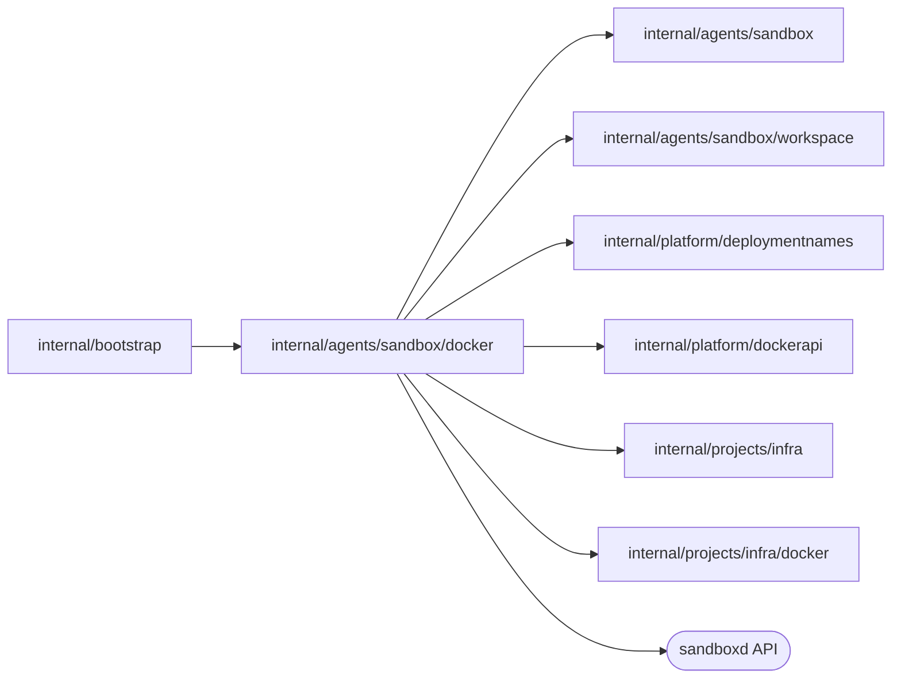

# Docker Sandbox instances

<!-- BEGIN GENERATED PACKAGE SUMMARY (scripts/check-package-readmes.py; edit only Purpose) -->
Purpose: Runs a Session's Sandbox instances as hardened Docker containers of the coding image on its own network and workspace volumes, and exposes and reclaims them by exact identity.

Callers: `internal/bootstrap` imports this package.

Dependencies: it imports `internal/agents/sandbox`, `internal/agents/sandbox/workspace`, `internal/platform/deploymentnames`, `internal/platform/dockerapi`, `internal/projects/infra` and `internal/projects/infra/docker` and calls the sandboxd API.

<!-- END GENERATED PACKAGE SUMMARY -->

`InstanceProvider` is the Docker implementation of `sandbox.InstanceProvider`, which
Local Native runs. It builds on the [Docker project infrastructure](../../../projects/infra/docker/README.md),
queries exact identities before every effect and owns no lifecycle state: an object
it finds must carry the Session's owner labels, and a recorded identity that no longer
matches is an ownership conflict, never adopted.

## Identities

| Reference (`sandbox.Resources`) | Kubernetes | Docker |
| --- | --- | --- |
| `Boundary`, the Session's isolation | the Session namespace `<prefix>-session-<project>`, by UID | the Session network `sv2-session-<project>`, by network ID |
| `Volume` and `Identity`, the workspace and the principal of Preview grants | the PVC and the service account, by UID | the workspace volumes `<network>-workspace-repository` and `<network>-workspace-preview-state`, by their shared `superdurable.io/workspace-uid` label |
| `Instance` | the Sandbox object, by UID | the container `<network>-coding`, by its `superdurable.io/instance-uid` label |
| `ServiceName`, `ServiceUID` | the Sandbox's headless Service | the container's alias `coding` on the Session network, and its container ID |

The instance UID is generated when the container is created and also set as
`SUPERVERSE_POD_UID`, so it stays the same across a `docker restart`. A cold start
attaches the next instance to the same network and workspace volumes, so the Preview
principal, the network ID and the workspace UID, survives the instance, and the
grants the Session holds stay valid. A container is reachable only through the ports
it publishes on 127.0.0.1, which `SandboxAddresses` resolves for each new workspace
transport from the container that carries the binding's instance UID.

## Container

`readProfile` reads the chart's coding profile, rendered by the Native launcher into
the lane's state directory, and verifies it as Kubernetes does
(`sandbox.VerifyCodingProfile`): Kind and Docker run the same contract. From the
Sandbox's Pod template it takes the image, command, arguments, environment, ports,
user, CPU and memory limits, the preStop hook, the termination grace period and the
mounts; a setting Docker has no counterpart of is an error, never dropped.

- **Hardening.** UID 1000, a read-only root, every capability dropped,
  `no-new-privileges`, the profile's CPU and memory limits and no restart policy:
  the Session decides whether an instance runs.
- **Volumes.** Each subPath of the workspace (`repository`, `preview-state`) is a
  named volume of its own, which replaces the Pod's subPaths and `fsGroup`: a new
  volume takes the ownership of the image directory it is mounted over, which the
  coding image gives UID 1000. Each `emptyDir`, `/tmp`, is an anonymous volume on
  disk that the container's removal deletes; tmpfs would count against the memory
  limit.
- **Networks.** The container joins the Sandbox network of the Project's Session,
  `<prefix>-session-<projectID>`, under the alias `coding` and the project network,
  where its Preview reaches the Live MinIO as `storage`.
- **Ports.** sandboxd (8080, 9090), the Preview Dex (8801) and the Preview
  application (3000) are published on ephemeral loopback ports.
- **Stop.** `DeletePod` runs the profile's preStop hook (`superverse-previewctl
  shutdown --timeout 30s`) in the container, then stops it with the profile's grace
  period (45 seconds) before it removes it.

## Provisioning and reclamation

The callers are those of every runtime ([the current contract](../../../../docs/architecture/agent-harness-design/sandbox.md)):
a SandboxProvisionFlow provisions an instance, the Project's PreviewFlow serves its
Preview on it, the SessionWorkspaceFlow reclaims its container, and the deleting Project releases
what the Session left by name and label.

- **Provision.** Converges the network, the workspace volumes under one workspace
  UID and the container, in that order, and creates the container only once the
  volumes are of this profile and no other container mounts them: a volume of another
  profile is `sandbox.ErrProfileMismatch`, a container of another instance that mounts
  them and that nobody removes is `sandbox.ErrVolumeInUse`, and one being removed is
  waited for. A created or exited container of the instance is started; a recorded
  instance whose container is gone is lost, as a deleted Sandbox object. Ready means
  running with sandboxd answering `/v1/health`.
- **Preview.** `EnsurePreviewEnvironment` starts the engine through the workspace
  transport and verifies, through `infra.Connections`, that its Dex answers on the
  instance's published Dex port. `ExposePreview` writes the Project's Preview route to
  the instance's application port as the platform wants it now, replacing a route
  that an earlier instance of the Project published or that differs and refusing
  another holder of the host (`infra.ErrOwnershipConflict`), and returns the public
  URL once the gateway's API lists the route and the application answers through the
  gateway. `StopPreview` withdraws the route, so nothing on the application's port is
  reachable through the gateway while the Preview is stopped, and then stops the
  application when the instance still runs. `ReleasePreviewRoute`, which a stop and
  the deleting Project's release call, withdraws the route whichever of the
  Project's instances published it, because the release names none.
- **Reclamation and release.** `DeletePod`, `DeleteVolume` and `DeleteNamespace`
  remove the recorded container, workspace volumes and network, each only while it
  carries the recorded identity, and an absent object is gone. `DiscoverResources` completes the
  references a reclamation or the release lacks from the deterministic names.

The deviations from the Pod that the Native lane accepts are in
[the current contract](../../../../docs/runbooks/local-native.md).

## Tests

`instance_integration_test.go` (build tag `live`) needs the local Docker Engine, helm
and `SUPERVERSE_TEST_CODING_IMAGE`. It renders the chart's coding profile with that
image and runs a Project's Sandbox as the server does: the instance's hardening and
Pod UID, a workspace written through sandboxd's user under a read-only root, a Preview
grant bound to the Sandbox network and workspace volumes, refusals of a replaced
instance, workspace and principal and of a second instance on the same volumes, the
reclamation that keeps the volumes, a cold start that attaches them again under the
same principal, the Preview engine whose Dex answers through the instance's published
port, the Project's Preview route that a later instance replaces, another holder of
the host keeps, the gateway forwards and, once a stop withdrew it, answers 404 for,
and the next expose writes again, rewriting one that differs, and the deleting
Project's release in the Session
Service's order, which removes the Project's route whichever instance published it
but not another holder's, leaves nothing of the Sandbox and, repeated, finds
everything gone.

## Files

| File | Responsibility |
| --- | --- |
| `instance_provider.go` | `InstanceProvider`, names and labels, `Provision`, the workspace volumes, `DiscoverResources`, `SandboxAddresses` |
| `profile.go` | The rendered coding profile as a Docker container |
| `preview.go` | `EnsurePreviewEnvironment`, `ExposePreview`, `StopPreview`, `ReleasePreviewRoute` |
| `cleanup.go` | `DeletePod`, `DeleteVolume`, `DeleteNamespace` |
