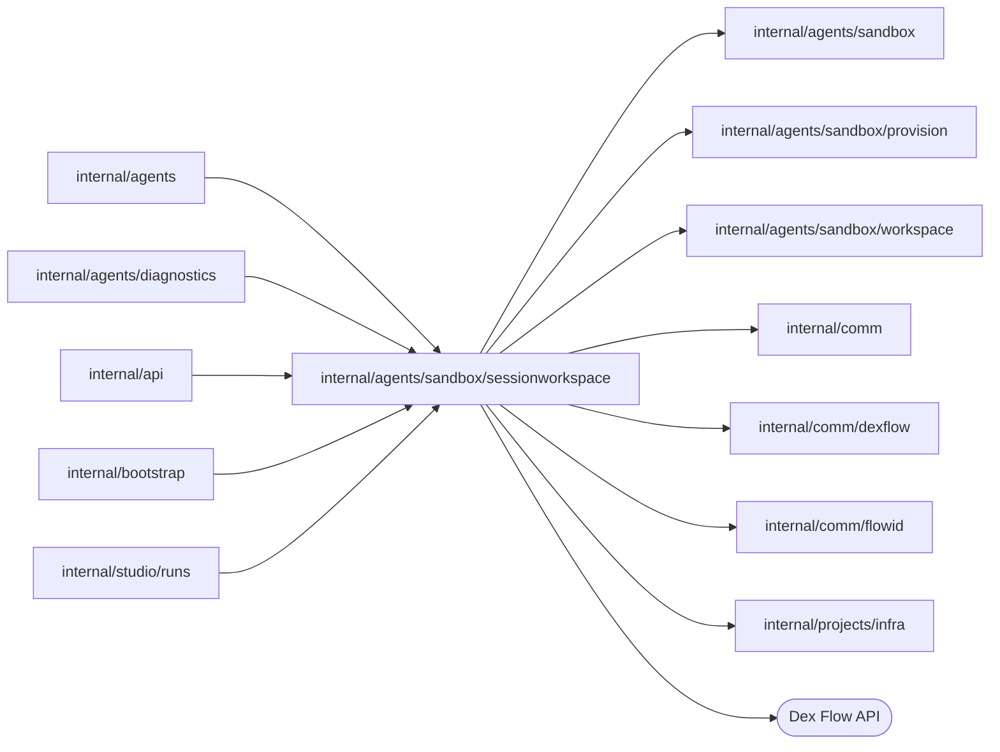
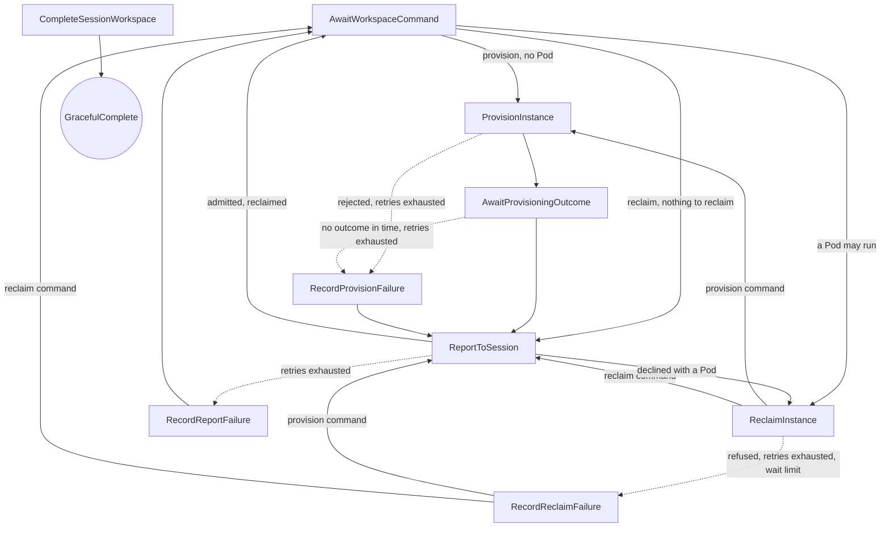

# Session workspace

<!-- BEGIN GENERATED PACKAGE SUMMARY (scripts/check-package-readmes.py; edit only Purpose) -->
Purpose: Owns a Project Session's Sandbox instances in one SessionWorkspaceFlow: runs the Session's provision and reclaim commands one at a time and reports each outcome.

Callers: `internal/agents`, `internal/agents/diagnostics`, `internal/api`, `internal/bootstrap` and `internal/studio/runs` import this package.

Dependencies: it imports `internal/agents/sandbox`, `internal/agents/sandbox/provision`, `internal/agents/sandbox/workspace`, `internal/comm`, `internal/comm/dexflow`, `internal/comm/flowid` and `internal/projects/infra` and calls the Dex Flow API.

<!-- END GENERATED PACKAGE SUMMARY -->

`SessionWorkspaceFlow` is the single owner of the Sandbox **instances** of a
Project's Session. The Session keeps the request side, its accepted lease, its
Sandbox deadline and the decision that the instance is idle
([the Session](../../session/README.md)); it sends this Flow a `provision`
command for each workspace request and a `reclaim` command at the deadline.
The Flow runs the commands one at a time, so a reclamation and a new
provisioning never interleave and one workspace volume carries one Pod. It
starts the instance's [SandboxProvisionFlow](../provision/README.md), which
reports back to it, reclaims an instance (the Preview's release, the engine
stop, the inspection and the Pod deletion, keeping the volume) and reports
every outcome to the Session.

| File | Responsibility |
| --- | --- |
| `session_workspace_flow.go` | Primitives, Step and RPC registration, Step options, thin Steps and the RPCs |
| `session_workspace_flow_client.go` | `flowID`, `SessionWorkspaceFlowClient`: the start with a command, the provisioning's report, the retained read and the end at the Project's deletion |
| `session_workspace_flow_dependency.go` | `SessionWorkspaceFlowDependency`, `ProvisionRequest` and `ErrWorkspaceStartRejected` |
| `session_workspace_flow_bootstrap.go` | `SessionWorkspaceFlowBootstrap`: the Flow with the reclaimer on the instance provider and the workspace transport, and its client |
| `instance.go` | `Instance` with its struct-typed `InstanceState`, `WorkspaceCommand` with `CommandKind` and its `Admission`, `Outcome` with `OutcomeKind` and `reportAnswer`, `Provisioning` and `Snapshot` |
| `workspace_task.go` | `workspaceTask`, the input of every Step, the provisioning's report and the reclamation helpers of `ReclaimInstance` |
| `reclamation.go` | `reclaimer`, `reclamationHooks` and `reclamationProgress`: one attempt of a reclamation in the rounds of a polling Step |

## Dex Flow Changes

| Fact | Single owner |
| --- | --- |
| The current instance: its state, its resources, what its volume holds, the phases of its provisioning, its lease once ready and its last failure | `SessionWorkspaceFlow` (`Instance`) |
| The outcome of the last command and how the Session answered it | `SessionWorkspaceFlow` (`Outcome`) |
| Which commands were admitted | `SessionWorkspaceFlow` (`Admission`) |
| The request side: the request in flight, the accepted lease, the Sandbox deadline, the Preview's hold | `SessionAgentFlow` (`Workspace`) |
| How one provisioning went | one `SandboxProvisionFlow` execution |
| What exists in the lane's runtime | the runtime, through deterministic names and ownership labels; recorded UIDs are "changed underneath us" guards |

### Identity and execution lifecycle

- Flow type: `SessionWorkspaceFlow` (the Go type name; no `GetFlowType` override).
- FlowID: `session-workspace-<projectID>`, for example
  `session-workspace-a7k2`, derived by `flowid.SessionWorkspaceFlowID`
  (`sessionworkspace.flowID`). One execution per Project, the owner of the
  instances of its one Session.
- Creation trigger: the Session's first workspace command, through
  `SessionFlowService.ProvisionWorkspace`, which requires a READY Project, or
  `ReclaimWorkspace`. `SessionWorkspaceFlowClient.Submit` starts the Flow and
  then invokes `SubmitWorkspaceCommand`; nothing else starts it and a read
  never does.
- Start RequestID: the fingerprint of `{SessionFlowID}`. Initial Attributes:
  `ProjectID` and an empty `Instance`.
- Reuse policy: `IDReuseDisallow` with `AlreadyStarted.IgnoreError`. Every
  later command joins the running execution. The engine also joins a
  same-request start of an ended execution, so the command RPC confirms every
  submission: an ended execution answers inactive, which the client returns
  as `ErrWorkspaceClosed`, and the Session records it as a rejected request.
- Duplicates and retries: a command's ID is `ws-<n>/<kind>`, for example
  `ws-3/provision` and `ws-3/reclaim`. A repeated command (a retry of the
  Session's `SendWorkspaceCommand` after a lost answer) is accepted without
  being published again; a command of an older request is refused.
- Completion: only the Project's deletion ends the Flow. `CompleteSessionWorkspace`
  refuses later commands, cancels a provisioning or reclamation in progress
  and moves to the `CompleteSessionWorkspace` Step, which discards pending
  commands and completes with `dex.GracefulComplete(Receipt{ProjectID})`. The
  deleting Project releases the instance's resources by label in the same
  cleanup pass. There is no business completion before that and no explicit
  rerun.
- Retention: the completed execution stays readable through
  `GetSessionWorkspace` for the engine retention period; the cleanup reads the
  recorded instance from it.
- Relationships: an independent top-level execution, neither a SubFlow nor a
  Project child. It starts one `SandboxProvisionFlow` per instance, through the
  Session Service, and reports to the Session through the same Service.

### Attributes and AttributeMaps

There is **no AttributeMap**. Every Attribute is an ordinary singleton value of
fixed size; none is indexed and none holds a secret (the lease binds provider
identities only).

| Attribute | Type and meaning |
| --- | --- |
| `ProjectID` | `string`, fixed by the start |
| `Instance` | `Instance` struct: `State` (`none`, `provisioning`, `ready`, `reclaiming`, `reclaimed`, `failed`; JSON key `instance`), `WorkspaceRequestID` of the command it runs or last ran, `InstanceID`, `Resources` (`sandbox.Resources`, whose namespace, service account and volume outlive the Pod), `VolumeState` (`sandbox.Workspace*`), `UpdatedAt` (JSON key `instanceUpdatedAt`), `Timings` of its provisioning, `Lease` of a ready instance and `Failure{Code, Detail}`. The keys of the fields the Session held before are kept |
| `Outcome` | `Outcome` struct, absent until the first command ended: `WorkspaceRequestID`, `Kind` (`ready`, `failed`, `reclaimed`), the `Lease` or the `Failure`, and `Reported` (`admitted`, `declined`, `undelivered`) |
| `Admission` | `Admission` struct: the last admitted `WorkspaceCommand` and `Closed` once the deletion began |

- Owners and locks: only the RPCs write `Admission`; the command RPCs and the provisioning's report lock it. The Steps
  form one chain, so each is the single writer of `Instance` and `Outcome`, and
  none holds a lock that would make the RPCs wait.
- The retained volume is `Instance.Resources.Retained()`; no separate
  Attribute copies it.
- Growth and retention: fixed size; nothing needs cleanup.

### Channels and ChannelMaps

| Channel | Payload | Producer and admission | Consumer |
| --- | --- | --- | --- |
| `WorkspaceCommands` | `WorkspaceCommand{ID, Kind, WorkspaceRequestID, HeadCommit, PreviewHolds}` | The Session, through `SubmitWorkspaceCommand`: refused while `Closed` and for an older request (requests order by the number of `ws-<n>`, the commands of one request by kind, `provision` before `reclaim`); a repeat of an admitted command answers accepted without publishing | `AwaitWorkspaceCommand`, one at a time |
| `ProvisionOutcomes` (ChannelMap) | `ProvisionReport{WorkspaceRequestID}`, key `ws-<n>`, for example `ws-3` | The instance's SandboxProvisionFlow, through `ReportProvisionOutcome`: published only while that instance provisions and no report is pending for its key; a repeat answers true, another instance's report false | `AwaitProvisioningOutcome` of that instance |

Pending commands are discarded when the Flow completes. A provisioning report
that arrives after the bounded wait stays pending and is never consumed; the
next reclamation reads the provisioning itself.

### Streams

None.

### Steps, RPCs and recovery

- `AwaitWorkspaceCommand` (start Step, `dexflow.StateStepOptions()`) takes one
  command and commits the instance it acts on before any effect: a
  provisioning that may still run is always recorded. A `provision` command
  first reclaims an instance whose Pod may still run (`provisioning`, `ready`
  or `failed`); a `reclaim` command reclaims it, or reports `reclaimed` at once
  when nothing runs.
- `ProvisionInstance` (`dexflow.ProviderStepOptions()`) starts the
  SandboxProvisionFlow of the instance on the retained namespace and volume
  with the command's HEAD, through `StartProvisioning`, which is idempotent for
  the request. A Project that no longer admits a workspace is a rejection,
  `WORKSPACE_START_FAILED`.
- `AwaitProvisioningOutcome` waits for the instance's `ProvisionOutcomes` key
  or `provision.Budget` plus ten minutes, then reads the outcome from the
  provisioning (`ObserveProvisioning`) and records the instance `ready` with
  its lease or `failed`. Without an outcome in time the request fails
  `WORKSPACE_TIMEOUT` and the instance stays `provisioning`.
- `ReclaimInstance` (`dexflow.PollingStepOptions(15m)`, rounds every 2 s
  within 40 s) first waits for the end of a provisioning that may still run
  and takes the resources it recorded, then runs a `reclamationProgress`: the
  Preview's release only when the command names the instance as the
  Preview's (`PreviewHolds`), the discovery of missing references by name,
  the engine stop, the inspection of the volume and the Pod deletion, which
  ends once every Pod of the Sandbox is gone. Each stage queries before it
  changes anything, so a new attempt after a Worker restart starts over
  safely. An object of another owner or UID is a definite refusal. It records
  the instance `reclaimed` and then provisions a waiting `provision` command's
  instance, or reports `reclaimed`.
- `RecordProvisionFailure` and `RecordReclaimFailure`
  (`dexflow.StateStepOptions()`) record the failure with the final error. A
  provisioning failure keeps the instance `provisioning`, as an unknown outcome
  may still create objects. A reclamation failure keeps the resources and
  records `WORKSPACE_RECLAIM_FAILED`; the request whose provisioning waited for
  it fails with that code.
- `ReportToSession` (`dexflow.ProviderStepOptions()`) calls the Session's
  `ReportWorkspaceOutcome` through `SessionWorkspaceFlowDependency` and records
  the answer. A Session that waits for no such request, or is closed,
  declines; a declined `ready` or `failed` instance is reclaimed before the next
  command. `RecordReportFailure` records an undelivered report; the Session
  reads the outcome from `GetSessionWorkspace` once its own bounded wait ends.

RPCs:

| RPC | Options | Purpose |
| --- | --- | --- |
| `SubmitWorkspaceCommand` | locks `Admission`, short | Admits a command (Session Service only) |
| `ReportProvisionOutcome` | locks `Admission`, short | Admits the report of the current instance's provisioning (Session Service only) |
| `GetSessionWorkspace` | unlocked, output only | The `Snapshot`: the instance, the last outcome and whether the Flow closes. Studio's Session snapshot and Runs, the Preview's lend, the Session's bounded wait and the cleanup read it; it also serves a completed execution |
| `CompleteSessionWorkspace` | locks `Admission`, short | The end at the Project's deletion |
| `GetDexSummary`, `GetDexDisplay` | unlocked | Operator metadata |

Cross-Flow calls: a tool call and a deadline extension make none. A cold
start makes four: the Session's command, the provisioning's start, its report
and the report to the Session. A reclamation at the deadline without a running
Preview makes two: the Session's reclaim command and the `reclaimed` report.
The Project's deletion completes the Session, this Flow and the Preview.

Consistency: the Session decides idleness and revokes the lease under its
Workspace lock, in the commit that a tool dispatch's deadline extension
shares, and only then sends the `reclaim` command; so no instance in use is
reclaimed. This Flow runs one command at a time, so a reclamation and a new
provisioning never interleave, and the reclamation ends only once every Pod
of the instance is gone.

Compatibility: a new Flow type that took the instance lifecycle over from
`SessionAgentFlow` before launch; the local lanes delete every Project before
they deploy it, so no open Session holds the earlier instance fields.

## Database Schema Changes

None. The Attributes above own the instance.

## UI/UX

None. Studio's Session snapshot shows the instance this Flow records
(`PROVISIONING`, `READY`, `CLOSING`, `CLOSED`, `FAILED`) with its phase
timings, joined by the Session Service; Studio Runs reads the instance's
identities from the same snapshot.

## Tests

In `internal/agents`, on the Worker of either local lane with the mock model:
`TestSessionWorkspaceCommandJoinsDexIntegration` (a repeated command joins, an
older one is refused, one execution and one provisioning),
`TestSandboxDeadlineReclaimDexIntegration` (a deadline reclamation is exactly
the reclaim command and the reclaimed report, no PreviewFlow exists),
`TestSandboxDeadlineSparesInstanceInUseDexIntegration` (a background command
holds the instance past its deadline),
`TestSandboxReclaimThenProvisionSerializedDexIntegration` (a provision command
waits behind a reclamation), `TestSandboxReclaimWorkerRestartDexIntegration`
and `TestSessionWorkspaceWorkerRestartDexIntegration` (Worker replacements
during the reclamation and the provisioning),
`TestSandboxReplacementReclaimsFirstDexIntegration`,
`TestSandboxReclaimStopsPreviewDexIntegration` and the `TestProjectDeletion*`
tests, which require this Flow completed after the deletion.

## Documentation

[The specification](../../../../docs/architecture/superverse-v2.md),
[the Sandbox design](../../../../docs/architecture/agent-harness-design/sandbox.md),
[the current contract](../../../../docs/architecture/agent-harness-design/sandbox.md)
and [StartFlow admission](../../../../docs/architecture/start-flow-admission.md).
The generated graph is `docs/flows/sv2-session-workspace-flow.json`.
