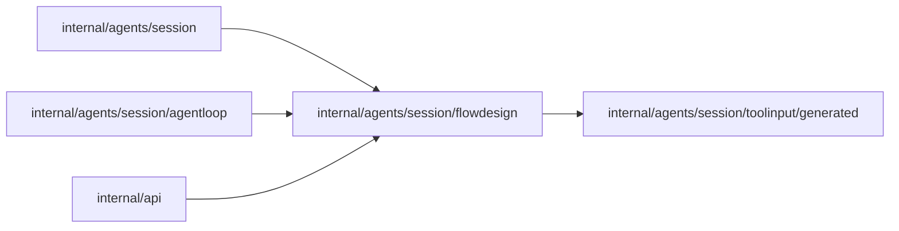

# Flow design

<!-- BEGIN GENERATED PACKAGE SUMMARY (scripts/check-package-readmes.py; edit only Purpose) -->
Purpose: Owns the Flow design a requirements card carries: its validation, canonical JSON, digest and outline, and the main story it shares with the Flow canvas.

Callers: `internal/agents/session`, `internal/agents/session/agentloop` and `internal/api` import this package.

Dependencies: it imports `internal/agents/session/toolinput/generated`.

<!-- END GENERATED PACKAGE SUMMARY -->

The agent's Flow design is the optional `design` of `confirm_requirements`
([design-first](../../../../docs/architecture/design-first/flow-design.md)). This package
turns the decoded tool input into a `Design`, checks what the schema cannot and renders
what the card, the confirmed requirements and every `segment_start` carry of it. The
Session keeps the body in its AttributeMap `FlowDesigns`; this package holds no state.

| Path | Responsibility |
| --- | --- |
| `flow_design.go` | the design types, the closed sets of wait kinds, transition ends and slots, and the conversion from the decoded tool input |
| `validation.go` | the cross-reference, reachability and size checks; group shape is left to Dex's analyzer |
| `outline.go` | the canonical JSON, the digest, the outline and the main story |

The main story is what the start Step reaches through ordinary transitions; every other
Step is failure handling, which only failure routes reach. This is the split Dex's
analyzer and the Flow canvas apply to implemented Flows, so the outline lists the main
story and counts the failure-handling Steps.
