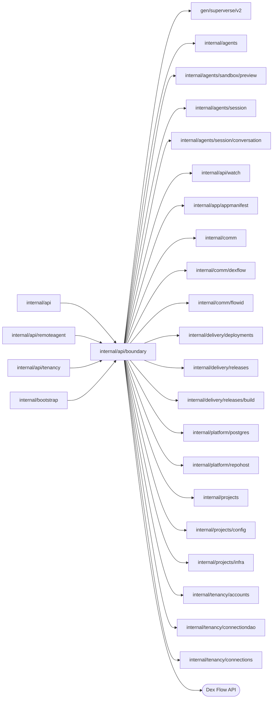

# API trust boundary

<!-- BEGIN GENERATED PACKAGE SUMMARY (scripts/check-package-readmes.py; edit only Purpose) -->
Purpose: Holds the trust boundary every business gRPC handler shares: caller authentication, panic recovery, request input checks, list paging and the mapping of errors to public statuses.

Callers: `internal/api`, `internal/api/remoteagent`, `internal/api/tenancy` and `internal/bootstrap` import this package.

Dependencies: it imports `gen/superverse/v2`, `internal/agents`, `internal/agents/sandbox/preview`, `internal/agents/session`, `internal/agents/session/conversation`, `internal/api/watch`, `internal/app/appmanifest`, `internal/comm`, `internal/comm/dexflow`, `internal/comm/flowid`, `internal/delivery/deployments`, `internal/delivery/releases`, `internal/delivery/releases/build`, `internal/platform/postgres`, `internal/platform/repohost`, `internal/projects`, `internal/projects/config`, `internal/projects/infra`, `internal/tenancy/accounts`, `internal/tenancy/connectiondao` and `internal/tenancy/connections` and calls the Dex Flow API.

<!-- END GENERATED PACKAGE SUMMARY -->

`Boundary` is what every business gRPC handler shares: it authenticates the
explicit caller, binds a Watch to its caller and resume cursor, pages the read
model, recovers panics, logs bounded failed-call status and maps every outcome
to a public status once.

It is also the single mapping between protobuf enums and persisted domain
values. A value name is the enum prefix plus the upper-cased domain value, so
`Enum` maps a domain value to its enum and `domainValue` maps a request enum
back. An empty domain value is the zero enum value; any other undeclared domain
value is a programming error that panics and reaches the caller as Internal. A
request's zero or undeclared enum value is InvalidArgument; the Agent commands
lower-case the domain value of their Resolution and Action.

| File | Responsibility |
| --- | --- |
| `boundary.go` | `Boundary`, caller authentication and Watch binding |
| `rpc_recovery.go` | The unary and stream recovery interceptors: a panic becomes a fixed Internal status and a logged stack, and an unclassified failure's cause is logged behind its fixed status |
| `rpc_failure_log.go` | Unary and stream failure logging with bounded method, status, caller account and Project identity; configuration HTTP error document logging |
| `request_input.go` | Request and message ID checks, `domainValue` and `DomainValues` of request enums and the InvalidArgument status of rejected input |
| `rpc_errors.go` | The mappers from domain, Flow-client and SDK errors to public statuses: `RPCStatus` and, for their domains, `ReleaseReadStatus`, `SessionRPCStatus`, `ConfigurationRPCStatus` and `AgentRPCStatus`; Release read deadlines become Unavailable with a retry hint, without changing commands; only fixed messages and safe business rejections reach the caller; a read model row Dex has not written (`postgres.ErrNotFound`) is NotFound like a missing Flow (`FlowNotFound`); `DexErrorAttrs` describes a Dex error for the log |
| `read_model.go` | `PageRequest`, `ReadPage` and `NextPageToken`: a List RPC's size and keyset page key, in page tokens signed for the caller, the resource and its filters |
| `snapshot_conversion.go` | `Enum` of persisted domain values, and failure, phase timing, timestamp and Flow Definition conversion shared by several snapshots |
