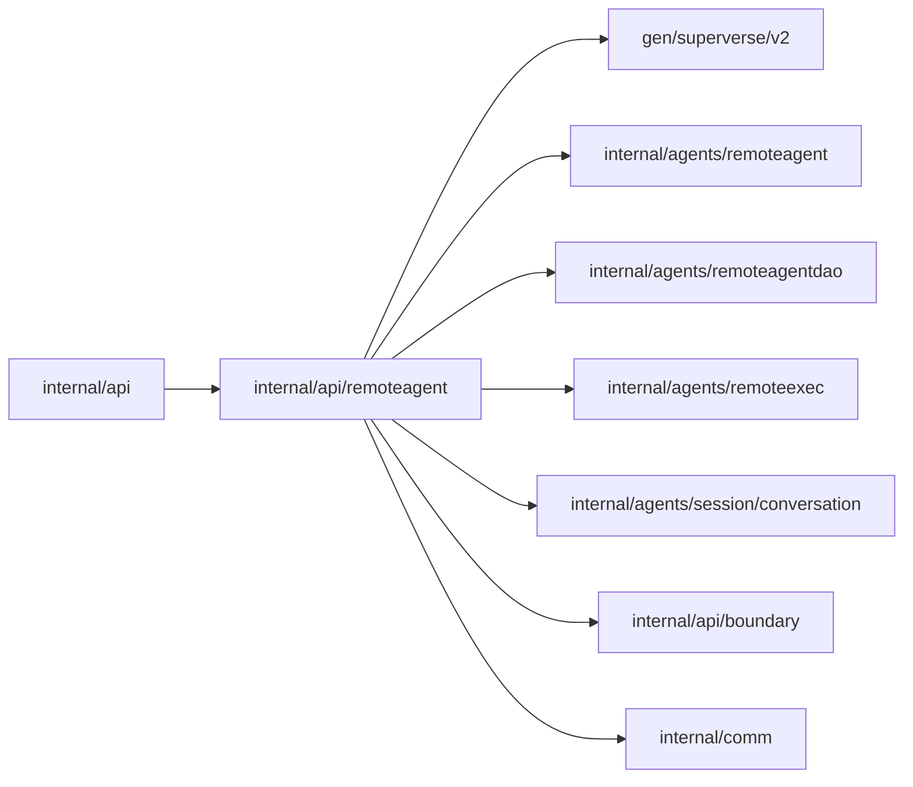

# Remote agent business API

<!-- BEGIN GENERATED PACKAGE SUMMARY (scripts/check-package-readmes.py; edit only Purpose) -->
Purpose: Authorizes Builder pairing, connection reads, removal and platform executor selection through the generated resource contract.

Callers: `internal/api` imports this package.

Dependencies: it imports `gen/superverse/v2`, `internal/agents/remoteagent`, `internal/agents/remoteagentdao`, `internal/agents/remoteexec`, `internal/agents/session/conversation`, `internal/api/boundary` and `internal/comm`.

<!-- END GENERATED PACKAGE SUMMARY -->

The existing server registers this package once through the reviewed business service boundary. Every command reads the canonical authenticated caller and delegates to Connections, which checks the Project capability against SQL and leaves Executor authority in Session. SetSessionExecutor accepts only the observed basis epoch and platform selection; a stale CAS returns the typed executor-changed conflict for snapshot refresh. The Bridge HTTP listener is separate and uses scope credentials rather than CallerContext.

No Flow, database pool, lifecycle, cache or polling loop is created here. Generated transport DTOs are mapped explicitly. Source wiring is uncompiled and real dependency acceptance remains gated.
