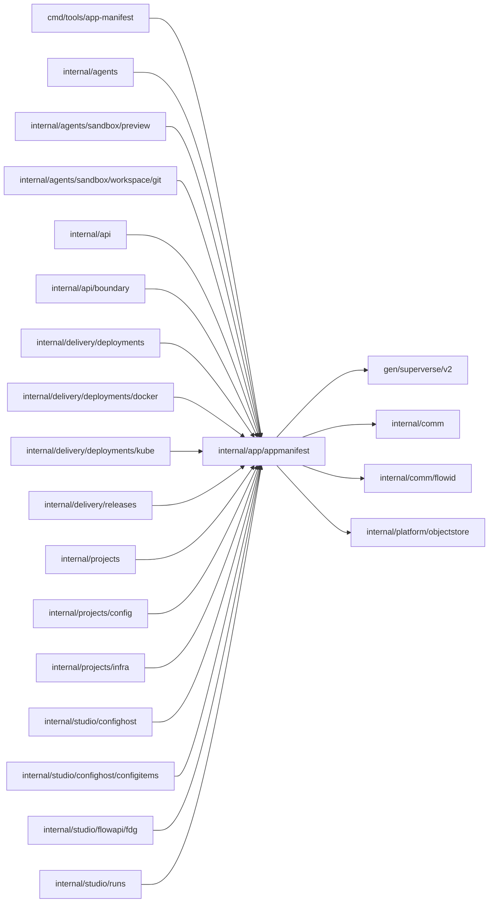

# Application manifest contracts

<!-- BEGIN GENERATED PACKAGE SUMMARY (scripts/check-package-readmes.py; edit only Purpose) -->
Purpose: Owns the application contracts a project's source declares, for Release, Preview and Studio: the dex-app.yaml manifest, its connector and environment requirements and strict Flow Definition Graphs.

Callers: `cmd/tools/app-manifest`, `internal/agents`, `internal/agents/sandbox/preview`, `internal/agents/sandbox/workspace/git`, `internal/api`, `internal/api/boundary`, `internal/delivery/deployments`, `internal/delivery/deployments/docker`, `internal/delivery/deployments/kube`, `internal/delivery/releases`, `internal/projects`, `internal/projects/config`, `internal/projects/infra`, `internal/studio/confighost`, `internal/studio/confighost/configitems`, `internal/studio/flowapi/fdg` and `internal/studio/runs` import this package.

Dependencies: it imports `gen/superverse/v2`, `internal/comm`, `internal/comm/flowid` and `internal/platform/objectstore`.

<!-- END GENERATED PACKAGE SUMMARY -->

`appmanifest` owns the formats that a project's source declares and the Release
artifacts that carry them. `ExtractAppManifest` strictly decodes `dex-app.yaml`
and admits how the application is served (an unprivileged port other than the
Worker port `WorkerPort`, and an absolute health path without a host, query or
line break), which Flow sources it declares and which connector releases it
uses. It returns the canonical connector and environment requirements with
their digests. The Flow Definition helpers validate strict FDG 2.0 bundles and
describe how project Dex serves them. Release, Preview, Studio and the trusted
`cmd/tools/app-manifest` executable read and write these formats only through
this package, which imports no Flow package.

Content that the manifest checks reject is `ErrInvalidAppManifest`, wrapping the
reason: the application's own source, which Preview reports as an
application-owned failure. `RequirementGap` (`requirement_gaps.go`) is one reason
why a scope's stored configuration cannot start the application a source
declares: its kind (`CONNECTION_REQUIRED`, `AUTHORIZATION_REQUIRED`,
`CONNECTION_INCOMPLETE`, `TRIGGER_BINDING_REQUIRED`, `TRIGGER_BINDING_INVALID`,
`OPERATION_CONFIGURATION_REQUIRED` or `ENVIRONMENT_REQUIRED`, a struct-typed
closed set) and the names of the connection, connector, trigger, binding, Flow,
Step, operation, required Connector UI unit or environment variable it concerns,
never a value or credential. The configuration host computes the gaps,
Preview and the Live release report them, and `RequirementGapSnapshots` maps
them to the business API's `ConfigurationRequirementGap`, whose wire kind each
kind declares. A gap of Live's next publish may carry its item's
`FollowRefusal` (`SECRET` or `ENDPOINT_BOUND`, a struct-typed closed set whose
zero value is none): the item can never follow Preview and Live holds no value
of its own.

## Retained contract names

The connector and environment requirements travel under `contract` names that
are stored or exchanged across boundaries. They are compatibility boundaries,
not generic names for new code:

| Boundary | Producer and consumer | Retained representation |
| --- | --- | --- |
| Release artifacts | Trusted AppManifest executable and Release verifier | `connector-contract.json`, `environment-contract.json`; `superverse.dev/connector-contract/v1`, `superverse.dev/environment-contract/v1`; envelope keys `connectorContract`, `environmentContract`, `connectorContractDigest`, `environmentContractDigest` |
| Stored Release references | Release Flow and its typed readers | Serialized `ArtifactRefs.ConnectorContract` and `.EnvironmentContract` in `PreparedSource` and `ReleaseBuildRevisions` |
| Accepted configuration metadata | Project/Sandbox owners, project Dex configuration API and deployment readers | `ReadyConfiguration` and `PreviewConfiguration` fields `ConnectorContractDigest`, `EnvironmentContractDigest`; Dex JSON `connectorContractDigest`, `environmentContractDigest` |
| Public resource protobuf | Merged server, generated clients and Studio | `AppManifestSnapshot` fields `connector_contract_digest` (3), `environment_contract_digest` (4), `connector_contract_object` (9), `environment_contract_object` (10); `ProjectConfigurationSnapshot` digest fields (16, 17), with their existing JSON names |

Some persisted Go fields have no explicit JSON tag, so their exported spelling
is part of the stored representation. A rename must preserve these bytes and
the canonical connector and environment serialization and digests.

## File map

| File | Responsibility |
| --- | --- |
| `manifest.go` | `Manifest`, strict `dex-app.yaml` decoding, application and Flow source rules, connector requirements, `ExtractAppManifest` |
| `environment.go` | Declared application environment variables and their rules |
| `requirements.go` | Canonical requirement JSON and digests, the two Release contract artifacts and their verification |
| `flow_definitions.go` | Strict FDG 2.0 validation, the published definition manifest, graph keys and bundle digest |
