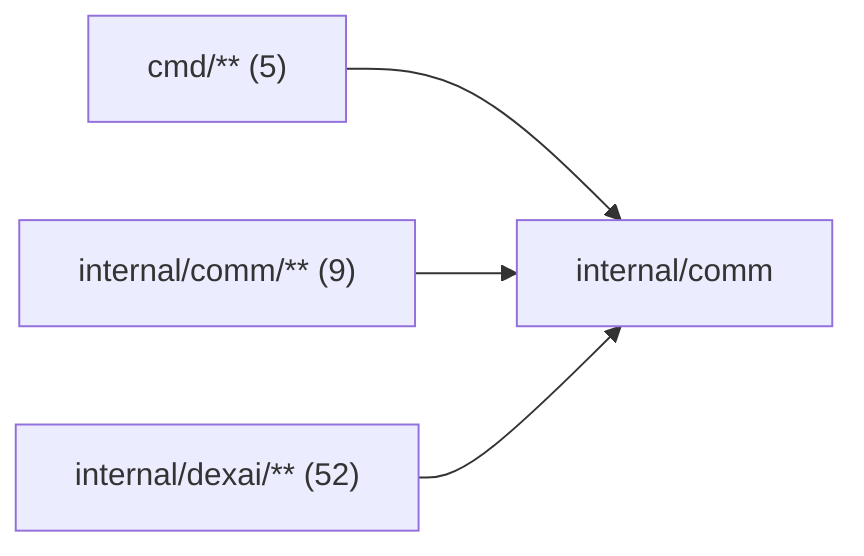

# Common utilities

<!-- BEGIN GENERATED PACKAGE SUMMARY (scripts/check-package-readmes.py; edit only Purpose) -->
Purpose: Holds the domain-free helpers every package shares: `Must`/`MustDo` for bug-only errors, UTF-8-safe text cuts, strict JSON decoding and long poll windows on the local clock.

Callers: `cmd/**` (5), `internal/comm/**` (9) and `internal/dexai/**` (52) import this package.

Dependencies: it imports no other package of this module and calls no remote API.

<!-- END GENERATED PACKAGE SUMMARY -->

Small, domain-free helpers shared by every package: `Must` and `MustDo` turn an
error that only a bug can cause into a panic (`must.go`), `TruncateUTF8` and
`TailUTF8` bound text to a byte budget without splitting a character
(`text_bounds.go`), and `DecodeStrictJSON` (with `DecodeStrictJSONNumbers`, which
keeps numbers as `json.Number`) decodes exactly one JSON value, rejecting unknown
fields and trailing data. `WithLongPollWindow` ends a long poll on this process's
clock while the call keeps its caller's deadline (`long_poll.go`): a deadline
travels with a gRPC call, and a server whose clock runs ahead would reset the
call first. This package imports no other
Superverse package and knows no business, Dex or provider concept. A helper
belongs here only when several unrelated packages need the same mechanism;
anything that names a domain belongs to that domain. Its sub-packages
[`dexflow`](dexflow/README.md) and [`flowid`](flowid/README.md) import only
`comm/**`, the standard library and the Dex SDK.
