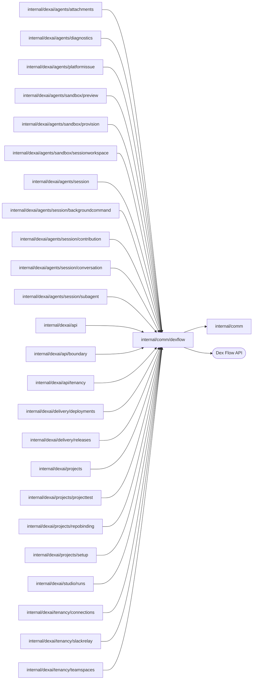

# Shared Dex plumbing

<!-- BEGIN GENERATED PACKAGE SUMMARY (scripts/check-package-readmes.py; edit only Purpose) -->
Purpose: Holds the Dex plumbing Flow packages share: persisted failure, progress and start identity shapes, failure causes, initial Attributes, option presets, polling, long-call heartbeats, lock-retrying RPCs and retained reads.

Callers: `internal/dexai/agents/attachments`, `internal/dexai/agents/diagnostics`, `internal/dexai/agents/platformissue`, `internal/dexai/agents/sandbox/preview`, `internal/dexai/agents/sandbox/provision`, `internal/dexai/agents/sandbox/sessionworkspace`, `internal/dexai/agents/session`, `internal/dexai/agents/session/backgroundcommand`, `internal/dexai/agents/session/contribution`, `internal/dexai/agents/session/conversation`, `internal/dexai/agents/session/subagent`, `internal/dexai/api`, `internal/dexai/api/boundary`, `internal/dexai/api/tenancy`, `internal/dexai/delivery/deployments`, `internal/dexai/delivery/releases`, `internal/dexai/projects`, `internal/dexai/projects/projecttest`, `internal/dexai/projects/repobinding`, `internal/dexai/projects/setup`, `internal/dexai/studio/runs`, `internal/dexai/tenancy/connections`, `internal/dexai/tenancy/slackrelay` and `internal/dexai/tenancy/teamspaces` import this package.

Dependencies: it imports `internal/comm` and calls the Dex Flow API.

<!-- END GENERATED PACKAGE SUMMARY -->

The Dex plumbing that several Flow packages share. It sits directly above the
Dex SDK and imports no Superverse domain package. Attribute, Channel and Stream
definitions stay in each Flow's own `*_flow.go`; a type moves here only when it
is the same persisted shape in several Flows.

| File | Responsibility |
| --- | --- |
| `payloads.go` | Persisted shapes every lifecycle Flow records: `StartIdentity`, `Rejection` with its `RejectionCode` set (`Reject` builds one, `HasCode` tests it), `Failure`, `PhaseTiming` with `BeginPhase` and `EndPhase`, and `ProgressEvent` with its constructor `Progress` and its `WithDetail`, whose Step diagnostic the API never maps; `StreamWritten`, which takes the result of every best-effort Stream write: once the handler's context ended, as after a cancelled Step, a failed write loses only its live entry and the handler goes on, and with the context alive a failure is a bug and panics |
| `failure_cause.go` | The cause a Failure carries: `TruncateCause` (2 KiB), `RecoveryDetail`, `RecoveryErrorType`, `RecoveryTimedOut` and `RecoveryStep` for failure-record Steps and `FailureMessage` |
| `attributes.go` | The initial-Attribute builder, optional Attribute reads and the checks for a missing and for a not loaded AttributeMap instance |
| `option_presets.go` | RPC and Step option presets, including `PollingStepOptions` for a Step that waits on an external system; the provider and polling presets take the Step's Execute failure route |
| `keep_alive.go` | `KeepAlive`, the 20-second heartbeat of a Step whose long call reports nothing for a while |
| `polling.go` | `PollUntil`, the in-Execute polling loop: a bounded round, a heartbeat and a sleep each time |
| `locked_rpc.go` | `InvokeLocked`, the Flow-client RPC call that retries a lock conflict within a bound, and `InvokeLockedWith`, which also locks and loads the AttributeMap instances the invocation names |
| `retained_read.go` | `InvokeRetainedRead`, the Flow-client read that also serves a closed execution |

## Polling an external system

A Step that waits for an external system runs one long Execute:
`err := dexflow.PollUntil(ctx, every, roundTimeout, check)` inside a Step that
uses `dexflow.PollingStepOptions(maxWait, failure)`. Each round calls `check`
within `roundTimeout`, records a heartbeat and sleeps `every`; `every` plus
`roundTimeout` must stay 10 seconds inside the one-minute heartbeat timeout, or
`PollUntil` panics. A round of one API call takes 10 seconds, so `every` may
reach 40 seconds; a round of several calls takes up to 40 seconds with an
interval of a few seconds, and a lock-conflict wait inside a round stays
strictly shorter than `roundTimeout`. The Step holds no Execute locks while
polling. `check` returns a plain `done`; a round that `roundTimeout` cuts off
while the attempt goes on is pending, like "not ready yet": the next round, an
idempotent query, settles what the slow round left, so `check` returns such a
round's error unclassified. Any other `check` error returns with a stack, and
the retry policy runs a new attempt.

The wait limits are the engine's only: `PollingStepOptions` sets
`ExecuteMethodTimeout` and `ExecuteRetry.TotalDuration` to `maxWait`.
TotalDuration is measured from the first attempt across every retry, so it
also cuts the attempt in flight. Step code
never computes a deadline of its own. When a limit passes, the engine fails the
Step and its Execute failure route moves it to the failure-record Step, which
records the business failure: `RecoveryTimedOut` tells a passed wait limit
from exhausted retries,
`RecoveryStep` names the failed Step, and `RecoveryDetail` is the bounded
cause. The failure-record Step chooses the failure code from those two; the
last observed state is in the Step's progress Stream and logs. A business
condition that is not a fixed duration, such as a lease the Flow does not own,
is a `check` that reports done, after which the Step decides its failure.

The pinned `dexcli` traces Attribute and Stream access inside the `check`
closure when the closure is a function literal in the Step method of the
`*_flow.go` file: the graph draws those reads and writes on the Step. It does
not draw a decision created inside the closure. The closure therefore records
its outcome in a local variable, and the Step method returns the
`dex.GoTo`/`dex.Complete` literals after `PollUntil` returns.
