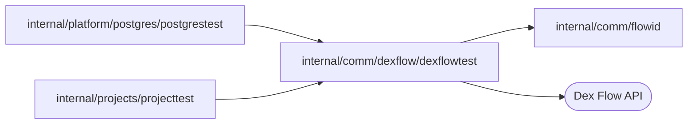

# Dex integration test client

<!-- BEGIN GENERATED PACKAGE SUMMARY (scripts/check-package-readmes.py; edit only Purpose) -->
Purpose: Connects integration tests to an actual Dex Server and checks engine state, never substituting a Flow, Worker or dependency.

Callers: `internal/platform/postgres/postgrestest` and `internal/projects/projecttest` import this package.

Dependencies: it imports `internal/comm/flowid` and calls the Dex Flow API.

<!-- END GENERATED PACKAGE SUMMARY -->

Connects integration tests to an actual Dex Server. It only builds clients and
checks engine state; it never substitutes a Flow, Worker or dependency, and a
missing setting fails the test instead of skipping it.

**Lane guard.** A lane's platform Dex stores each Flow with the Worker target it
was started with, so a test whose Dex, Worker and API addresses belong to
different lanes starts Flows that the other lane's server runs, against that
server's own state. `ClientForTest`, `WorkerClientForTest` and `ExecutionReaderForTest`, and
`Setting` for a lane input (`SUPERVERSE_TEST_DEX_ADDRESS`,
`SUPERVERSE_TEST_API_ADDRESS`, `SUPERVERSE_TEST_WORKER_TARGET`,
`SUPERVERSE_TEST_EXISTING_WORKER_TARGET`, `SUPERVERSE_TEST_WORKER_HOST`), fail
the test before any connection unless `SUPERVERSE_TEST_LANE` names `kind` or
`native` (a missing lane is a failure, never a skip) and every one of these
variables that is set, and every address passed to the constructor, is that
lane's. A Worker target passed to `ClientForTest` on a port that `FreePortForTest` returned
is the test's own Worker and only its host must be the lane's test Worker host;
any other target must be the lane's server Worker target, so a test cannot
start Flows on another instance's server Worker, which may share the host. The
message names each mismatch and the lane the value belongs to.
`lane_endpoints.go` owns the addresses: Native's are read from
`cmd/superverse-server/config/native.yaml`, which the launcher reads as well;
Kind's are constants whose owners are `infra-as-code/scripts/kind/cluster.py`,
the chart's server configuration and `infra.HostFromContainers`, and
`make check-test-lanes` fails when one differs. The same check refuses a test
that builds a Dex client or Worker with `dex.NewClient` or `dex.NewWorker`
instead of this package. The lane inputs are tabled in the
[integration verification runbook](../../../agents/README.md).

`LanePostgres` returns the lane's PostgreSQL address, Kind's forward or the
effective Native run layer's `postgres` port, and the lane's private file of
its role passwords; `internal/platform/postgres/postgrestest` connects with
them.

`ProjectChildIDsForTest` lists through Dex search the Release or Deployment Flows
(closed ones included) that a Project left, and `MapInstanceKeysForTest` the
instance keys of an AttributeMap in a Flow's state; the read model sync tests
start from them, so a Flow whose row Dex never wrote fails the test.

`LocalLaneForTest` reads the local lane a test runs against (`SUPERVERSE_TEST_LANE`), and
`LocalGitURLForTest` that lane's local Git host: Kind's `git` forward, which `make check-test-lanes`
also keeps equal to its owner, or the selected Native instance's `localgit.listen`.
`RestartServerForTest` replaces that lane's platform server, and with it the
application Worker, as an operator does: Kind deletes the server Pod and waits
until it is gone, and Native asks the launcher of its run. It returns once
platform Dex invokes the new Worker, which happens some seconds after the
Worker serves: it repeats a read of an existing Flow that the test names while
Dex answers `*dex.WorkerInvocationError`, for at most five minutes, and fails
the test on any other error, so the next read, also of the next test, never
meets the replacement.

`WorkerClientForTest` serves flows from the test process on a Worker of its own and
returns a client whose executions run on it. `FreePortForTest` names a port that
nothing listens on before a Worker serves it, and `WorkerClientAtForTest` starts the
Worker on it later, so that a test can start an execution on a Worker target
that is closed, let it fail, and then serve the target.

`WorkerClientWithReplacementForTest` serves the test's own registered Flows on an owned port and
allows one bounded replacement with a fresh Worker, registry and blob cache on that port. It stops
only that Worker; it never replaces the merged platform server. The test must complete or terminate
its disposable executions before final cleanup, including on failure, so none remains pinned to the
closed port. Use `RestartServerForTest` separately for an explicitly authorized merged-server
replacement on the owned local lane.
