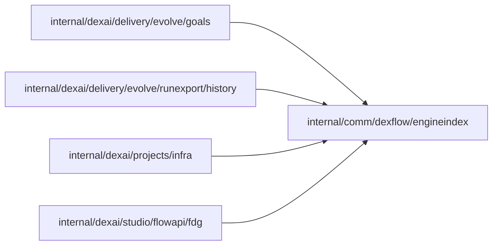

# Engine search indexes

<!-- BEGIN GENERATED PACKAGE SUMMARY (scripts/check-package-readmes.py; edit only Purpose) -->
Purpose: Declares once the search indexes the Dex engine keeps for every Flow, for the local Temporal, Flow API searches, the run export and the goals check.

Callers: `internal/dexai/delivery/evolve/goals`, `internal/dexai/delivery/evolve/runexport/history`, `internal/dexai/projects/infra` and `internal/dexai/studio/flowapi/fdg` import this package.

Dependencies: it imports no other package of this module and calls no remote API.

<!-- END GENERATED PACKAGE SUMMARY -->

`Name` is a search index the Dex engine keeps for every Flow, whatever the application declares:
`FlowType`, `DexParentFlowID`, `ActiveStepTypes` (an open run's active Step types, for a Flow
that indexes them) and the SDK's work-queue permissions (`DexWorkQueuePermissions`, the SDK's
`dex.WorkQueuePermissionsIndexKey`). No application Attribute owns one; `Is` tells them from an
application's own index keys.

The local Temporal of a Project's Live scope registers the first three as search attributes
(`internal/dexai/projects/infra`); the Flow API's visibility queries select by `FlowType` and
`DexWorkQueuePermissions` (`internal/dexai/studio/flowapi/fdg`); the goals check refuses a goals
file that names any of them as a field or an outcome's Attribute
(`internal/dexai/delivery/evolve/goals`); and so the run
export's history compactor, which reads an open run's `ActiveStepTypes` from its search entry,
never takes another engine index for an allow-listed Attribute's indexed value
(`internal/dexai/delivery/evolve/runexport/history`). The package imports only the standard
library, so the coding image builds it from the source tree with `goals`;
`scripts/check-package-layers.py` keeps it so. For the same reason it spells the SDK's
work-queue permissions index; the Dex integration test of `dexai evolve` checks that it equals
`dex.WorkQueuePermissionsIndexKey`.
