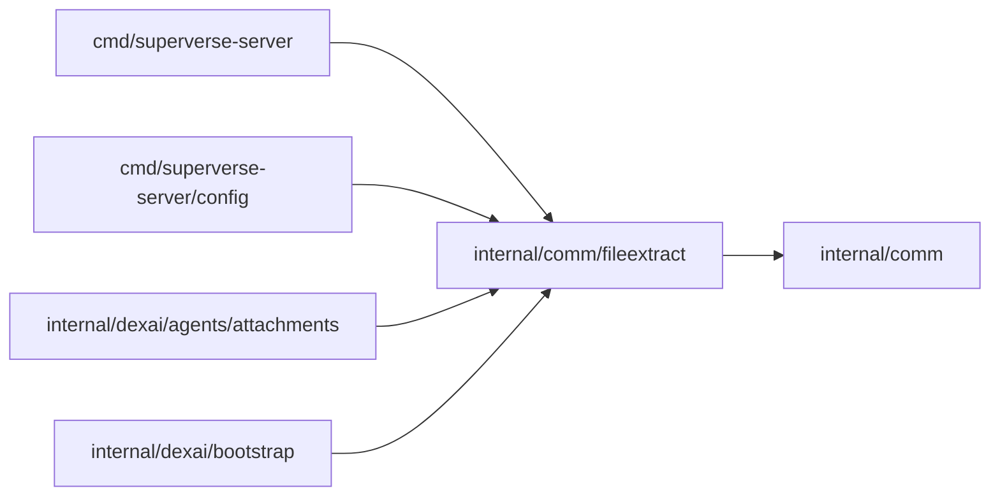

# File extraction

<!-- BEGIN GENERATED PACKAGE SUMMARY (scripts/check-package-readmes.py; edit only Purpose) -->
Purpose: Prepares uploaded files for the model in a limited child process of the server binary: image header probes, document sections and redacted, summarized JSON.

Callers: `cmd/superverse-server`, `cmd/superverse-server/config`, `internal/dexai/agents/attachments` and `internal/dexai/bootstrap` import this package.

Dependencies: it imports `internal/comm`.

<!-- END GENERATED PACKAGE SUMMARY -->

`fileextract` reads the bytes of one uploaded file and answers what the model may see of
it. Attachments and knowledge documents share it. It is domain-free: it knows formats,
bounds and refusals, never TeamSpaces, Flows or storage; the owner of a file reads the
bytes from storage, calls `Extractor.Extract` and writes what comes back.

## The child process

`Extractor.Extract` runs `superverse-server file-extract <request JSON>` (`Subcommand`,
dispatched by `cmd/superverse-server` before it reads any configuration) with an empty
environment, an empty temporary working directory and the file on stdin, and reads one JSON
`Result` from stdout, at most 8 MiB. One child runs at a time per process: the one
`Extractor` that the composition root creates holds the slot, and every owner of
extractions shares it, waiting inside its own attempt. The slot is fair by
`Request.Queue`, which the caller names, such as a tenant (attachments name their
TeamSpace), and which the child never sees: when the slot frees, the queue whose turn it is
gets it for its oldest waiter and goes to the back of the turns while it still waits, so
one queue's backlog delays another queue's extraction by at most one extraction per other
waiting queue, never by the whole backlog. A waiter whose context ends leaves its queue,
and a grant that met the end of its wait goes to the next waiter.

Before it reads its input the child (`ServeChild`) sets its own limits: `GOMAXPROCS=1`, a
soft memory limit of 512 MiB, `RLIMIT_CPU` 60 seconds (the kernel signals the child, which
exits; a second later it kills it) and `RLIMIT_NOFILE` 16 everywhere, and on Linux, the only
platform that enforces it, `RLIMIT_AS` at the address space the process holds when it starts
plus 1 GiB. The Go runtime of the server binary reserves about 1.3 GB of address space
before `main` (measured on linux/arm64), so an absolute 1 GiB would fail every extraction.
The parent kills the child after 120 seconds. On macOS (Local Native) the soft limit, the
readers' own bounds and the timeouts bound it.

Outcomes:

- a `Result` with its `Document`, `JSON` or `Image`;
- a `Result` with a `Refusal`, a business decision the owner records and never retries,
  since the same bytes fail the same way: `unsupported_content`, `encrypted`, `no_text`,
  `too_large`, `invalid_json`, `image_mismatch`, `image_too_large`, and
  `extraction_failed` for a crash, a process limit, the time limit or output beyond its
  limit (its detail names the limit, the signal or a Go runtime's fatal line, never
  content);
- an error: the context ended or the child could not start, which the caller retries.

The readers are memory-safe Go: the standard library and `github.com/ledongthuc/pdf`
(BSD-3-Clause), whose objects, streams, filters and decryption the PDF reader uses. `make
check` (`scripts/check-package-layers.py`) refuses cgo and `unsafe` anywhere in this
package's dependency graph outside the standard library, on linux/arm64, linux/amd64 and
darwin/arm64, so this package imports nothing that brings either, such as the object store.

## Formats

`Format` is the closed set of accepted formats, each with its media type, its kind and the
file name extensions that declare it; `FormatOf` admits a declared media type and file name
only when both name the same format.

| Kind | Formats | What the child returns |
| --- | --- | --- |
| Image | PNG, JPEG, WebP, GIF | `ImageProbe`: width, height and frames from the header only, never the pixels. The signature must be the declared format's (`image_mismatch`), the long edge at most the request's `MaxImageEdge` (`image_too_large`); a GIF's first frame must lie inside its screen, and an animated GIF or PNG reports its frame count. A header that declares huge dimensions is refused before anything is decoded |
| Document | Markdown, plain text, Word (`.docx`), PDF | `Document`: at most 512 sections (`s1` to `s512`), each at most 32 KiB, at most 2 MiB of text in all; a longer text keeps its beginning and is `truncated`, a longer section splits into parts that keep its heading, `3.2 Pricing (part 2)`. Text before the first heading is a section with an empty heading |
| JSON | JSON | `PreparedJSON`: the redacted file, its format (`n8n` or `generic`), the redaction count and the first 200 redacted paths, the number of values, the depth and a summary |

- **Markdown and text** are UTF-8 (a BOM is dropped) or UTF-16 with a BOM; invalid UTF-8, an
  unpaired surrogate or a NUL is `unsupported_content`. Markdown sections start at ATX and
  setext headings; fenced code and a leading front matter stay text of their section. Plain
  text is packed into parts of about 16 KiB, `Part 1`, `Part 2`.
- **Word** opens only `word/document.xml` and `word/styles.xml`, each at most 64 MiB
  uncompressed and at most 100 times its compressed size, with at most 256 nested elements.
  Paragraphs styled Title or Heading 1 to 6, directly, through the styles they are based on or
  by an outline level, start sections; tables become tab-separated rows; tracked deletions,
  drawings, embedded objects and field codes are skipped. A legacy `.doc` is
  `unsupported_content`, an encrypted Office file `encrypted`.
- **PDF** text comes from the content streams of each page and its form objects. The reader
  decodes codes through the font's ToUnicode map first, then the font's encoding, and places
  spaces and line breaks from the glyph positions and widths; ligatures are spelled out.
  Outline entries that resolve to a page (explicit or named destinations) start sections
  where their title appears on the page; without an outline every page is a section
  `Page N`. A header of any version opens; a PDF that only an owner password restricts
  opens, one that needs a password is `encrypted`, one without a text layer `no_text`.
  Bounds: 10,000 pages, 32 MiB of decoded content per stream and 64 MiB per page,
  2,000,000 operators per page, form objects nested four deep, 1 MiB and 20,000 entries per
  ToUnicode map.
- **JSON** is UTF-8, one value, at most 4 MiB (`MaxJSONBytes`), 64 levels deep and 200,000
  values; beyond a bound it is `too_large`, a syntax error `invalid_json`. The redacted copy
  keeps the order of every object's keys; the parent indents it by two spaces.

## Redaction

Every likely secret of a JSON file is replaced with the marker
`‹redacted:superverse›`, which the import inventory reports as a literal secret to set up as
a connection and rotate. The redaction rule names why:

| Rule | What it replaces |
| --- | --- |
| `secret_field` | The string value of a member whose key matches the inventory's secret-name pattern (API key, access, auth or refresh token, token, secret, password, private key, authorization, bearer), access keys, passphrases or cookies, except a name whose whole words, split at separators and case changes, make it no credential: a count or bound (`maxTokens`, `passwordMinLength`), a last word type, url or uri (`tokenType`, `accessTokenUrl`), or a pagination or anti-forgery token without a credential word (`nextPageToken`, `X-CSRF-Token`, but not `pageAccessToken`). Words are never matched inside other words, so `accountPassword` and `X-Account-Token` are credentials |
| `secret_pair` | The `value` of a name and value pair (`name` or `key` with `value`), such as a header or query parameter, whose name matches the same pattern |
| `url_query` | A URL query value whose parameter name holds key, token, secret or password (the inventory's `URL_SECRET`) |
| `url_password` | The password of a URL's user information |
| `authorization_credential` | The credential after `Bearer` or `Basic` |
| `api_key`, `slack_token`, `github_token`, `aws_access_key`, `jwt`, `private_key` | Token-shaped strings anywhere: `sk-…`, `sk_live_…`, `AIza…`; `xox[abposr]-…`, `xapp-…`; `gh[pousr]_…`, `github_pat_…`; `AKIA` or `ASIA` with 16 characters; JWTs; PEM private key blocks |

The field and pair rules keep, as the inventory does, values shorter than eight
characters, placeholders and n8n expressions (strings that start with `=`); the token rules
still apply inside them. A value that already is the marker is not redacted again, so
preparing a redacted file changes nothing. Results count redactions and name their paths,
never their values.

An export is `n8n` when its value is an object with a `nodes` array of objects with string
`name` and `type` fields, at least one type of an n8n package (`n8n-nodes-…` or `@n8n/…`),
and a `connections` object; that workflow inside `{"data": …}`; or a non-empty array of
those. Each workflow is summarized: its name, node count, connection count, node types with
their counts, triggers and the credentials its nodes name (type and name; an export holds
no credential value). Any other JSON is `generic`, summarized by its top-level type and the
first 50 members of an object with their types and array lengths.

| File | Responsibility |
| --- | --- |
| `extractor.go` | `Extractor`: the per-process slot, the child's start, timeout and outcome, `Request` |
| `child.go` | `ServeChild`: the child's limits, input, dispatch and bounded output |
| `results.go` | The closed sets `Kind`, `Format` and `Code`, `Refusal` and the result types |
| `sections.go` | The section bounds and splitting, text decoding, Markdown and plain text |
| `docx.go` | Word documents |
| `pdf.go` | PDF documents: opening, pages, outline and sections |
| `pdf_text.go` | PDF content streams: the lexer, the text assembly, fonts and ToUnicode maps |
| `json_tree.go` | The bounded JSON parser that keeps key order, and its compact encoding |
| `json_redaction.go` | Redaction rules, n8n detection and the summaries |
| `images.go` | Image header probes |
| `extraction_corpus_test.go` | The corpus through the real child process |

## Tests

`extraction_corpus_test.go` runs the real child process, the test binary itself with the
`file-extract` argument (its `TestMain` dispatches it to `ServeChild` exactly as the server
binary does), on the synthetic corpus in `testdata/`: every document format with and without
headings or an outline, an encrypted and an image-only PDF, a ZIP bomb, a mismatched type,
invalid UTF-8, JSON redaction cases compared byte for byte with their expected files and
prepared twice to show the marker is stable, and image probes (a mismatch, an oversized
header, an animated GIF and PNG, a GIF frame outside its screen), and the outcomes of a
child that exits without a result, one that cannot start and a wait for the held slot.
`TestExtractorFairSlotIntegration` runs a backlog of ten real extractions of one queue and,
once the first finished, one of another queue, which finishes within the next few instead of
after the backlog. The
PDF, WebP and `textutil-no-styles.docx` fixtures come from Chromium, macOS Quartz and
`textutil`; the Word documents with styles, the bombs and the images are built by the test.
Its fixtures hold no real secret. The test needs nothing but the Go toolchain; the process
limits are those of the platform it runs on, so it also runs on Linux to cover `RLIMIT_AS`.
