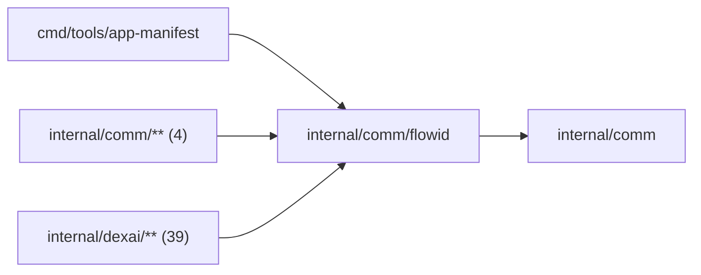

# Flow identities

<!-- BEGIN GENERATED PACKAGE SUMMARY (scripts/check-package-readmes.py; edit only Purpose) -->
Purpose: Derives the stable FlowIDs, server-assigned business IDs and Start RequestID fingerprints of the platform Flows, and checks the formats of identifiers that callers supply.

Callers: `cmd/tools/app-manifest`, `internal/comm/**` (4) and `internal/dexai/**` (39) import this package.

Dependencies: it imports `internal/comm`.

<!-- END GENERATED PACKAGE SUMMARY -->

Derives the stable FlowIDs and server-assigned business IDs of the platform
Flows, the fingerprints their Start RequestIDs are made of, and the format
checks of identifiers that callers supply. Validation here is for identifiers
that arrive from outside the process; an ID this process derives from already
validated input is not checked again. `ValidateSessionScope` takes the
`NamespaceNames` it needs as an interface, so this package imports no platform
package.

| File | Responsibility |
| --- | --- |
| `project.go` | Project and Project-child FlowIDs: the Project's one Session `session-<projectID>` and Preview `preview-<projectID>`, its Sandbox instances `sandbox-provision-<projectID>-<workspaceRequestID>` and subagents `subagent-<projectID>-<agentID>`, and their parsing |
| `creation_ids.go` | Server-assigned Project and Setup IDs, and the subagent IDs and task IDs derived from the Session's FlowID and a tool call |
| `fingerprint.go` | Start RequestID fingerprints |
| `platform_issue.go` | The signature of a platform fault and the FlowID `platform-issue-<env>-<sig16>` of its PlatformIssueFlow, which belongs to no Project |
| `identifier_formats.go` | Commit SHA and SHA-256 formats |
| `session_scope.go` | The scope check of a Project ID against the name of its Sandbox namespace |
