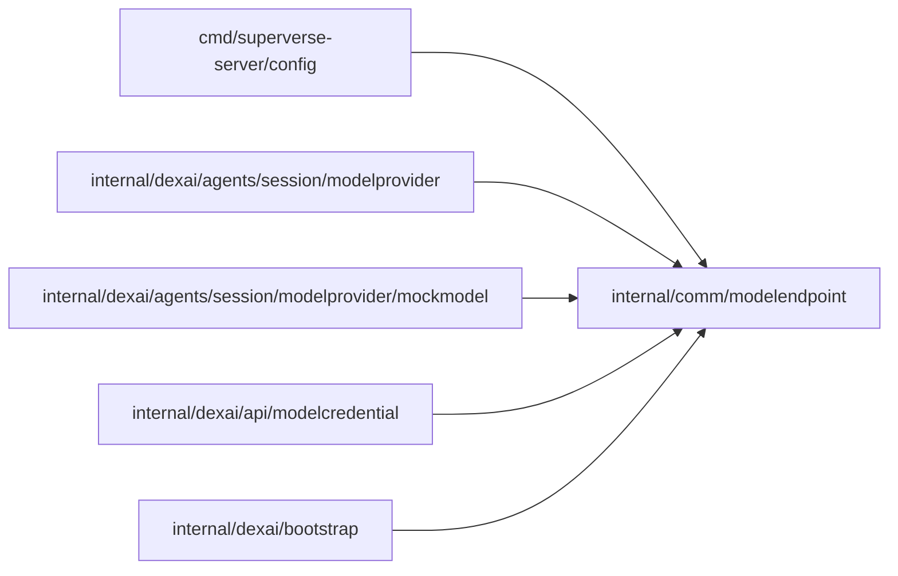

# Model endpoint transport

<!-- BEGIN GENERATED PACKAGE SUMMARY (scripts/check-package-readmes.py; edit only Purpose) -->
Purpose: Validates model endpoint destinations and connects only to public DNS results, with an explicit local loopback policy.

Callers: `cmd/superverse-server/config`, `internal/dexai/agents/session/modelprovider`, `internal/dexai/agents/session/modelprovider/mockmodel`, `internal/dexai/api/modelcredential` and `internal/dexai/bootstrap` import this package.

Dependencies: it imports no other package of this module and calls no remote API.

<!-- END GENERATED PACKAGE SUMMARY -->

The compatible provider runtime owns this shared transport for official endpoints
and explicit local verification routing. `agent.modelEndpoints.allowLocalLoopback`
is checked by server `Validate` and is refused outside Local Native and Kind.
No implicit mock hostname exception is used. Custom endpoints, Messages and
OpenAI inference, credential probes and model discovery use this same validator.

Base admission requires HTTPS and rejects URL credentials, queries and fragments,
and rejects private, special-use, loopback, link-local and metadata targets.
Its explicit local policy permits loopback HTTP/HTTPS only. Client construction
validates syntax and authority without DNS, so provider DNS outages do not prevent
server startup. Every new connection
resolves DNS, rejects the complete answer set if any address is forbidden, and
dials the checked address directly. TLS authenticates the original hostname.
Request URLs retain the admitted origin while allowing protocol query parameters,
including Messages beta. Discovery never follows pagination URLs. It inherits no proxy and
follows no redirects. Its shared pool bounds active plus idle connections to 128
across every admitted origin, with no capacity wait queue; each connection has a
ten-second DNS/connect bound. Origin wrappers share that pool without holding
keys. IPv6 documentation addresses including RFC 9637 are refused.
The pool is owned per replica;
its owner must close idle connections and bound each call. Response reads have a
16 MiB transport ceiling, before SDK event decoding; discovery and probes apply
their smaller per-operation bounds. Request Host overrides cannot change the
admitted authority.
No key or endpoint is retained outside the owned request or pool.

Network integration tests exercise actual HTTP, TLS, sockets and system DNS.
They establish transport policy only, not provider compatibility or Session acceptance.

`CanonicalBaseURL` admits a bounded API root before metadata reservation. `Discover`
uses an origin-bound GET of that root plus `/models`, with transient authentication,
a ten-second overall deadline, a 1 MiB body bound, at most 100 distinct IDs and
256 bytes per ID. Unsupported listings and empty lists are explicit outcomes.
Excess counts, pagination and malformed IDs fail closed. Provider response bodies
and endpoint paths never enter the returned error. `DiscoverWithStatus` uses the same parser and returns the upstream HTTP status
without retaining error bodies; credential validation uses it to distinguish
authentication failures from unsupported model listings. Transport timeout and
cancellation remain classifiable without returning request URLs or raw errors.
Discovery admits at most 32
concurrent calls per process with no waiting goroutines or tenant scans.

The server-created built-in mock has a separate client bound to its own listener,
including for administrator mock Sessions in hosted test/staging. Only the owner
that starts that listener constructs this client; user and catalog endpoints
never use it. Hosted `allowLocalLoopback` stays false, so a custom URL naming
that same listener is refused by the ordinary shared policy. This adds one
bounded pool per mock-enabled replica, released with its existing listener.
