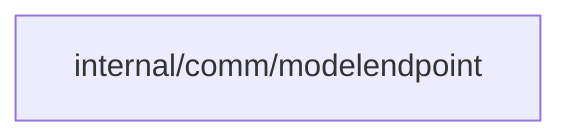

# Model endpoint transport

<!-- BEGIN GENERATED PACKAGE SUMMARY (scripts/check-package-readmes.py; edit only Purpose) -->
Purpose: Validates model endpoint destinations and connects only to public DNS results, with an explicit local loopback policy.

Callers: no production package imports this package.

Dependencies: it imports no other package of this module and calls no remote API.

<!-- END GENERATED PACKAGE SUMMARY -->

This shared implementation is staged for the custom endpoint delivery; it has no
production callers yet. That delivery must expose its local loopback flag only
through server configuration validated against the local environment. There is
no implicit mock or test hostname exception.

Base admission requires HTTPS and rejects URL credentials, queries and fragments,
and rejects private, special-use, loopback, link-local and metadata targets.
Its explicit local policy permits loopback HTTP/HTTPS only. Admission resolves
and checks the complete DNS answer set. Every new connection
resolves DNS, rejects the complete answer set if any address is forbidden, and
dials the checked address directly. TLS authenticates the original hostname.
Request URLs retain the admitted origin while allowing protocol query parameters,
including Messages beta and model-list pagination. It inherits no proxy and
follows no redirects. Its shared pool bounds active plus idle connections to 128
across every admitted origin, with no capacity wait queue; each connection has a
ten-second DNS/connect bound. Origin wrappers share that pool without holding
keys. IPv6 documentation addresses including RFC 9637 are refused.
The pool is owned per replica;
its owner must close idle connections and bound each call and response body.
No key or endpoint is retained outside the owned request or pool.

Network integration tests exercise actual HTTP, TLS, sockets and system DNS.
They establish transport policy only, not provider compatibility or Session acceptance.
