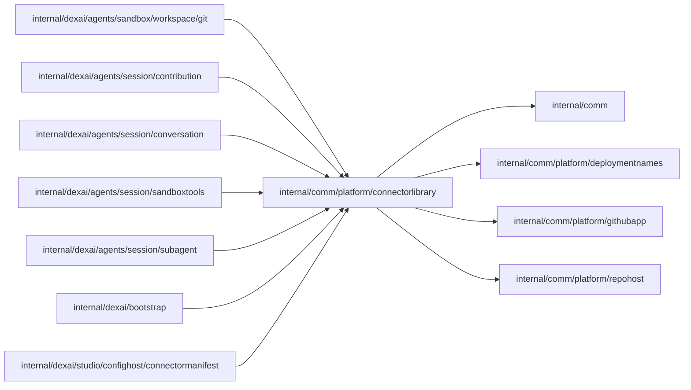

# Connectors library

<!-- BEGIN GENERATED PACKAGE SUMMARY (scripts/check-package-readmes.py; edit only Purpose) -->
Purpose: Reaches the connectors library that connector_develop subagents contribute to: fetch and push remotes, the committing bot identity and the upstream library's draft pull requests.

Callers: `internal/dexai/agents/sandbox/workspace/git`, `internal/dexai/agents/session/contribution`, `internal/dexai/agents/session/conversation`, `internal/dexai/agents/session/sandboxtools`, `internal/dexai/agents/session/subagent`, `internal/dexai/bootstrap` and `internal/dexai/studio/confighost/connectormanifest` import this package.

Dependencies: it imports `internal/comm`, `internal/comm/platform/deploymentnames`, `internal/comm/platform/githubapp` and `internal/comm/platform/repohost`.

<!-- END GENERATED PACKAGE SUMMARY -->

A Session's `connector_develop` subagents build or fix connectors of the public library
`superdurable/dex-connectors-library` ([connectors](../../../../docs/architecture/agent-harness-design/connectors.md#connector-subagents)
owns the design). `Library` is this server's view of it, which bootstrap builds from the
configuration:

| Server | Fetch from | Pushes to | Commits as |
| --- | --- | --- | --- |
| `github.connectors` set, GitHub repository host | the upstream library | the upstream library, with a token of contents write | the GitHub App's bot |
| local lanes (local Git host) | the local Git host's copy, refreshed from GitHub before every new branch | the local Git host's copy (`LocationLocalGitHost`) | the bot with an upstream, else `Superverse` |
| no `github.connectors`, GitHub repository host | the public library, anonymously | nowhere: the branch stays in the Sandbox's clone (`LocationSandbox`) | `Superverse` |

- `Branch` names the branch of a connector, `superverse/<lane>/<projectID>/<slug>`, with the
  server's repository prefix as the lane (`test`, `staging`, `prod`, `localkind`,
  `localnative`), so the lanes that share the test environment never share a branch.
- `Upstream` is the upstream library on GitHub, a further installation of the
  [GitHub App](../githubapp/README.md) beside the repository host's and the issue repository's
  (`github.connectors.repository` and `github.connectors.installationId` of the
  [server configuration](../../../../cmd/superverse-server/config/README.md#github)). Every operation
  mints its own token with `githubapp.App.OperationToken`, restricted to the one repository and
  to the permission it needs: contents write for a push, pull requests write for the pull
  request calls, metadata read for the bot's user. No token is cached, logged, stored or put in
  an error; `Remote` shows its token only to the trusted Git process.
- `botIdentity` is `<App slug>[bot]` with the noreply address of the bot's user ID, the identity
  GitHub attributes the commits to; it is read once per process.
- `findPullRequest` lists the pull requests, open or closed, whose head is a branch of the
  library itself, and `OpenDraftPullRequest` looks the branch up before it opens a draft against
  `main`, so a repeat after a lost answer opens no second pull request.
- `Mirror` is the local Git host's copy (`localgit.Host.ConnectorLibraryMirror`), which the local
  lanes push their branches and release candidates to; only the pull request uses GitHub.

## Release candidates

Every head a contribution pushes becomes a release candidate: the connector at that commit,
published as `vX.Y.Z-rc.N` under the tag `<directory>/vX.Y.Z-rc.N`, where `vX.Y.Z` is the
manifest's `metadata.version` and `N` counts the candidates of that version. A candidate carries
the assets of a release (`connector-release.json`, its `.sha256`, and on GitHub
`connector-release.complete`, uploaded last), so an application can depend on it in the Preview
and in Live before maintainers review and release the connector. `ReleaseCandidate` names one.

| Lane | Who publishes | `RequestReleaseCandidate` | `IsReleaseCandidatePublished` |
| --- | --- | --- | --- |
| upstream library (`LocationUpstream`) | the library's Release Connector Candidate workflow, which validates and builds the commit with its tooling at `main` | sends the repository dispatch `connector-release-candidate` with `{directory, commit, version}` | the tag names the commit, and its release holds the metadata and the complete marker; a tag of another commit is `ErrReleaseCandidateConflict` |
| local Git host's copy (`LocationLocalGitHost`) | the Sandbox, which builds the assets with the library's `connectorctl` at `main` and pushes the tag to the copy; `PublishLocalReleaseCandidate` stores them in the copy's release store | nothing: the copy already holds it | the copy's release holds the metadata and its digest |

The workflow refuses a tag that names another commit and repeats a publication at the same commit,
and the copy's assets never change, so a repeated request is harmless. `PublicCloneURL` is where the
Sandbox reads the official library's released tags without a credential, so a candidate's version
is checked against its connector's latest release.

`ReleaseCandidateDownloadURL` is where this server's configuration host downloads candidates: the
copy's release store in the local lanes, the upstream library's GitHub releases on a server with
`github.connectors`, and the connectors library's own releases (`OfficialReleaseDownloadURL`)
otherwise. Official releases are always read from `OfficialReleaseDownloadURL`.

Errors are classified as the [GitHub repository host](../repohost/github/README.md) does: a lost
answer is `errOutcomeUnknown`, a 4xx other than 408 and 429 is `ErrRejected`, and any other error
may succeed when asked again. A server without an upstream answers `ErrNotConfigured` where the
upstream is needed.

## Verification

`TestConnectorContributionGitHubIntegration` in the [workspace Git package](../../../dexai/agents/sandbox/workspace/git/README.md)
exercises this package against the GitHub test repository. It is a manual test, like
`TestPlatformIssueGitHubIntegration`.

| File | Responsibility |
| --- | --- |
| `library.go` | `Library`, `Location`, `Remote`, `Identity`, `Mirror` and the branch of a connector |
| `release_candidate.go` | `ReleaseCandidate`, its publication on the upstream library or the local Git host's copy, and where candidates are downloaded from |
| `upstream.go` | `Upstream`: per-operation tokens, the bot identity, the pull request lookup and the draft pull request, and the classification of errors |
