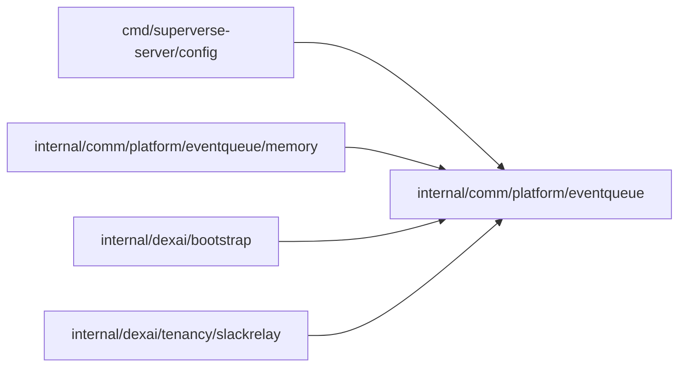

# Event queue

<!-- BEGIN GENERATED PACKAGE SUMMARY (scripts/check-package-readmes.py; edit only Purpose) -->
Purpose: Declares the bounded, best-effort keyed queue that the Slack event relay offers events to and consumes them from, with its limits and typed refusals.

Callers: `cmd/superverse-server/config`, `internal/comm/platform/eventqueue/memory`, `internal/dexai/bootstrap` and `internal/dexai/tenancy/slackrelay` import this package.

Dependencies: it imports no other package of this module and calls no remote API.

<!-- END GENERATED PACKAGE SUMMARY -->

A capability with one implementation per sub-package, which only
`internal/dexai/bootstrap` imports, selected by `connections.slackRelay.queue.implementation`:
`memory` is the only one in Beta; a broker such as SQS or Kafka would be another.

- `Offer` never blocks. It refuses an item over `MaxItemBytes` (`ErrTooLarge`), over the
  total items or bytes (`ErrFull`), or beyond its key's `MaxKeyItems` (`ErrKeyFull`). The
  caller drops and logs a refused item.
- `Consume` hands out the items of one key one at a time in offer order, and at most
  `Concurrency` items at once across keys, so a slow key never blocks the others beyond
  its own slot. Items still queued when its context ends are dropped.
