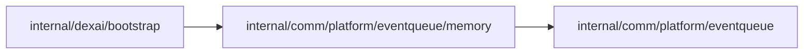

# In-memory event queue

<!-- BEGIN GENERATED PACKAGE SUMMARY (scripts/check-package-readmes.py; edit only Purpose) -->
Purpose: Implements the event queue in one process's memory: per-key FIFO sub-queues, total item and byte limits, and bounded concurrent consumption.

Callers: `internal/dexai/bootstrap` imports this package.

Dependencies: it imports `internal/comm/platform/eventqueue`.

<!-- END GENERATED PACKAGE SUMMARY -->

The queued and in-flight items count against the total limits until their consumption
returns; only waiting items count against their key's limit. A server restart drops
everything it holds, which the relay accepts as best effort.
