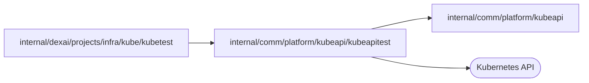

# Kubernetes integration test client

<!-- BEGIN GENERATED PACKAGE SUMMARY (scripts/check-package-readmes.py; edit only Purpose) -->
Purpose: Connects integration tests to the real Kubernetes API of the isolated Local Kind cluster as the platform server's ServiceAccount.

Callers: `internal/dexai/projects/infra/kube/kubetest` imports this package.

Dependencies: it imports `internal/comm/platform/kubeapi` and calls the Kubernetes API.

<!-- END GENERATED PACKAGE SUMMARY -->

Reaches the real Kubernetes API of integration tests: the isolated Local Kind
cluster, as the platform server's ServiceAccount.

| File | Responsibility |
| --- | --- |
| `kind_platform.go` | `KindPlatform` reads the operator's kubeconfig of the isolated cluster from `SUPERVERSE_TEST_KIND_KUBECONFIG` and mints a short-lived token of the platform server's ServiceAccount; `ServerAPI` calls the Kubernetes API with that token, so a test proves the server's own permissions |
| `service_forwards.go` | `ServiceForwards` reaches the cluster's Services from the test process on the host: each in-cluster Service address is dialed through a `kubectl port-forward` of that Service with the operator's kubeconfig, never the server's credential, which the server does not need because it runs in the cluster. The test's cleanup stops every forward |
