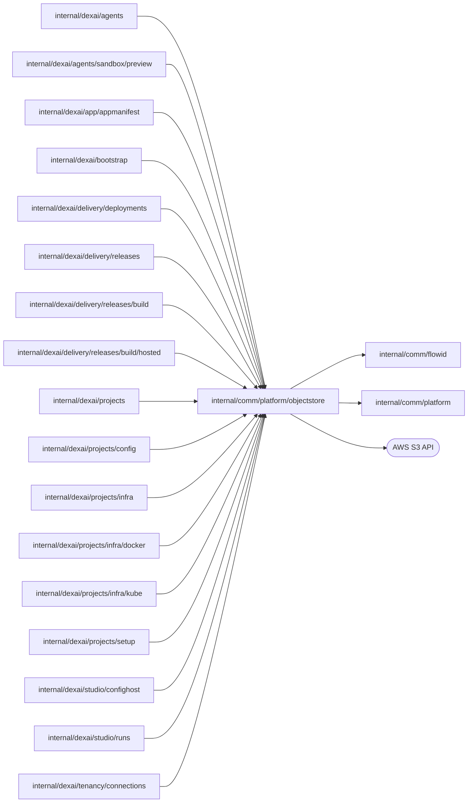

# Object storage

<!-- BEGIN GENERATED PACKAGE SUMMARY (scripts/check-package-readmes.py; edit only Purpose) -->
Purpose: Stores the immutable, versioned payloads that owning Flows reference by ObjectRef, content-addressed by SHA-256 and verified on every read.

Callers: `internal/dexai/agents`, `internal/dexai/agents/sandbox/preview`, `internal/dexai/app/appmanifest`, `internal/dexai/bootstrap`, `internal/dexai/delivery/deployments`, `internal/dexai/delivery/releases`, `internal/dexai/delivery/releases/build`, `internal/dexai/delivery/releases/build/hosted`, `internal/dexai/projects`, `internal/dexai/projects/config`, `internal/dexai/projects/infra`, `internal/dexai/projects/infra/docker`, `internal/dexai/projects/infra/kube`, `internal/dexai/projects/setup`, `internal/dexai/studio/confighost`, `internal/dexai/studio/runs` and `internal/dexai/tenancy/connections` import this package.

Dependencies: it imports `internal/comm/flowid` and `internal/comm/platform` and calls the AWS S3 API.

<!-- END GENERATED PACKAGE SUMMARY -->

`objectstore.Store` reads and writes immutable, versioned payloads in the
platform S3/MinIO bucket. Owning Flows retain lifecycle authority; this package
owns no Flow, queue, database or projection. Callers supply project-scoped keys
under the environment prefix selected by bootstrap.

Writes read before mutation, use `If-None-Match`, and reconcile an uncertain
response by exact content digest and media type. Reads verify key scope,
version, digest and media type, and a rejected read names the object, its
version and the property that differs. `GetCurrentJSON` reads the one version
an immutable write left under a key, for an owner that derives the key but
recorded no reference, such as the Preview definition bundle of a commit; an
absent key is `ErrNotFound`. Payloads are bounded by `MaxObjectBytes`;
response bodies are closed. Hosted storage requires KMS; Local Kind uses the real
MinIO API.

Cleanup removes at most 16 versions and delete markers per call and reports
whether its prefixes are empty; the owner calls again until they are.
`DeleteProjectObjects` covers the project's three prefixes (`<project>/`,
`projects/<project>/source/` and `projects/<project>/preview-source/`) after
Project has fenced admissions and completed child cleanup. `DeleteReleaseObjects`
removes one commit's Release objects. `DeletePrefix` removes the prefix its
owner derives, such as the Project's prepared Preview sources from
`infra.PreviewKeysOf`; an unclean prefix is a programming error.

`ObjectRef` is persisted as JSON under the tagged keys `Key`, `Version`,
`Digest` and `MediaType`; changing a tag breaks every stored reference.

| File | Responsibility |
| --- | --- |
| `objects.go` | `Store`, immutable writes, verified reads, the read of a key's current version, the digest format and `EncodeJSON`, the digest-preserving JSON encoding |
| `cleanup.go` | Bounded prefix cleanup for projects, Releases and prepared Preview sources |
| `integration_test.go` | Real versioned S3/MinIO writes, reads, a rejected changed digest and cleanup |

`integration_test.go` calls the actual versioned S3/MinIO API. Missing service
configuration is a failure, not a successful skip.
