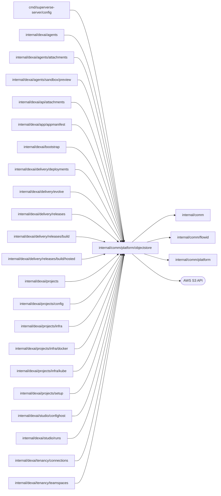

# Object storage

<!-- BEGIN GENERATED PACKAGE SUMMARY (scripts/check-package-readmes.py; edit only Purpose) -->
Purpose: Stores the immutable, versioned payloads that owning Flows reference by ObjectRef, content-addressed by SHA-256 and verified on every read.

Callers: `cmd/superverse-server/config`, `internal/dexai/agents`, `internal/dexai/agents/attachments`, `internal/dexai/agents/sandbox/preview`, `internal/dexai/api/attachments`, `internal/dexai/app/appmanifest`, `internal/dexai/bootstrap`, `internal/dexai/delivery/deployments`, `internal/dexai/delivery/evolve`, `internal/dexai/delivery/releases`, `internal/dexai/delivery/releases/build`, `internal/dexai/delivery/releases/build/hosted`, `internal/dexai/projects`, `internal/dexai/projects/config`, `internal/dexai/projects/infra`, `internal/dexai/projects/infra/docker`, `internal/dexai/projects/infra/kube`, `internal/dexai/projects/setup`, `internal/dexai/studio/confighost`, `internal/dexai/studio/runs`, `internal/dexai/tenancy/connections` and `internal/dexai/tenancy/teamspaces` import this package.

Dependencies: it imports `internal/comm`, `internal/comm/flowid` and `internal/comm/platform` and calls the AWS S3 API.

<!-- END GENERATED PACKAGE SUMMARY -->

`objectstore.Store` reads and writes immutable, versioned payloads in the
platform S3/MinIO bucket. Owning Flows retain lifecycle authority; this package
owns no Flow, queue, database or projection. Callers supply project-scoped keys
under the environment prefix selected by bootstrap.

Writes read before mutation, use `If-None-Match`, and reconcile an uncertain
response by exact content digest and media type. Reads verify key scope,
version, digest and media type, and a rejected read names the object, its
version and the property that differs. `GetCurrentJSON` reads the one version
an immutable write left under a key, for an owner that derives the key but
recorded no reference, such as the Preview definition bundle of a commit; an
absent key is `ErrNotFound`. Payloads are bounded by `MaxObjectBytes`;
response bodies are closed. Hosted storage requires KMS; Local Kind uses the real
MinIO API.

Cleanup removes at most 16 versions and delete markers per call and reports
whether its prefixes are empty; the owner calls again until they are.
`DeleteProjectObjects` covers the project's three prefixes (`<project>/`,
`projects/<project>/source/` and `projects/<project>/preview-source/`) after
Project has fenced admissions and completed child cleanup. `DeleteReleaseObjects`
removes one commit's Release objects. `DeletePrefix` removes the prefix its
owner derives, such as the Project's prepared Preview sources from
`infra.PreviewKeysOf`; an unclean prefix is a programming error.

`ObjectRef` is persisted as JSON under the tagged keys `Key`, `Version`,
`Digest` and `MediaType`; changing a tag breaks every stored reference. The
platform's own objects have the media types declared here (JSON, YAML, ZIP and
`MediaTypeRendition`, the exact JSON of one Claude content block); an uploaded
file keeps the media type of its `fileextract.Format`.

Browser transfers. Bootstrap gives the platform store a presigner for the
endpoint browsers reach (`storage.browserEndpoint`, or the AWS regional
endpoint) with `WithPresigner`; presigning is local computation.
`PresignPut` signs the PUT of one `Upload` at its exact key with
`Content-Length`, `Content-Type`, `x-amz-checksum-sha256`, `x-amz-meta-sha256`
(the hex digest every read verifies), `If-None-Match: *` and, in hosted storage,
the KMS headers, so storage itself refuses another length, digest or media type
and any second write. `PresignGet` signs the GET of an exact version with a
`Content-Disposition` naming the file, as a download or inline content such
as a thumbnail. Both are valid at most one hour; a `PresignedRequest` is a
bearer capability and prints and logs without its URL. `VerifyUpload` reads
the head of a key's current version with its full-object SHA-256 checksum,
which storage computed from the body, and accepts it only as the declared
upload (`ErrNotFound`, `ErrUploadMismatch`). `CopyVersion` copies an exact
version to a new immutable key inside storage, keeping its metadata; it reads
the destination's head first and answers an existing copy of the same digest
and media type, so a retry after an uncertain response creates nothing new,
and a source version that no longer exists is `ErrNotFound`. Storage does not
refuse a concurrent second copy (MinIO ignores `If-None-Match` on a copy), which
then leaves a second version with the same content.

| File | Responsibility |
| --- | --- |
| `objects.go` | `Store`, immutable writes, verified reads, the read of a key's current version, the server-side copy of an exact version, the media types, the digest format and `EncodeJSON`, the digest-preserving JSON encoding |
| `presigned.go` | Presigned browser uploads and downloads, the checksummed head read and upload verification |
| `cleanup.go` | Bounded prefix cleanup for projects, Releases and prepared Preview sources |
| `integration_test.go` | Real versioned S3/MinIO writes, reads, a rejected changed digest and cleanup |
| `presigned_integration_test.go` | Real presigned PUTs and their refusals, a CORS preflight, the head read, a presigned GET and idempotent copies |

The integration tests call the actual versioned S3/MinIO API
(`SUPERVERSE_S3_ENDPOINT` on the loopback, `SUPERVERSE_ARTIFACT_BUCKET` and the
MinIO credentials in the AWS environment). Missing service configuration is a
failure, not a successful skip.
