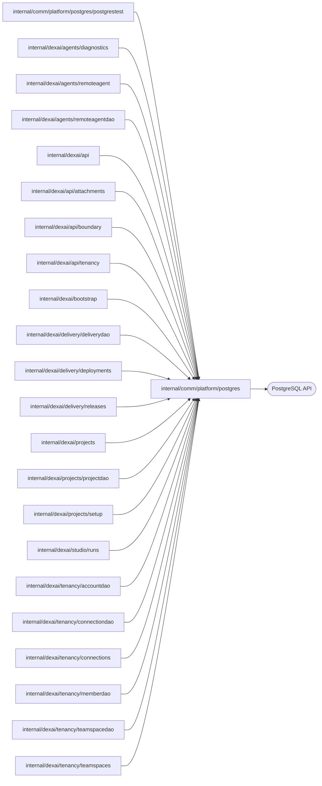

# PostgreSQL connections and migrations

<!-- BEGIN GENERATED PACKAGE SUMMARY (scripts/check-package-readmes.py; edit only Purpose) -->
Purpose: Opens the server's PostgreSQL pool, runs transactions, applies the embedded schema migrations under an advisory lock and shares the read model's paging and row decoding.

Callers: `internal/comm/platform/postgres/postgrestest`, `internal/dexai/agents/diagnostics`, `internal/dexai/agents/remoteagent`, `internal/dexai/agents/remoteagentdao`, `internal/dexai/api`, `internal/dexai/api/attachments`, `internal/dexai/api/boundary`, `internal/dexai/api/tenancy`, `internal/dexai/bootstrap`, `internal/dexai/delivery/deliverydao`, `internal/dexai/delivery/deployments`, `internal/dexai/delivery/releases`, `internal/dexai/projects`, `internal/dexai/projects/projectdao`, `internal/dexai/projects/setup`, `internal/dexai/studio/runs`, `internal/dexai/tenancy/accountdao`, `internal/dexai/tenancy/connectiondao`, `internal/dexai/tenancy/connections`, `internal/dexai/tenancy/memberdao`, `internal/dexai/tenancy/teamspacedao` and `internal/dexai/tenancy/teamspaces` import this package.

Dependencies: it calls the PostgreSQL API.

<!-- END GENERATED PACKAGE SUMMARY -->

The database holds the accounts and their login sessions
([accounts](../../../../docs/architecture/teamspace/accounts.md)) and the read
model of the Project, Release and Deployment Flows
(`docs/architecture/teamspace/read-model.md`), which only the platform Dex
Attribute Store writes. SQL itself lives only in the `*dao` packages; this
package owns the connection, the transaction helper, the schema, the names
of the read model's Attribute Stores and the helpers its DAOs share. `ErrorMetadata` extracts only SQLSTATE and the
schema-owned constraint name from a wrapped concrete pgconn error for safe
server logging; value-bearing Message/Detail/Where and credentials stay private.

| File | Responsibility |
| --- | --- |
| `postgres.go` | `Connection`, `Open` (a pinged, bounded `*sql.DB` over the pgx driver), `InTransaction`, `JSONColumn` (a raw JSON scan destination that takes NULL), the role names |
| `migrate.go` | `Migrate`: the embedded `migrations/NNNN_*.sql`, `schema_migrations` and the advisory lock |
| `attribute_store.go` | `AttributeStore`: the platform Dex Attribute Store each synced Flow type selects where it starts (`projects`, `project_setups`, `releases`, `deployments`) |
| `read_model.go` | What the read model's DAOs share: `ErrNotFound` for a row Dex has not written, `PageKey` with `AfterValues` and `Page` for keyset pages newest first, `QueryRows` and `RowError` for their statements, and `DecodeJSON` and `Unsigned`, with which the owning packages decode a row into their Attribute types; and `AwaitRow`, with which they read the row of one resource: when it is missing, one read of the resource's Flow tells a resource created a moment ago, whose row is read again every 500 ms for at most 10 seconds, from one that does not exist, which is `ErrNotFound` at once |
| `migrations/` | The schema changes, applied in file name order (`NNNN_<topic>.sql`); numbers need not be contiguous |

**Roles.** `superverse_owner` owns the schema and only `superverse-server migrate`
connects as it; the server connects as `superverse_server`, and the platform Dex
Attribute Store as `superverse_dex`. Each environment's private procedure
creates the roles with their passwords, so no migration, chart value or
Terraform state holds one. Migrations grant the server role its table
privileges and read access to the read model, and the Dex role SELECT, INSERT
and UPDATE on the read model's tables, plus DELETE on its child tables.

**Read model.** Dex writes the tables of `0002_read_model` and `0003_teamspaces` from the Attributes
that the Flows mark with `dex.SyncToAttributeStore()`: the row key template of
each store splits the FlowID into the primary key, and every other column is
the snake_case of an Attribute or of a field of an AttributeMap instance. The
tables have no foreign key, no CHECK constraint and no NOT NULL outside the
primary key, because a violated constraint fails a whole sync batch.

**Migrations.** A migration only adds. `Migrate` takes a dedicated connection,
holds the advisory lock for the whole run, applies each pending file in its own
transaction and records its version with the SHA-256 of its contents. A recorded
version whose file changed stops the run. The server never migrates on start:
Local Kind runs `superverse-server migrate` as the server Pod's init container
and Local Native runs it before it starts the server. Platform Dex refreshes the
columns of a read model table when a batch writes one it does not know (Server
v1.6.1), so a migration that adds a synced column needs no Dex restart, as long
as it completes before the Workers that write the column start.

## Tests

`TestMigrateIntegration` migrates a scratch database of the lane's PostgreSQL
(`postgrestest.ScratchDatabaseForTest`): every migration applies once, a second
run applies none, and a changed recorded migration stops the run.
`TestReadModelMigrationIntegration` checks in a migrated scratch database that
the read model's tables have no constraint but their primary keys and no NOT
NULL column outside them, that the Dex role may write them, and that the server
role may only read them. Both need the lane's `superverse_dex` role, which the
lane scripts create.

The sync tests compare rows that platform Dex wrote with the Flows' state, read
through `postgrestest.AwaitRowForTest`: `TestProjectReadModelSyncDexIntegration`
(`internal/dexai/projects`) for a new Project and its Setup, and
`TestRetainedReleaseSyncDexIntegration` and `TestRetainedDeploymentSyncDexIntegration`
(`internal/dexai/delivery`) for a Project of a completed journey. The last two start
from the Flows: Dex search lists every Release and Deployment Flow the journey
left, each must have its row, no row may lack a Flow, and each Release's build
rows must be exactly the instances of its `ReleaseBuildRevisions` map; the
Project's own row must equal ProjectFlow.

The additive `0007_remote_agent_connections` table is server-owned credential
state, not a Dex projection. Only `remoteagentdao` owns its SQL; current
executor state belongs to Session. Its account FK, hash/state constraints,
fixed Project bound and transaction lock are described in
[remote agent connections](../../../../docs/api/remote-agent.md).
