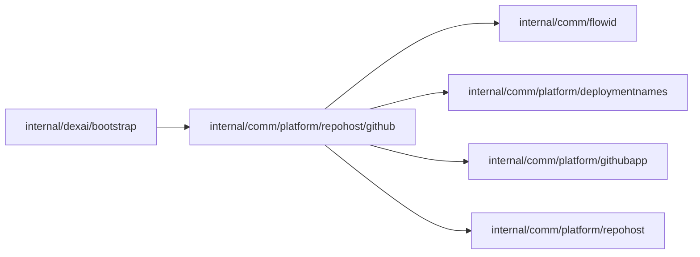

# GitHub repository host

<!-- BEGIN GENERATED PACKAGE SUMMARY (scripts/check-package-readmes.py; edit only Purpose) -->
Purpose: Implements the repository host on GitHub for Project setup, Releases and Sandbox Git: repository reads, scoped credentials, managed repositories and template initialization.

Callers: `internal/dexai/bootstrap` imports this package.

Dependencies: it imports `internal/comm/flowid`, `internal/comm/platform/deploymentnames`, `internal/comm/platform/githubapp` and `internal/comm/platform/repohost`.

<!-- END GENERATED PACKAGE SUMMARY -->

`Client` implements `repohost.Host` as one installation of the GitHub App
([`githubapp`](../../githubapp/README.md)). Hosted environments and
`local-kind-acceptance.yaml` select it with `repohost: github`; the final acceptance and
the GitHub integration test (`SUPERVERSE_TEST_GITHUB_EFFECTS`) cover this path.

Reads repository source, mints repository-scoped credentials, and owns the managed
repository and template initialization effects of Project setup. Every effect
reconciles a lost response by reading GitHub again, never by repeating the write.
The client finds and creates a repository by `repohost.ManagedName` of its
`RepositoryPrefix`, the Project's name and the Project ID, and archives the full name
that the Project's binding recorded.

Errors leave this package as the host-independent errors of `repohost`: a lost response
is `ErrOutcomeUnknown`, a 404 `ErrNotFound`, a 401 or 403 `ErrPermissionDenied` and any
other 4xx `ErrRejected`, each wrapping the GitHub error. A server error stays untyped,
and the Step's retry policy asks again. An archive request whose effect is unknown (a
server error, a conflict, or a 404 on the archive itself) is `ErrOutcomeUnknown`.

Template initialization uses `Start the project from the app template` as its
subject and `Platform agent` as author and committer. Both signatures use the
owning Project's persisted creation time at Git's second precision, making
retried object creation deterministic without a synthetic display date. Zero
and epoch times are rejected. The bootstrap commit also has a neutral subject;
its internal ownership marker is unchanged. Project and Setup retain the
template revision; no commit-message parser depends on it.

| File | Responsibility |
| --- | --- |
| `client.go` | The client, repository credentials and the translation of errors |
| `repository.go` | Repository, branch, file and commit reads |
| `managed_repository.go` | Managed repository creation, lookup and archival |
| `template.go` | Template initialization of a new repository |
