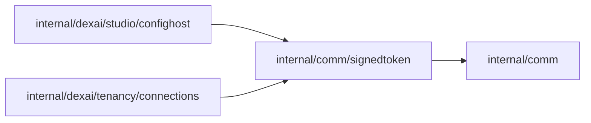

# Signed tokens

<!-- BEGIN GENERATED PACKAGE SUMMARY (scripts/check-package-readmes.py; edit only Purpose) -->
Purpose: Seals short-lived claims into HMAC-SHA256 tokens with a key derived per purpose by HKDF, so any server replica opens what another sealed without shared state.

Callers: `internal/dexai/studio/confighost` and `internal/dexai/tenancy/connections` import this package.

Dependencies: it imports `internal/comm`.

<!-- END GENERATED PACKAGE SUMMARY -->

A `Signer` belongs to one `Purpose`, a closed set declared here: `ConnectionForm` for the
TeamSpace connection forms and `ConnectorUISession` for the Project connector forms. `New`
derives the purpose's key from the root key with HKDF-SHA256, the purpose's label as the info,
so a token of one purpose never verifies as another, and `internal/dexai/bootstrap` gives every
replica the same root key, `SUPERVERSE_COOKIE_SIGNING_KEY`.

A token is `base64url(JSON {"exp", "claims"}) "." base64url(HMAC-SHA256)`. Its claims are
signed, not encrypted: they hold identifiers the bearer already knows and never a secret. The
expiry is inside the MAC. `Open` compares the MAC in constant time, refuses an expired token
and decodes the claims strictly; every failure is the same error.

The tokens are bearer handles that can be used many times until they expire, with no
revocation: their users check the bound actor and target on every use, and a rotation of the
root key voids every open token.
