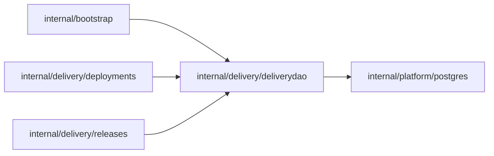

# Release and Deployment read model queries

<!-- BEGIN GENERATED PACKAGE SUMMARY (scripts/check-package-readmes.py; edit only Purpose) -->
Purpose: Reads the releases, release_build_revisions and deployments tables that the platform Dex Attribute Store writes, and the Live Runs target join.

Callers: `internal/bootstrap`, `internal/delivery/deployments` and `internal/delivery/releases` import this package.

Dependencies: it imports `internal/platform/postgres`.

<!-- END GENERATED PACKAGE SUMMARY -->

The only SQL of the `releases`, `release_build_revisions` and `deployments`
tables (`docs/architecture/teamspace/read-model.md`). Dex is their only writer:
ProjectReleaseFlow's store upserts the Release row and writes each
`ReleaseBuildRevisions` entry as its whole child row, and ProjectDeployFlow's
store upserts the Deployment row. The package holds queries and row types and no
business rule, and reads only.

| Method | Query |
| --- | --- |
| `Release`, `Deployment` | One row by its key |
| `ListReleases`, `ListDeployments` | A Project's rows newest first, in `(created_at, ID)` keyset pages of the size the caller asks for, with the key of the next page; a status set, when given, selects rows |
| `BuildRevisions` | The build rows of a Project with the given IDs, which are unique within it: one statement for the active and ready builds of a page of Releases |
| `LiveTarget` | The Project's status, `current_live` pointer and references joined with the Deployment the pointer names, in the serving status the caller passes and with the pointer's Release and build revision, in one read |

Every column but the key may be NULL. JSON columns stay the Attributes' JSON
encodings (`json.RawMessage`, nil for NULL through `postgres.JSONColumn`),
which `releases` and `deployments` decode with the Attributes' own types; no
local struct mirrors them. The only SQL that reads inside one is the Live
target's: the `DeploymentID`, `ReleaseID` and `BuildRevisionID` of
`current_live`, the Go field names of `projects.LivePointer`, which has no JSON
tags. The target selection compares nothing else, such as a build's frozen
configuration: ProjectDeployFlow checked what it pinned. Every query is one
statement without a transaction or lock. A missing row or Live target is
`postgres.ErrNotFound`; every other error names its operation.

A Deployment row also carries the version of the Release it deploys: each
Deployment query joins `releases` on the Project and `release_id` and reads
`prepared_source->'Version'`, NULL when the Release's source recorded none.

## Tests

`TestDeliveryDAOIntegration` writes rows into a migrated scratch database of
the lane's PostgreSQL (`postgrestest.MigratedScratchDatabaseForTest`) as the
stores would and runs the Release, build revision and Deployment queries:
lookups across Projects, full pages with and without a status set, and builds
by ID.
`TestLiveTargetDAOIntegration` writes the Live pointer as a marshaled
`projects.LivePointer`, the value ProjectFlow writes, and checks each JSON path:
the pointer that agrees selects the target, and no pointer, a pointer to a
Deployment without a row, one whose Release or build revision disagrees, and a
Deployment that is not serving select none.
