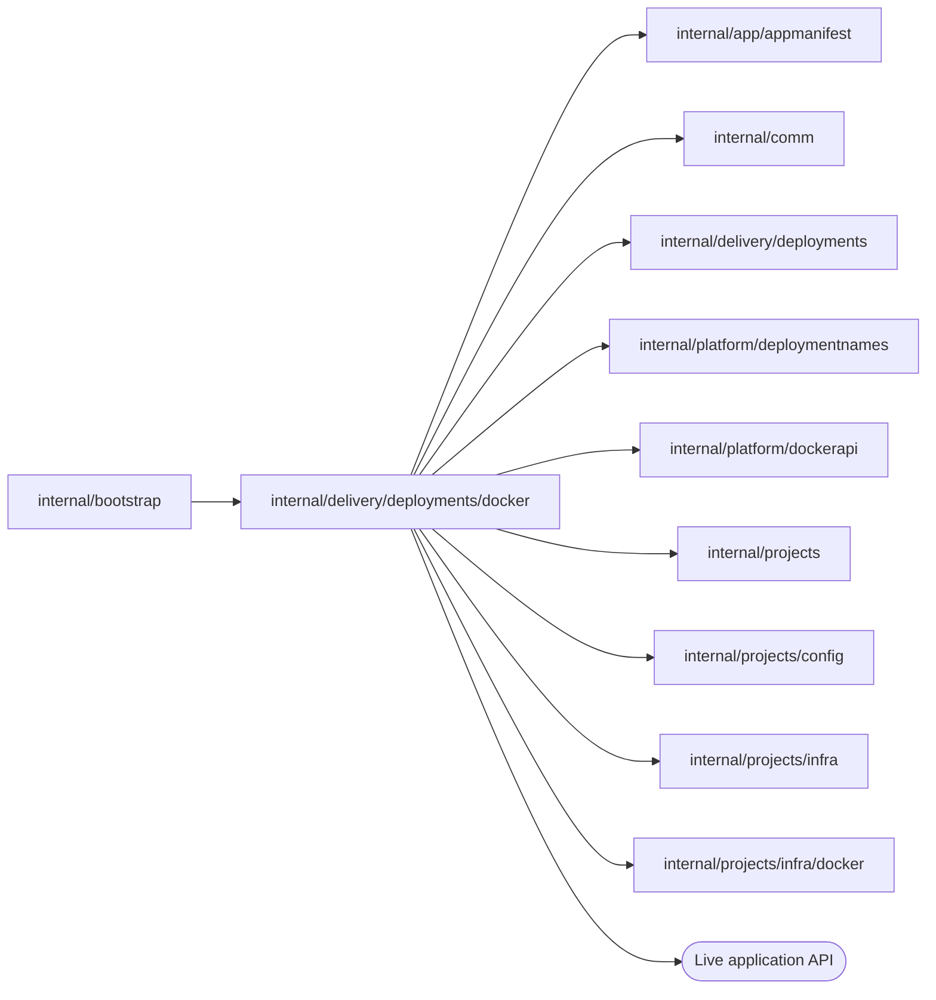

# Docker Live serving

<!-- BEGIN GENERATED PACKAGE SUMMARY (scripts/check-package-readmes.py; edit only Purpose) -->
Purpose: Serves each Live deployment generation as a Docker container of its Release image on its own network, moves the project's Live route to it and reads its log for diagnostics.

Callers: `internal/bootstrap` imports this package.

Dependencies: it imports `internal/app/appmanifest`, `internal/comm`, `internal/delivery/deployments`, `internal/platform/deploymentnames`, `internal/platform/dockerapi`, `internal/projects`, `internal/projects/config`, `internal/projects/infra` and `internal/projects/infra/docker` and calls the Live application API.

<!-- END GENERATED PACKAGE SUMMARY -->

`LiveServing` is the Docker implementation of `deployments.Serving`, which Local Native
runs. It builds on the [Docker project infrastructure](../../../projects/infra/docker/README.md),
verifies the references the deployment accepted before every effect, and never
rebuilds an application: a generation runs exactly the image its Release built and
pushed to the lane's registry.

| Reference | Kubernetes | Docker |
| --- | --- | --- |
| The generation's Service (`DeploymentResources.Service`) | a Service created before the Pods | the network `<project network>-app-<deployment>-<generation>`, by network ID, created before the application |
| The application (`ProviderRefs.Application`) | the generation's Deployment | the container of the same name, by container ID |

- **Generation.** `EnsureGenerationService` creates the generation's network.
  `ApplyApplication` runs the Release image (pinned by digest, pulled from the local
  registry when the engine does not have it) as UID 65532 with a read-only root,
  every capability dropped, `no-new-privileges`, limits of two CPUs and 1 GiB, an
  anonymous volume for `/tmp` and restart `unless-stopped`. It joins the generation's
  network and the project network under the generation's name, and publishes the
  application port and the Worker port on 127.0.0.1. Its environment is the fixed
  `deployments.ApplicationSettings`, as in Kubernetes, and the grant's, given when
  the container is created.
- **Readiness.** `VerifyReadiness` requires the published Flow Definitions, the
  accepted network and container of the accepted image, HTTP 200 from the health
  path through the container's published port and a Worker that accepts an HTTP/2
  connection on its published Worker port.
- **Activation.** `Activate` first moves the Live Worker alias `live-worker`, where
  the project Dex reaches the current generation's Worker
  (`infra.Connections.WorkerAddress`), to the generation: the engine changes a
  container's aliases only when it attaches it again, so the generation is attached
  to the project network again under its own name and `live-worker`, and then the
  replaced generation under its own name alone. Only the Live generation the
  deployment replaces may hold the alias. It then publishes the project's Live route to the generation
  through the gateway's route files, taking it over only from the Live generation the
  deployment replaces or from itself, makes the generation's Flow Definitions the
  active manifest under a guard that the route is still the generation's, and succeeds
  once the gateway's API lists the route and the public host answers the health path
  through the gateway.
- **Removal.** `CleanupDeployment` and `RemoveServing` withdraw the route the
  generation holds and remove its container and network, each confirmed gone; the
  live generation must hold the route. A removal still converging is
  `projects.ErrCleanupPending`.
- **Diagnostics.** `ReadApplication` inspects the application container once at the
  ID and labels the deployment recorded (another one is
  `deployments.ErrApplicationChanged`); the `LiveApplication` it returns takes its
  `Environment`, the values of the container's environment beyond the fixed settings
  and every key pair the server generated for the project, for redaction, and its
  `Log`, the end of `docker logs` in whole lines with the container's state, from that
  one container.

## Tests

`live_serving_integration_test.go` (build tag `live`) needs the local Docker Engine.
It pushes a Release image to a local registry as the Native builder does, reads its
digest back with a HEAD of its manifest, removes the local tag so the engine pulls it
again by that digest from the same registry address, and deploys it as a Live
generation: its network, the grant's environment, the application, readiness,
activation of the Worker alias, the definitions and the route through the gateway, the
diagnostics' log and environment and a refusal to read another application. It deploys
three versions of the [generation application](../generationapp/README.md) on the
project's own Temporal and Live Dex: a Flow that generation 1 started runs its next
Step on generation 2 while generation 1 still runs, and a Step that generation 3 no
longer registers takes its failure route within its retry budget. The removal of the
Live generation takes the alias with it, after which the project's deletion leaves
nothing.

## Files

| File | Responsibility |
| --- | --- |
| `live_serving.go` | `LiveServing`, the generation's network and application, readiness |
| `route.go` | `Activate`, the Live route, `CleanupDeployment`, `RemoveServing` |
| `live_serving_worker.go` | The Worker probe of readiness and the Live Worker alias |
| `diagnostics.go` | The application read for the Agent's diagnostics: its environment and log |
