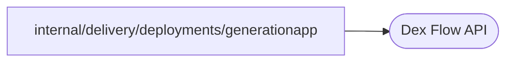

# Live generation test application

<!-- BEGIN GENERATED PACKAGE SUMMARY (scripts/check-package-readmes.py; edit only Purpose) -->
Purpose: A Live application that the deployment integration tests build in several versions to observe which generation's Worker runs each Step of an open Flow.

Callers: no production package imports this package.

Dependencies: it calls the Dex Flow API.

<!-- END GENERATED PACKAGE SUMMARY -->

`generationapp` is a command that the Docker and Kubernetes deployment integration tests build for Linux, in
several versions, and run as consecutive Live generations of one project
(`dockertest.GenerationAppImageForTest` and the Kind deployment tests). It serves the health path `/healthz`, runs a
Dex Worker with the settings every Live application receives (`deployments.ApplicationSettings`), and lets a test
start, release and read one `GenerationProbeFlow` by its ID over HTTP.

The Flow records the build's version in each Step it runs: `RecordStart` in `started-by`, then `AwaitRelease`, which
waits for the `release` Channel, in `released-by`. A test therefore observes which generation's Worker the project
Dex dispatched each Step to. The build sets `main.version` and, with `main.removeAwait=true`, leaves `AwaitRelease`
unregistered, as a version that removed a Step that open Flows still wait in; such a Flow fails that Step's
attempts and takes its failure route, `RecordFailureRoute`, once the Step's 45-second retry budget has passed.
