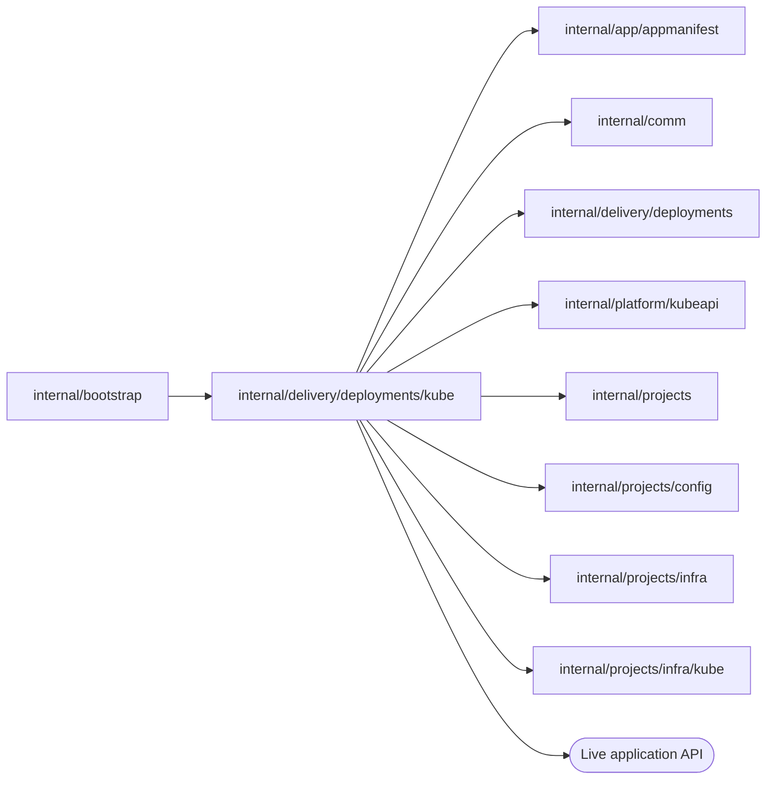

# Kubernetes Live serving

<!-- BEGIN GENERATED PACKAGE SUMMARY (scripts/check-package-readmes.py; edit only Purpose) -->
Purpose: Serves each Live deployment generation as an application Deployment and Service in the project namespace, activates its route and reads its environment and log, for `deployments.Serving`.

Callers: `internal/bootstrap` imports this package.

Dependencies: it imports `internal/app/appmanifest`, `internal/comm`, `internal/delivery/deployments`, `internal/platform/kubeapi`, `internal/projects`, `internal/projects/config`, `internal/projects/infra` and `internal/projects/infra/kube` and calls the Live application API.

<!-- END GENERATED PACKAGE SUMMARY -->

`LiveServing` is the Kubernetes implementation of `deployments.Serving`. It embeds the
`Infrastructure` of [`infra/kube`](../../../projects/infra/kube/README.md), whose
`Backend` decides what differs between environments: the ingress peer and runtime class
of the application, where the route is probed, and whether a generation has a service
account of its own. The Live route is the same on every lane: the HTTPRoute `live` of the
Live namespace on the platform's one project Gateway (`infra/kube` `RouteGateway`), whose
host the chart's admission fixes to the Project's Live host.

- **Generation.** Each generation is an application Deployment, an immutable environment
  Secret, a network policy and a Service that exists before its Pods, all labelled with
  the deployment ID and the generation, so a resource of another generation is never
  adopted and a Pod of one generation is never selected by another's Service.
- **Application.** Runs the immutable image as an unprivileged, read-only container that
  cannot obtain a service-account token. The grant's storage and project references
  reach it only through the environment Secret.
- **Readiness and activation.** Readiness requires the published definitions, the
  Deployment of the accepted image with one ready replica and the accepted Service, an
  application that answers its health path and a Worker that accepts an HTTP/2
  connection on its Service. Activation first moves the project's Live Worker endpoint,
  the headless Service `live-worker`, to the generation, then the `live` HTTPRoute, each
  unless a concurrent activation owns it (only this generation or the Live generation
  it replaces may hold them, and a lost update is pending), makes the published manifest
  the active one only while the route still belongs to the generation, and succeeds once
  the public route answers. Every Live Flow stores `live-worker` as its headless Worker
  target (`DEX_WORKER_HEADLESS`), and the project Dex resolves it again every two
  seconds, so from then on it dispatches every open Flow to the new generation
  ([the current contract](../../../../docs/architecture/studio-setup/flow-changes.md)).
- **Cleanup.** Removes the generation's objects after checking their owner labels and
  generation, and the Live route only when the generation owns it; Project deletion also
  waits until the route is gone. Only the removal of the Live generation removes the
  `live-worker` Service, when it selects that generation; a replaced generation leaves
  the one its successor holds.
- **Diagnostics.** `ReadApplication` reads the application Deployment once and refuses
  one whose UID is not the recorded one; from that Deployment, `Environment` reads the
  Secrets the application container takes its environment from, and `Log` the newest
  Pod's log tail with the state of the container.

| File | Responsibility |
| --- | --- |
| `live_serving.go` | `LiveServing`, generation labels and the generation Service |
| `live_serving_application.go` | Application workload and readiness |
| `live_serving_route.go` | Activation and the Live route |
| `live_serving_worker.go` | The Worker probe of readiness and the Live Worker endpoint |
| `live_serving_cleanup.go` | Generation and serving cleanup |
| `live_serving_diagnostics.go` | The application's Secret-backed environment and log for the Agent's diagnostics |

## Tests

`live_serving_kind_test.go` provisions a Live scope one part at a time on a real Local
Kind cluster and covers Live generation infrastructure, activation and scope
destruction; `preview_storage_kind_test.go` covers a Preview grant's scope, principal
check, revocation and Session cleanup on the Live MinIO; `live_worker_kind_test.go` runs
three versions of the [generation application](../generationapp/README.md) as
consecutive generations on a project's own Live Dex and proves that a Flow that
generation 1 started runs its next Step on generation 2 while generation 1 still runs,
and that a Step that generation 3 no longer registers takes its failure route within its
retry budget. They live here because they use the Kubernetes API directly.
