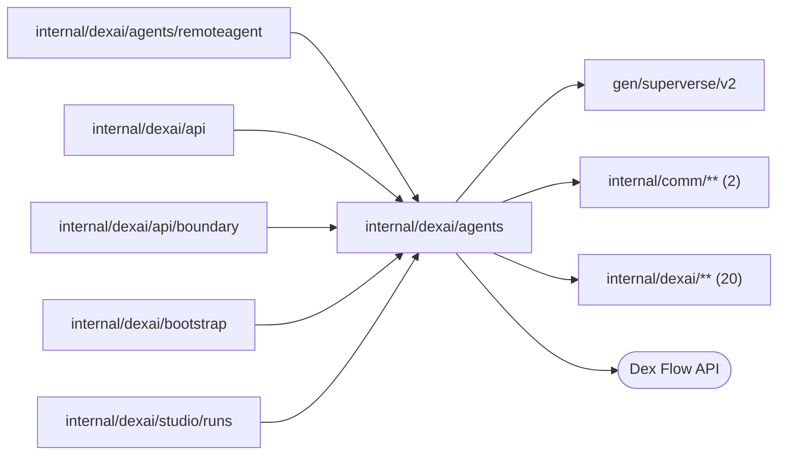

# Session coordination: admission, workspace lifecycle and cleanup

<!-- BEGIN GENERATED PACKAGE SUMMARY (scripts/check-package-readmes.py; edit only Purpose) -->
Purpose: Coordinates each Project's one Session across its Project, Session Agent, provisioning and Preview Flows for the API and those Flows: start, reads, workspace cold path, Preview commands, cleanup.

Callers: `internal/dexai/agents/remoteagent`, `internal/dexai/api`, `internal/dexai/api/boundary`, `internal/dexai/bootstrap` and `internal/dexai/studio/runs` import this package.

Dependencies: it imports `gen/superverse/v2`, `internal/comm/**` (2) and `internal/dexai/**` (20) and calls the Dex Flow API.


<!-- END GENERATED PACKAGE SUMMARY -->

This package holds the Session Service: `SessionFlowService` and its
implementation `SessionFlowService`. It is the in-process Service above
seven independently owned Flows, used by the API and by those Flows, and the
only code that issues their cross-Flow calls. It holds the Flow clients
`ProjectFlowClient`, `SessionWorkspaceFlowClient`, `SandboxProvisionFlowClient`, `PreviewFlowClient`,
`SessionAgentFlowClient`, `SubagentFlowClient` and `PlatformIssueFlowClient`,
which reports the platform failures of Sessions; and, for a deleting Project's
release by label, the `sandbox.InstanceProvider` and the
`preview.PreviewConfiguration`.

| File | Responsibility |
| --- | --- |
| `session_flow_service.go` | The API interface, the start of the Project's Session (`StartForProject`) and authorized reads that join the Session with its instance and its Preview |
| `session_flow_service_preview.go` | Preview reads (including the narrow read of a Preview Runs request) and commands, the first command that starts the Preview and source preparation |
| `session_flow_service_workspace.go` | The workspace cold path: the Session's provision and reclaim commands to its SessionWorkspaceFlow and the read of their outcome, the workspace Flow's provisioning start and read, its outcome report to the Session, the provisioning's report to it, lending the instance to the Preview, the settlement announcement and the Preview's release before a reclamation; the workspace renewal |
| `session_flow_service_tasks.go` | `ReportSessionNotification`, the route of a notification from outside the Session into it, and the Session's subagents: their start and stop for the Session (`agenttasks.AgentTaskLauncher`), their admission, lease refresh and report for each `SubagentFlow` (`subagent.SubagentFlowDependency`), and the stop of a deleting Project's subagents |
| `session_flow_service_feedback.go` | Delivery feedback: the deployment of a turn's pushed commit to the Preview (`RequestPreviewDeployment`) and its switch (`UpdatePreviewAutoDeploy`), and the Preview's outcomes and the Live release and deployment failures as `delivery` notifications (`ReportPreviewOutcome`, `ReportDeliveryFailure`) |
| `session_flow_service_cleanup.go` | One Project deletion pass for the Project's Session and its workspace Flow, and the release of their resources by label |
| `session_flow_service_project.go` | Project authorization, Session admission and the Sandbox repository |
| `session_flow_service_configuration.go` | The Preview target of the project configuration host |
| `session_flow_service_connectors.go` | The Session's connector contributions: the submission of a completed `connector_develop` subagent's contribution to its `ConnectorContributionFlow` after the Session admitted the report (a start, or an update of a later head), the contribution's admission and its `connector` notifications (`contribution.ConnectorContributionFlowDependency`), the Snapshot's read of the contributions the Session's slugs name, and the close of a deleting Project's contributions |
| `session_flow_service_issues.go` | `ReportPlatformIssue`, which starts the `PlatformIssueFlow` of a Session's platform failure, or joins the one of its signature that runs |

## Dex Flow Changes

This package contains no Flow. Its own primitives are: Attributes None,
AttributeMaps None, Channels None, ChannelMaps None, Streams None, Steps None,
RPCs None. The primitives it reaches are owned and documented by
[the Session Agent](../../../docs/architecture/agent-harness-design/session.md#sessionagentflow-contract),
[the Session workspace](sandbox/sessionworkspace/README.md),
[the provisioning](sandbox/provision/README.md), [the Preview](sandbox/preview/README.md),
[the platform issue reports](platformissue/README.md) and [the Project](../projects/README.md); [the current contract](../../../docs/architecture/agent-harness-design/sandbox.md)
divides the instance lifecycle among them.

| Fact | Single owner |
| --- | --- |
| Conversation, tool scheduling, confirmed HEAD, the workspace request, the accepted lease and its Sandbox deadline | `SessionAgentFlow` (`Workspace` Attribute) |
| The Session's current instance, its resources and what earlier instances retained | one `SessionWorkspaceFlow` execution per Project, `session-workspace-<projectID>` (`Instance` Attribute) |
| One provisioning and its outcome | one `SandboxProvisionFlow` execution per instance |
| The Project's Preview | one `PreviewFlow` execution per Project, `preview-<projectID>` |
| One subagent's execution: its conversation, worktree, outcome and report | one `SubagentFlow` execution per `start_agent` call |
| The Session's record of each subagent, its admission and its limits | `SessionAgentFlow` (`Subagents` AttributeMap) |
| Project admission, the start of its one Session and deletion; the Session is its only Session-scoped child | `ProjectFlow` |
| The report of a platform failure and its outcome; the issue itself is GitHub's | one `PlatformIssueFlow` execution per signature and environment, `platform-issue-<env>-<sig16>` |

`SessionFlowService` is the API surface: Get, Project and Session
authorization, the Preview operations, the switch of the Preview's automatic
deployment and the workspace renewal, each addressed by the Project. The same
implementation satisfies the interfaces the Flows declare, asserted at compile
time: `sessionagent.SessionAgentFlowDependency`,
`sessionworkspace.SessionWorkspaceFlowDependency`,
`provision.SandboxProvisionFlowDependency`, `preview.PreviewFlowDependency`,
`subagent.SubagentFlowDependency`, `projects.SessionLifecycle`,
`projectconfig.PreviewReader` and `releases.DeliveryFeedback`.

**A tool call performs no Flow RPC, StartFlow or Flow read.** The Session Step
replays its accepted `workspace.Lease` to the pooled sandboxd transport, and Git
credentials come from `git.HostCredentials`, which calls only the repository
host. Nothing in this package is on the tool path. Every cold-path method logs
one `session workspace cold path` line with `operation` and `project_id` and
nothing else, so a tool call that reached it would be visible:
`ProvisionWorkspace`, `ReclaimWorkspace`, `ObserveWorkspace`,
`ReportWorkspaceOutcome`, `StartProvisioning`, `ReportProvisionOutcome`,
`AcquireSessionWorkspace`, `NotifyPreviewWorkspace`, `ReleasePreviewInstance`,
`RequestPreviewDeployment`, `StartPreview` and `CleanupProjectSession`.
`StartForProject`, `AdmitSession`, the Project registration,
`ReportPreviewOutcome` and `ReportDeliveryFailure`, which log their own
`session notification` and dropped-notification lines, the Preview
configuration read and the warm API reads and commands do not log it.

### Session start

A Project has exactly one Session, `session-<projectID>`, for example
`session-a7k2`, derived by `flowid.SessionFlowID`
([the current contract](../../../docs/architecture/agent-harness-design/session.md)).
The API has no Session ID and no Session start: ProjectFlow's Step
`StartProjectSession` calls `StartForProject` (`projects.SessionLifecycle`)
once the Project is READY. It starts the Session with the profile `session-v1`
on the Project's AppManifest commit, and with the first message and model that
CreateProject carried (ProjectFlow's `InitialSessionRequest`), if any, through
`SessionAgentFlowClient.StartAccepted`: `IDReuseDisallow`, the Start RequestID
`flowid.Fingerprint(struct{ProjectID string})` and same-request
`AlreadyStarted.IgnoreError`, so a retried Step, a replay and a repeated Setup
commit join the one execution. The Session's StartIdentity Attribute keeps that
fingerprint; the HEAD, the start model and the first message are not part of it, so a
retry under other server defaults joins the accepted execution unchanged, and a
start with another RequestID is refused (`dex.FlowAlreadyStartedError`). A
start whose retries are exhausted leaves the Project READY with
`SESSION_START_FAILED` in its own `SessionStartFailure`, which the Session's
admission clears (`TestProjectSessionStartFailureDexIntegration`).

The Session starts on the model the person chose on the creation page (the
server's default when none), and its start Step publishes the first message to
`QueuedUserMessages` in the commit that admits the Session, once, so no browser
has to stay open to deliver it. Session start involves no Sandbox: the
first tool or Preview demand provisions one. The
Session's first Step calls `AdmitSession`, which registers `session-<projectID>`
as the Project's child before any message, model call, tool or workspace
effect; a Project that is no longer READY denies it, and the Session completes
with `admission_denied`.

### The instance on the cold path

The instance identity is the `WorkspaceRequestID` the Session chose, `ws-<n>`.
The Session's commands go to `session-workspace-<projectID>` with the IDs
`ws-<n>/provision` and `ws-<n>/reclaim`. The instance's provisioning is
`sandbox-provision-<projectID>-<workspaceRequestID>`,
one execution that is never reused, and the Project's Preview is
`preview-<projectID>`, one execution per Project. The Dex RunID is
never used. Commands this package sends to the Preview use the caller's request
ID (kinds `prepare-preview-source`, `start-preview`, `stop-preview`) or
`reclaim-<workspaceRequestID>` (kind `reclaim`); a deployment request names the
instance, the commit and the handoff's sequence, and the Preview derives the
command `deploy-preview-<Sequence>` from it.

### Methods called by Flow Steps

Session Steps (`sessionagent.SessionAgentFlowDependency`):

- `AdmitSession`: Project RPC `RegisterChildFlow` for the already started Session.
- `ProvisionWorkspace(identity, requestID, previewHolds)`: requires a READY
  Project and submits `ws-<n>/provision` with the Session's HEAD and the
  instance the Preview holds through `SessionWorkspaceFlowClient.Submit`, which
  starts the Project's workspace Flow on the first command (`IDReuseDisallow`,
  the fingerprint of `{SessionFlowID}`, same-request IgnoreError). True when
  admitted or a repeat, false for a replaced request; a Project that is not
  READY, or a workspace Flow that ended or closes, is a rejection wrapping
  `sessionagent.ErrWorkspaceCommandRejected`.
- `ReclaimWorkspace(identity, requestID, previewHolds)`: submits
  `ws-<n>/reclaim` for the revoked request, answered like `ProvisionWorkspace`.
- `ObserveWorkspace(identity, requestID)`: one read of the workspace Flow for a
  Session whose bounded wait ended without the report: the grant of the
  request's ready or failed outcome, else nil.
- `NotifyPreviewWorkspace(identity, commandID, requestID, failure)`: announces
  to the Preview command commandID, which waits for the Session's request,
  that it settled; the Preview admits it only while that command is active.
- `RequestPreviewDeployment(identity, requestID, handoff)`: starts the
  Session's Preview, a no-op when it exists, then one locked invocation
  (ten-second lock wait) of the Preview RPC `RequestPreviewDeployment` with the
  READY instance, the handed-off commit and its sequence. The answer
  (`SKIPPED`, `DUPLICATE`, `ACCEPTED`, `QUEUED`) is only logged, and a Preview
  that ended with its Project deploys nothing; the outcome returns as a
  notification.
- `StartSubagent(start)`: `SubagentFlowClient.Start` of an admitted
  `start_agent` call (`IDReuseDisallow`, the call's fingerprint and snapshot as
  RequestID, same-request IgnoreError). `StopSubagent(id)`: the subagent RPC
  `StopSubagent`, which answers whether it ended; a subagent whose execution
  never started or ended has ended. The `start_agent` and `stop_task` tools, the
  Stop button's InterruptAgent Step and the deleting Project's cleanup call
  them; each logs one `subagent` line with `operation`, `project_id` and
  `agent_id`.
- `ReportPlatformIssue(identity, incident)`, from the side branch
  `ReportPlatformIssue` beside the turn: maps the Session's incident to a
  `platformissue.Incident` with the Session's FlowID and starts the
  `PlatformIssueFlow` of its signature through `PlatformIssueFlowClient.Report`
  (`platform-issue-<env>-<sig16>`, `IDReuseAllowIfNotRunning`, the Start RequestID
  `{SessionFlowID, CallID, Signature}` and same-request IgnoreError). A report while the
  signature's run is open joins it, which it logs as `platform incident joined a
  running report`; a failed start is logged and returned, so the Step asks again. It
  reads no Flow; the Flow finds or opens the issue in the repository that
  `internal/dexai/bootstrap` gives it, the `github.issues` installation of the GitHub App or
  `githubissues.NotConfigured`, and logs the outcome
  ([the platform issue reports](platformissue/README.md)).

Subagent Steps (`subagent.SubagentFlowDependency`):

- `AdmitSubagent(id, admission)`: the Session RPC `AdmitSubagent` with the
  agent's record locked and loaded. Admitted only for the call the STARTING
  record admitted, while the Session is ACTIVE and no Stop is pending, and
  marked stopped for a record a Stop ended before the start; a missing or
  closed Session denies.
- `RefreshSubagentWorkspace(id, lost)`: the Session RPC
  `RequestSessionWorkspace{ForAgentID, Lost}` with the record loaded: the lease
  of a usable instance, none while one is provisioned, and closed for a
  Session that is no longer ACTIVE or a record that no longer runs. A lost
  lease that is still current is revoked and replaced.
- `ReportSubagentOutcome(id, notification)`: the Session RPC
  `ReportSessionNotification` with the record locked and loaded, which records
  the end in it: `admitted`, `busy` while an ACTIVE Session's queue is full, or
  `closed` once the Session no longer runs.

Workspace Flow Steps (`sessionworkspace.SessionWorkspaceFlowDependency`):

- `StartProvisioning(projectID, request)`: requires a READY Project and starts
  the instance's `SandboxProvisionFlow` with the Project's repository, the
  command's HEAD and what earlier instances retained. A repeated start joins
  the execution. A Project that is not READY or not bound is a rejection
  wrapping `sessionworkspace.ErrWorkspaceStartRejected` with its reason.
- `ObserveProvisioning(projectID, requestID)`: one read of the provisioning,
  which owns the outcome: nil while it runs, the READY lease with the
  instance's resources, volume state and phases, or the failure code with the
  resources it recorded. A provisioning that never started reads as failed
  `WORKSPACE_NOT_PROVISIONED`, one whose engine execution stopped as failed
  `WORKSPACE_EXECUTION_STOPPED`.
- `ReleasePreviewInstance(projectID, requestID)`: sends `reclaim` to the
  Preview that holds the instance, before the workspace Flow reclaims it, and
  reports whether the Preview released it. `NOT_HELD` and an ended Preview are
  done, `BUSY` and an unfinished reclaim are asked again in the next round. A
  reclaim that failed is logged: the Pod deletion stops what still runs.
- `ReportWorkspaceOutcome(projectID, outcome)`: the Session RPC
  `ReportWorkspaceOutcome` with the grant of a ready or failed outcome, or a
  reclaimed one. False means the Session waits for no such request; a missing
  or closed Session answers false, and its SDK cause is logged here.

Provisioning Steps (`provision.SandboxProvisionFlowDependency`):

- `ReportProvisionOutcome(identity, requestID, status)`: the workspace Flow
  RPC `ReportProvisionOutcome`. False means the workspace Flow provisions no
  such instance or ended, which the provisioning only records.

Preview Steps (`preview.PreviewFlowDependency`):

- `AcquireSessionWorkspace(identity, commandID)`: the Session RPC
  `RequestSessionWorkspace` with the Preview's active command ID. A READY instance is lent
  with its resources, which the workspace Flow's `GetSessionWorkspace` reads
  for exactly the lent instance, and the Session records the Preview as its
  holder;
  otherwise the Session requests one unless one is in flight and records the
  Preview as waiting. Automatic pinned builds also resume a reclaimed workspace. A Session that is not ACTIVE, or whose engine
  execution stopped, lends nothing (`preview.ErrSessionClosed`).
- `ReportPreviewOutcome(identity, notification)`: one admission through
  `ReportSessionNotification`. A Session that does not admit it or that is
  missing or closed drops it with a logged fixed category (`not_admitted`,
  `session_inactive`): the Preview keeps the outcome. An error is retried by
  `NotifyPreviewOutcome`, and the notification's ID makes a repeat a no-op.

Release and deployment Steps (`releases.DeliveryFeedback`):

- `ReportDeliveryFailure(failure)`: the notify Steps of ProjectReleaseFlow and
  ProjectDeployFlow deliver a Live failure as their hook committed it
  ([Live failure feedback](../delivery/releases/README.md#live-failure-feedback)).
  The Service builds the `delivery` notification from the failure alone,
  never from its code: its ID, the source `release` or `deployment`, the
  owner, the code, phase, message and remedy of the committed Failure, the
  commit, the build revision or deployment as `ResourceID`, the first eight
  gaps by name with their count, and the summary "The Live <source> failed."
  or "... needs configuration: <gaps>.", which names no commit or code; a
  failure when the
  application owns it and a notice otherwise, the message cut until the
  notification fits 4 KiB. It resolves `session-<projectID>`, the Project's
  only Session, and makes one admission as `ReportPreviewOutcome` does: a
  Session that does not admit it, or that is missing or closed, drops it with
  a logged category, and an error is retried by the notify Step. The
  Session's receipts admit an ID once; only an application failure of the
  Session's HEAD may open an automatic turn, within `agent.platformTurns`.

### Project deletion

`CleanupProjectSession` performs one bounded reconciliation pass, which never
depends on Session Steps being runnable:

1. It requires Project DELETING and the exact Session membership, and reads the
   Session summary by retained read.
2. A running Session is completed once: `CompleteProjectSession` cancels every
   branch, a workspace command it sends and its wait included, archives it and
   completes it. A Session whose engine already ended abnormally is not asked,
   and one archived for the cleanup is not asked again.
3. The Session's workspace Flow is ended (`CompleteSessionWorkspace`), which
   refuses later commands and cancels a provisioning or reclamation, and a
   provisioning of the instance it recorded that may still run is waited for
   (`ObserveProvisioning`), so that nothing is created after the release.
4. Every subagent of the Session that has not ended is stopped and waited for.
   Subagents are not Project children, so they are found by their Flow type,
   `ProjectID` and status (`SubagentFlowClient.SessionSubagents`); the search is
   eventually consistent, and one it misses is denied by the closed Session at
   its admission or fails at its next lease refresh.
5. The Preview is ended (`EndPreview`); its resources are released only once
   its execution no longer runs.
6. Every resource of the Session is released by label and owner through the
   instance provider: the namespace, volume and Sandbox found by their
   deterministic names, the Pod, the Preview's route objects that no stop
   removed, the Project's Preview data in the Live storage, the volume and the
   namespace. Each part
   queries its exact object before it deletes, with the UID as a precondition.
7. It answers true only once the Session and its workspace Flow have ended and
   every resource is gone; the workspace Flow is read again after the
   Session's completion, so a command a cancelled Step sent late is ended:
   a missing Session execution is `projects.ErrCleanupOwnerMissing`; a Session
   engine that FAILED, was CANCELED or TERMINATED discharges the membership
   after a fresh DELETING check; every other Session confirms its graceful
   receipt.

A typed refusal keeps its classification in the Project's deletion state: a
provider's access denial, an owner or UID conflict, a missing owner or a
receipt that does not match. The completion call waits at most two seconds,
for the Session's lock or for a slow answer; its lock conflict or
`DeadlineExceeded` leaves the Session pending, and the next pass reads the
Session first. No dirty workspace is protected: deleting the Project discards
it.

### Workspace renewal

`RenewWorkspace(account, projectID)` admits the account to the Project's
Session, which a stopped engine execution refuses with its `SESSION_EXECUTION_*`
code, and calls the Session RPC `RenewSessionWorkspace`: the Sandbox deadline
of the READY instance moves to at least seven days from now
(`agentloop.KeepRunningHold`), Studio's "Keep running for 7 days". It answers
false, changing nothing, while the Session is not ACTIVE or its workspace not
READY.

### Preview's automatic deployment

`UpdatePreviewAutoDeploy(account, projectID, isEnabled)` admits the account to
the Project's Session, which a stopped engine execution refuses with its
`SESSION_EXECUTION_*` code, and calls the Session RPC `UpdatePreviewAutoDeploy`,
which sets `PreviewAutoDeploy` under the SessionStatus and Attribute locks and
rejects a Session that is not ACTIVE (`sessionagent.ErrCommandRejected`). A
repeat changes nothing, and the RPC writes no Stream: the caller reads the
Snapshot. While it is off, a successful pushed tool result publishes its handoff
without a deployment, and the handoff is never deployed later. The Snapshot's
Agent description reads it (`IsPreviewAutoDeployEnabled`); a new Session
starts with it on. PreviewService's `UpdatePreviewAutoDeploy` calls it and
maps its errors like an Agent command.

### Preview operations

- `Get` and `GetPreview` read the Session and its Preview by retained read.
  `Preview` is always present: the PreviewFlow's state, or `NOT_STARTED` with a
  `NOT_PREPARED` source, generation and revision 0 and no instance while the
  Session never ran a Preview command.
- `ReadPreviewServing` is the read of a Preview Runs request, whose Project the
  caller authorized: the Session's retained summary, its instance and the
  Preview, without the conversation or the connector contributions.
- `PreviewCommand(start-preview)` and `PreparePreviewSource` require an ACTIVE
  Session. A command in the first-demand form (no instance, generation 0,
  revision 0) starts the Preview and is sent with generation 1; a retry of it
  repeats that form, which the Preview recognizes by its ID, and a first-demand
  command for a Session whose Preview already exists conflicts. Any other
  command names the Preview the caller observed, which the Preview compares:
  its revision and generation with the instance it acquired, empty while it
  never acquired one, so a Preview whose first command was refused accepts
  the next.
- `PreviewCommand(stop-preview)` addresses the Preview directly; a Project
  without a Preview has nothing to stop (NotFound).
  `PreviewSnapshot.revision` stays the command fence.
- `GetPreviewDefinitions` is an authorized exact immutable read.
- `ReadPreviewTarget(projectID)` serves the AppManifest of the source the
  Preview prepared for the Session's HEAD from stored state alone: the HEAD
  from the Session's retained summary and the commit's definition bundle
  through `PreviewFlowClient.ReadPreparedSource`, which makes no Flow call. It
  never asks the Session for a workspace, and Session liveness does not gate
  it; a HEAD without a preparation is `preview.ErrSourceNotPrepared`, which the
  API answers as FAILED_PRECONDITION "Prepare the current source".

## Database Schema Changes

None. Admission, the instance, the provisioning, the Preview and cleanup are
owned by Dex Flows. The Git credential cache of `git.HostCredentials` is
disposable process memory.

## UI/UX

Studio addresses the Session by its Project: the Build page opens the
Project's one Session directly. The creation page shows the Session's model picker and
composer (the mock composer on the mock model), and CreateProject carries the chosen model
and the first message, so the Session starts on that model with the message queued once
(`StartForProject` passes ProjectFlow's `InitialSessionRequest` to `StartAccepted`). A Session denied at admission is ARCHIVED
with `admission_denied`.

A new Session has no workspace. `SessionSnapshot.workspace` is absent until the
Session sent its first workspace command and then shows the instance its
SessionWorkspaceFlow records: `PROVISIONING`, `READY` (with
`expires_at`, the Session's Sandbox deadline), `CLOSING` while it is reclaimed,
`CLOSED` once its Pod is gone and its volume kept, or `FAILED`.
`SessionSnapshot.preview` is always present; its `workspace_request_id` is the
instance the Preview last acquired. Start Preview on a Session without a READY
instance is accepted, and the Preview waits until the Session's instance is
READY. Preview configuration is the one of the source prepared for the
Session's HEAD and never wakes a Sandbox; an unprepared HEAD reads "Prepare the
current source" (Studio labels the action Build processes). Each pushed result schedules
its process build asynchronously; a reclaimed workspace is resumed. A failed deployment appears in the
conversation as a notification. "Keep running for 7 days" renews the READY
instance's Sandbox deadline (`RenewWorkspace`). No action stops or archives the
Session: only the Project's deletion closes it. A terminal
Session engine reads as a transient FAILED response without changing the
durable Session status, and every command, Preview operation and archive read
of it answers FAILED_PRECONDITION with its `SESSION_EXECUTION_*` code.

## Tests

Every test creates its own throwaway READY Project, whose one Session it uses,
and deletes it at the end (`projecttest`): it registers an ordinary account
through the merged business API at `SUPERVERSE_TEST_API_ADDRESS`, derives the
Project ID with the server's `SUPERVERSE_TEST_PROJECT_ID_LENGTH` and requires
`SUPERVERSE_TEST_GITHUB_EFFECTS=true`, since Setup creates the Project's
repository on the lane's Git host. Every test also needs
`SUPERVERSE_TEST_LANE` (`kind` or `native`), `SUPERVERSE_TEST_DEX_ADDRESS` and
the actual Worker of the local lane, `SUPERVERSE_TEST_EXISTING_WORKER_TARGET`,
whose server offers the mock model, all of that one lane
([lane inputs](README.md)),
besides the inputs it names, and runs on either lane. A test that replaces the Worker or reads the
runtime also needs the lane's own inputs: `SUPERVERSE_TEST_KIND_KUBECONFIG` on Local Kind, where it reads
and changes the Session's objects with kubectl, and on Local Native
`SUPERVERSE_TEST_NATIVE_RUN_ID` for a Worker replacement and the Docker CLI of
the operator's engine for the objects.

- `TestProjectSessionIdentityDexIntegration`: the Session that ProjectFlow
  started at READY is exactly `session-<projectID>`, started with the Project
  fingerprint as its Start RequestID, registered in the Project's `ChildFlows`
  and running for the Project's HEAD without a start failure; a repeated Setup
  commit starts nothing, a repeated start under other server defaults joins the
  running execution unchanged, and a start with another RequestID is refused.
- `TestProjectDeletionBeforeReadyDexIntegration` and
  `TestProjectDeletionRightAfterReadyDexIntegration`: a deletion while Setup
  runs starts no Session; a deletion as soon as the Project is READY ends the
  Session in one of three ways (never started, denied at admission, or admitted
  and completed by the cleanup), and it never runs on after the deletion.
- `TestSessionNeverExpiresDexIntegration`: an idle Session holds no Flow timeout
  and no timer and only waits for the user.
- `TestSessionWorkspaceWorkerRestartDexIntegration` (`SUPERVERSE_TEST_LANE`):
  the Worker is replaced while the provisioning polls; one execution provisions
  the request.
- `TestStoppedSandboxProvisionDexIntegration`: a terminated provisioning reads as
  `WORKSPACE_EXECUTION_STOPPED`, and the Project's deletion releases what it
  created.
- `TestSandboxDeadlineReclaimDexIntegration` and
  `TestSandboxDeadlineWorkerRestartDexIntegration` (a Worker deployed with a
  short `sandbox.hold` that `SUPERVERSE_TEST_SANDBOX_HOLD_SECONDS` repeats; the
  second also `SUPERVERSE_TEST_LANE`): at the deadline the Session revokes its
  idle instance's lease and sends one reclaim command, and its workspace Flow
  runs exactly `AwaitWorkspaceCommand`, `ReclaimInstance` and `ReportToSession`,
  keeping the volume; no PreviewFlow exists and the provisioning records no
  event; the next turn finds its note on a new instance of that volume.
- `TestSessionWorkspaceCommandJoinsDexIntegration`: a repeated provision
  command joins the admitted one, an older request's command is refused, and
  the Project's workspace Flow stays one execution with one provisioning.
- `TestSandboxDeadlineSparesInstanceInUseDexIntegration` (a
  `SUPERVERSE_TEST_SANDBOX_HOLD_SECONDS` of at most 300): the
  `background-long-turn` command runs past the deadline its dispatch set; the
  Session extends the deadline instead of reclaiming, and the command's
  notification turn reads its output on the same instance.
- `TestSandboxReclaimThenProvisionSerializedDexIntegration`
  (`SUPERVERSE_TEST_SANDBOX_HOLD_SECONDS`): a message sent while the workspace
  Flow reclaims queues its provision command, which runs only after the
  reclamation ended; the turn runs on a new instance of the same volume.
- `TestSandboxReclaimWorkerRestartDexIntegration`
  (`SUPERVERSE_TEST_SANDBOX_HOLD_SECONDS`, `SUPERVERSE_TEST_LANE` and the
  lane's restart inputs): a Worker replaced while `ReclaimInstance` polls; the
  instance is reclaimed once, keeping the volume.
- `TestPreviewLendHoldsSandboxDexIntegration` (the same inputs, a hold of at
  least two minutes): a lend of the READY instance to a Preview command more
  than a minute after the turn moves the Sandbox deadline to one hold after
  the lend.
- `TestSandboxDeadlineRenewDexIntegration` (`SUPERVERSE_TEST_SANDBOX_HOLD_SECONDS`):
  `RenewWorkspace` answers false without a workspace; on the READY instance it
  answers true and moves the deadline seven days ahead, a repeat answers true
  without moving it, and the deadline timer armed for the short hold waits
  again instead of reclaiming.
- `TestSandboxProvisionStartJoinsDexIntegration`: a cold start runs exactly one
  provisioning, and a repeated start joins it.
- `TestSessionMockPlatformIssueDexIntegration` (scenario `platform-issue`) and
  `TestSessionMockModelFailureDexIntegration` (scenario `model-failure`): each
  Step that recorded a platform failure moved to `CheckSteered` and to
  `ReportPlatformIssue` in one decision, and each report ended as a dead end
  once it started the `PlatformIssueFlow` of its signature; the reports of one
  signature address one FlowID, `platform-issue-test-<sig16>`, whose latest run
  holds an incident of the Session, ran `EnsurePlatformIssue` and
  `RecordPlatformIssue` and recorded `logged`, since the lanes name no issue
  repository. That reports of a signature join one open run is
  `TestPlatformIssueJoinDexIntegration` ([the reports](platformissue/README.md#tests)).
- `TestSandboxReclaimStopsPreviewDexIntegration`
  (`SUPERVERSE_TEST_SANDBOX_HOLD_SECONDS`,
  `SUPERVERSE_TEST_SANDBOX_PREVIEW_HOLD_SECONDS` of at most 600 and the Preview
  configuration inputs below): the Preview starts without a lease through
  `VerifyPreviewSource`; the reclamation of an instance a READY Preview serves
  on stops the Preview first, whose engine its supervisor stops `GRACEFUL`
  before the Pod deletion, and it stays `STOPPED`; a later pushed build can resume the workspace; the reclamation removed the Project's
  route, so the local gateway answers 404 for its host within a minute, and the
  Preview configuration of the prepared HEAD stays readable without starting a
  provisioning.
- `TestPreviewAfterRefusedFirstCommandDexIntegration`
  (`SUPERVERSE_TEST_SANDBOX_HOLD_SECONDS`, `SUPERVERSE_TEST_LANE`): after the
  deadline reclaimed the first instance, the test gives the workspace volume
  another owner, so the Preview's first command waits for a request whose
  provisioning fails and is refused before the Preview acquired an instance;
  with the volume given back, the next command, which names the observed
  revision and generation with no instance, is admitted and prepares the
  source on a new instance; the Session Service repeats the first command's
  failed settlement while the next command waits, as a retried Session Step
  does, and the Preview does not refuse the next command with it.
- The Preview deployment tests below that need a READY Preview configure the
  fresh Project's Preview before the deployment validates it, as a person does
  in Studio before relying on automatic deployment
  (`newConfiguredPreviewSession`): the read-only `inspect-basic` turn brings
  up the Session's READY instance, a `prepare-preview-source` command in the
  first-demand form prepares the source of the Session's HEAD there and starts
  the Preview, and `configurePreview` configures it with the Preview
  configuration inputs below; only then does the test send the scenario's
  pushing input or its deployment requests.
- `TestSessionMockPreviewAutoDeployDexIntegration` and
  `TestSessionMockPreviewFailureFixDexIntegration`
  (pushing to the throwaway Project's default branch;
  `SUPERVERSE_TEST_SANDBOX_PREVIEW_HOLD_SECONDS` for the first; the Preview
  configuration inputs; a Worker whose `sandbox.hold` outlasts a Preview
  build): a turn that pushes hands its commit to the Preview, which deploys it
  from its pinned tree to `READY` and holds the instance for the Preview hold
  without a conversation entry; a deployment whose application exits ends
  `PREVIEW_FAILED` owned by the application after it started the Preview,
  which releases it at once with one stop that keeps the engine, its
  notification opens an automatic turn, and the Preview serves the pushed fix.
  Each stops its Preview at the end.
- `TestPreviewDeploymentAnswersDexIntegration` (the Preview configuration
  inputs, a Worker whose `sandbox.hold` outlasts a Preview build): the answers
  of `RequestPreviewDeployment`: `ACCEPTED`, `DUPLICATE` for a retried
  sequence, then, while the first deployment's provider Steps run, `QUEUED`
  superseded by a newer `QUEUED` and `DUPLICATE` for an older one; no Step of
  the running deployment drops the queued request, which deploys after it, and
  only the first and the newest deployments prepare a source.
- `TestPreviewRefusedDeploymentKeepsServingProcessesDexIntegration` (pushing to the
  throwaway Project's default branch, the Preview configuration inputs, a Worker
  whose `sandbox.hold` outlasts a Preview build): after the configuration, the
  `preview-broken-checkpoint` scenario pushes a blocked checkpoint whose Flow
  source does not compile, then the restored source, which the Preview
  deploys; a deployment of the checkpoint is refused `PREVIEW_FDG_INVALID`,
  owned by the application, and records FAILED for the new build while preserving the
  serving processes and previous AppManifest. A rebuild of restored HEAD becomes READY;
  the Session records the refusal as a notice.
- `TestPreviewStartFailureDexIntegration` (pushing to the throwaway Project's
  default branch, the Preview configuration inputs, a Worker whose
  `sandbox.hold` outlasts a Preview build): after the configuration, the
  `preview-start-failure` scenario pushes a server that exits without
  `WELCOME_TEXT` as a blocked checkpoint, which hands nothing off; a person's
  start of that commit fails `PREVIEW_FAILED` with the application's reason
  within minutes, is released at once and leaves the Preview `STOPPED` with
  that failure; a later source preparation leaves it `STOPPED`, a second
  start is admitted and fails the same way, and each failure's `delivery`
  notification opens an automatic turn.
- `TestPreviewRefusedStartKeepsServingDexIntegration` (the Preview
  configuration inputs, a Worker whose `sandbox.hold` outlasts a Preview
  build): a READY Preview's source preparation of a workspace with an
  uncommitted note is refused `PREVIEW_DIRTY_HEAD`, and a person's next start
  is refused `PREVIEW_SOURCE_NOT_PREPARED` before it pins anything: no
  release or stop runs, and the Preview stays `READY` with the same URL and
  pinned configuration.
- `TestPreviewIncompatibleDeploymentDexIntegration` (the Preview configuration
  inputs, a Worker whose `sandbox.hold` outlasts a Preview build): the
  deployment of a fresh Project's HEAD, which nobody configured, is refused
  `PREVIEW_CONFIGURATION_INCOMPATIBLE` before it started anything, so nothing
  is released: the Preview stays `NOT_STARTED` with the refusal, its gaps and
  the READY preparation, and the Session records the configuration notice.
  The Preview starts once configured, after a read-only turn that brings up
  the instance again if its deadline reclaimed it.
- `TestPreviewBuildResumesReclaimedInstanceDexIntegration`
  (`SUPERVERSE_TEST_SANDBOX_HOLD_SECONDS`): a deployment on an instance the
  Session reclaimed resumes a new instance and builds its pinned processes before configuration.
- `TestSandboxReplacementReclaimsFirstDexIntegration` (`SUPERVERSE_TEST_LANE`):
  a lost instance, whose Sandbox object or container the test removes, is
  reclaimed before its replacement is provisioned on the same volume.
- `TestRunsPreviewTargetFollowsReplacedInstanceDexIntegration`
  (`SUPERVERSE_TEST_LANE`, the Preview configuration inputs; an external test
  package, because `internal/dexai/studio/runs` imports this package): Studio Runs
  admit the instance a READY Preview serves on, refuse any other, and after a
  lost node's replacement refuse a read or a write that names the lost instance,
  the new instance included until the Preview starts on it.
- `TestProjectDeletionClosesSessionDexIntegration`: the deletion of a Project
  whose Session holds a READY instance and whose Preview runs completes the
  Session exactly once with its cleanup receipt, completes the Preview and
  releases every Sandbox resource; the Project ends DELETED. It is the only
  close of a Session.
- `TestProjectDeletionReleaseFailureDexIntegration` (`SUPERVERSE_TEST_LANE`,
  `SUPERVERSE_TEST_SANDBOX_HOLD_SECONDS`): a reclaimed instance's volume whose
  owner label the test changes keeps the deletion DELETING with its failure
  recorded, and once the label is restored a retried deletion ends DELETED.
- `TestProjectDeletionDuringProvisioningDexIntegration`,
  `TestProjectDeletionDuringReclamationDexIntegration` (also
  `SUPERVERSE_TEST_SANDBOX_HOLD_SECONDS`) and
  `TestProjectDeletionAfterAbnormalSessionEndDexIntegration`
  (`SUPERVERSE_TEST_LANE`): a deletion during a provisioning, during a
  reclamation and after a terminated Session engine ends DELETED with nothing
  of the Session left.
- The subagent scenarios (on the mock model):
  `TestSessionMockSubagentInvestigateDexIntegration` (a subagent reports and its
  notification opens an automatic turn; while it runs the Session admits only its
  own call again, unchanged; its agent ID derives from the Session and the call
  and its FlowID from the Project and the agent ID, a repeated start joins its
  closed execution and the Session denies a late admission),
  `TestSessionMockSubagentChangeMergeDexIntegration`
  (also `SUPERVERSE_TEST_LANE`: the Worker is replaced while the change subagent's
  check runs, which cuts the check's attempt, yet the check runs once and the
  worktree is saved once; a merge of a path it did not change merges nothing, names the
  path unknown and leaves the record open, and the merge of every file applies
  its change and closes the record),
  `TestSessionMockSubagentConflictDexIntegration` (a content conflict),
  `TestSessionMockSubagentLostInstanceDexIntegration` (also `SUPERVERSE_TEST_LANE`,
  with `SUPERVERSE_TEST_KIND_KUBECONFIG` on Kind: the instance is removed while
  the change subagent's check runs, and its finish saves the worktree on the
  instance the Session provisions next),
  `TestSessionMockSubagentSteeredStartDexIntegration` (also `SUPERVERSE_TEST_LANE`:
  the instance is removed, so an admitted start waits for the next instance, and
  steering supersedes it; its record goes away and no subagent starts),
  `TestSessionMockSubagentStoppedStartDexIntegration` (also `SUPERVERSE_TEST_LANE`:
  the Stop overtakes a start that waits for the next instance, and a subagent
  started for the stopped record is denied as stopped and reports it),
  `TestSessionMockSubagentStopDexIntegration` (`stop_task`),
  `TestSessionMockSubagentStopButtonDexIntegration` (the Stop button stops a
  subagent while no turn runs and its report opens no turn),
  `TestSessionMockSubagentLimitDexIntegration` (the running limit, the
  per-message budget and a delayed report).
- `TestProjectDeletionStopsSubagentsDexIntegration` (on the mock model): the
  deletion finds the Session's running subagent by search and stops it before
  it releases the Sandbox.
- `TestProjectDeletionStopsBackgroundCommandWatchDexIntegration` (on the mock
  model): the deletion during a turn beside a sleeping background command stops
  the command's `BackgroundCommandFlow` watch, records the command stopped and
  completes the Session; no watch runs on.
- `TestLiveReadModelDexIntegration`, in the external test package
  `agents_test`, which imports `studio/runs` (an import this package's own
  tests cannot make, since `runs` imports `agents`): `NewLiveProjectForTest`
  deploys a throwaway Project's HEAD to Live with the Live failure feedback's
  clients and inputs. The Release, build and Deployment projections equal
  their Flows except the unsynced fields; while SHARE locks on `projects` and
  `deployments` hold the rows back, a Live removal leaves a Runs read on the
  stale selection and refuses a Runs write after ProjectFlow's confirmation,
  and the read is refused once Dex writes the rows.
- The Live failure feedback (on the mock model; each test that pushes turns
  the Preview's automatic deployment off first, and builds and deploys
  through the Release and Deployment Flow clients in the test's process,
  which need `SUPERVERSE_LOCAL_BUILD_URL` and
  `SUPERVERSE_LOCAL_BUILD_TOKEN_FILE` for the Release client's admission):
  `TestSessionMockLiveFailureFixDexIntegration` (pushing to the throwaway
  Project's default branch; the Live configuration inputs below; a Worker
  whose `agent.platformTurns` is at least 1): the `live-failure-fix` scenario
  pushes a server that exits without `WELCOME_TEXT`; a build of the Release's
  unconfigured draft is refused with its gaps, a configuration notice
  `release/<commit>/<build>/r<n>`; once the draft is configured, a build whose
  automatic deployment expects a Live generation the Project does not have
  stays READY with the deployment rejected, a platform notice; neither opens a
  turn. The explicit deployment of that build fails in a phase the
  application owns, and its failure `deployment/<deployment>/g<generation>/r<n>`
  of the Session's HEAD opens an automatic turn that reads the delivery
  status, pushes the fix and tells the user to publish it; the failure
  delivered again records nothing. `TestLiveSourceFailureNotifiesDexIntegration`
  (pushing to the default branch): a Release of the `preview-broken-checkpoint`
  checkpoint fails its source preparation as the application's failure of
  HEAD, `release/<commit>/source/r<n>`, which opens an automatic turn, and a
  retried preparation fails and notifies again under its new Revision; input
  2 restores the source. `TestLiveFailureAutomaticTurnBoundDexIntegration`
  (a Worker with the default `agent.platformTurns` of 3): Live failures
  delivered through the Session Service open no turn when the platform owns
  them or they concern another commit, one turn each for an application
  failure of HEAD up to the bound, then only a record and one pause marker; a
  repeated ID records nothing, and the user's next message resets the bound.
  `TestSessionPreviewAutoDeploySwitchDexIntegration`: a new Session reads the
  switch on; turned off, a turn that pushes deploys nothing and the Project
  never starts its Preview; turned on again, the next turn end still deploys
  nothing.
- Publish cancellation (the current contract; the Live delivery inputs, and
  `SUPERVERSE_TEST_NATIVE_RUN_ID` on Native for the Worker replacement), whose
  Release draft selects an llm connection whose key is the HEAD's commit, a
  configured value the build log prints:
  `TestReleaseBuildCancellationDexIntegration` cancels builds before the
  provider, while they poll the provider across a Worker restart and at the
  artifact commit, checks the refusals and the read model, and pages a READY
  build's log through `PublishingFlowService.ReadBuildLog`, redacted, shared
  between viewers and deferred beyond the replica's budget;
  `TestDeploymentCancellationDexIntegration` cancels deployments before their
  lease and while they poll their provider, with a current Live that keeps
  serving, and the automatic deployment that a published build names.

A Project's Preview configuration is its own, so the template's declared llm
connection is unconfigured on every fresh Project, and a test that needs a
READY Preview configures it first with `configurePreview`; a Live test
configures a Release's draft the same way (`configureConnections` with the
Release's target). Once the Preview
prepared the source of the Session's HEAD, the helper sends the
configuration operations that Studio sends through the API (`ListConnections`,
`SelectTeamSpaceConnection`, `ValidateProjectConfiguration`) to
`projectconfig.Configuration` in the test's process, as the Session's owner:
it creates in the Project's TeamSpace a connection of each declared llm
connection with the OpenAI provider, the browser cases' model `gpt-5-mini` and
the key of the private file `SUPERVERSE_E2E_OPENAI_FILE` names
(`{"apiKey":"sk-..."}`), as the TeamSpace's Connections page does, selects it,
validates the revision it wrote and returns the READY configuration. The
connections live in the lane's PostgreSQL and platform bucket, and the
configuration's credential broker names the lane's credential read URL
(`dexflowtest.CredentialReadURLForTest`). It opens the Project's storage through the lane's runtime:
`SUPERVERSE_TEST_LANE` with `SUPERVERSE_TEST_KIND_KUBECONFIG` on Kind, or with
`SUPERVERSE_TEST_DOCKER_SOCKET` and `SUPERVERSE_TEST_NATIVE_STATE_DIR` (the
lane's `.local/superverse-v2/native`, whose credential files open a Project's
storage) on Native. It reads the AppManifest of the HEAD's prepared source
from the platform's artifact bucket, as the server does: `SUPERVERSE_S3_ENDPOINT`
and `SUPERVERSE_ARTIFACT_BUCKET`, with the platform MinIO's credentials in the
AWS environment. No log or failure carries the key or a configuration
document.

```sh
SUPERVERSE_TEST_LANE=kind \
SUPERVERSE_TEST_DEX_ADDRESS=127.0.0.1:28811 \
SUPERVERSE_TEST_EXISTING_WORKER_TARGET=superverse-server-worker.superverse-v2-system.svc.cluster.local:50051 \
SUPERVERSE_TEST_EXISTING_WORKER_HEADLESS=true \
SUPERVERSE_TEST_API_ADDRESS=127.0.0.1:28080 \
SUPERVERSE_TEST_PROJECT_ID_LENGTH=<the server's Project ID length> \
SUPERVERSE_TEST_GITHUB_EFFECTS=true \
GOWORK=off go test ./internal/dexai/agents -run '^TestProjectSessionIdentityDexIntegration$' -count=1 -timeout=30m
```

Not yet covered by a real-dependency scenario: a tool turn that logs no
cold-path line after the first initialization; a Preview whose waited-for
provisioning fails; a Worker replacement inside `StartProjectSession`; the
recovery of a failed Session start by the runbook's time travel. Use the Studio and Kind journeys of the
[Agent development runbook](README.md).
Compilation alone proves none of it.

## Documentation

[The Session design](../../../docs/architecture/agent-harness-design/session.md#sessionagentflow-contract) owns the
SessionAgentFlow contract, including admission and the Sandbox deadline;
[the composition design](../../../docs/architecture/agent-harness-design/composition.md#sessionflowservice)
describes this Service's composition;
[the current contract](../../../docs/architecture/agent-harness-design/sandbox.md)
owns the Session-owned instance lifecycle,
[the current contract](../../../docs/architecture/agent-harness-design/session.md)
the one Session per Project and
[StartFlow admission](../../../docs/architecture/start-flow-admission.md) the start
rules. Root composition sets the dependency of the Session Agent, provisioning
and Preview Flows, `projectFlow.Sessions` and the configuration host's Preview
reader to this one Service. `sandbox.hold` ([server configuration](../../../cmd/superverse-server/config/README.md);
default 1h, 1m to 168h) sets how long the main agent's workspace use, the lend
to a Preview command or a READY Preview holds the instance before the Session
reclaims it.

Session command authorization returns SessionCaller with the authenticated account's Actor and
the Project's effective Role. The API injects them into the Session's command payloads; Preview
commands keep their existing ActorAccountID. No request can supply an author.

Remote connection cleanup uses the injected `remoteagentdao` at the existing
`CleanupProjectSession` reconciliation boundary, before Session/Workspace/Preview
reconciliation. It deletes only exact Project rows, idempotently after the SQL
projection shows DELETING/DELETED. A stale or absent projection returns pending
to the existing Project retry; no new loop or durable cleanup owner exists.
Creation takes the same Project lock and rechecks SQL admission after locking.
See [remote agent connections](../../../docs/api/remote-agent.md).

Remote turn-control integration source exercises 100 actual serialized remote
tool batches before the canonical Continue/Stop-and-report question. The two
independent branches use the business answer API and real sync, preserving the
canonical sender envelope. They distinguish the stored hidden reporting
instruction from the delivered user answer, check both Sandbox and built-in
reporting refusals, and verify tools resume in the next turn. A separate case
rejects `start_agent` after a real platform segment offered it. These new cases
require live lane execution; compilation does not establish their acceptance.

Remote Stop integration source exercises two consecutive generation fences
through the business Stop API and cancellation of a real foreground Sandbox
command. Read-only Docker or Kind process observations prove the command
started and ended once; stale reports must not change canonical state. The
held Preview race relays genuine requests for one logical Step across natural
deadlines, preserving immutable input until the newer commit is admitted.
It requires successful dead-end completion without old-request effects;
compilation alone does not establish that race or the exact Stop windows.
