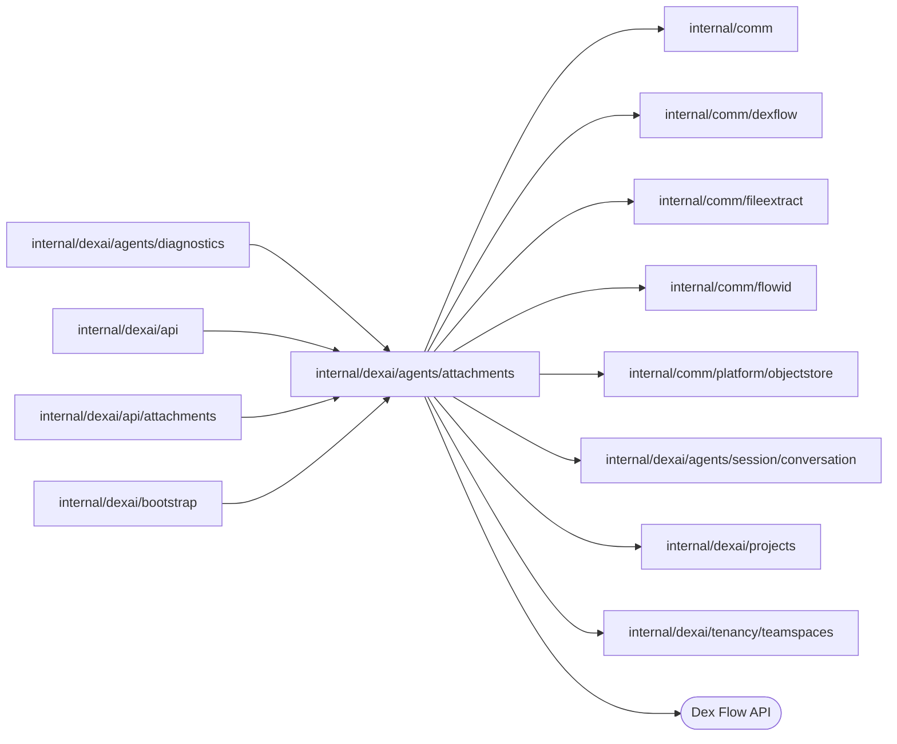

# Attachments

<!-- BEGIN GENERATED PACKAGE SUMMARY (scripts/check-package-readmes.py; edit only Purpose) -->
Purpose: Owns uploaded attachments through AttachmentFlow, prepares them into the exact blocks the model reads, and renders a Session's references from the Project's copies.

Callers: `internal/dexai/agents/diagnostics`, `internal/dexai/api`, `internal/dexai/api/attachments` and `internal/dexai/bootstrap` import this package.

Dependencies: it imports `internal/comm`, `internal/comm/dexflow`, `internal/comm/fileextract`, `internal/comm/flowid`, `internal/comm/platform/objectstore`, `internal/dexai/agents/session/conversation`, `internal/dexai/projects` and `internal/dexai/tenancy/teamspaces` and calls the Dex Flow API.

<!-- END GENERATED PACKAGE SUMMARY -->

The design is [docs/architecture/attachments](../../../../docs/architecture/attachments/README.md);
[upload and preparation](../../../../docs/architecture/attachments/upload-and-preparation.md) holds the
complete contract of `AttachmentFlow`. This README states what the code does.

| File | Responsibility |
| --- | --- |
| `attachment_flow.go` | `AttachmentFlow`: its primitives, Steps and RPCs |
| `attachment_flow_state.go` | The statuses, failure codes, commands, prepared facts, the `Attachment` snapshot and the reference a message carries |
| `attachment_flow_client.go` | `AttachmentFlowClient`: the start with its bounded registration wait and presigned PUT, the completion with its bounded preparation wait, the deletion and the reads |
| `attachment_flow_bootstrap.go` | `AttachmentFlowBootstrap`: the Flow with the object store, the replica's extractor, the TeamSpace client and the settings |
| `attachment_preparation.go` | The settings, the preparation through the extractor child and the objects it writes, the deletion and failure helpers |
| `attachment_renditions.go` | The exact Claude blocks: the base64 image, the framed document text with its outline and excerpt and its brief, an export's summary and a generic JSON file's text or summary; everything the file holds is escaped (`conversation.EscapeAttachmentText`) so that it cannot close the frame, and an export's names and types are quoted |
| `attachment_flow_service.go` | `AttachmentFlowService`: the admission of a message's attachments, their reservation in the Project and its release, and the attachments of a creation's first message |
| `rendition_store.go` | `RenditionStore`, the Session's `attachmentRenditions` port: copy-on-first-render, verified reads, downloads and the per-replica cache |

## AttachmentFlow

One Flow per uploaded file, `attachment-<teamSpaceID>-<attachmentID>` (`flowid.AttachmentFlowID`), for
example `attachment-k3v9q2ma-a7f2c9xq4m1p`. The attachment ID is
`flowid.AttachmentCreationID(uploader, requestID)`, twelve lowercase letters and digits.
`AttachmentFlowClient.Create` starts it with `IDReuseDisallow`, the RequestID and Fingerprint of the
uploader, request ID, TeamSpace, name, media type, size and digest, and same-request `IgnoreError`: a
replay joins the execution, running or completed; the same request ID with another file is
`FlowAlreadyStartedError`. The first Step is the quota admission, not deduplication.

Status (`AttachmentStatus`, the status lock of every write, which also increments `Revision`):
REGISTERING → AWAITING_UPLOAD → VERIFYING → PREPARING → READY → DELETING → EXPIRED or DELETED; FAILED
from any status before READY. EXPIRED, DELETED and FAILED complete the Flow gracefully with its snapshot.

| Step | What it does |
| --- | --- |
| `ReserveAttachmentStaging` (start) | `TeamSpaceFlow.ReserveAttachmentStaging` until `StagingHeldUntil`, the start plus the longest an attachment stays staged; a full quota first reclaims the lapsed slots a failed Flow left (`ListLapsedAttachmentStaging`, at most ten: their prefix deleted, then released) and asks again; a refusal is `attachment_quota_exceeded`, `not_member` or `teamspace_closed`; success is AWAITING_UPLOAD |
| `AwaitAttachmentUpload` | Waits for `UploadCompleted`, an `AttachmentCommands` command or the end of `UploadWait` after the start |
| `VerifyAttachmentUpload` | `objectstore.VerifyUpload` of `original/<sha256>`: the declared length, SHA-256 and media type with a version. A completion before the PUT waits again; a missing upload after the wait is `upload_missing`; a mismatch `upload_mismatch` |
| `PrepareAttachment` | Reads the verified original, runs the replica's extractor child (heartbeating while it waits for the slot and runs), writes the renditions; a refusal is its failure code. 10-minute attempts, three within 45 minutes |
| `DeleteRawAttachment` | JSON only: deletes every version of `original/` once `redacted/` exists, before READY. The prepared facts travel in the Step input, so a retry never needs the raw upload again |
| `PublishAttachment` | Records `Prepared` (and the redacted copy as `Original`), READY, `ReadyAt` and `ExpiresAt`, capped so that its deletion and release end within `StagingHeldUntil` |
| `AwaitAttachmentExpiry` | Waits for a command or `ExpiresAt` (`StagingRetention` after READY) |
| `DeleteAttachmentObjects` | Waits until every presigned PUT expired (`UploadClosedAt` plus the URL validity and a minute), then deletes the staging prefix with every version |
| `CompleteAttachment` | Releases the staging slot (a deleted TeamSpace counts as released) and records the final status; when its hour of retries ends the Flow fails and its slot lapses to the reclaim |
| `RecordAttachmentFailure` | Every failure route: deletes the prefix after the same wait and ends FAILED with the decided code, or `preparation_failed` with the cause that exhausted a Step; a failed deletion is asked again and keeps its status |

RPCs: `GetAttachmentState` (an unlocked retained read, also of a completed execution),
`CompleteAttachmentUpload` (the uploader only; in AWAITING_UPLOAD it records `UploadClosedAt`, sets
VERIFYING and publishes once, otherwise it answers the state) and `RequestAttachmentDeletion` (the
uploader or the platform admin; one active command, the same ID answers, another is
`FAILED_PRECONDITION`). The client's waits read the state and wait on `Revision` with
`WaitForAttributeMatch` until the condition holds or the bound ends; a completed execution answers its
last state. A write to a completed execution, which the RPC can no longer check, is answered only after
the client applied the RPC's own caller check to the state it read, so a stranger is refused
PERMISSION_DENIED for the whole closed-execution retention.

`UploadClosedAt` is the last moment the API may have presigned a PUT: an upload landing after the
prefix was deleted would outlive the Flow, so both deleting Steps wait for the URLs to expire first.

## Renditions

Each rendition is the exact Claude block, encoded once without HTML escaping and stored under
`rendition/` or `brief/` at its SHA-256 with `objectstore.MediaTypeRendition`; `RenditionVersion` names
the templates. An image is `{"type":"image","source":{"type":"base64","media_type":…,"data":…}}` with
`min(⌈w/28⌉ × ⌈h/28⌉, 4784)` context tokens. A document's full rendition frames, inside
`<attachment id name kind>`, its outline (at most 16 KiB) and as many whole sections as fit the
message's inline budget (`attachments.messageInlineText`) as `<section id heading>` elements, and names
the next section for `read_attachment`; its brief holds the top two outline levels and the start of the
text in at most 8 KiB; its bundle is every section's text. An n8n export's rendition is its summary
(workflows, node types, triggers, credentials, the number of removed secret values) with the routing to
the workflow-import reference and `place_attachment`, at most 8 KiB. A generic JSON file shows its
redacted text up to 32 KiB, with the structural summary as its brief; a larger one shows the summary.
Text tokens are the block's bytes divided by four.

## RenditionStore

`RenditionStore` implements the Session's `attachmentRenditions` port
([the Session Agent](../session/README.md#attachments)). A message carries `conversation.AttachmentRef`
values, which name the staged objects by digest and exact version. The first `Resolve` of an attachment
in a Project binds it: `objectstore.CopyVersion` copies each staged object (the original, or a JSON
file's redacted copy, the rendition, the brief and the bundle) inside storage to
`<projectID>/attachments/<id>/<role>/<hex sha256>`, and then the manifest
`<projectID>/attachments/<id>/manifest.json`, written last, records the copies. At most four
attachments bind at once; every copy reads before it writes, so a retried or concurrent bind writes the
same objects. A staged version that no longer exists (`ErrNotFound`) leaves the attachment unbound, and it
resolves to `conversation.ExpiredAttachmentBlock`, which nothing restores. A resolve reads the bound
copy by its exact version, verified by digest and media type. A transient storage error returns, and
the model Step retries.

Only Session Steps write under `<projectID>/attachments/`, and the Project's deletion removes the whole
`<projectID>/` prefix after the Project's Session completed, so a bound attachment resolves to the same
bytes on every call of every segment.

The store keeps a bounded least-recently-used cache of resolved blocks per server replica
(`attachments.renditionCacheBytes`), keyed by Project, attachment, variant and digest. A block enters
only after its Project copy was read and verified; replicas keep their own, and correctness never
depends on it.

`ReadBound` and `BoundFile` read an attachment the Project bound, never binding it: the manifest's
label and redaction count, a JSON file's redacted copy (for `read_attachment` and `place_attachment`)
and, for `ReadBound`, a document's sections, `{"sections":[{"id":"s1","heading":"…","text":"…"},…]}`.
`Download` presigns, for five minutes, the browser's GET of the Project's copy of the original, inline
for a thumbnail or as a download named as the file.

## AttachmentFlowService

`AttachmentFlowService` owns the coordination that spans `AttachmentFlow` and `ProjectFlow` for the
API's `SendMessage` and `CreateProject`; no Flow uses it
([admission at send](../../../../docs/architecture/attachments/api-and-studio.md#admission-at-send)).
It admits at most `attachments.maxPerMessage` attachments, which the configuration bounds by
`conversation.MaximumMessageAttachments`.

- `AdmitMessage` reads the named attachments of the Project's TeamSpace, at most four
  `GetAttachmentState` reads at a time, and refuses the message with an `*AdmissionRefusal` for the
  first attachment, in order, that the TeamSpace does not hold (`attachment_not_found`), that another
  person uploaded (`attachment_not_yours`, decided before the status is looked at), that expired or
  was removed (`attachment_expired`) or that is not READY (`attachment_not_ready`). It then reserves
  them in the Project under the message ID and a new admission ID, which holds them
  (`ProjectFlowClient.ReserveAttachments`, whose RESOURCE_EXHAUSTED is `attachment_quota_exceeded`),
  and returns the `MessageAdmission` with their references (`conversation.AttachmentRef`), which
  name the staged objects by exact version.
- `ReleaseMessage` drops that admission's holds after the Session definitely refused its send; an
  attachment another admission holds, another message's or an earlier send's of the same message,
  stays counted.
- `AdmitProjectStart` reads a creation's first-message attachments the same way and returns
  `ProjectStartAttachments`: the `projects.SessionAttachment` values the Project's start carries
  (the counted file and the encoded reference), whether one is an automation export, and the
  `(ID, SHA-256)` identities of the creation's fingerprint, which a refusal also returns so that the
  API can recognize the retry of an accepted creation whose attachments expired since.

## Tests

`attachment_flow_integration_test.go` runs the Flow and `TeamSpaceFlow` on a Worker of the test against
the lane's platform Dex, its MinIO through real presigned PUTs and the real extractor child (the test
binary, dispatched by `TestMain`): identity and replays, the last-quota-slot race, the storage's
refusals of a wrong length, a wrong digest and a second PUT, preparation of an image, a document and an
n8n export with its redaction and raw deletion, the bounded waits, expiry and the missing upload with
short settings, deletion in every state, a Worker restart during preparation, a TeamSpace deleted with
open uploads, and the copy-on-first-render of the prepared references with a verified read back.
`AttachmentFlowService` is covered through the API by `TestAttachmentMessageAdmissionDexIntegration`
([`internal/dexai/api`](../../api/README.md)) and through the lane's business API by the Session
scenarios and `TestSessionRemoteAttachmentRefusalDexIntegration` ([`internal/dexai/agents`](../README.md)).
