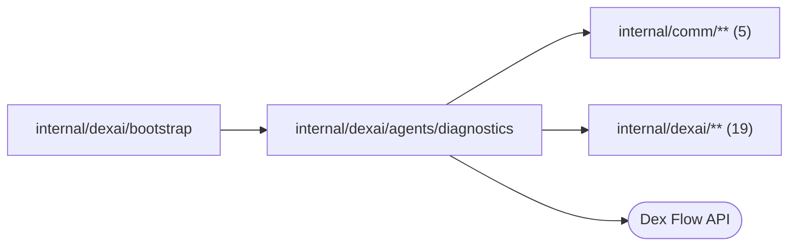

# Agent platform tools

<!-- BEGIN GENERATED PACKAGE SUMMARY (scripts/check-package-readmes.py; edit only Purpose) -->
Purpose: Runs the Session Agent's read-only platform tools on the server for the Session's own Project, redacted and bounded, without the workspace.

Callers: `internal/dexai/bootstrap` imports this package.

Dependencies: it imports `internal/comm/**` (5) and `internal/dexai/**` (19) and calls the Dex Flow API.

<!-- END GENERATED PACKAGE SUMMARY -->

`ProjectDiagnostics` implements `session.ProjectDiagnosticsReader`, the port
through which SessionAgentFlow runs its platform tools
([`agentloop.ToolDefinition.Platform`](../session/agentloop/tool_catalog.go)).
The Session identity scopes every read; no tool argument names a Project or a
Session. A tool takes no workspace lease and never reaches sandboxd, so it works
while the Sandbox is reclaimed, and it changes nothing anywhere, so its calls
join parallel waves and are repeated safely.

## Tools

| Tool | Reads | Output |
| --- | --- | --- |
| `read_delivery_status` | The Project and its Setup from the Project's read model row, a few seconds behind their Flows; the Project's Preview through its Flow client; the newest three Releases and Live Deployments of the read model when no IDs are supplied, or the one named Live Release/Deployment; the active build revision of each Release, and for a failed one its log's end through `deployments.PublishingFlowService.ReadBuildLog`, which reads the build's recipe from its Flow, shares the replica's rate-limited log reads with Studio and answers a deferred read with no tail | Status, phase, failure and FlowID of each resource, the Session HEAD, the Live pointer, the Preview and its engine, and a failed build's log tail of at most 8 KiB, cut shorter when the status would pass 16 KiB |
| `read_platform_flow` | One platform Flow through the platform Dex FlowService: summary, state or one history page of the current run | The summary with the current Steps and waits; the allowlisted business Attributes of the Flow type, each value at most 1 KiB of JSON; Step executions, decisions, attempts and failures |
| `read_live_app_runs` | The Project's current Live deployment, as the read model's Live target selects it, through `runs.Runs.InvokeLive`: a search through indexed Attributes, one run's summary, state or history page; or the log of the application container through `deployments.Serving` | Runs newest first, run documents as above with every Attribute, and a log tail of at most 12 KiB with the container's state, cut shorter when the result would pass 16 KiB |

`read_platform_flow` admits only `project-
`, `setup-
-*`, `release-
-*`,
`deploy-
-*`, the Project's PreviewFlow `preview-
` and the provisionings
of its Session's instances (`sandbox-provision-
-ws-<n>`), derived by the
`flowid` helpers, and refuses every other FlowID, the Session's own
SessionAgentFlow included, with `flow_not_in_project` before any Dex read. It then requires the
Flow type the FlowID names. The platform Dex is shared by every Project, so no
raw platform engine read reaches the Agent.

Every result is at most 16 KiB, applied when it is produced and so the size the
model reads: a history or search page and a Live state keep as many events, runs
or Attributes as fit and say where the rest starts, and the log tails shrink
until the result fits; the pagination arguments of the tools page a large result. A
refused or impossible read is a failure of the call with a code
(`invalid_arguments`, `flow_not_in_project`, `live_not_ready`, `not_found`) that
the model corrects. A transient fault is returned for Dex to repeat within the
retry budget of the tool; after its attempts the Session records the platform
failure `tool_unavailable`. Any other error is the platform failure `tool_error`,
whose detail is redacted like every other string. A read changes nothing, so
neither leaves an effect.

## History pages

A `history` read (`read_platform_flow`, and `read_live_app_runs` with the
`history` operation) shows the events of the Flow's current run, oldest first.
The engine serves history by run, so the read resolves the Flow's current run
from its summary and sends it with the request; the run belongs to that one read
and never reaches a result. The cursor `after_event_id` and the
`next_after_event_id` of a page are event IDs within that run, and a page names
the `start_time` of the run it reads.

A page that is not the last names `next_after_event_id`: the event ID up to which
the engine read, which can lie after the page's last event, and a page can hold
no event while the history goes on. A reader continues for as long as the field
is present. A page cut short to fit the result bound, or by the engine returning
more events than `page_size`, names its last event instead.

When the Flow starts another run between two pages, such as after a restart
under the same FlowID or a reset, the next page reads the new current run from
the cursor of the old one: its events count from 1 again, so the cursor can skip
some of them or lie after its last event, and the page's `start_time` differs
from the page before. A reader that sees it change starts again from
`after_event_id` 0. A FlowID without a run is `flow_not_found`, and so is a run
whose history is gone by the time it is read.

## Redaction and secrets

Every string a tool returns, object keys included, is redacted before it is
encoded, with `projectconfig.OutputRedaction`, which these tools share with
the build log reads of Studio:

1. Configured values of at least 8 bytes, longest first: for Live runs and
   logs the deployment's frozen configuration (`projectconfig.ConfiguredValues`:
   connection settings and credentials, trigger and operation settings, the
   application environment with its secrets) and the workload grant
   environment that the application container takes from Secrets; for a build
   log tail the build revision's frozen configuration. Preview failures in the
   Preview state already carry the supervisor's redaction of their start's
   configured environment.
2. `infra.Redact`: the Project's namespace, workload generations, Temporal
   namespace and hosted cloud names.

Values come first so that replacing a name inside a value never leaves the rest
of it behind. The values stay in memory for the one call and are never
returned, logged or stored. No result names a RunID, a Start RequestID or a
blob reference: a read always addresses the current run of a FlowID, and a blob
value is shown as `<blob value omitted>` and never loaded. Credentials never
reach a platform Attribute or log, and the Session stores a tool result only
after both passes.

The Preview's own runs are not read here: the Agent runs `dexcli` in the
Sandbox against its Sandbox-local engine and reads
`/var/lib/superverse/preview/logs`.

## Files

| File | Responsibility |
| --- | --- |
| `project_diagnostics.go` | `ProjectDiagnostics`, tool dispatch, failures, redaction and the result budget |
| `delivery_status.go` | `read_delivery_status` |
| `platform_flows.go` | `read_platform_flow`: the admitted FlowIDs and the Attribute allowlists |
| `live_app_runs.go` | `read_live_app_runs`: Live runs, the Live redaction values and the application log |
| `flow_documents.go` | Summary, state and history documents of one Flow, shared by both engines |

## Dex Flow Changes

None. The package reads Flows through their clients, the platform Dex and the
Live engine; it starts, signals and changes no Flow, and owns no primitive.
SessionAgentFlow's platform tool category is documented in
[tool orchestration](../../../../docs/architecture/agent-harness-design/tool-orchestration.md#platform-diagnostic-tools).

## Tests

`platform_tools_integration_test.go` runs the three tools against an existing
environment of the local lane that `SUPERVERSE_TEST_LANE` names and its real
platform Dex, Live engine, Kubernetes or Docker, MinIO and local build fixture,
and changes nothing:

- the Session of a Project that ran a Preview and whose instance was
  reclaimed reads its delivery status and every platform Flow it lists, the
  Preview and the completed provisioning included, nothing changes, and a
  foreign Project's FlowIDs, the per-Session identities of the earlier format
  and the Session's own SessionAgentFlow are refused with `flow_not_in_project`
  (also when they do not exist, so the refusal precedes any read);
- the history of each of those Flows, read page by page from the cursor of the
  page before, advances with every page and, for a closed Flow, shows the same
  events in pages of 5 and in pages of 50;
- the Live search, summary, state, history and log of a run whose application
  printed a configured credential and the grant's storage key and stored a
  configured value in an Attribute show `[REDACTED]` and never the values, and
  a `hydrate` field is rejected;
- a failed build that echoed a configured value shows a redacted log tail;
- the three tools form one parallel wave without the workspace and read
  concurrently;
- no output names a RunID or the Project's namespace.

It needs `SUPERVERSE_TEST_DEX_ADDRESS`, `SUPERVERSE_TEST_LANE` with
`SUPERVERSE_TEST_KIND_KUBECONFIG` on Kind, or `SUPERVERSE_TEST_DOCKER_SOCKET` and
`SUPERVERSE_TEST_NATIVE_STATE_DIR` (the lane's `.local/superverse-v2/native`,
whose credential files the redaction reads) on Native, `SUPERVERSE_S3_ENDPOINT`, `SUPERVERSE_ARTIFACT_BUCKET`,
`SUPERVERSE_LOCAL_BUILD_URL`, `SUPERVERSE_LOCAL_BUILD_TOKEN_FILE`, the fixture
`SUPERVERSE_TEST_DIAGNOSTICS_PROJECT_ID`, whose one Session the tools serve,
`SUPERVERSE_TEST_DIAGNOSTICS_LEAKING_FLOW_ID`,
`SUPERVERSE_TEST_DIAGNOSTICS_FAILED_RELEASE_ID` and
`SUPERVERSE_TEST_FOREIGN_PROJECT_ID`, and
`SUPERVERSE_TEST_DIAGNOSTICS_SECRETS_FILE`, a private JSON file
`{"values": [...]}` of the values the fixture application printed and stored.
It logs identities only, never a tool result or a value.

`TestReadDeliveryStatusUnknownIDsIntegration` instead needs an existing Session
Project with a Preview Sandbox instance through
`SUPERVERSE_TEST_DELIVERY_STATUS_PROJECT_ID`. It verifies that the Sandbox
instance is refused as a Live deployment ID and that a missing Live Release
returns the corrective no-argument hint; it neither needs nor changes the
historical Live diagnostics fixture.

The path through a Session is covered in `internal/dexai/agents` by
`TestSessionMockPlatformReadsDexIntegration`: a real Session on the mock model
reads the delivery status, the ProjectFlow summary and the first page of its
history, and the Live log in one wave. The scenario `platform-reads` stops
unless the history page holds the Flow's first event.
