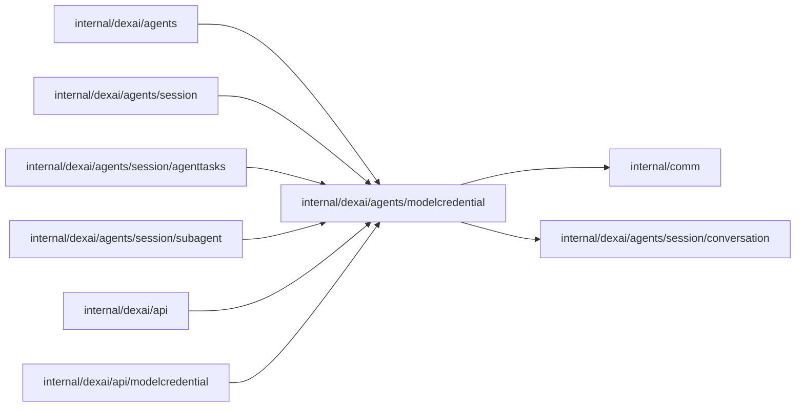

# Model credentials

<!-- BEGIN GENERATED PACKAGE SUMMARY (scripts/check-package-readmes.py; edit only Purpose) -->
Purpose: Defines model credential envelopes, metadata and revision admission.

Callers: `internal/dexai/agents`, `internal/dexai/agents/session`, `internal/dexai/agents/session/agenttasks`, `internal/dexai/agents/session/subagent`, `internal/dexai/api` and `internal/dexai/api/modelcredential` import this package.

Dependencies: it imports `internal/comm` and `internal/dexai/agents/session/conversation`.

<!-- END GENERATED PACKAGE SUMMARY -->

The provider namespace is derived from the canonical model catalog, sorted and
deduplicated into ten credential instances. Mock has none. Metadata/writer
operations and hard-delete storage support that closed set; execution and new
key validation follow the server-admitted provider profiles. No key is stored
in the provider catalog, holder record, public snapshot or operation identity.

`Info.Endpoint` owns the canonical custom API root, requested model ID (possibly
empty), resolved effective model ID and conservative profile version. The
secret `Envelope` remains exactly revision and key. Endpoint/key/model changes
reserve one provider revision and follow the existing direct write, exact
readback and finalization path; the bounded previous metadata record supports
recovery. Frozen segment and child selections are historical execution choices,
not additional owners of current configuration.
