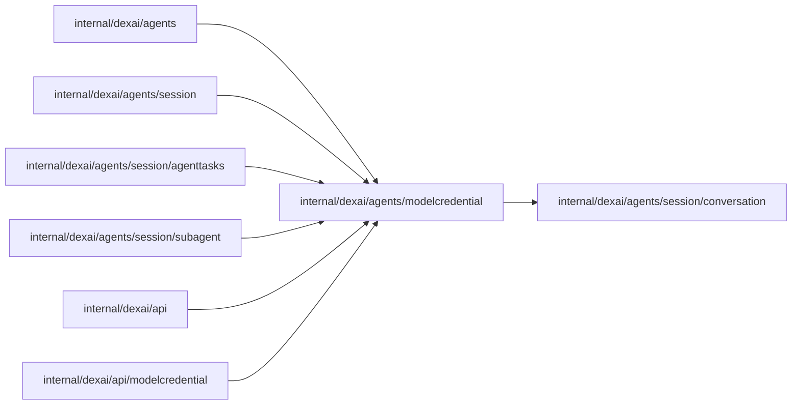

# Model credentials

<!-- BEGIN GENERATED PACKAGE SUMMARY (scripts/check-package-readmes.py; edit only Purpose) -->
Purpose: Defines model credential envelopes, metadata and revision admission.

Callers: `internal/dexai/agents`, `internal/dexai/agents/session`, `internal/dexai/agents/session/agenttasks`, `internal/dexai/agents/session/subagent`, `internal/dexai/api` and `internal/dexai/api/modelcredential` import this package.

Dependencies: it imports `internal/dexai/agents/session/conversation`.

<!-- END GENERATED PACKAGE SUMMARY -->
