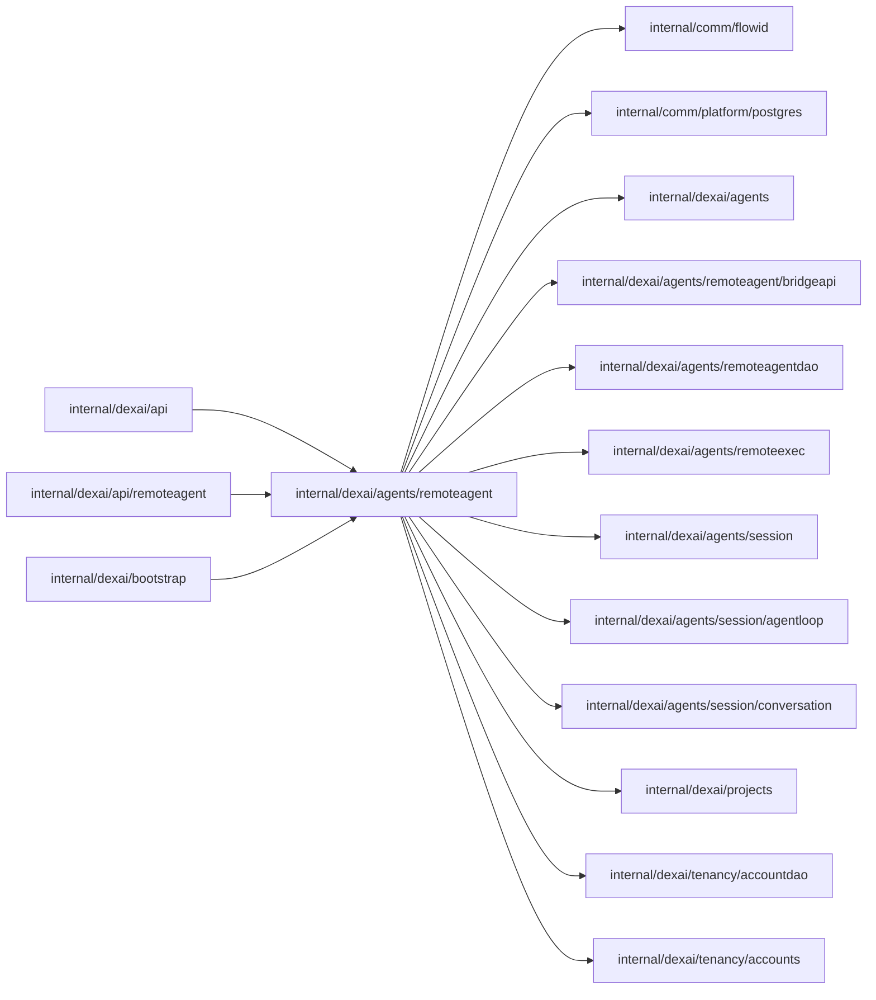

# Remote agent connections

<!-- BEGIN GENERATED PACKAGE SUMMARY (scripts/check-package-readmes.py; edit only Purpose) -->
Purpose: Owns remote agent pairing, credential authorization and the independent Bridge HTTP endpoint while Session owns executor authority.

Callers: `internal/dexai/api`, `internal/dexai/api/remoteagent` and `internal/dexai/bootstrap` import this package.

Dependencies: it imports `internal/comm/flowid`, `internal/comm/platform/postgres`, `internal/dexai/agents`, `internal/dexai/agents/remoteagent/bridgeapi`, `internal/dexai/agents/remoteagentdao`, `internal/dexai/agents/remoteexec`, `internal/dexai/agents/session`, `internal/dexai/agents/session/agentloop`, `internal/dexai/agents/session/conversation`, `internal/dexai/projects`, `internal/dexai/tenancy/accountdao` and `internal/dexai/tenancy/accounts`.

<!-- END GENERATED PACKAGE SUMMARY -->

`Connections` coordinates real current SQL credentials with the existing
Session admission/read seam. Bootstrap injects one shared DAO/pool and Session
Service; this package creates no database pool, Flow, cleaner or per-connection
goroutine. `Endpoint` serves the shared `bridgeapi` DTOs explicitly; it never
creates competing wire models or exposes arbitrary files. The HTTP server has
bounded header/body/idle/write timeouts, ten-second pairing/disconnect work and
ordinary graceful shutdown owned by bootstrap. Pairing has an independent fixed
16-slot per-replica gate acquired before body/auth work: no waiters, immediate
429 with `Retry-After`, and release when the request ends. HTTP timeouts bound
request duration, not concurrent requests. Unexpected failures are logged through
the injected logger with matched path/method, controlled failure/type and typed
PostgreSQL SQLSTATE/constraint identity. Raw error messages, Detail/Where, headers
and bodies are never logged, including errors containing newly minted hashes
which the endpoint never sees. Public errors stay generic. The displayed endpoint
is an origin; the Bridge joins the shared exact route paths itself.

Creation reads the live Session executor and records its epoch only as an
immutable credential basis. List returns safe rows and separate current Session
truth; revoke reads that truth at admission and refuses its current connection.
`Pair` normalizes a ten-character code, enforces the approved Bridge version,
atomically consumes its hash and returns a new random token once. Authentication
performs the DAO's current indexed joins and the owning Project's
`CapabilityBuild`; it never reads a Flow or writes a projection. Credential
failure (401), missing/deleting/deleted Project (404), lost role (403) and
unavailable dependencies (503) remain distinct, including the redemption
callback. Codes/tokens/hashes never enter logs or public list data.

The existing endpoint now also implements activate, sync and report. Activation
uses the SQL pairing basis and authenticated owner, then rechecks SQL after the
Session CAS to close removal races with exact-epoch compensation. Builder removal
rechecks after SQL revoke; UsePlatform authorizes the Builder, commits its observed
basis and revokes only the replaced connection. Explicit Bridge disconnect still
only revokes its own credential and leaves remote mode offline.

Pairing keeps a separate fixed 16-slot gate. Activate/disconnect share another
fixed 16-slot gate. Reports have their configured nonqueued pre-body/pre-auth gate
(default 16, range 1..256), with at most four per authenticated connection; the map
exists only while reports run. Sync requests use maxLongPolls (default 1000, range
1..10000) and bounded FIFO read admission (default four, range 1..64). Read slots
cover bounded aggregation and the final response write; selected payload references
are cleared before releasing for activity waits. No immediate physical Go heap
reclamation is implied; decoded copies and GC require measured acceptance.

Sync reads canonical data first, captures a disposable activity tail and rereads
to close the tail race before waiting, then reads again after wake or timeout.
SQL authenticates every hydration pass and the completed response. At most 64
entries and a 1 MiB soft entry-wire budget are returned, with the first eligible
entry whole and a 16 MiB total hard wire bound. Filtered entries advance the cursor;
a budget-excluded eligible entry does not. One aggregate retention-floor restart
is allowed; repeated movement is an availability error. The request/write deadline
is 25 seconds, reserving five for the final read. Activity is best effort and never
owns a business fact. Shutdown closes admission, wakes FIFO waiters and cancels
long polls before HTTP drain, with forced socket close after drain timeout.

Owning Session reads expose read-only authority/projection, and LastSeen is joined
transiently from the exact SQL credential only in remote mode. No alternate
bootstrap, durable projection, executor table or per-connection goroutine exists.
This source is uncompiled and unrun; pinned SDK payload transport, end-to-end tool
result wait values, legacy tool-input identity, full external-effect/restart/load
acceptance and Studio dialog integration remain review/gated work.
