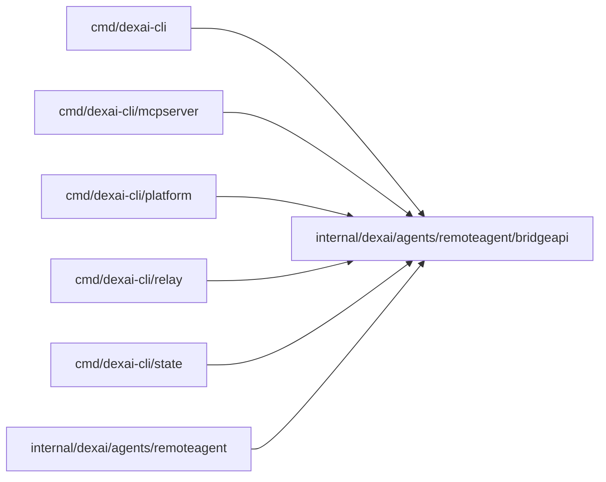

# Bridge protocol

<!-- BEGIN GENERATED PACKAGE SUMMARY (scripts/check-package-readmes.py; edit only Purpose) -->
Purpose: Declares the remote agent endpoint's paths, body limits, JSON requests, responses, reports and error codes, shared by the endpoint and the Bridge.

Callers: `cmd/dexai-cli`, `cmd/dexai-cli/mcpserver`, `cmd/dexai-cli/platform`, `cmd/dexai-cli/relay`, `cmd/dexai-cli/state` and `internal/dexai/agents/remoteagent` import this package.

Dependencies: it imports no other package of this module and calls no remote API.

<!-- END GENERATED PACKAGE SUMMARY -->

`Binding` carries only `codexVersion`, `providerThreadId` and `hostLabel` for
safe display. `codexVersion` retains its wire spelling for both supported local
agents. Executor authority comes from the authenticated connection and Session
fences, never these display fields. The matching business proto removes obsolete
pre-launch fields without reserving or renumbering retained field numbers.

The [remote agent endpoint](../../../../../docs/api/remote-agent.md)
and the private dexai platform client both build on these types, so the two sides cannot drift. The
package imports nothing from `internal/`.

- Every request but the downloads manifest is a `POST` with a JSON body; both sides refuse unknown
  fields. `pair` carries no bearer token; the others carry `Authorization: Bearer <token>`.
- A `Report` carries exactly one of `events` (at most 32), `toolCall` or `turnCompleted`, and is
  numbered by `sequence` from 1 per connection. `Report.Validate` checks the shape and the bounds.
- A refusal is an `ErrorBody` with a declared `ErrorCode`; `ErrorCode.Status` is its HTTP status.
  `sequence_gap` names the expected sequence; `rate_limited`, `reports_pending` (429: the Session
  holds 8 unconsumed reports or 2 MiB of them) and `unavailable` are transient, and the Bridge
  resends the same request, a report with its same sequence, after a backoff.
- `RemoteCallID` spells the call ID `remote-<epoch>-<sequence>` that the Session gives a remote tool
  call and that its `tool_result` entry answers.
- `sync` returns a projection: only user-role input entries this connection did not report and the
  `tool_result` entries of its remote calls, never assistant entries, thinking, system markers or
  platform tool arguments. `Entry.Text` is the entry's text blocks joined by a blank line: the exact
  string the model reads (an input's canonical sender envelope, which carries the actor), which the
  Bridge sends to Codex unchanged. `Entry.Delivered` decides which entries the Bridge sends.
- A sync answer aims for `SyncSoftBudgetBytes` (1 MiB) of entries but always includes the first
  entry after the cursor, so a Bridge reads up to `MaxSyncResponseBytes` (16 MiB). The next
  request's `after` is always the answer's `examinedThrough`. `dropped` names a range retention
  removed while the Bridge was behind. `examinedThrough` never passes an entry left out for the
  budget, so the next answer starts with it. When `stateDigest` differs from the request's, the
  pending question, requirements and todo list replace the cached values and an absent one clears;
  when it is unchanged, absent means keep. State values stay typed JSON whose text may end with
  "[truncated: open Studio for the full <field>]".
- `context: true` asks for `agentContext`, everything the platform tells the remote agent (at most
  80 KiB, outside the state digest); such a request is answered at once, never held as a long
  poll. The Bridge relays it into its brief and its MCP `instructions` and adds none of its own.
